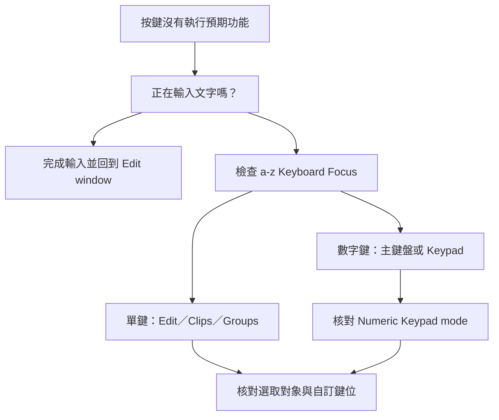

# Mac 快捷鍵 — 依工作情境查找

> 先確認操作焦點、選取範圍與鍵盤種類，再記按鍵；相同的鍵在不同情境可以執行不同功能。

本頁以 **Mac 的 Pro Tools 2023.3 預設鍵位**為準，由 Avid 官方 **Pro Tools Shortcuts Guide 2023.3** 的 Mac 欄逐項整理。表內列的是可查找、可對照原文的常用操作，不把 Windows 的 Control 任意換成 Command。自訂快捷鍵會覆寫預設，因此你的 menu 與 Keyboard Shortcuts window 顯示仍是現場查核入口。

官方原文已另存本機：[[Pro_Tools_Shortcuts_2023.3.pdf]]。快捷鍵手冊 **共95頁**，正文的「印刷頁 S」與「PDF 頁」相差 **5**；本書 Reference Guide 正文則相差32，兩者不能混用。本頁每一列的來源都標成 **S印刷頁／PDF頁序**。

## 快速入口

- [[#01｜Session、檔案與交付]]
- [[#02｜Transport、錄音與監聽]]
- [[#03｜Numeric Keypad Transport]]
- [[#04｜Edit Mode 與 Edit Tool]]
- [[#05｜Selection、Tab 與時間定位]]
- [[#06｜Clip 編輯、Nudge 與 Fade]]
- [[#07｜Commands Keyboard Focus 單鍵]]
- [[#08｜Clip Gain 與 Playlist Comping]]
- [[#09｜Zoom、Marker 與視窗]]
- [[#10｜Track、Group、Insert 與 Send]]
- [[#11｜MIDI、Automation 與功能檢索]]
- [[#快捷鍵失效時，按這個順序查]]
- [[#自訂快捷鍵：2023.3 已經支援]]
- [[#官方文件的差異與本頁取捨]]
- [[#來源與查核範圍]]

## 鍵盤符號與讀法

| 本頁記法 | 完整名稱 | 怎麼讀 |
|---|---|---|
| ⌘ | Command | 按住 Command |
| ⌥ | Option／Alt | Mac 的 Option；不要與 Control 混淆 |
| ⌃ | Control | Mac 也有獨立的 Control key，與 Command 是兩個鍵 |
| ⇧ | Shift | 按住 Shift |
| Num | Numeric Keypad | 獨立數字鍵盤區；不是字母上方的數字列 |
| Return | 主鍵盤 Return | 常見於文字輸入區右側；不等於 Numeric Keypad Enter |
| A／B | 二選一 | 例如 `R／T` 表示 R 為 Zoom Out、T 為 Zoom In |
| →（位於序列中） | 依序按 | `Num . → 12 → Num .` 是先句點、再1與2、再句點 |
| ↑ ↓ ← →（位於組合鍵中） | Arrow keys | `⌥⇧↑` 是按住 Option＋Shift，再按上方向鍵 |

大寫字母只用來辨識鍵名，**沒有寫 ⇧ 就不額外按 Shift**。本頁以 U.S. English layout 的字元／鍵位命名；如果你的鍵盤是非 U.S. layout，先核對 [[#自訂快捷鍵：2023.3 已經支援]] 的 Layout 設定。

> [!warning] 不可復原的錄音丟棄
> `⌘.` 在錄音時代表停止並丟棄目前 recording take，官方標明 **not undoable**。一般停止錄音用 Space；不要把兩者當成同一種停止。

## 先懂三種焦點

| 焦點／模式 | 你看到或設定的位置 | 會影響哪些按鍵 | 可靠的確認方式 |
|---|---|---|---|
| Commands Keyboard Focus | Edit window 的 a–z | B、E、R、T、A、S 等單鍵 | 點 Edit window 的 a–z，或按 ⌘⌥1 |
| Clips List Keyboard Focus | Clips List 的 a–z | 打字找 Clip | ⌘⌥2 會把焦點移到 Clips List；不要同時期待 Edit 單鍵作用 |
| Groups List Keyboard Focus | Groups List 的 a–z | 以字母切換對應 Group | ⌘⌥3 會把焦點移到 Groups List |
| Numeric Keypad mode | Operation preferences | Num 0–9、Marker 序列、Shuttle 速度 | 明確查看 Classic／Transport／Shuttle；Shuttle 僅 Ultimate |
| Text／Dialog focus | Track name、搜尋欄、dialog 內 | 字母、Return、Esc 等 | 完成文字編輯後，點回 Edit window 再執行編輯 |

## 最先記的十二項

這張小表只挑起步最常用的動作；完整條件與來源在下面各段，不另計為新命令。

| 用途 | Mac | 去哪裡看細節 |
|---|---|---|
| 儲存工程 | ⌘S | [[#01｜Session、檔案與交付]] |
| 匯入 Audio | ⌘⇧I | [[#01｜Session、檔案與交付]] |
| 播放／停止 | Space | [[#02｜Transport、錄音與監聽]] |
| 開始錄音 | F12 或 ⌘Space | [[#02｜Transport、錄音與監聽]] |
| 啟用 Edit 單鍵操作 | ⌘⌥1 | [[#07｜Commands Keyboard Focus 單鍵]] |
| 在游標處切開 Clip | ⌘E；Focus 開啟時 B | [[#06｜Clip 編輯、Nudge 與 Fade]] |
| Smart Tool | ⌘7 | [[#04｜Edit Mode 與 Edit Tool]] |
| 建立 Fade | ⌘F | [[#06｜Clip 編輯、Nudge 與 Fade]] |
| 選取內容 Consolidate | ⌥⇧3 | [[#06｜Clip 編輯、Nudge 與 Fade]] |
| 新增 Track | ⌘⇧N | [[#10｜Track、Group、Insert 與 Send]] |
| Edit／Mix 視窗互換 | ⌘＝ | [[#09｜Zoom、Marker 與視窗]] |
| 輸出 Mix | ⌘⌥B | [[#01｜Session、檔案與交付]] |

本頁共 **135 筆常用操作索引**；同列的成對方向鍵或同功能替代鍵放在一起，另附十二項起步速查、中文需求索引與文件差異說明。

## 01｜Session、檔案與交付

先記 Save、Import 與 Bounce；它們分別處理工程狀態、外部素材與交付檔案。Bounce Mix 與 Bounce Track 是不同命令，請勿混用。

| 編號 | 功能／中文用途 | Mac 預設鍵位 | 必要條件／作用範圍 | 官方來源 |
|---|---|---|---|---|
| K001 | New Session｜新建工程 | `⌘N` | 開啟 New Session 流程 | [[Pro_Tools_Shortcuts_2023.3.pdf#page=54\|S49／PDF54]] |
| K002 | Open Session｜開啟工程 | `⌘O` | 選擇要開啟的 Session | [[Pro_Tools_Shortcuts_2023.3.pdf#page=54\|S49／PDF54]] |
| K003 | Open Dashboard | `⌘⌥O` | 從 Dashboard 選建立／開啟入口 | [[Pro_Tools_Shortcuts_2023.3.pdf#page=54\|S49／PDF54]] |
| K004 | Open Most Recent｜開最近工程 | `⌘⇧O` | 開啟最近的 Session | [[Pro_Tools_Shortcuts_2023.3.pdf#page=54\|S49／PDF54]] |
| K005 | Save Session｜儲存 | `⌘S` | 儲存目前 Session | [[Pro_Tools_Shortcuts_2023.3.pdf#page=54\|S49／PDF54]] |
| K006 | Save As｜另存 | `⌘⌃S` | Session 用 Save As；Project 用 Save As New Version | [[Pro_Tools_Shortcuts_2023.3.pdf#page=54\|S49／PDF54]] |
| K007 | Close Session｜關閉工程 | `⌘⇧W` | 關閉 Session，先處理未存變更 | [[Pro_Tools_Shortcuts_2023.3.pdf#page=54\|S49／PDF54]] |
| K008 | Import Session Data｜匯入工程資料 | `⌥⇧I` | 從其他 Session／交換格式匯入 | [[Pro_Tools_Shortcuts_2023.3.pdf#page=54\|S49／PDF54]] |
| K009 | Import Audio｜匯入音訊 | `⌘⇧I` | 開啟 Import Audio | [[Pro_Tools_Shortcuts_2023.3.pdf#page=54\|S49／PDF54]] |
| K010 | Import MIDI | `⌘⌥I` | 字母 I，不是小寫 L | [[Pro_Tools_Shortcuts_2023.3.pdf#page=54\|S49／PDF54]] |
| K011 | Import Video | `⌘⌥⇧I` | 影像支援依版本／設定 | [[Pro_Tools_Shortcuts_2023.3.pdf#page=54\|S49／PDF54]] |
| K012 | Bounce Mix｜匯出混音 | `⌘⌥B` | 輸出完整 Mix 的入口 | [[Pro_Tools_Shortcuts_2023.3.pdf#page=54\|S49／PDF54]] |
| K013 | Bounce Track｜輸出 Track | `⌘⌥⇧B` | 選取欲處理的 Track | [[Pro_Tools_Shortcuts_2023.3.pdf#page=58\|S53／PDF58]] |
| K014 | Export Clips as Files｜輸出個別 Clip | `⌘⇧K` | 先在 Clips List 選取 Clip；不等同 Bounce Mix | [[Pro_Tools_Shortcuts_2023.3.pdf#page=49\|S44／PDF49]] |

## 02｜Transport、錄音與監聽

錄音快捷鍵仍需要正確的 Track Record Enable、Input 與錄音模式；按鍵不會替你建立訊號路徑。⌘Space 可能被 macOS 截走，這是系統衝突，不代表 Pro Tools 改了快捷鍵。

| 編號 | 功能／中文用途 | Mac 預設鍵位 | 必要條件／作用範圍 | 官方來源 |
|---|---|---|---|---|
| K015 | Start／Stop Playback｜播放／停止 | `Space` | Transport 為 Pro Tools 的一般播放 | [[Pro_Tools_Shortcuts_2023.3.pdf#page=28\|S23／PDF28]] |
| K016 | Half-speed Playback｜半速播放 | `⇧Space` | 以半速播放 | [[Pro_Tools_Shortcuts_2023.3.pdf#page=28\|S23／PDF28]] |
| K017 | Start Record｜開始錄音 | `⌘Space；或 F12` | Track 已 Record Enable；F12 可能須配合 Fn | [[Pro_Tools_Shortcuts_2023.3.pdf#page=29\|S24／PDF29]] |
| K018 | Stop Record｜停止錄音 | `Space` | 結束錄音並保留 take | [[Pro_Tools_Shortcuts_2023.3.pdf#page=29\|S24／PDF29]] |
| K019 | Stop and Discard Take｜停止並丟棄剛錄的 Take | `⌘.` | 不可 Undo，確認你真的要捨棄 | [[Pro_Tools_Shortcuts_2023.3.pdf#page=29\|S24／PDF29]] |
| K020 | Half-speed Record｜半速錄音 | `⌘⇧Space；或 ⇧F12` | 相容快捷鍵須避開 macOS 衝突 | [[Pro_Tools_Shortcuts_2023.3.pdf#page=29\|S24／PDF29]] |
| K021 | Loop Playback｜循環播放 | `⌘⇧L` | 切換 Loop Playback | [[Pro_Tools_Shortcuts_2023.3.pdf#page=29\|S24／PDF29]] |
| K022 | Loop Record｜循環錄音 | `⌥L` | 切換 Loop Record | [[Pro_Tools_Shortcuts_2023.3.pdf#page=29\|S24／PDF29]] |
| K023 | QuickPunch | `⌘⇧P` | 切換 QuickPunch；錄音前確認支援與模式 | [[Pro_Tools_Shortcuts_2023.3.pdf#page=29\|S24／PDF29]] |
| K024 | Pre／Post-Roll｜切換前後導入 | `⌘K` | 啟用／停用已設定的 pre-roll／post-roll | [[Pro_Tools_Shortcuts_2023.3.pdf#page=30\|S25／PDF30]] |
| K025 | Dynamic Transport | `⌘⌃P` | 切換 Dynamic Transport Mode | [[Pro_Tools_Shortcuts_2023.3.pdf#page=29\|S24／PDF29]] |
| K026 | Auto Input／Input Only Monitoring | `⌥K` | 作用名稱依 Pro Tools／Ultimate；只改監聽狀態 | [[Pro_Tools_Shortcuts_2023.3.pdf#page=58\|S53／PDF58]] |
| K027 | Solo-safe｜避免 Track 被 Solo 排除 | `⌘點按 Solo` | 對目標 Track 的 Solo button 操作 | [[Pro_Tools_Shortcuts_2023.3.pdf#page=29\|S24／PDF29]] |
| K028 | Record-safe｜避免誤啟錄音 | `⌘點按 Record Enable` | 對目標 Track 的 Record Enable button 操作 | [[Pro_Tools_Shortcuts_2023.3.pdf#page=29\|S24／PDF29]] |

## 03｜Numeric Keypad Transport

本段的 0–9 全部指獨立 Numeric Keypad，不是字母上方那排數字。先到 Operation preferences 將 Numeric Keypad 設為 Transport；若是 Shuttle，這些按鍵會改做速度控制。

| 編號 | 功能／中文用途 | Mac 預設鍵位 | 必要條件／作用範圍 | 官方來源 |
|---|---|---|---|---|
| K029 | Play／Stop | `Num 0` | Numeric Keypad: Transport | [[Pro_Tools_Shortcuts_2023.3.pdf#page=31\|S26／PDF31]] |
| K030 | Rewind | `Num 1` | Numeric Keypad: Transport | [[Pro_Tools_Shortcuts_2023.3.pdf#page=31\|S26／PDF31]] |
| K031 | Fast Forward | `Num 2` | Numeric Keypad: Transport | [[Pro_Tools_Shortcuts_2023.3.pdf#page=31\|S26／PDF31]] |
| K032 | Record Enable | `Num 3` | Numeric Keypad: Transport；錄音也需正確的 Track／Transport 狀態 | [[Pro_Tools_Shortcuts_2023.3.pdf#page=31\|S26／PDF31]] |
| K033 | Loop Playback On／Off | `Num 4` | Numeric Keypad: Transport | [[Pro_Tools_Shortcuts_2023.3.pdf#page=31\|S26／PDF31]] |
| K034 | Loop Record On／Off | `Num 5` | Numeric Keypad: Transport | [[Pro_Tools_Shortcuts_2023.3.pdf#page=31\|S26／PDF31]] |
| K035 | QuickPunch On／Off | `Num 6` | Numeric Keypad: Transport | [[Pro_Tools_Shortcuts_2023.3.pdf#page=31\|S26／PDF31]] |
| K036 | Click On／Off｜節拍器 | `Num 7` | Numeric Keypad: Transport | [[Pro_Tools_Shortcuts_2023.3.pdf#page=31\|S26／PDF31]] |
| K037 | Countoff On／Off｜預備拍 | `Num 8` | Numeric Keypad: Transport | [[Pro_Tools_Shortcuts_2023.3.pdf#page=31\|S26／PDF31]] |
| K038 | MIDI Merge／Replace | `Num 9` | Numeric Keypad: Transport | [[Pro_Tools_Shortcuts_2023.3.pdf#page=31\|S26／PDF31]] |

## 04｜Edit Mode 與 Edit Tool

Edit Mode 決定 Clip 移動受什麼規則約束，Edit Tool 決定滑鼠正在做什麼。Mac 若把 F1–F12 當亮度／音量鍵，優先使用同列的 modifier＋數字替代方式。以下數字是主鍵盤數字列。

| 編號 | 功能／中文用途 | Mac 預設鍵位 | 必要條件／作用範圍 | 官方來源 |
|---|---|---|---|---|
| K039 | Shuffle Mode | `⌥1；或 F1` | 主鍵盤 1；留意 Shuffle 會牽動後續素材 | [[Pro_Tools_Shortcuts_2023.3.pdf#page=33\|S28／PDF33]] |
| K040 | Slip Mode | `⌥2；或 F2` | 主鍵盤 2 | [[Pro_Tools_Shortcuts_2023.3.pdf#page=33\|S28／PDF33]] |
| K041 | Spot Mode | `⌥3；或 F3` | 主鍵盤 3 | [[Pro_Tools_Shortcuts_2023.3.pdf#page=33\|S28／PDF33]] |
| K042 | Grid Mode | `⌥4；或 F4` | 主鍵盤 4 | [[Pro_Tools_Shortcuts_2023.3.pdf#page=33\|S28／PDF33]] |
| K043 | Zoomer Tool | `⌘1；或 F5` | 主鍵盤 1，與 Num 1 的 Show Transport 不同 | [[Pro_Tools_Shortcuts_2023.3.pdf#page=34\|S29／PDF34]] |
| K044 | Trimmer Tool | `⌘2；或 F6` | 主鍵盤 2 | [[Pro_Tools_Shortcuts_2023.3.pdf#page=34\|S29／PDF34]] |
| K045 | Selector Tool | `⌘3；或 F7` | 主鍵盤 3 | [[Pro_Tools_Shortcuts_2023.3.pdf#page=34\|S29／PDF34]] |
| K046 | Grabber Tool | `⌘4；或 F8` | 主鍵盤 4 | [[Pro_Tools_Shortcuts_2023.3.pdf#page=34\|S29／PDF34]] |
| K047 | Scrubber Tool | `⌘5；或 F9` | 主鍵盤 5；原書提醒系統快捷鍵衝突 | [[Pro_Tools_Shortcuts_2023.3.pdf#page=34\|S29／PDF34]] |
| K048 | Pencil Tool | `⌘6；或 F10` | 主鍵盤 6；原書提醒系統快捷鍵衝突 | [[Pro_Tools_Shortcuts_2023.3.pdf#page=34\|S29／PDF34]] |
| K049 | Smart Tool | `⌘7；或 F6＋F7／F7＋F8` | 主鍵盤 7；以指標位置整合編輯工具 | [[Pro_Tools_Shortcuts_2023.3.pdf#page=34\|S29／PDF34]] |
| K050 | Cycle Edit Tools｜循環切工具 | `Esc` | Edit context；文字欄或 dialog 中 Esc 可能另有用途 | [[Pro_Tools_Shortcuts_2023.3.pdf#page=34\|S29／PDF34]] |

## 05｜Selection、Tab 與時間定位

Tab 的目的地取決於 Tab to Transients 是否開啟；Shift 通常把「跳到」改為「延伸選取」。先分清 Edit selection、Timeline selection 與 Track selection，再使用連動快捷鍵。

| 編號 | 功能／中文用途 | Mac 預設鍵位 | 必要條件／作用範圍 | 官方來源 |
|---|---|---|---|---|
| K051 | Tab to Transients On／Off | `⌘⌥Tab` | 切換瞬態定位 | [[Pro_Tools_Shortcuts_2023.3.pdf#page=34\|S29／PDF34]] |
| K052 | Next Transient｜下一個瞬態 | `Tab` | Tab to Transients 開啟 | [[Pro_Tools_Shortcuts_2023.3.pdf#page=34\|S29／PDF34]] |
| K053 | Previous Transient｜上一個瞬態 | `⌥Tab` | Tab to Transients 開啟 | [[Pro_Tools_Shortcuts_2023.3.pdf#page=35\|S30／PDF35]] |
| K054 | Next Clip Boundary／Sync Point | `Tab` | Tab to Transients 關閉 | [[Pro_Tools_Shortcuts_2023.3.pdf#page=35\|S30／PDF35]] |
| K055 | Previous Clip Boundary／Sync Point | `⌥Tab` | Tab to Transients 關閉 | [[Pro_Tools_Shortcuts_2023.3.pdf#page=35\|S30／PDF35]] |
| K056 | Select Next Clip | `⌃Tab` | 移至並選取下一個 Clip | [[Pro_Tools_Shortcuts_2023.3.pdf#page=35\|S30／PDF35]] |
| K057 | Select Previous Clip | `⌃⌥Tab` | 移至並選取上一個 Clip | [[Pro_Tools_Shortcuts_2023.3.pdf#page=35\|S30／PDF35]] |
| K058 | Extend Selection to Next Boundary | `⇧Tab` | 延伸到下一個 Clip boundary | [[Pro_Tools_Shortcuts_2023.3.pdf#page=35\|S30／PDF35]] |
| K059 | Extend Selection to Previous Boundary | `⌥⇧Tab` | 延伸到上一個 Clip boundary | [[Pro_Tools_Shortcuts_2023.3.pdf#page=35\|S30／PDF35]] |
| K060 | Return to Session Start｜回到工程開頭 | `Return` | 主鍵盤 Return；不要誤用 Numeric Keypad Enter | [[Pro_Tools_Shortcuts_2023.3.pdf#page=35\|S30／PDF35]] |
| K061 | Go to Session End｜跳到工程尾端 | `⌥Return` | 主鍵盤 Return | [[Pro_Tools_Shortcuts_2023.3.pdf#page=35\|S30／PDF35]] |
| K062 | Link Timeline and Edit Selection | `⇧/` | 切換 Timeline／Edit selection 連動 | [[Pro_Tools_Shortcuts_2023.3.pdf#page=35\|S30／PDF35]] |
| K063 | Link Track and Edit Selection | `⇧T` | 切換 Track／Edit selection 連動 | [[Pro_Tools_Shortcuts_2023.3.pdf#page=35\|S30／PDF35]] |
| K064 | Restore Last Selection｜還原前一選取 | `⌘⌥Z` | 恢復上一個 selection | [[Pro_Tools_Shortcuts_2023.3.pdf#page=55\|S50／PDF55]] |

## 06｜Clip 編輯、Nudge 與 Fade

先用 selection 說明你要處理的範圍，再下命令。Separate 改的是剪輯邊界；Consolidate 建立連續的新音訊材料；Duplicate 與 Repeat 則是複製／重複操作，目的並不相同。

| 編號 | 功能／中文用途 | Mac 預設鍵位 | 必要條件／作用範圍 | 官方來源 |
|---|---|---|---|---|
| K065 | Undo｜復原 | `⌘Z` | 一般 Edit 命令 | [[Pro_Tools_Shortcuts_2023.3.pdf#page=55\|S50／PDF55]] |
| K066 | Redo｜重做 | `⌘⇧Z` | 一般 Edit 命令 | [[Pro_Tools_Shortcuts_2023.3.pdf#page=55\|S50／PDF55]] |
| K067 | Cut｜剪下 | `⌘X` | 先選取欲處理的內容 | [[Pro_Tools_Shortcuts_2023.3.pdf#page=55\|S50／PDF55]] |
| K068 | Copy｜複製 | `⌘C` | 先選取欲處理的內容 | [[Pro_Tools_Shortcuts_2023.3.pdf#page=55\|S50／PDF55]] |
| K069 | Paste｜貼上 | `⌘V` | 貼至目前 Edit insertion／selection；特殊內容另看來源 | [[Pro_Tools_Shortcuts_2023.3.pdf#page=55\|S50／PDF55]] |
| K070 | Separate Clip at Selection｜切開 | `⌘E` | 在 Edit insertion 或 selection 邊界分離 Clip | [[Pro_Tools_Shortcuts_2023.3.pdf#page=56\|S51／PDF56]] |
| K071 | Duplicate Selection｜複製選取內容 | `⌘D` | 依目前 selection 複製 | [[Pro_Tools_Shortcuts_2023.3.pdf#page=56\|S51／PDF56]] |
| K072 | Repeat Selection｜重複 | `⌥R` | 開啟 Repeat 設定 | [[Pro_Tools_Shortcuts_2023.3.pdf#page=56\|S51／PDF56]] |
| K073 | Trim Clip to Selection｜裁到選取範圍 | `⌘T` | 先建立選取範圍 | [[Pro_Tools_Shortcuts_2023.3.pdf#page=56\|S51／PDF56]] |
| K074 | Consolidate Clip｜整合成連續材料 | `⌥⇧3` | 主鍵盤 3；先選取欲 Consolidate 的範圍 | [[Pro_Tools_Shortcuts_2023.3.pdf#page=57\|S52／PDF57]] |
| K075 | Mute／Unmute Clips｜靜音 Clip | `⌘M` | 作用於選取 Clip，不是 Track Mute | [[Pro_Tools_Shortcuts_2023.3.pdf#page=57\|S52／PDF57]] |
| K076 | Strip Silence | `⌘U` | 開啟 Strip Silence；先選取目標 | [[Pro_Tools_Shortcuts_2023.3.pdf#page=57\|S52／PDF57]] |
| K077 | Nudge Earlier／Later｜前後微移 | `Num −／Num ＋` | 依目前 Nudge 值；必須 Numeric Keypad | [[Pro_Tools_Shortcuts_2023.3.pdf#page=37\|S32／PDF37]] |
| K078 | Create Fades｜開啟 Fades Dialog | `⌘F` | 依 selection 建立 Fade／Crossfade | [[Pro_Tools_Shortcuts_2023.3.pdf#page=48\|S43／PDF48]] |
| K079 | Crossfade without Dialog | `⌘⌃F` | 使用最後選取的 fade shape；先建立適當接縫選取 | [[Pro_Tools_Shortcuts_2023.3.pdf#page=48\|S43／PDF48]] |
| K080 | Fade to Start | `⌃D` | 依目前 selection／Edit insertion 與 Clip 邊界 | [[Pro_Tools_Shortcuts_2023.3.pdf#page=48\|S43／PDF48]] |
| K081 | Fade to End | `⌃G` | 依目前 selection／Edit insertion 與 Clip 邊界 | [[Pro_Tools_Shortcuts_2023.3.pdf#page=48\|S43／PDF48]] |

## 07｜Commands Keyboard Focus 單鍵

先按 ⌘⌥1 或點 Edit window 的 a–z，再用本段。這些不是任何視窗都能用的「全域單鍵」。若文字輸入框、Clips List 或 Groups List 取得焦點，先回到 Edit window。

| 編號 | 功能／中文用途 | Mac 預設鍵位 | 必要條件／作用範圍 | 官方來源 |
|---|---|---|---|---|
| K082 | Enable Edit Commands Keyboard Focus | `⌘⌥1` | 主鍵盤 1；也可點 Edit window 的 a–z | [[Pro_Tools_Shortcuts_2023.3.pdf#page=11\|S6／PDF11]] |
| K083 | Zoom Toggle | `E` | Commands Keyboard Focus | [[Pro_Tools_Shortcuts_2023.3.pdf#page=12\|S7／PDF12]] |
| K084 | Horizontal Zoom Out／In | `R／T` | Commands Keyboard Focus | [[Pro_Tools_Shortcuts_2023.3.pdf#page=12\|S7／PDF12]] |
| K085 | Trim Clip Start／End to Cursor | `A／S` | Commands Keyboard Focus；可改變 Clip 範圍 | [[Pro_Tools_Shortcuts_2023.3.pdf#page=12\|S7／PDF12]] |
| K086 | Fade from Start／Fade to End | `D／G` | Commands Keyboard Focus；功能依 Edit insertion／selection | [[Pro_Tools_Shortcuts_2023.3.pdf#page=12\|S7／PDF12]] |
| K087 | Crossfade without Dialog | `F` | Commands Keyboard Focus；使用目前的 fade 設定 | [[Pro_Tools_Shortcuts_2023.3.pdf#page=12\|S7／PDF12]] |
| K088 | Separate | `B` | Commands Keyboard Focus；等同常用 Separate 流程 | [[Pro_Tools_Shortcuts_2023.3.pdf#page=13\|S8／PDF13]] |
| K089 | Undo／Redo | `Z／⇧Z` | Commands Keyboard Focus | [[Pro_Tools_Shortcuts_2023.3.pdf#page=13\|S8／PDF13]] |
| K090 | Cut／Copy／Paste | `X／C／V` | Commands Keyboard Focus | [[Pro_Tools_Shortcuts_2023.3.pdf#page=13\|S8／PDF13]] |
| K091 | Insertion Follows Playback On／Off | `N` | Commands Keyboard Focus；插入點行為變了先檢查這個 | [[Pro_Tools_Shortcuts_2023.3.pdf#page=13\|S8／PDF13]] |
| K092 | Edit Insertion Previous／Next Track | `P／;` | Commands Keyboard Focus | [[Pro_Tools_Shortcuts_2023.3.pdf#page=12\|S7／PDF12]]、[[Pro_Tools_Shortcuts_2023.3.pdf#page=13\|S8／PDF13]] |
| K093 | Previous／Next Edit | `L／'` | Commands Keyboard Focus；單引號為主鍵盤 apostrophe | [[Pro_Tools_Shortcuts_2023.3.pdf#page=13\|S8／PDF13]] |

## 08｜Clip Gain 與 Playlist Comping

Clip Gain 通常用於整理進入 Track processing 前的片段音量；Comping 則先指定 Target Playlist，再把挑選的片段送過去。下面列的是官方 Shortcuts Guide 兩處一致的預設鍵位，Reference Guide Ch33 的內文差異另見文末。

| 編號 | 功能／中文用途 | Mac 預設鍵位 | 必要條件／作用範圍 | 官方來源 |
|---|---|---|---|---|
| K094 | Show／Hide Clip Gain Line | `⌃⇧−` | 主鍵盤 hyphen；顯示或隱藏 Clip Gain Line | [[Pro_Tools_Shortcuts_2023.3.pdf#page=39\|S34／PDF39]] |
| K095 | Show／Hide Clip Gain Info | `⌃⇧＝` | 主鍵盤 equals；顯示或隱藏 Clip Gain Info | [[Pro_Tools_Shortcuts_2023.3.pdf#page=39\|S34／PDF39]] |
| K096 | Clip Gain Up／Down | `⌃⇧↑／⌃⇧↓` | 選取 Clip／Clip Gain；增量由偏好設定決定 | [[Pro_Tools_Shortcuts_2023.3.pdf#page=39\|S34／PDF39]] |
| K097 | Clear Clip Gain | `⌃⇧B` | 清除目標 Clip Gain；不是刪除 Audio | [[Pro_Tools_Shortcuts_2023.3.pdf#page=40\|S35／PDF40]] |
| K098 | Designate Target Playlist | `⌘⇧→` | 把包含 Edit insertion 的 Playlist 設為 Target | [[Pro_Tools_Shortcuts_2023.3.pdf#page=41\|S36／PDF41]] |
| K099 | Show Target as Main Playlist | `⇧→` | Track Playlist context | [[Pro_Tools_Shortcuts_2023.3.pdf#page=41\|S36／PDF41]] |
| K100 | Toggle Recent Main Playlists | `⇧←` | 在目前與最近的 Main Playlist 之間切換 | [[Pro_Tools_Shortcuts_2023.3.pdf#page=41\|S36／PDF41]] |
| K101 | Copy Selection to Target Playlist | `⌥⇧↑` | 在 Edit window 的 Playlist lanes 中選取素材 | [[Pro_Tools_Shortcuts_2023.3.pdf#page=41\|S36／PDF41]] |
| K102 | Move Selection to Target Playlist | `⌥⇧T` | 移動，不是複製；先確認 Target | [[Pro_Tools_Shortcuts_2023.3.pdf#page=41\|S36／PDF41]] |
| K103 | Copy Selection to New Playlist | `⌥⇧↓` | 官方 p36 與 p52 一致；Reference 內文差異見文末 | [[Pro_Tools_Shortcuts_2023.3.pdf#page=41\|S36／PDF41]] |
| K104 | Move Selection to New Playlist | `⌥⇧N` | 官方 p36 與 p52 一致；Reference 內文差異見文末 | [[Pro_Tools_Shortcuts_2023.3.pdf#page=41\|S36／PDF41]] |
| K105 | New Playlist for First Selected Track | `⌃\` | 不是 ⌘\；作用於第一個 selected Track | [[Pro_Tools_Shortcuts_2023.3.pdf#page=41\|S36／PDF41]] |

## 09｜Zoom、Marker 與視窗

Memory Location 的句點序列是依序按，不是三個鍵一起按。Numeric Keypad 的 Enter、句點與星號都有特定用途；沒有 keypad 時，使用 menu 或建立自訂鍵位，比猜測主鍵盤替代鍵可靠。

| 編號 | 功能／中文用途 | Mac 預設鍵位 | 必要條件／作用範圍 | 官方來源 |
|---|---|---|---|---|
| K106 | Horizontal Zoom Out／In | `⌘[／⌘]` | 一般水平 Zoom | [[Pro_Tools_Shortcuts_2023.3.pdf#page=43\|S38／PDF43]] |
| K107 | Zoom Entire Session without Vertical Change | `⌘⌃[` | 顯示整個 Session，維持垂直顯示 | [[Pro_Tools_Shortcuts_2023.3.pdf#page=43\|S38／PDF43]] |
| K108 | Zoom Selection without Vertical Change | `⌘⌃]` | 先建立 selection；維持垂直顯示 | [[Pro_Tools_Shortcuts_2023.3.pdf#page=43\|S38／PDF43]] |
| K109 | Fit All Clips and Reset Amplitude Zoom | `⌥A` | 顯示所有 Clip 並重設 amplitude zoom | [[Pro_Tools_Shortcuts_2023.3.pdf#page=43\|S38／PDF43]] |
| K110 | Zoom Toggle without Commands Focus | `⌃E` | 與 Focus 單鍵 E 對照 | [[Pro_Tools_Shortcuts_2023.3.pdf#page=44\|S39／PDF44]] |
| K111 | Create Memory Location｜建立 Marker | `Num Enter` | Numeric Keypad Enter | [[Pro_Tools_Shortcuts_2023.3.pdf#page=44\|S39／PDF44]] |
| K112 | Recall Memory Location｜跳 Marker | `Num . → 編號 → Num .` | Transport／Shuttle 模式；Classic 是編號 → Num . | [[Pro_Tools_Shortcuts_2023.3.pdf#page=45\|S40／PDF45]] |
| K113 | Show Memory Locations | `⌘Num 5` | Numeric Keypad 5 | [[Pro_Tools_Shortcuts_2023.3.pdf#page=61\|S56／PDF61]] |
| K114 | Toggle Edit／Mix Window | `⌘＝` | 主鍵盤 equals；不是 ⌘Num ＝ | [[Pro_Tools_Shortcuts_2023.3.pdf#page=61\|S56／PDF61]] |
| K115 | Show Transport | `⌘Num 1` | Numeric Keypad 1；不同於主鍵盤 ⌘1 的 Zoomer | [[Pro_Tools_Shortcuts_2023.3.pdf#page=61\|S56／PDF61]] |

## 10｜Track、Group、Insert 與 Send

Shift 加字母的 Track 操作通常作用於包含 Edit cursor／selection 的 Track；Insert／Send 批次操作則作用於 selected Tracks。先確認作用範圍，避免以為選到 Clip 就一定只改該 Clip。

| 編號 | 功能／中文用途 | Mac 預設鍵位 | 必要條件／作用範圍 | 官方來源 |
|---|---|---|---|---|
| K116 | New Track | `⌘⇧N` | 開啟 New Tracks dialog | [[Pro_Tools_Shortcuts_2023.3.pdf#page=58\|S53／PDF58]] |
| K117 | Group Tracks | `⌘G` | 至少選取兩個 Track | [[Pro_Tools_Shortcuts_2023.3.pdf#page=58\|S53／PDF58]] |
| K118 | Suspend All Groups | `⌘⇧G` | 暫停全部 Group 的連動 | [[Pro_Tools_Shortcuts_2023.3.pdf#page=51\|S46／PDF51]] |
| K119 | Record Enable Tracks | `⇧R` | 包含 Edit cursor／selection 的 Tracks | [[Pro_Tools_Shortcuts_2023.3.pdf#page=36\|S31／PDF36]] |
| K120 | Track Input Monitor | `⇧I` | 包含 Edit cursor／selection 的 Tracks | [[Pro_Tools_Shortcuts_2023.3.pdf#page=36\|S31／PDF36]] |
| K121 | Solo Tracks | `⇧S` | 包含 Edit cursor／selection 的 Tracks；在 Playlist lane 可是 lane Solo | [[Pro_Tools_Shortcuts_2023.3.pdf#page=36\|S31／PDF36]] |
| K122 | Mute Tracks | `⇧M` | 包含 Edit cursor／selection 的 Tracks | [[Pro_Tools_Shortcuts_2023.3.pdf#page=36\|S31／PDF36]] |
| K123 | Open／Close Folder Tracks | `⇧F` | 包含 Edit cursor／selection 的 Folder Tracks | [[Pro_Tools_Shortcuts_2023.3.pdf#page=36\|S31／PDF36]] |
| K124 | Bypass All Inserts | `⇧A` | selected Tracks 上所有 Inserts A–J | [[Pro_Tools_Shortcuts_2023.3.pdf#page=52\|S47／PDF52]] |
| K125 | Mute／Unmute All Sends | `⇧Q` | selected Tracks 上 Sends A–J | [[Pro_Tools_Shortcuts_2023.3.pdf#page=53\|S48／PDF53]] |

## 11｜MIDI、Automation 與功能檢索

MIDI 音符快捷鍵需要在 Notes／Velocity view 等正確情境；Automation 命令也常有 edition 限制。最後兩列是最有價值的「忘了快捷鍵時的快捷鍵」。

| 編號 | 功能／中文用途 | Mac 預設鍵位 | 必要條件／作用範圍 | 官方來源 |
|---|---|---|---|---|
| K126 | Transpose One Semitone Up／Down | `↑／↓` | MIDI／Instrument Track 的 Notes 或 Velocity view，先選音符 | [[Pro_Tools_Shortcuts_2023.3.pdf#page=38\|S33／PDF38]] |
| K127 | Transpose One Octave Up／Down | `⇧↑／⇧↓` | 同上，先選 MIDI notes | [[Pro_Tools_Shortcuts_2023.3.pdf#page=38\|S33／PDF38]] |
| K128 | Velocity Up／Down by Five | `⌘↑／⌘↓` | 同上，先選 MIDI notes；不同於 Track navigation 情境 | [[Pro_Tools_Shortcuts_2023.3.pdf#page=38\|S33／PDF38]] |
| K129 | Quantize MIDI to Nearest Grid | `⌘⌥0` | 使用目前 Grid；主鍵盤 0 | [[Pro_Tools_Shortcuts_2023.3.pdf#page=59\|S54／PDF59]] |
| K130 | All MIDI Notes Off | `⌘⇧.` | 處理卡住的 MIDI note；不替代音訊路由排查 | [[Pro_Tools_Shortcuts_2023.3.pdf#page=59\|S54／PDF59]] |
| K131 | Copy Automation to Send | `⌘⌥H` | 開啟 Copy Automation to Send 流程 | [[Pro_Tools_Shortcuts_2023.3.pdf#page=45\|S40／PDF45]] |
| K132 | Thin Automation | `⌘⌥T` | 精簡 Automation 資料，先確認選取內容 | [[Pro_Tools_Shortcuts_2023.3.pdf#page=45\|S40／PDF45]] |
| K133 | Write Automation to Current Parameter | `⌘/` | Pro Tools Ultimate only；須了解寫入範圍與當前參數 | [[Pro_Tools_Shortcuts_2023.3.pdf#page=46\|S41／PDF46]] |
| K134 | Keyboard Shortcuts Window | `⌃⇧K` | Setup > Keyboard Shortcuts；2023.3 已有 | [[Pro_Tools_Shortcuts_2023.3.pdf#page=15\|S10／PDF15]] |
| K135 | Pro Tools Search | `⌃⇧S` | 搜尋英文命令／Track／Clip／Memory Location 等 | [[Pro_Tools_Shortcuts_2023.3.pdf#page=14\|S9／PDF14]] |

## 中文需求與英文名檢索

| 你正在找什麼 | 在本頁搜尋這些字 | 先看哪段 |
|---|---|---|
| 錄音、補錄、預備拍、監聽 | Record、QuickPunch、Countoff、Monitoring | [[#02｜Transport、錄音與監聽]]、[[#03｜Numeric Keypad Transport]] |
| 剪開、裁邊、接縫、淡入淡出 | Separate、Trim、Fade、Crossfade | [[#06｜Clip 編輯、Nudge 與 Fade]] |
| 剪接鍵沒反應、按 B 沒切開 | Commands Keyboard Focus、a–z、Text focus | [[#07｜Commands Keyboard Focus 單鍵]]、[[#快捷鍵失效時，按這個順序查]] |
| 鼓點定位、跳下一個瞬態 | Tab to Transients、Transient、Boundary | [[#05｜Selection、Tab 與時間定位]] |
| 合併片段、輸出 Stem 或混音 | Consolidate、Export Clips、Bounce Track、Bounce Mix | [[#01｜Session、檔案與交付]]、[[#06｜Clip 編輯、Nudge 與 Fade]] |
| 人聲音量、挑 Take、Comping | Clip Gain、Playlist、Target、Copy Selection | [[#08｜Clip Gain 與 Playlist Comping]] |
| 跳段落、Marker、放大縮小 | Memory Location、Zoom、Recall | [[#09｜Zoom、Marker 與視窗]] |
| 整組 Solo、Mute、效果器旁通 | Group、Solo、Mute、Bypass、Send | [[#10｜Track、Group、Insert 與 Send]] |
| 修音高、改力度、量化、卡音 | Transpose、Velocity、Quantize、All MIDI Notes Off | [[#11｜MIDI、Automation 與功能檢索]] |
| 自訂快捷鍵、帶去別台電腦 | Keyboard Shortcuts、Presets、Export | [[#自訂快捷鍵：2023.3 已經支援]] |

用法：`Cmd+F` 搜中文需求、英文命令或 K 編號；在 Obsidian Search 可用 `path:"Pro Tools Reference Guide 2023.3" "QuickPunch"` 跨所有教學筆記尋找操作脈絡。只想找本頁，可用 `file:"PT-00-Mac快捷鍵" "Playlist"`。

## 快捷鍵失效時，按這個順序查

| 順序 | 現象 | 最可能需要確認的條件 | 處理方式 |
|---|---|---|---|
| 1 | B、R、T 等單鍵沒有作用 | Commands Keyboard Focus 不在 Edit window | 點 Edit window 的 a–z 或按 ⌘⌥1 |
| 2 | 按鍵變成打字，或觸發搜尋 | Text field、Clips List 或 Groups List 拿到焦點 | 完成輸入並點回 Edit window；查看哪個 a–z 亮著 |
| 3 | ⌘Space 開了系統搜尋、⌃Space 切輸入法 | macOS 全域鍵位先取得事件 | 到 macOS 的 Keyboard Shortcuts 核對衝突；或用 F12／自訂鍵位。**這是故障排查建議，不宣稱每個 macOS 版本的設定位置都相同** |
| 4 | F1–F12 變成調亮度、音量或系統動作 | Mac function-key 行為／Fn layer | 使用 Fn 配合 function key，或本頁列出的 ⌥數字／⌘數字替代鍵；實際行為依鍵盤與系統設定 |
| 5 | 主鍵盤 1 有用，Num 1 卻不是同功能 | Keypad 不是主鍵盤數字列 | 看清命令標的是 Num 或主鍵盤，不互換 |
| 6 | Num 6 不再切 QuickPunch，而是控制播放速度 | Numeric Keypad mode 設成 Shuttle | 查看 Operation preferences；本頁 Transport 小表要求 Transport mode |
| 7 | 同一快捷鍵在音符、Track、Playlist 結果不同 | selection／view／Track type 不同 | 先確認選的是 MIDI note、Edit range、Track 還是 Playlist lane |
| 8 | 別人的鍵位在你電腦不同 | Custom assignment、Preset、非 U.S. layout | 開 ⌃⇧K 搜該 command，查看實際按鍵與衝突，再看 menu 右側鍵位 |
| 9 | Shortcut 找得到，但功能無法使用 | 版本、edition、Track state 或硬體限制 | 回到 Reference Guide 對應章節確認條件；快捷鍵不會解鎖 Ultimate 功能 |

## 自訂快捷鍵：2023.3 已經支援

**Custom Keyboard Shortcuts 並不是這份筆記額外套入的新版本功能。**2023.3 官方 Shortcuts Guide 的 Ch05 已包含 Keyboard Shortcuts window、搜尋與 Filter、重新指派、Tags、Export 與 Presets。開啟 `Setup > Keyboard Shortcuts`，或按 `⌃⇧K`，即可先查現場實際設定。

| 目的 | 2023.3 文件中的做法 | 來源 |
|---|---|---|
| 找某命令目前的鍵位 | 在 Keyboard Shortcuts window 依 command name、key assignment 或 tag 搜尋 | [[Pro_Tools_Shortcuts_2023.3.pdf#page=15\|S10 起／PDF15 起]] |
| 讓非 U.S. 鍵盤沿用原本的手指位置 | Default Menu Shortcut Assignments 選 **Lock to U.S. Layout**；依物理位置 | [[Pro_Tools_Shortcuts_2023.3.pdf#page=25\|S20／PDF25]] |
| 讓非 U.S. 鍵盤跟隨字元名稱 | 選 **Follow Keyboard Layout**；相同字母即使命名位置改變仍用該字母 | [[Pro_Tools_Shortcuts_2023.3.pdf#page=25\|S20／PDF25]] |
| 檢查衝突 | 在 Keyboard Shortcuts window 查看並改 assigned key；不要先假設軟體壞了 | [[Pro_Tools_Shortcuts_2023.3.pdf#page=25\|S20／PDF25]] |
| 備查或製作自己的表格 | Export 可輸出目前 command list 為 HTML、XML 或 CSV；完整匯出前先清除 search／filters | [[Pro_Tools_Shortcuts_2023.3.pdf#page=24\|S19／PDF24]] |
| 在工作機保留自己的配置 | 使用 Keyboard Shortcuts Presets 與 Librarian menu 儲存／匯入設定；官方提供五個快速 Presets | [[Pro_Tools_Shortcuts_2023.3.pdf#page=26\|S21／PDF26]] |

> [!tip] 用「常做且容易忘」的動作開始自訂
> 先把目前設定存成 Preset，再一次改少量命令。若你使用沒有 Numeric Keypad 的鍵盤，優先替 Memory Location、視窗或其他 keypad 操作安排自己的按鍵；新增後再 Export CSV，更新這份速查旁的個人備忘。這是工作流程建議，並非宣稱某個原廠預設替代鍵一定存在。

## 官方文件的差異與本頁取捨

同一套 2023.3 官方文件內，Reference Guide Ch33 的部分內文，與後面的總表／Shortcuts Guide 並不一致。這裡把差異攤開記錄，避免把兩種記法都寫成同一命令的保證有效替代鍵。

| 動作 | Reference Guide 的內文 | Reference 末表／Shortcuts Guide | 本頁如何處理 |
|---|---|---|---|
| Copy selection to a new playlist | 原書 p739／PDF771 寫 `⌃⇧←` | Reference p757／PDF789 及 Shortcuts S36、S52 寫 `⌥⇧↓` | 速查採 Shortcuts 兩表一致的 `⌥⇧↓`；另留此差異，不聲稱內文版本一定可用 |
| Move selection to a new playlist | Reference p741／PDF773 寫 `⌃⇧N` | Reference p757／PDF789 及 Shortcuts S36、S52 寫 `⌥⇧N` | 速查採 `⌥⇧N`；若你的自訂配置不同，查 Keyboard Shortcuts window |
| Target the same playlist in all audio tracks | Reference p753／PDF785 描述 Option-click Target | Reference p758／PDF790 及 Shortcuts S37 寫 Shift-click Target | 本頁採 Shortcuts 的 **Shift-click** 作查核依據；選定 Tracks 的版本是 **Option-Shift-click** |

來源對照：[[Pro_Tools_Shortcuts_2023.3.pdf#page=41|Shortcuts S36／PDF41]]、[[Pro_Tools_Shortcuts_2023.3.pdf#page=42|S37／PDF42]]、[[Pro_Tools_Shortcuts_2023.3.pdf#page=57|S52／PDF57]]；Reference Guide 的 [[Pro_Tools_Reference_Guide_2023.3.pdf#page=771|PDF771]]、[[Pro_Tools_Reference_Guide_2023.3.pdf#page=773|PDF773]]、[[Pro_Tools_Reference_Guide_2023.3.pdf#page=785|PDF785]]、[[Pro_Tools_Reference_Guide_2023.3.pdf#page=789|PDF789]]、[[Pro_Tools_Reference_Guide_2023.3.pdf#page=790|PDF790]]。這是**文件對照結果**；仍可能有上下文差別，沒有實機驗證就不直接斷言哪個內文一定是誤植。完整差異記錄另見 [[PT-00-版本與原文疑義]]。

> [!note] 本頁刻意不混入的內容
> 不將其他版本的新增 shortcut、自訂 Preset 或網路社群偏好冒充 2023.3 factory default；也不把 Focus 小表的單鍵 1–5 當成所有 1–5 Number Keys Control Editing 設定下都必然同義。若需要完整 Shuttle／deck control／Satellite／right-click 表，直接開官方 Shortcuts PDF 後半部。

## 來源與查核範圍

| 來源 | 已讀與使用範圍 | 用途 |
|---|---|---|
| [Avid — Pro Tools Shortcuts Guide 2023.3](https://resources.avid.com/SupportFiles/PT/Pro_Tools_Shortcuts_2023.3.pdf) | Ch01–05；Ch07 的 Playback／Recording／Keypad／Tools／Selection／Editing／MIDI／Clip Gain／Comping／Zoom／Automation／Fades／Track／Clips List／Groups／Insert／Send；Ch08 menus | 本頁各列以 **Mac 欄**核對；沒有以 Windows 欄推算 |
| [Avid — Pro Tools Reference Guide 2023.3](https://resources.avid.com/SupportFiles/PT/Pro_Tools_Reference_Guide_2023.3.pdf) | Ch03 的操作焦點脈絡；Ch33 上表所列頁碼差異 | 補充情境與記錄文件內部差異 |

Shortcuts PDF 的 S49／PDF54 已另作頁面渲染檢查，確認 Import MIDI 的字母為 **I**，避免純文字抽取把它誤讀成小寫 L。Shortcut 是否有效仍受 edition、view、selection、Focus、自訂設定與 OS 衝突影響；本頁核對的是文件與條件，沒有宣稱已逐鍵做實機測試。

> [!abstract] Takeaway
> 把快捷鍵記成「功能＋情境＋按鍵」，比只背字母可靠。最先建立 Save、Transport、Smart Tool、Separate、Fade、Consolidate 與 Bounce 的肌肉記憶；遇到失效先查 Focus／Keypad／OS 衝突，忘記命令時就用 `⌃⇧S` 的 Pro Tools Search，或 `⌃⇧K` 查看實際快捷鍵。

## 相關

[[PT-00-索引]] · [[PT-00-快速檢索]] · [[PT-00-功能目錄]] · [[PT-00-功能目錄#Ch03 — Keyboard and Mouse Shortcuts]] · [[PT-00-功能目錄#Ch29 — Edit Modes and Tools]] · [[PT-00-功能目錄#Ch33 — Playlists]] · [[PT-00-功能目錄#Ch53 — Automation]]

標籤： #pro-tools #mac #shortcuts #index
