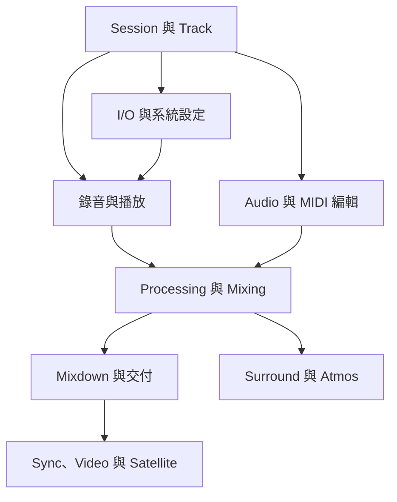

# Pro Tools 2023.3 — 全書索引

> 用中文理解工作原理，用英文對照功能介面；從手上的任務找到章節、按鍵與原文依據。

## 先選入口

| 你想怎麼找 | 開啟哪一頁 | 裡面有什麼 |
|---|---|---|
| 用中文描述需求 | [[PT-00-快速檢索]] | 中文任務 → 英文功能 → 原文位置 |
| 按工作流程一路做 | [[PT-00-工作流程導航]] | 錄音、Comping、修節奏、混音與交付路線 |
| 查 Mac 按鍵 | [[PT-00-Mac快捷鍵]] | 依情境分段的按鍵表、前提與來源 |
| 看不懂英文術語 | [[PT-00-術語與功能對照]] | 43 個核心名詞的中文查找詞與解釋 |
| 從頭系統學習 | 下方逐章導覽 | 分章、分主題的繁體中文教學篇 |
| 已知道英文功能名 | [[PT-00-功能目錄]] | 882 個章內小節 + 書末 Index 入口 |
| 原文有矛盾或數字可疑 | [[PT-00-版本與原文疑義]] | 已查核的文件疑義與處理方式 |

目前已整理 **66／66 章**，分成 **122 篇教學筆記**。[[PT-00-製作進度]] 提供逐章列表。

## 這套筆記怎麼讀

每篇先講這個功能解決什麼問題，再解釋觀念、選項差異與操作步驟。比較表讓你能快速回查，callout 補充實務用法和常見陷阱；需要時再沿 PDF 連結核對原文。長章拆成 a／b／c 等聚焦篇，保留同一個 chapter 屬性，方便排序。

> [!note] 版本與頁碼
> 這是 **2023.3 Reference Guide 的消化式教學整理**；不是逐字翻譯，也不把 2023.3 的服務、硬體支援或版本上限當成現行資訊。英文功能名稱保留。正文的「PDF 頁」＝「原書印刷頁」＋32；快捷鍵專用指南有自己的頁碼，依快捷鍵頁標示。



## 逐章導覽

「教學篇」可直接開啟中文筆記；a／b／c 代表同章的主題切分。「原文」開啟附件 PDF 的章首。

### Part I Introduction to Pro Tools — 入門

| 章／中文主題 | 英文章名 | 教學篇 | 原書頁 | 原文 |
|---|---|---|---|---|
| Ch01 歡迎與文件讀法 | Welcome to Pro Tools | [[PT-Ch01-歡迎與文件讀法\|全文]] | 3–6 | [[Pro_Tools_Reference_Guide_2023.3.pdf#page=35\|PDF 35]] |
| Ch02 核心概念 | Pro Tools Concepts | [[PT-Ch02a-Session與訊號流的基本積木\|a]] · [[PT-Ch02b-時間基準資源與交換格式\|b]] | 7–23 | [[Pro_Tools_Reference_Guide_2023.3.pdf#page=39\|PDF 39]] |
| Ch03 鍵盤與滑鼠操作 | Keyboard and Mouse Shortcuts | [[PT-Ch03-KeyboardFocus與操作模式\|全文]] | 25–30 | [[Pro_Tools_Reference_Guide_2023.3.pdf#page=57\|PDF 57]] |
| Ch04 使用 Help | Using Help | [[PT-Ch04-用Help找準確答案\|全文]] | 31–34 | [[Pro_Tools_Reference_Guide_2023.3.pdf#page=63\|PDF 63]] |

### Part II System Configuration — 系統設定

| 章／中文主題 | 英文章名 | 教學篇 | 原書頁 | 原文 |
|---|---|---|---|---|
| Ch05 系統與版本架構 | Pro Tools Systems | [[PT-Ch05a-版本與處理架構\|a]] · [[PT-Ch05b-錄音介面與HD硬體導覽\|b]] | 37–54 | [[Pro_Tools_Reference_Guide_2023.3.pdf#page=69\|PDF 69]] |
| Ch06 I/O Setup 與訊號路由 | I/O Setup | [[PT-Ch06a-I-O與Path地圖\|a]] · [[PT-Ch06b-Bus監聽與特殊路徑\|b]] · [[PT-Ch06c-跨系統映射與AuxIO\|c]] | 55–93 | [[Pro_Tools_Reference_Guide_2023.3.pdf#page=87\|PDF 87]] |
| Ch07 系統設定 | System Setup | [[PT-Ch07a-PlaybackEngine與低延遲\|a]] · [[PT-Ch07b-HardwareClock與效能診斷\|b]] | 95–113 | [[Pro_Tools_Reference_Guide_2023.3.pdf#page=127\|PDF 127]] |
| Ch08 Preferences 偏好設定 | Preferences | [[PT-Ch08a-顯示與錄音操作偏好\|a]] · [[PT-Ch08b-剪輯混音與Automation偏好\|b]] · [[PT-Ch08c-MeteringProcessing與MIDI偏好\|c]] · [[PT-Ch08d-協作同步與設定作用範圍\|d]] | 115–147 | [[Pro_Tools_Reference_Guide_2023.3.pdf#page=147\|PDF 147]] |
| Ch09 周邊設備 | Peripherals | [[PT-Ch09a-周邊設備與控制協定\|a]] · [[PT-Ch09b-SatelliteVENUE與DolbyAtmos連線\|b]] | 149–159 | [[Pro_Tools_Reference_Guide_2023.3.pdf#page=181\|PDF 181]] |
| Ch10 MIDI 設定 | Configuring MIDI | [[PT-Ch10-MIDIStudio與AudioBridge\|全文]] | 161–166 | [[Pro_Tools_Reference_Guide_2023.3.pdf#page=193\|PDF 193]] |

### Part III Sessions, Projects & Tracks — Session、Project 與 Track

| 章／中文主題 | 英文章名 | 教學篇 | 原書頁 | 原文 |
|---|---|---|---|---|
| Ch11 Session 與 Project | Sessions and Projects | [[PT-Ch11a-建立Session與媒體格式\|a]] · [[PT-Ch11b-儲存備份與工程交接\|b]] · [[PT-Ch11c-Project版本與Template\|c]] | 169–201 | [[Pro_Tools_Reference_Guide_2023.3.pdf#page=201\|PDF 201]] |
| Ch12 主要視窗 | Pro Tools Main Windows | [[PT-Ch12a-主要視窗與Transport\|a]] · [[PT-Ch12b-WindowConfigurations與介面管理\|b]] | 203–231 | [[Pro_Tools_Reference_Guide_2023.3.pdf#page=235\|PDF 235]] |
| Ch13 Track 操作 | Tracks | [[PT-Ch13a-Track類型與Metering\|a]] · [[PT-Ch13b-建立編輯與管理Track\|b]] · [[PT-Ch13c-路由Solo與Track狀態\|c]] | 233–287 | [[Pro_Tools_Reference_Guide_2023.3.pdf#page=265\|PDF 265]] |
| Ch14 Folder Track | Folder Tracks | [[PT-Ch14a-Basic與RoutingFolder\|a]] · [[PT-Ch14b-Overview編輯與Folder操作\|b]] | 289–302 | [[Pro_Tools_Reference_Guide_2023.3.pdf#page=321\|PDF 321]] |
| Ch15 Track Preset | Track Presets | [[PT-Ch15-Track-Presets與可重用工作流程\|全文]] | 303–315 | [[Pro_Tools_Reference_Guide_2023.3.pdf#page=335\|PDF 335]] |
| Ch16 Track Group | Grouping Tracks | [[PT-Ch16-Group聯動與相對關係\|全文]] | 317–328 | [[Pro_Tools_Reference_Guide_2023.3.pdf#page=349\|PDF 349]] |
| Ch17 Clips List | The Clips List | [[PT-Ch17a-Clips-List搜尋與素材辨識\|a]] · [[PT-Ch17b-Clips命名與安全清理\|b]] | 329–346 | [[Pro_Tools_Reference_Guide_2023.3.pdf#page=361\|PDF 361]] |
| Ch18 Workspace Browser | Workspace Browsers | [[PT-Ch18a-Workspace素材庫與搜尋\|a]] · [[PT-Ch18b-Workspace預聽與Tempo\|b]] · [[PT-Ch18c-Relink與背景任務\|c]] | 347–398 | [[Pro_Tools_Reference_Guide_2023.3.pdf#page=379\|PDF 379]] |
| Ch19 Artist Chat 與 Avid Link | Artist Chat and Avid Link | [[PT-Ch19-Artist-Chat與Avid-Link協作入口\|全文]] | 399–412 | [[Pro_Tools_Reference_Guide_2023.3.pdf#page=431\|PDF 431]] |
| Ch20 Track 協作 | Track Collaboration | [[PT-Ch20-Track-Collaboration與衝突處理\|全文]] | 413–430 | [[Pro_Tools_Reference_Guide_2023.3.pdf#page=445\|PDF 445]] |
| Ch21 匯入與匯出 Session Data | Importing and Exporting Session Data | [[PT-Ch21a-Audio與MIDI匯入匯出\|a]] · [[PT-Ch21b-Import-Session-Data精準合併\|b]] · [[PT-Ch21c-AAF-OMF與交付文件\|c]] | 431–490 | [[Pro_Tools_Reference_Guide_2023.3.pdf#page=463\|PDF 463]] |
| Ch22 檔案管理與相容性 | File and Session Management and Compatibility | [[PT-Ch22-媒體管理與跨版本相容性\|全文]] | 491–507 | [[Pro_Tools_Reference_Guide_2023.3.pdf#page=523\|PDF 523]] |

### Part IV Playback and Recording — 播放與錄音

| 章／中文主題 | 英文章名 | 教學篇 | 原書頁 | 原文 |
|---|---|---|---|---|
| Ch23 播放 Track 內容 | Playing Back Track Material | [[PT-Ch23a-播放位置與選取範圍\|a]] · [[PT-Ch23b-Loop-Dynamic-Transport與同步\|b]] | 511–533 | [[Pro_Tools_Reference_Guide_2023.3.pdf#page=543\|PDF 543]] |
| Ch24 錄音前設定 | Record Setup | [[PT-Ch24a-錄音準備與Record-Modes\|a]] · [[PT-Ch24b-Input-Monitoring與Latency\|b]] | 535–557 | [[Pro_Tools_Reference_Guide_2023.3.pdf#page=567\|PDF 567]] |
| Ch25 Audio 錄音 | Audio Recording | [[PT-Ch25a-Audio錄音與補錄範圍\|a]] · [[PT-Ch25b-Loop-Takes與數位錄音\|b]] | 559–577 | [[Pro_Tools_Reference_Guide_2023.3.pdf#page=591\|PDF 591]] |
| Ch26 MIDI 錄音 | MIDI Recording | [[PT-Ch26a-MIDI錄音與Merge-Replace\|a]] · [[PT-Ch26b-MIDI轉Audio與Retrospective-Record\|b]] | 579–599 | [[Pro_Tools_Reference_Guide_2023.3.pdf#page=611\|PDF 611]] |
| Ch27 Punch Recording 模式 | Punch Recording Modes | [[PT-Ch27a-QuickPunch與TrackPunch\|a]] · [[PT-Ch27b-DestructivePunch與後期工作流程\|b]] | 601–618 | [[Pro_Tools_Reference_Guide_2023.3.pdf#page=633\|PDF 633]] |

### Part V Editing — 編輯

| 章／中文主題 | 英文章名 | 教學篇 | 原書頁 | 原文 |
|---|---|---|---|---|
| Ch28 編輯基礎 | Editing Basics | [[PT-Ch28-編輯前先分清Clip與資料\|全文]] | 621–638 | [[Pro_Tools_Reference_Guide_2023.3.pdf#page=653\|PDF 653]] |
| Ch29 Edit Mode 與工具 | Edit Modes and Tools | [[PT-Ch29a-Edit Mode與Grid的選擇\|a]] · [[PT-Ch29b-工具切換與精準觀察\|b]] | 639–667 | [[Pro_Tools_Reference_Guide_2023.3.pdf#page=671\|PDF 671]] |
| Ch30 選取範圍 | Making Selections | [[PT-Ch30-選取範圍與時間軸導航\|全文]] | 669–691 | [[Pro_Tools_Reference_Guide_2023.3.pdf#page=701\|PDF 701]] |
| Ch31 編輯 Clip 與選取內容 | Editing Clips and Selections | [[PT-Ch31-Clip剪裁微移與整合\|全文]] | 693–707 | [[Pro_Tools_Reference_Guide_2023.3.pdf#page=725\|PDF 725]] |
| Ch32 Fade 與 Crossfade | Fades and Crossfades | [[PT-Ch32a-Fade形狀與Crossfade判斷\|a]] · [[PT-Ch32b-建立批次調整與保留Fade\|b]] | 709–729 | [[Pro_Tools_Reference_Guide_2023.3.pdf#page=741\|PDF 741]] |
| Ch33 Playlist 與剪輯合成 | Playlists | [[PT-Ch33a-用Playlist保留版本與合成Take\|a]] · [[PT-Ch33b-Target與Matches的進階工作流\|b]] | 731–758 | [[Pro_Tools_Reference_Guide_2023.3.pdf#page=763\|PDF 763]] |
| Ch34 Beat Detective | Beat Detective | [[PT-Ch34a-BeatDetective偵測與TempoMap\|a]] · [[PT-Ch34b-多軌鼓對拍與接縫平滑\|b]] | 759–781 | [[Pro_Tools_Reference_Guide_2023.3.pdf#page=791\|PDF 791]] |

### Part VI MIDI — MIDI

| 章／中文主題 | 英文章名 | 教學篇 | 原書頁 | 原文 |
|---|---|---|---|---|
| Ch35 MIDI 編輯 | MIDI Editing | [[PT-Ch35a-MIDI音符輸入與選取\|a]] · [[PT-Ch35b-Controller與外部MIDI排查\|b]] · [[PT-Ch35c-Quantize與RealTimeProperties\|c]] | 785–826 | [[Pro_Tools_Reference_Guide_2023.3.pdf#page=817\|PDF 817]] |
| Ch36 MIDI Editor | MIDI Editors | [[PT-Ch36-MIDIEditor多軌編輯工作台\|全文]] | 827–845 | [[Pro_Tools_Reference_Guide_2023.3.pdf#page=859\|PDF 859]] |
| Ch37 Score Editor | Score Editor | [[PT-Ch37-ScoreEditor譜面與列印\|全文]] | 847–868 | [[Pro_Tools_Reference_Guide_2023.3.pdf#page=879\|PDF 879]] |
| Ch38 MIDI Event List | MIDI Event List | [[PT-Ch38-MIDIEventList精確檢查\|全文]] | 869–876 | [[Pro_Tools_Reference_Guide_2023.3.pdf#page=901\|PDF 901]] |

### Part VII Arranging — 編排

| 章／中文主題 | 英文章名 | 教學篇 | 原書頁 | 原文 |
|---|---|---|---|---|
| Ch39 時間與 Tempo、Meter、Key、Chord | Time, Tempo, Meter, Key, and Chords | [[PT-Ch39a-時間基準與Track錨定\|a]] · [[PT-Ch39b-Tempo曲線與IdentifyBeat\|b]] · [[PT-Ch39c-Meter時間操作與KeyChord\|c]] | 879–921 | [[Pro_Tools_Reference_Guide_2023.3.pdf#page=911\|PDF 911]] |
| Ch40 Memory Location | Memory Locations | [[PT-Ch40-MemoryLocations段落與工作畫面\|全文]] | 923–932 | [[Pro_Tools_Reference_Guide_2023.3.pdf#page=955\|PDF 955]] |
| Ch41 編排 Clip | Arranging Clips | [[PT-Ch41a-Clip放置與精準定位\|a]] · [[PT-Ch41b-保護Clip與整理空白片段\|b]] | 933–957 | [[Pro_Tools_Reference_Guide_2023.3.pdf#page=965\|PDF 965]] |
| Ch42 Clip Loop 與 Group | Clip Loops and Groups | [[PT-Ch42-ClipLoop與Group的編排方法\|全文]] | 959–970 | [[Pro_Tools_Reference_Guide_2023.3.pdf#page=991\|PDF 991]] |

### Part VIII Processing — 處理

| 章／中文主題 | 英文章名 | 教學篇 | 原書頁 | 原文 |
|---|---|---|---|---|
| Ch43 AudioSuite 處理 | AudioSuite Processing | [[PT-Ch43-AudioSuite離線處理與Handles\|全文]] | 973–983 | [[Pro_Tools_Reference_Guide_2023.3.pdf#page=1005\|PDF 1005]] |
| Ch44 Clip Gain 與 Clip Effects | Clip Gain and Clip Effects | [[PT-Ch44a-ClipGain與音量整理\|a]] · [[PT-Ch44b-ClipEffects與片段處理鏈\|b]] | 985–1007 | [[Pro_Tools_Reference_Guide_2023.3.pdf#page=1017\|PDF 1017]] |
| Ch45 Elastic Audio | Elastic Audio | [[PT-Ch45a-ElasticAudio啟用與演算法\|a]] · [[PT-Ch45b-Warp與Analysis的時間修正\|b]] · [[PT-Ch45c-ElasticProperties與轉檔邊界\|c]] | 1009–1039 | [[Pro_Tools_Reference_Guide_2023.3.pdf#page=1041\|PDF 1041]] |
| Ch46 Melodyne 與 Audio to MIDI | Melodyne Editing and Audio to MIDI | [[PT-Ch46-Melodyne整合與Audio轉MIDI\|全文]] | 1041–1046 | [[Pro_Tools_Reference_Guide_2023.3.pdf#page=1073\|PDF 1073]] |
| Ch47 Commit、Freeze 與 Bounce Track | Committing, Freezing, and Bouncing Tracks | [[PT-Ch47a-Commit固定處理與交接\|a]] · [[PT-Ch47b-Freeze與TrackBounce的使用時機\|b]] | 1047–1056 | [[Pro_Tools_Reference_Guide_2023.3.pdf#page=1079\|PDF 1079]] |
| Ch48 Event Operation | Event Operations | [[PT-Ch48a-Quantize與Groove的節奏整理\|a]] · [[PT-Ch48b-MIDI力度時值移調與StepInput\|b]] | 1057–1083 | [[Pro_Tools_Reference_Guide_2023.3.pdf#page=1089\|PDF 1089]] |
| Ch49 HEAT | HEAT | [[PT-Ch49-HEAT的音色與資源管理\|全文]] | 1085–1092 | [[Pro_Tools_Reference_Guide_2023.3.pdf#page=1117\|PDF 1117]] |

### Part IX Mixing — 混音

| 章／中文主題 | 英文章名 | 教學篇 | 原書頁 | 原文 |
|---|---|---|---|---|
| Ch50 混音基礎 | Basic Mixing | [[PT-Ch50a-混音Track與訊號流\|a]] · [[PT-Ch50b-Sends與混音視窗操作\|b]] · [[PT-Ch50c-Submix效果回傳與耳機混音\|c]] · [[PT-Ch50d-DelayCompensation與Dither\|d]] | 1095–1146 | [[Pro_Tools_Reference_Guide_2023.3.pdf#page=1127\|PDF 1127]] |
| Ch51 Plug-In 與 Hardware Insert | Plug-In and Hardware Inserts | [[PT-Ch51a-PlugInInsert與SideChain\|a]] · [[PT-Ch51b-Preset與MultiMono控制\|b]] · [[PT-Ch51c-HardwareInsert與數位Clock\|c]] | 1147–1177 | [[Pro_Tools_Reference_Guide_2023.3.pdf#page=1179\|PDF 1179]] |
| Ch52 DSP Mode | DSP Mode | [[PT-Ch52-DSPMode與低延遲錄音\|全文]] | 1179–1188 | [[Pro_Tools_Reference_Guide_2023.3.pdf#page=1211\|PDF 1211]] |
| Ch53 Automation | Automation | [[PT-Ch53a-Automation模式與資料層\|a]] · [[PT-Ch53b-Automation錄寫與保護\|b]] · [[PT-Ch53c-Breakpoint編輯與Trim整合\|c]] · [[PT-Ch53d-WriteTo快照與Preview工作流\|d]] · [[PT-Ch53e-VCAAutomation與Coalesce\|e]] | 1189–1247 | [[Pro_Tools_Reference_Guide_2023.3.pdf#page=1221\|PDF 1221]] |
| Ch54 Mixdown | Mixdown | [[PT-Ch54-Mixdown與交付檔案\|全文]] | 1249–1263 | [[Pro_Tools_Reference_Guide_2023.3.pdf#page=1281\|PDF 1281]] |

### Part X Surround — Surround

| 章／中文主題 | 英文章名 | 教學篇 | 原書頁 | 原文 |
|---|---|---|---|---|
| Ch55 Surround 系統設定 | Pro Tools Setup for Surround | [[PT-Ch55-Surround設定與Channel順序\|全文]] | 1267–1275 | [[Pro_Tools_Reference_Guide_2023.3.pdf#page=1299\|PDF 1299]] |
| Ch56 Multichannel Track 與路由 | Multichannel Tracks and Signal Routing | [[PT-Ch56-Multichannel路由與Stem\|全文]] | 1277–1289 | [[Pro_Tools_Reference_Guide_2023.3.pdf#page=1309\|PDF 1309]] |
| Ch57 Surround Panning 與混音 | Surround Panning and Mixing | [[PT-Ch57-SurroundPanner與移動聲像\|全文]] | 1291–1302 | [[Pro_Tools_Reference_Guide_2023.3.pdf#page=1323\|PDF 1323]] |
| Ch58 Dolby Atmos 混音 | Mixing to Dolby Atmos | [[PT-Ch58a-DolbyAtmos架構與Renderer連接\|a]] · [[PT-Ch58b-Object控制與空間Automation\|b]] · [[PT-Ch58c-ADM交換與Atmos交付\|c]] | 1303–1336 | [[Pro_Tools_Reference_Guide_2023.3.pdf#page=1335\|PDF 1335]] |
| Ch59 Ambisonics | Ambisonics | [[PT-Ch59-Ambisonics與格式轉換陷阱\|全文]] | 1337–1342 | [[Pro_Tools_Reference_Guide_2023.3.pdf#page=1369\|PDF 1369]] |

### Part XI Sync and Video — Sync 與 Video

| 章／中文主題 | 英文章名 | 教學篇 | 原書頁 | 原文 |
|---|---|---|---|---|
| Ch60 Synchronization | Working with Synchronization | [[PT-Ch60a-Synchronization與SessionSetup\|a]] · [[PT-Ch60b-PullUpDown與外部Transport\|b]] · [[PT-Ch60c-Spot與TimeStamp定位音效\|c]] | 1345–1374 | [[Pro_Tools_Reference_Guide_2023.3.pdf#page=1377\|PDF 1377]] |
| Ch61 MachineControl | Pro Tools MachineControl | [[PT-Ch61a-MachineControl連接與Deck控制\|a]] · [[PT-Ch61b-TrackArming與Remote錄製\|b]] | 1375–1407 | [[Pro_Tools_Reference_Guide_2023.3.pdf#page=1407\|PDF 1407]] |
| Ch62 Field Recorder 工作流程 | Working with Field Recorders in Pro Tools | [[PT-Ch62a-FieldRecorder素材與Metadata\|a]] · [[PT-Ch62b-FieldRecorder匹配與Conform\|b]] | 1409–1430 | [[Pro_Tools_Reference_Guide_2023.3.pdf#page=1441\|PDF 1441]] |
| Ch63 Video 操作 | Working with Video in Pro Tools | [[PT-Ch63a-Video匯入與AVE設定\|a]] · [[PT-Ch63b-Video剪輯效能與MOV交付\|b]] | 1431–1464 | [[Pro_Tools_Reference_Guide_2023.3.pdf#page=1463\|PDF 1463]] |

### Part XII Satellite Systems — Satellite 系統

| 章／中文主題 | 英文章名 | 教學篇 | 原書頁 | 原文 |
|---|---|---|---|---|
| Ch64 Satellite Link | Satellite Link | [[PT-Ch64-SatelliteLink多機同步\|全文]] | 1467–1475 | [[Pro_Tools_Reference_Guide_2023.3.pdf#page=1499\|PDF 1499]] |
| Ch65 Pro Tools Video Satellite | Pro Tools Video Satellite | [[PT-Ch65-ProToolsVideoSatellite獨立影片機\|全文]] | 1477–1480 | [[Pro_Tools_Reference_Guide_2023.3.pdf#page=1509\|PDF 1509]] |
| Ch66 Media Composer Video Satellite | Media Composer Video Satellite | [[PT-Ch66a-MediaComposerSatellite與同步設定\|a]] · [[PT-Ch66b-Satellite擷取與DigitalCut\|b]] | 1481–1495 | [[Pro_Tools_Reference_Guide_2023.3.pdf#page=1513\|PDF 1513]] |

## 每篇主題速覽

### Ch01 — 歡迎與文件讀法

- [[PT-Ch01-歡迎與文件讀法|Ch01 — 歡迎與文件讀法]] — 操作 Pro Tools 的第一步，是分清楚帳號、軟體、支援資訊與文件語法，讓遇到問題時找得到正確入口。
### Ch02 — 核心概念

- [[PT-Ch02a-Session與訊號流的基本積木|Ch02a — Session、Track、Clip：先看懂聲音住在哪裡]] — Session 記錄製作的安排，Audio File 保存聲音，而 Track、Clip 與 Bus 決定聲音在何時、沿哪條路出現。
- [[PT-Ch02b-時間基準資源與交換格式|Ch02b — 時間跟著秒還是跟著拍？再看資源與交換格式]] — Timebase 決定素材跟哪一種時間移動，System Resources 決定它能否即時播放，而交換格式決定另一套系統能重建多少安排。
### Ch03 — 鍵盤與滑鼠操作

- [[PT-Ch03-KeyboardFocus與操作模式|Ch03 — 快捷鍵沒作用，先檢查 Keyboard Focus]] — 快捷鍵的意思由焦點、所在視窗與 Numeric Keypad mode 一起決定，記住按鍵只是操作的一半。
### Ch04 — 使用 Help

- [[PT-Ch04-用Help找準確答案|Ch04 — 用 Help 查功能，不必從頭翻完整本手冊]] — Contents 看結構、Index 找術語、Search 找線索；先選對查找工具，才容易找到操作的前提與限制。
### Ch05 — 系統與版本架構

- [[PT-Ch05a-版本與處理架構|Ch05a — 選版本與硬體，先分清 I/O、Track、Voice 與 DSP]] — 軟體版本限制可用功能與容量，硬體與 Audio Engine 決定訊號如何進出、由誰即時處理；這是兩張不同的規格表。
- [[PT-Ch05b-錄音介面與HD硬體導覽|Ch05b — 介面上的孔、Pro Tools 的 I/O，與監聽系統怎麼對起來]] — 同一台介面可能有多種接孔、格式與監聽功能，但同時可用的 Pro Tools I/O 還受連線、Sample Rate 與系統模式限制。
### Ch06 — I/O Setup 與訊號路由

- [[PT-Ch06a-I-O與Path地圖|Ch06a — I/O Setup 是一張可命名的接線表]] — Track selector 裡的名字只是路徑入口，真正能否錄到、送出聲音，要一路追到 I/O Setup 的 Bus、Output Path 與實體通道。
- [[PT-Ch06b-Bus監聽與特殊路徑|Ch06b — Main Mix、Audition、Solo：你聽到的不一定走同一條路]] — Pro Tools 可以同時有主混音、素材預聽、AFL／PFL 與其他監聽路徑；某一種聲音有輸出，不能證明其他路徑也接好了。
- [[PT-Ch06c-跨系統映射與AuxIO|Ch06c — 搬到另一台電腦，讓 Session 的路由接回當地硬體]] — Session 保存「我要往哪裡送」，系統保存「這裡實際接在哪裡」；I/O mapping 連接兩者，Aux I/O 再把訊號延伸到其他 Mac 應用程式。
### Ch07 — 系統設定

- [[PT-Ch07a-PlaybackEngine與低延遲|Ch07a — Playback Engine：在穩定播放與低延遲演奏之間取捨]] — H/W Buffer Size 控制 Host 即時處理的緩衝量；錄音想要反應快，混音想要處理空間，而 Engine 決定這個取捨如何落實。
- [[PT-Ch07b-HardwareClock與效能診斷|Ch07b — 沒聲音、爆音、卡住：把 Hardware、Clock 與資源分開查]] — Playback Engine 選哪套系統，Hardware Setup 設那套系統的硬體；Clock 決定取樣節奏，System Usage 才用來看即時負載。
### Ch08 — Preferences 偏好設定

- [[PT-Ch08a-顯示與錄音操作偏好|Ch08a — Preferences：先把畫面、播放游標與錄音行為調成可預期]] — Preferences 決定同一個操作會怎樣反應；先掌握關鍵開關，才不會把設定差異誤認成軟體故障。
- [[PT-Ch08b-剪輯混音與Automation偏好|Ch08b — 讓剪輯、Send 與 Automation 按你預期工作]] — Editing 決定你改動哪份資料，Mixing 決定控制如何連動；看懂開關的兩種結果，比收集一份「最佳設定」更實用。
- [[PT-Ch08c-MeteringProcessing與MIDI偏好|Ch08c — 表頭、匯入與 MIDI：看見的、存下來的、送出去的要分開]] — Meter Type 改變量測的觀點，Processing Preferences 改變媒體處理規則，而 MIDI Preferences 改變事件的顯示與路由。
- [[PT-Ch08d-協作同步與設定作用範圍|Ch08d — 有些設定跟著電腦，有些設定跟著 Session]] — 調整 Preference 前，先知道它改變的是所有工程的工作環境，還是只有目前 Session 的行為。
### Ch09 — 周邊設備

- [[PT-Ch09a-周邊設備與控制協定|Ch09a — Peripherals：接通控制訊息，不等於接通 Audio]] — Peripherals 管的是同步、控制器與可遙控設備；Audio 路徑仍要在 Hardware、I/O Setup 和 Track assignment 中完成。
- [[PT-Ch09b-SatelliteVENUE與DolbyAtmos連線|Ch09b — 多系統連線：Satellite、VENUE Link 與 Dolby Atmos Renderer]] — 網路連通只是第一步，還要確認角色、控制協定與 Audio 去向；三種連線並不是同一個「同步」按鈕。
### Ch10 — MIDI 設定

- [[PT-Ch10-MIDIStudio與AudioBridge|Ch10 — Audio MIDI Setup：MIDI 接線圖與 Audio Bridge 是兩件事]] — MIDI Studio 把演奏訊息送到正確設備，Audio Bridge 把真正的聲音送到另一個應用程式；知道兩條線的差別，才容易排查「有反應卻沒聲音」。
### Ch11 — Session 與 Project

- [[PT-Ch11a-建立Session與媒體格式|Ch11a — 建立 Session：先決定資料放哪裡，再決定錄成什麼格式]] — 新工程的 Sample Rate、Bit Depth、儲存模式與 I/O，不只是開檔選項，它們會影響後續交接、容量與工作流程。
- [[PT-Ch11b-儲存備份與工程交接|Ch11b — Save、Save As、Save Copy In：三種儲存解決三種問題]] — Save 保存目前進度，Save As 分出文件版本，Save Copy In 才能依選項收齊媒體、轉換格式並準備獨立交接。
- [[PT-Ch11c-Project版本與Template|Ch11c — 把 Project 的版本、Template 與製作註記管清楚]] — 版本是作品狀態，Template 是可重用的起點，Cloud cache 是同步資料；三者不能用同一個「備份」概念代替。
### Ch12 — 主要視窗

- [[PT-Ch12a-主要視窗與Transport|Ch12a — 同一份 Session，用 Edit 看時間，用 Mix 看訊號]] — Edit 與 Mix 不是兩份工程：前者把資料攤在 Timeline，後者把 Track 攤成 channel strips，Transport 則決定從哪裡播放或錄音。
- [[PT-Ch12b-WindowConfigurations與介面管理|Ch12b — Window Configurations：把工作視角存起來]] — 一套 Window Configuration 保存視窗布局或顯示設定，讓你在錄音、剪輯與混音間切換時，不必重新排列整個桌面。
### Ch13 — Track 操作

- [[PT-Ch13a-Track類型與Metering|Ch13a — Track類型：選對資料容器，也選對控制方式]] — Audio、MIDI、Auxiliary Input、Master Fader 與 VCA 的外觀相似，但它們處理的資料、路由與控制對象並不相同。
- [[PT-Ch13b-建立編輯與管理Track|Ch13b — Track管理：先選對範圍，再建立、複製與編輯]] — Track selection、Edit selection、Track View 與顯示狀態各管不同的範圍；把它們分清楚，批次操作才不會誤改一整組資料。
- [[PT-Ch13c-路由Solo與Track狀態|Ch13c — Track有內容卻沒聲音：沿路由、Voice與監聽狀態逐層查]] — 音訊能否被聽見，同時取決於 Input／Output、Voice、Mute／Solo、Active 狀態與硬體映射；任何一層都可能讓有 Clip 的 Track 保持安靜。
### Ch14 — Folder Track

- [[PT-Ch14a-Basic與RoutingFolder|Ch14a — Folder收納Tracks，但不一定收納它們的Audio]] — Basic Folder 管理畫面與成員，Routing Folder 另外提供 Audio 處理；成員關係與實際訊號路由必須分開確認。
- [[PT-Ch14b-Overview編輯與Folder操作|Ch14b — 在Overview剪一刀，可能同時剪到整個Folder]] — Folder 的 Overview 是跨成員的編輯入口，收合只改顯示，不會把成員排除在所有編輯之外。
### Ch15 — Track Preset

- [[PT-Ch15-Track-Presets與可重用工作流程|Ch15 — Track Presets：把常用工作流程存成可重用積木]] — Track Preset 不只存一顆效果器，而是把 Track 的結構、處理與可選素材一起封裝，再決定下次要帶回哪些部分。
### Ch16 — Track Group

- [[PT-Ch16-Group聯動與相對關係|Ch16 — Grouping Tracks：讓多軌一起動，又保留彼此差異]] — Group 是操作聯動規則，不是把多條 Audio 合成一條訊號；把這點分清楚，才不會把 Group、Bus 與 VCA 混為一談。
### Ch17 — Clips List

- [[PT-Ch17a-Clips-List搜尋與素材辨識|Ch17 — Clips List：先找到正確 Clip，再開始編輯]] — Timeline 告訴你素材放在哪裡，Clips List 告訴你 Session 裡有哪些 Clip；兩個地方回答的問題不同。
- [[PT-Ch17b-Clips命名與安全清理|Ch17 — Clips 命名與安全清理：Remove 和 Delete 差在哪裡]] — 清理 Session 時最重要的不是清掉多少項，而是知道自己移除的是 Clip reference，還是硬碟上真正的錄音檔。
### Ch18 — Workspace Browser

- [[PT-Ch18a-Workspace素材庫與搜尋|Ch18 — Workspace：用 metadata 把散落素材變成可搜尋的素材庫]] — Workspace 把檔案位置、metadata 與搜尋條件放在一起；先縮小搜尋範圍，再描述內容，才能從大量素材中找到真正要用的聲音。
- [[PT-Ch18b-Workspace預聽與Tempo|Ch18 — Workspace 預聽：聽到的速度、輸出與匯入結果要一致]] — 預聽不只是按播放：Audition Path、Timebase、Elastic Audio 與 Session Tempo 共同決定你聽到的結果。
- [[PT-Ch18c-Relink與背景任務|Ch18 — Relink 與 Task Manager：檔案找到了，Session 還要連對它]] — Session 保存的是對媒體的引用；找不到聲音時，要修的是引用、儲存位置與背景任務，而不只是把檔名改得一樣。
### Ch19 — Artist Chat 與 Avid Link

- [[PT-Ch19-Artist-Chat與Avid-Link協作入口|Ch19 — Artist Chat 與 Avid Link：人、Project 與訊息各有自己的範圍]] — 協作先要分清「聯絡到誰」「邀請進哪個 Project」「把訊息送到哪個對話」；這些不是同一個權限。
### Ch20 — Track 協作

- [[PT-Ch20-Track-Collaboration與衝突處理|Ch20 — Track Collaboration：控制共享範圍，讀懂 ownership 與衝突]] — Track Collaboration 不是所有人的工程即時鏡像；它讓每個人選擇何時、以哪條 Track、把哪些變更交給雲端版本。
### Ch21 — 匯入與匯出 Session Data

- [[PT-Ch21a-Audio與MIDI匯入匯出|Ch21 — Audio／MIDI 匯入與匯出：先決定資料型態，再決定 Copy 與 Conversion]] — 匯入不是單純把檔案拖進畫面，而是決定來源留在哪裡、規格怎麼解讀、內容落在什麼時間位置。
- [[PT-Ch21b-Import-Session-Data精準合併|Ch21 — Import Session Data：只合併需要的資料，保住既有混音]] — Import Session Data 的威力在於把素材、Playlist、Plug-In 與 Automation 拆開選擇；合併前先說清楚哪些應保留，哪些才要替換。
- [[PT-Ch21c-AAF-OMF與交付文件|Ch21 — AAF／OMF／MXF 與交付文件：交換剪輯結構，也交代轉譯限制]] — 跨軟體交付的重點是保住媒體、時間與可編輯餘裕；一個 AAF 檔案並不自動包含所有聲音與效果。
### Ch22 — 檔案管理與相容性

- [[PT-Ch22-媒體管理與跨版本相容性|Ch22 — 檔案管理與相容性：能打開 Session，不代表內容全部保住]] — 一份可交接的 Session，要同時保住媒體連結、儲存位置、版本功能與語言編碼；只傳 `.ptx` 不足以證明工程完整。
### Ch23 — 播放 Track 內容

- [[PT-Ch23a-播放位置與選取範圍|Ch23 — Playback：分清 Edit、Timeline 與停止後的起點]] — 播放從哪裡開始，不只由你最後點到哪裡決定；Edit selection、Timeline selection 與 insertion-following 設定必須一起看。
- [[PT-Ch23b-Loop-Dynamic-Transport與同步|Ch23 — Loop、Dynamic Transport 與外部同步]] — Loop 決定重複哪段，Play Start Marker 決定先從哪裡聽；外部同步再把這個時間關係擴展到其他設備。
### Ch24 — 錄音前設定

- [[PT-Ch24a-錄音準備與Record-Modes|Ch24 — 錄音前準備：先把硬體、時間與錄音模式配好]] — 錄音開始之前，先決定訊號怎麼進、檔案寫在哪裡、演奏跟哪個時間基準，以及這次是否保留舊 Take。
- [[PT-Ch24b-Input-Monitoring與Latency|Ch24 — Input Monitoring 與 Latency：演奏者聽到什麼，由路徑決定]] — 監聽模式決定何時聽 Input、何時聽 disk；Latency 則取決於訊號走過的硬體、buffer 與處理，不是單靠 Fader 能解決。
### Ch25 — Audio 錄音

- [[PT-Ch25a-Audio錄音與補錄範圍|Ch25 — Audio Recording：從第一個 Take 到可控制的補錄]] — 一次可靠錄音的標準，是輸入正確、監聽合理、檔案可播放，而且你知道重新錄製時舊 Take 是否仍保留。
- [[PT-Ch25b-Loop-Takes與數位錄音|Ch25 — Loop Takes、Alternate Takes 與 Digital Source]] — 反覆錄音不難，難的是保留可比較的 Takes、找回正確版本，並讓數位來源在共同時脈下可靠寫入。
### Ch26 — MIDI 錄音

- [[PT-Ch26a-MIDI錄音與Merge-Replace|Ch26 — MIDI 錄音：路由、監聽與 Merge／Replace 是三件不同的事]] — MIDI 錄下的是演奏事件；有沒有聲音取決於音源與 Audio 路徑，舊演奏會不會被取代則取決於 Merge／Replace。
- [[PT-Ch26b-MIDI轉Audio與Retrospective-Record|Ch26 — MIDI 轉 Audio、Step Input 與 Retrospective Record]] — 保留 MIDI 是保留演奏可編輯性，錄成 Audio 是保留當下聲音；兩者都留下，才兼顧修改與可靠交付。
### Ch27 — Punch Recording 模式

- [[PT-Ch27a-QuickPunch與TrackPunch|Ch27 — QuickPunch 與 TrackPunch：播放不中斷，錄音可進可出]] — Punch mode 的價值是讓錄音在持續播放中進出；先分「整組一起 Punch」與「逐條 Track 控制」，再選模式。
- [[PT-Ch27b-DestructivePunch與後期工作流程|Ch27 — DestructivePunch：連續檔與後期寫入的嚴格前提]] — DestructivePunch 讓既有連續檔被局部重寫；它省去大量分段檔案的代價，是操作前必須確定資料與時間關係都正確。
### Ch28 — 編輯基礎

- [[PT-Ch28-編輯前先分清Clip與資料|Ch28 — 編輯前先分清Clip與資料]] — 剪輯大多是在改播放素材的地圖；要先知道目前選到的是 Audio、MIDI、Automation，還是它們的組合。
### Ch29 — Edit Mode 與工具

- [[PT-Ch29a-Edit Mode與Grid的選擇|Ch29a — Edit Mode與Grid的選擇]] — Edit mode 決定「這次拖曳遵守什麼規則」，Grid 則決定時間落點的解析度。
- [[PT-Ch29b-工具切換與精準觀察|Ch29b — 工具切換與精準觀察]] — 同一個工具在 Clip、MIDI note、Automation 上會有不同語意，先辨認 cursor 再動手。
### Ch30 — 選取範圍

- [[PT-Ch30-選取範圍與時間軸導航|Ch30 — 選取範圍與時間軸導航]] — 選取分成「要改哪裡」與「要播放哪裡」，兩者連動與否決定整個剪輯手感。
### Ch31 — 編輯 Clip 與選取內容

- [[PT-Ch31-Clip剪裁微移與整合|Ch31 — Clip剪裁微移與整合]] — Capture、Separate、Trim、Consolidate 看起來都在整理 Clip，實際上改的是四種不同層次。
### Ch32 — Fade 與 Crossfade

- [[PT-Ch32a-Fade形狀與Crossfade判斷|Ch32a — Fade形狀與Crossfade判斷]] — Crossfade 是把兩段來源重疊後交接音量；形狀、位置與來源餘量缺一不可。
- [[PT-Ch32b-建立批次調整與保留Fade|Ch32b — 建立批次調整與保留Fade]] — Fade 跟著 Clip 的邊界工作，但選取包含不包含 Fade，會讓移動與 Nudge 出現不同結果。
### Ch33 — Playlist 與剪輯合成

- [[PT-Ch33a-用Playlist保留版本與合成Take|Ch33a — 用Playlist保留版本與合成Take]] — Playlist 保存同一條 Track 上不同素材排列，讓你挑最佳片段時不必破壞原始演奏。
- [[PT-Ch33b-Target與Matches的進階工作流|Ch33b — Target與Matches的進階工作流]] — Target 決定成品送去哪裡，Matches 決定哪些其他素材有資格被拿來替換。
### Ch34 — Beat Detective

- [[PT-Ch34a-BeatDetective偵測與TempoMap|Ch34a — BeatDetective偵測與TempoMap]] — Beat Detective 先把演奏解析成可核對的 beat trigger，再決定是讓格線跟演奏，還是讓演奏跟格線。
- [[PT-Ch34b-多軌鼓對拍與接縫平滑|Ch34b — 多軌鼓對拍與接縫平滑]] — 先收集可靠的 attack，再把相同切點與位移套到整組鼓，才能兼顧節奏與跨麥關係。
### Ch35 — MIDI 編輯

- [[PT-Ch35a-MIDI音符輸入與選取|Ch35a — MIDI音符輸入與選取]] — 編輯 MIDI 時，要分開決定音高、開始時間、長度與 Velocity，才能改得準又保留表情。
- [[PT-Ch35b-Controller與外部MIDI排查|Ch35b — Controller與外部MIDI排查]] — MIDI 不只有音符：pedal、Pitch Bend、音色切換與 chasing 決定演奏能否被正確重播。
- [[PT-Ch35c-Quantize與RealTimeProperties|Ch35c — Quantize與RealTimeProperties]] — 先用 Real-Time Properties 試出音樂方向，再決定是否把改動寫進 MIDI 資料。
### Ch36 — MIDI Editor

- [[PT-Ch36-MIDIEditor多軌編輯工作台|Ch36 — MIDIEditor多軌編輯工作台]] — MIDI Editor 可以把多條 Track 疊在同一個 Piano Roll；看得到、能修改、會被插入新 note，是三個不同狀態。
### Ch37 — Score Editor

- [[PT-Ch37-ScoreEditor譜面與列印|Ch37 — ScoreEditor譜面與列印]] — 譜面是 MIDI 的另一種呈現：可以只改讀譜外觀，也可以真的改音符，兩者要刻意區分。
### Ch38 — MIDI Event List

- [[PT-Ch38-MIDIEventList精確檢查|Ch38 — MIDIEventList精確檢查]] — 當 Piano Roll 看不清疊在一起的事件時，用 Event List 把每個時間、值與事件類型攤開。
### Ch39 — 時間與 Tempo、Meter、Key、Chord

- [[PT-Ch39a-時間基準與Track錨定|Ch39a — 時間基準與Track錨定]] — 切換顯示尺規只改你怎麼量時間，切換 Track timebase 才改素材在 Tempo 變動時如何定位。
- [[PT-Ch39b-Tempo曲線與IdentifyBeat|Ch39b — Tempo曲線與IdentifyBeat]] — Tempo map 可以塑造音樂，也可以追隨演奏；先選對表示法，再畫曲線或標拍。
- [[PT-Ch39c-Meter時間操作與KeyChord|Ch39c — Meter時間操作與KeyChord]] — 拍號、時間插刪、調性與和弦各自控制不同層次；先選會移動哪些資料，再套用變更。
### Ch40 — Memory Location

- [[PT-Ch40-MemoryLocations段落與工作畫面|Ch40 — MemoryLocations段落與工作畫面]] — Memory Location 不只能跳段落，也能保存選取範圍與工作畫面，讓常做的工作一鍵回到正確情境。
### Ch41 — 編排 Clip

- [[PT-Ch41a-Clip放置與精準定位|Ch41a — Clip放置與精準定位]] — 移動 Clip 前，先決定要對齊的是起點、尾端還是聲音裡真正發生的那一刻。
- [[PT-Ch41b-保護Clip與整理空白片段|Ch41b — 保護Clip與整理空白片段]] — 整理素材時，位置保護、靜音判定與重複長度，分別解決三種不同問題。
### Ch42 — Clip Loop 與 Group

- [[PT-Ch42-ClipLoop與Group的編排方法|Ch42 — ClipLoop與Group的編排方法]] — Loop 管重複，Clip Group 管一起搬動；兩者都不是把全部音訊混成新檔。
### Ch43 — AudioSuite 處理

- [[PT-Ch43-AudioSuite離線處理與Handles|Ch43 — AudioSuite離線處理與Handles]] — AudioSuite 不只是「先算好的 Plug-In」；它的引用範圍與檔案模式，決定哪些素材被替換、原檔是否改寫。
### Ch44 — Clip Gain 與 Clip Effects

- [[PT-Ch44a-ClipGain與音量整理|Ch44a — ClipGain與音量整理]] — Clip Gain 在 mixer 與 Plug-In 之前改變音量，適合先整理素材，再讓後面的 Compressor 在穩定的輸入條件下工作。
- [[PT-Ch44b-ClipEffects與片段處理鏈|Ch44b — ClipEffects與片段處理鏈]] — Clip Effects 讓每個片段帶著自己的 EQ、Filter 與 Dynamics，適合修整來源差異，同時保留 Track Insert 的整體音色設計。
### Ch45 — Elastic Audio

- [[PT-Ch45a-ElasticAudio啟用與演算法|Ch45a — ElasticAudio啟用與演算法]] — Elastic Audio 讓 Audio 服從時間設計，但是否跟 Tempo 變速、用哪種演算法，是兩個要分開決定的問題。
- [[PT-Ch45b-Warp與Analysis的時間修正|Ch45b — Warp與Analysis的時間修正]] — Event marker 告訴你聲音被偵測在哪裡，Warp marker 才把某個聲音位置釘在 Timeline 上。
- [[PT-Ch45c-ElasticProperties與轉檔邊界|Ch45c — ElasticProperties與轉檔邊界]] — 處理結果不對時，先查來源 Tempo、Meter 與 Event Sensitivity，別把錯誤 metadata 當成演算法音質不夠好。
### Ch46 — Melodyne 與 Audio to MIDI

- [[PT-Ch46-Melodyne整合與Audio轉MIDI|Ch46 — Melodyne整合與Audio轉MIDI]] — Melodyne 整合讓你直接在 Edit window 改 Audio，但 Audio to MIDI 擷取的是演奏資料，不是把原音色複製成另一種檔案。
### Ch47 — Commit、Freeze 與 Bounce Track

- [[PT-Ch47a-Commit固定處理與交接|Ch47a — Commit固定處理與交接]] — Commit 把目前處理結果變成新的 Audio Track，讓修改、運算負擔與交接相依性各有清楚的邊界。
- [[PT-Ch47b-Freeze與TrackBounce的使用時機|Ch47b — Freeze與TrackBounce的使用時機]] — Freeze 暫停修改來換運算資源，Track Bounce 則把結果交成檔案；先選目的，再選命令。
### Ch48 — Event Operation

- [[PT-Ch48a-Quantize與Groove的節奏整理|Ch48a — Quantize與Groove的節奏整理]] — Quantize 不是把所有事件硬吸到線上，而是指定哪些事件、朝哪個時間參考、移動多少。
- [[PT-Ch48b-MIDI力度時值移調與StepInput|Ch48b — MIDI力度時值移調與StepInput]] — MIDI 的 velocity、duration 與 pitch 是演奏資料；批次改動前先知道哪些相對關係要留下。
### Ch49 — HEAT

- [[PT-Ch49-HEAT的音色與資源管理|Ch49 — HEAT的音色與資源管理]] — HEAT 用一組全域 Drive 與 Tone 改變 Audio Track 的非線性色彩，效果取決於輸入，也取決於它放在 Insert 前還是後。
### Ch50 — 混音基礎

- [[PT-Ch50a-混音Track與訊號流|Ch50a — 混音Track與訊號流]] — Audio、Aux、Master Fader 與 VCA 都能改變混音，卻只有先看清楚訊號是否真的流過它們，才不會接錯。
- [[PT-Ch50b-Sends與混音視窗操作|Ch50b — Sends與混音視窗操作]] — Send 把訊號分出去，卻不會自動替你建立回程；聲音在哪裡消失，沿著來源、Send、目的地三段查最有效。
- [[PT-Ch50c-Submix效果回傳與耳機混音|Ch50c — Submix效果回傳與耳機混音]] — Submix 把多個來源送到共同處理點；先分清是取代原聲的串接，還是與原聲並存的效果回傳。
- [[PT-Ch50d-DelayCompensation與Dither|Ch50d — DelayCompensation與Dither]] — Delay Compensation 對齊不同路徑，Dither 處理降 bit depth 的量化行為；兩者都在保護結果，卻各自有明確邊界。
### Ch51 — Plug-In 與 Hardware Insert

- [[PT-Ch51a-PlugInInsert與SideChain|Ch51a — PlugInInsert與SideChain]] — Insert 是串在訊號路上的處理；弄清楚順序、格式與旁路狀態，才能知道你比較的到底是哪一個聲音。
- [[PT-Ch51b-Preset與MultiMono控制|Ch51b — Preset與MultiMono控制]] — Preset 儲存的是聲音設定，Plug-In Map 儲存的是控制器如何操作它；兩種檔案不能混用。
- [[PT-Ch51c-HardwareInsert與數位Clock|Ch51c — HardwareInsert與數位Clock]] — 外部 Insert 要同時接對送出、返回、時間與 Clock；少一項，就可能有聲但不可靠。
### Ch52 — DSP Mode

- [[PT-Ch52-DSPMode與低延遲錄音|Ch52 — DSPMode與低延遲錄音]] — DSP Mode 優先保護 live monitoring 的低延遲路徑，代價是 Native-only Plug-In 可能被旁路。
### Ch53 — Automation

- [[PT-Ch53a-Automation模式與資料層|Ch53a — Automation模式與資料層]] — Automation 把控制變化記成時間資料；先弄清讀取、寫入與修改層級，才能避免一按播放就覆蓋原混音。
- [[PT-Ch53b-Automation錄寫與保護|Ch53b — Automation錄寫與保護]] — 可靠的 automation pass 要同時開啟參數、Track mode 與正確的操作焦點，保護也要選對是停寫還是停讀。
- [[PT-Ch53c-Breakpoint編輯與Trim整合|Ch53c — Breakpoint編輯與Trim整合]] — 編輯 automation 時，邊界點決定局部修整會不會牽動遠處；Cut 與 Delete 不是同一個聲音結果。
- [[PT-Ch53d-WriteTo快照與Preview工作流|Ch53d — WriteTo快照與Preview工作流]] — 先 audition、再固定，是處理複雜 automation 的好方法；Write To、Snapshot、Preview 與 Capture 各自負責不同階段。
- [[PT-Ch53e-VCAAutomation與Coalesce|Ch53e — VCAAutomation與Coalesce]] — VCA 的變化與成員原本的 automation 可以共存；Coalesce 才把兩層正式合成成員自己的資料。
### Ch54 — Mixdown

- [[PT-Ch54-Mixdown與交付檔案|Ch54 — Mixdown與交付檔案]] — 把混音交出去以前，先決定要錄下哪條訊號、哪段時間，以及哪些處理必須留在檔案裡。
### Ch55 — Surround 系統設定

- [[PT-Ch55-Surround設定與Channel順序|Ch55 — Surround設定與Channel順序]] — Surround 最容易出錯的地方，是畫面中的 channel 順序、實體接線與交付標準看起來很像，實際上卻不是同一層。
### Ch56 — Multichannel Track 與路由

- [[PT-Ch56-Multichannel路由與Stem|Ch56 — Multichannel路由與Stem]] — Multichannel 混音的核心，是讓需要移動的聲音有完整 panner，讓固定聲音走簡單路徑，並保留可獨立交付的 stem。
### Ch57 — Surround Panning 與混音

- [[PT-Ch57-SurroundPanner與移動聲像|Ch57 — SurroundPanner與移動聲像]] — Surround Panner 不只決定聲音在哪裡，也決定它會集中在一顆喇叭，還是散到附近的 channel。
### Ch58 — Dolby Atmos 混音

- [[PT-Ch58a-DolbyAtmos架構與Renderer連接|Ch58a — DolbyAtmos架構與Renderer連接]] — Dolby Atmos 把「聲音」與「聲音應該出現的位置」分開傳送，Renderer 才是把它們轉成實際監聽結果的核心。
- [[PT-Ch58b-Object控制與空間Automation|Ch58b — Object控制與空間Automation]] — Object Track 上同時存在普通 Output 與 Object Output，真正走哪一條，取決於 Bus/Object toggle 與控制模式。
- [[PT-Ch58c-ADM交換與Atmos交付|Ch58c — ADM交換與Atmos交付]] — ADM BWF 保存的不只多聲道 Audio，還有 Object、Pan 與 Program-level Metadata；交付前必須知道哪些內容真的被寫進去。
### Ch59 — Ambisonics

- [[PT-Ch59-Ambisonics與格式轉換陷阱|Ch59 — Ambisonics與格式轉換陷阱]] — Ambisonics channel 描述的是聲場資訊，不是某顆喇叭；沒有正確 encoder／decoder，接上幾條線也不等於聽到正確的空間。
### Ch60 — Synchronization

- [[PT-Ch60a-Synchronization與SessionSetup|Ch60a — Synchronization與SessionSetup]] — Timecode 告訴系統「現在在哪裡」，Clock 決定「走多快」，Video Reference 還要讓每個 frame 從相同邊界開始。
- [[PT-Ch60b-PullUpDown與外部Transport|Ch60b — PullUpDown與外部Transport]] — 改 frame rate 標示、改影像走速、改 Audio sample clock 是不同操作；Pull Up/Down 要配合整個交付流程。
- [[PT-Ch60c-Spot與TimeStamp定位音效|Ch60c — Spot與TimeStamp定位音效]] — 讓音效跟畫面對齊，應該鎖定真正的 hit point，而不是勉強把整個檔案開頭搬到同一個時間。
### Ch61 — MachineControl

- [[PT-Ch61a-MachineControl連接與Deck控制|Ch61a — MachineControl連接與Deck控制]] — MachineControl 是用 Sony 9-pin 協定遙控機器；它跟提供位置的 Timecode、提供走速的 Clock 必須配合，卻不能互相取代。
- [[PT-Ch61b-TrackArming與Remote錄製|Ch61b — TrackArming與Remote錄製]] — 遠端錄音最重要的是明確指定「哪個 Track、哪段時間、由誰執行 Punch」，因為錯誤命令可能真的覆寫外部媒體。
### Ch62 — Field Recorder 工作流程

- [[PT-Ch62a-FieldRecorder素材與Metadata|Ch62a — FieldRecorder素材與Metadata]] — Field Recorder 工作流程能保留畫面剪輯又換回原始多麥素材，前提是從拍攝到交接都保住正確 Metadata。
- [[PT-Ch62b-FieldRecorder匹配與Conform|Ch62b — FieldRecorder匹配與Conform]] — Match 不是找「聽起來相似」的聲音，而是依 Timecode 與 Metadata 找同時錄下的其他 channel，再把原剪輯套回去。
### Ch63 — Video 操作

- [[PT-Ch63a-Video匯入與AVE設定|Ch63a — Video匯入與AVE設定]] — Pro Tools 裡能看見影片，還不代表它以正確 frame rate、正確同步基準與合適效能播放。
- [[PT-Ch63b-Video剪輯效能與MOV交付|Ch63b — Video剪輯效能與MOV交付]] — Video 可以配合 Audio 一起剪、一起交付，但編輯邊界與輸出條件都要服從 frame，而不是 Audio sample。
### Ch64 — Satellite Link

- [[PT-Ch64-SatelliteLink多機同步|Ch64 — SatelliteLink多機同步]] — Satellite Link 讓多台工作站一起 Cue、Play、Stop 與 Solo，但 Ethernet 送的是控制，精準同步仍要靠共同 reference。
### Ch65 — Pro Tools Video Satellite

- [[PT-Ch65-ProToolsVideoSatellite獨立影片機|Ch65 — ProToolsVideoSatellite獨立影片機]] — 把 Video 搬到另一台電腦，是分擔影片解碼與顯示工作；它不等於得到完整 HD 同步或第二台可任意控制整網的工作站。
### Ch66 — Media Composer Video Satellite

- [[PT-Ch66a-MediaComposerSatellite與同步設定|Ch66a — MediaComposerSatellite與同步設定]] — Media Composer Video Satellite 可以直接播放剪輯中的 sequence，讓 Pro Tools 專心做 Audio，而不必每次先輸出一支扁平影片。
- [[PT-Ch66b-Satellite擷取與DigitalCut|Ch66b — Satellite擷取與DigitalCut]] — 一次把 Audio 錄進 Pro Tools、Video 錄進 Media Composer，必須先把訊號路徑與錄製控制接好；Linked Transport 本身不會替你搬運媒體。

## 跨章主線與跨書呼應

- **錄音路徑**：Ch06 的 I/O Setup → Ch24 的 Record Setup → Ch25／Ch27 的錄音與補錄。從 [[PT-00-工作流程導航#準備一場錄音]] 開始。
- **人聲整理**：Ch33 的 Playlist → Ch32 的 Fade → Ch44 的 Clip Gain → Ch46 的 Melodyne → Ch53 的 Automation。從 [[PT-00-工作流程導航#人聲與樂器 Comping]] 開始。
- **音樂節奏**：Ch39 的 Tempo → Ch34 的 Beat Detective／Ch45 的 Elastic Audio。從 [[PT-00-工作流程導航#修節奏與調整時間]] 開始。
- **處理與交付**：Ch51 的 Inserts → Ch47 的 Commit／Freeze／Bounce Track → Ch54 的 Mixdown。從 [[PT-00-工作流程導航#完成輸出與交付]] 開始。
- [[Pirkle-00-索引]]：補充 Plug-In 背後的 DSP 與程式架構；本套聚焦宿主裡的功能與操作。
- [[SRP-00-索引]]：補充錄音技術與訊號流程；本套提供 Pro Tools 的實際工作入口。
- [[PA-00-索引]]：比較製作／剪輯的判斷思路；涉及 Pro Tools 功能機制時，以本套核對的官方原文為準。

## 自動列出教學筆記

```dataview
TABLE chapter AS "章", source_pages AS "原書頁", status AS "狀態"
FROM "Pro Tools Reference Guide 2023.3"
WHERE type = "study-note"
SORT chapter ASC, file.name ASC
```

## 相關

[[PT-00-快速檢索]] · [[PT-00-工作流程導航]] · [[PT-00-Mac快捷鍵]] · [[PT-00-功能目錄]] · [[PT-00-版本與原文疑義]] · [[PT-00-術語與功能對照]] · [[PT-00-製作進度]]

標籤： #pro-tools #audio #moc
