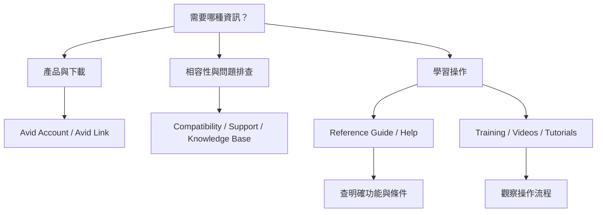

# Ch01 — 歡迎與文件讀法

> 操作 Pro Tools 的第一步，是分清楚帳號、軟體、支援資訊與文件語法，讓遇到問題時找得到正確入口。

原文：[[Pro_Tools_Reference_Guide_2023.3.pdf#page=35|Chapter 1 — Welcome to Pro Tools，原書 p. 3–6／PDF p. 35–38]]。功能名稱保留英文，方便直接對照介面。圖解與實務情境為本筆記補充。

**本篇先解決三件事**：產品與下載要去哪裡找、操作文件怎麼讀、遇到問題如何選對支援入口。實際錄音和剪輯從後續章節展開；需要按鍵時直接開 [[PT-00-Mac快捷鍵]]。

## 1. 先分清楚 Pro Tools 與管理工具

Pro Tools 把 multitrack digital audio 與 MIDI sequencing 放在同一個工作環境，涵蓋錄音、編排、作曲、編輯、混音與 mastering。這裡的重點是：Audio 與 MIDI 都能成為同一份製作工作的材料，但它們的資料性質不同；具體概念要接著讀 Ch02，而不是把 MIDI 當成已經錄好的 Audio。

Avid Master Account 則是你的產品管理入口。原書說明，帳號內包含已購產品的 entitlements、installers 與 profile details，可以透過 Avid Link 或 `my.avid.com` 存取。先把下面三個角色分開，後面遇到授權或下載問題就不會找錯地方。

| 名稱 | 它負責什麼 | 你什麼時候會用到 |
|---|---|---|
| Pro Tools | Audio 與 MIDI 的製作、編輯、混音環境 | 錄一條人聲、剪一段鼓、完成整首混音 |
| Avid Master Account | 已購產品的 entitlements、installers 與 profile details | 查自己買過什麼、找安裝檔、核對帳號 |
| Avid Link | 帳號與產品管理，以及文件當時提供的社群／協作入口 | 查看 Products、管理產品資訊、進入相關服務 |

> [!tip] 實務連結
> 換電腦或重裝系統時，先找回正確的 Avid Account，再核對產品與 installer。若問題是「找不到購買的產品」，先從帳號資料查起；若是「已開啟軟體但錄不到聲音」，則要轉向 Ch06 的 I/O Setup 與 Ch24 的 Record Setup。

## 2. System Requirements 不只是電腦夠不夠快

原書對 compatibility 的立場很明確：Avid 能保證相容性並提供對應支援的，是經過測試與核准的硬體、軟體組合。列出的查核範圍包括 computer、operating system、hard drive 與 third-party device。

一台電腦能打開 Pro Tools，不等於整套錄音環境都已通過測試。真正要核對的是一組條件：**哪個 Pro Tools 版本、搭配哪個 operating system、接哪個裝置**。只比較 CPU 或 RAM，還少了軟體與硬體之間的相容性。

| 查核項目 | 要確認的問題 | 紀錄範例的寫法 |
|---|---|---|
| Pro Tools version | 現在安裝的是哪一版？ | 寫完整版本，不只寫「Pro Tools」 |
| Operating system | 這個系統版本是否在該軟體測試範圍內？ | 記下系統版本號 |
| Audio interface／third-party device | 裝置與相關軟體是否搭得起來？ | 記裝置型號與相關版本 |
| Storage | 媒體所在儲存裝置是否符合對應條件？ | 分清楚系統碟與 Audio 素材位置 |

這張表是根據原書相容性原則整理的紀錄方式，不是 2023.3 的硬體支援清單。

> [!warning] 2023.3 的版本界線
> 這份 Reference Guide 是 2023.3 的操作文件，不能拿來證明 2026 年的 operating system 或硬體已獲支援。需要做升級或安裝決定時，應另查該 Pro Tools 版本的 compatibility 資料。本篇不推定任何現行支援狀態。

> [!tip] 實務連結
> 工程上排查問題時，把 Pro Tools 版本、operating system、audio interface 與相關軟體版本一起記下來。這是根據原書相容性原則延伸的排查習慣，能讓「偶爾沒聲音」之類的描述變成可比較的條件。

## 3. 文件裡的符號怎麼讀

Reference Guide 使用固定語法表示 menu、keyboard command 與 mouse command。讀錯符號，就可能把應該按的快捷鍵當成 menu，或把 modifier-click 當成右鍵。

| 原書記法 | 正確讀法 | 注意點 |
|---|---|---|
| `File > Save` | 打開 File menu，再選 Save | `>` 表示選單層級 |
| `Control+N` | 按住 Control，再按 N | 這裡是按鍵語法範例，不代表 Save 的快捷鍵 |
| `Control-click` | 按住 Control，再按滑鼠按鍵 | 不要直接換成所有情境下的 Right-click |
| `Right-click` | 按滑鼠右鍵 | 原書獨立列為一種操作 |

畫面上出現的 Commands、Options 與 Settings，在原書使用不同字體區分。本套筆記保留這些英文名稱，讓你能直接對照介面、用 Help 搜尋，或把同一個詞輸入 [[PT-00-功能目錄]]。

> [!important] 平台快捷鍵要看該操作本身
> Mac 的 **Control（⌃）** 和 **Command（⌘）** 是兩顆不同的鍵，不能看到原文 Control 就全部換成 Command。查實際功能時，直接看 Mac 欄。[[PT-00-Mac快捷鍵]] 統一列出 Mac 按法，Ch03 則解釋 Keyboard Focus 等前提。

原書的提示圖示也有分工。讀到長篇操作時，先認出它在提醒哪一種事，再決定要不要停下來查。

| 原書提示 | 它在提醒什麼 | 閱讀時怎麼處理 |
|---|---|---|
| User Tips | 好用的使用技巧 | 看是否能改善自己的操作習慣 |
| Important Notices | 可能影響 Session data 或 system performance 的事項 | 操作前先確認，尤其是會改資料或設定時 |
| Shortcuts | 鍵盤／滑鼠捷徑 | 核對平台與生效條件，再練習 |
| Cross References | 其他段落或文件 | 發現缺少前置概念時，沿連結補讀 |

> [!tip] 實務連結
> 若照步驟做卻沒有相同結果，先回頭檢查 Important Notices 與 Cross References。問題可能出在前置設定、版本限制或操作焦點；不是每一次都應從頭重裝。

## 4. 遇到問題，選哪一個入口

想找答案時，不必把所有網站都打開。先把問題說成一句話，再依需求選入口：

| 你的問題 | 優先入口 | 要找的答案 |
|---|---|---|
| 「我買的產品與 installer 在哪？」 | Avid Account／Avid Link | 產品、下載與註冊資料 |
| 「這個版本支援我的系統嗎？」 | Compatibility documents | 已測試的硬體／軟體組合 |
| 「照做還是不行，可能哪裡出問題？」 | Support／Knowledge Base | 已知問題、限制與排查資訊 |
| 「這個功能的選項究竟代表什麼？」 | Reference Guide／Help | 功能定義、操作與適用條件 |
| 「我想先看一次完整操作」 | Training／Videos and Tutorials | 操作流程的畫面與示範 |
| 「有什麼相關軟硬體與開發夥伴？」 | Products and Developers | 產品與開發生態資訊 |

上圖是依原書資源分類重組的查找流程；不是 Pro Tools 內部的訊號路由。

![[PT-Ch01-resource-map.png]]

圖中三層是本筆記的原創整理：帳號與管理、製作軟體、文件與支援。方塊位置不代表執行順序或系統相依性。

> [!tip] 實務連結
> 若你記得英文功能名，直接查 Reference Guide 或 Help；若你連工具大概怎麼操作都不清楚，先看 tutorial 建立畫面感，再回到手冊核對細節。這也是 [[PT-00-快速檢索]] 同時保留中文需求與英文名稱的原因。

## 5. Avid Link 的各個區域在做什麼

依 2023.3 原書，Avid Link 用來管理 Avid Account、product licenses、subscriptions，並提供社群與其他服務。原書描述 desktop version 隨 Pro Tools 安裝，另有 mobile 與 browser 存取方式，也能從 Pro Tools 的 Avid Link menu 進入。這些是當時文件的描述，不代表目前所有服務仍照原樣提供。

| 區域／功能 | 原書用途的繁中整理 |
|---|---|
| Home | 顯示新聞、產品資訊、技巧與工作流程內容 |
| Marketplace | 瀏覽與購買 Plug-In、軟硬體等相關產品 |
| Pro Tools Projects | 登入後在 Artist Chat window 查看線上 Project，並可開啟清單項目 |
| Messages | 與聯絡人或協作者交談 |
| Find Talent | 尋找音樂、影像與媒體領域的合作對象 |
| Lounges | 依主題參與社群討論 |
| Profile | 展示作品、技能與個人資料 |
| Products | 查看已註冊產品，以及適用時的 System ID、Activation ID、Support Expires 與 Support Status；可加 Notes |

> [!tip] 實務連結
> 尋找產品註冊與支援識別資訊時，先看 Products；與他人協作的操作細節，則接到 Ch19 的 Artist Chat and Avid Link，以及 Ch20 的 Track Collaboration。不要把社群聊天、產品管理與實際 Track 協作混成同一件事。

## 6. Pro Tools Analytics：在哪裡決定是否參與

原書說明，Pro Tools 可以把匿名的功能使用資料傳給 Avid，用於後續版本的開發規劃與功能設計；文件也聲明其中不包含 personal information。這裡是在轉述 **2023.3 手冊的說明**，不延伸為對現行資料處理方式的獨立查核。

依原書，可在安裝時同意或不同意，也可稍後到 `Setup > Preferences` 的 Operation preferences 調整。這是參與資料回報的設定，與產品下載入口、實際 Audio 訊號路由是不同層面的事。

> [!tip] 實務連結
> 建立自己的工作機設定紀錄時，可以一併記下 Analytics 選擇。之後要重建偏好設定，再從 Ch08 的 Preferences 系統性確認。

## 做一次完整的查找練習

假設你已經安裝 Pro Tools，卻不知道一個選項為什麼不能用。先記下完整版本與選項的英文名稱，從 [[PT-00-快速檢索]] 找到章節，再到 [[PT-00-功能目錄]] 開原文小節。如果功能還需要特定 software tier、hardware 或操作模式，先補齊前提；若條件看起來都符合，再進 Support／Knowledge Base 查問題。

這個次序的好處，是把「不理解這個功能」和「功能異常」分開處理。後面讀到 I/O、Record Mode、Automation 或 Video，都能沿用同一個查找方法。

> [!tip] 實務連結
> 做成自己的工作習慣：**保留英文名稱、記下版本、檢查前提、再查異常**。這四件事能讓問題描述更精確，也方便向合作工程師說明。

> [!abstract] Takeaway
> Avid Master Account 管理已購產品、installer 與帳號資訊；Avid Link 提供管理與社群入口。讀 Reference Guide 時，先辨認 menu 語法、modifier key 與提示類型；遇到安裝或支援問題，要核對指定版本的 compatibility。2023.3 文件中的服務描述與支援入口，都有其時間背景。

## 相關

%% PT-NAV-BEGIN %%

下一篇：[[PT-Ch02a-Session與訊號流的基本積木]]

按任務閱讀：[[PT-00-工作流程導航]]

%% PT-NAV-END %%

- [[PT-00-功能目錄#Ch02 — Pro Tools Concepts|Ch02 — 核心概念]]：接著建立 Audio、MIDI、Session 與時間基準的觀念。
- [[PT-00-功能目錄#Ch03 — Keyboard and Mouse Shortcuts|Ch03 — 鍵盤與滑鼠操作]]：延伸本章的操作語法，釐清 Keyboard Focus。
- [[PT-00-功能目錄#Ch08 — Preferences|Ch08 — Preferences]]：查 Analytics 與其他偏好設定的操作脈絡。
- [[PT-00-功能目錄#Ch19 — Artist Chat and Avid Link|Ch19 — Artist Chat and Avid Link]]：延伸 Avid Link 的協作入口。
- [[PT-00-索引]] · [[PT-00-快速檢索]] · [[PT-00-Mac快捷鍵]] · [[PT-00-工作流程導航]]

標籤： #pro-tools #audio #workflow
