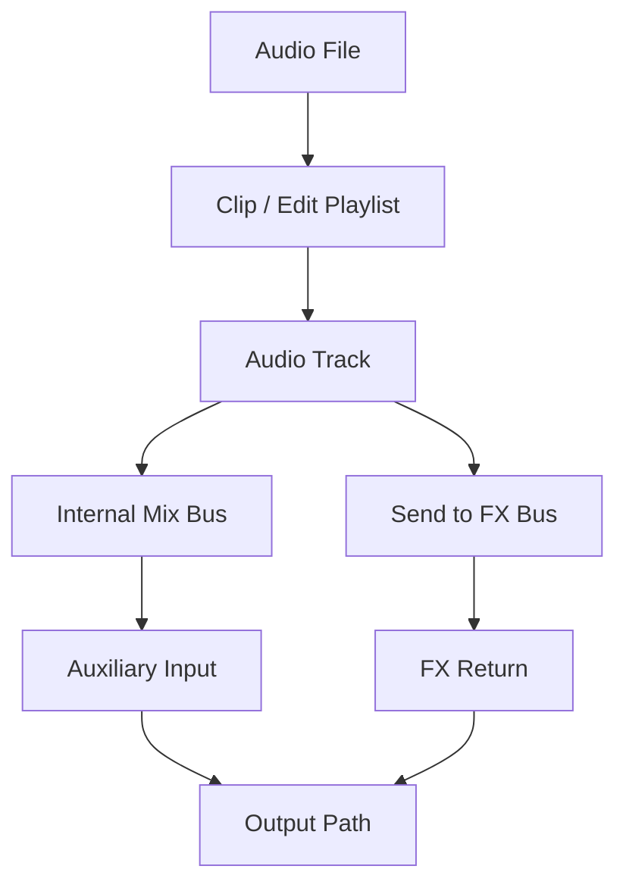

# Ch02a — Session、Track、Clip：先看懂聲音住在哪裡

> Session 記錄製作的安排，Audio File 保存聲音，而 Track、Clip 與 Bus 決定聲音在何時、沿哪條路出現。

原文：[[Pro_Tools_Reference_Guide_2023.3.pdf#page=39]]，原書 p. 7–15（PDF p. 39–47）。功能與適用條件以 **2023.3** 為準；情境例子與圖解為本筆記重新組織的教學補充。

## Nonlinear Editing：改播放安排，不必重錄一次

在磁帶上要聽後段，必須先快轉；要重複一個段落，可能需要重新錄製或剪接磁帶。Hard Disk Recording 可以直接讀取任意位置，因此 Pro Tools 能在 Timeline 上 Cut、Copy、Move、Trim，讓同一份資料按不同順序播放。一般 Clip 編輯具有 nondestructive 特性：你改的是使用哪段資料、何時播放，不是把原始 Audio File 剪壞。

這個觀念能解釋兩個常見現象。第一，把同一個 Clip 複製到副歌其他位置，不需要為每次出現另存整份聲音。第二，刪掉 Timeline 上的一段安排，不等於已從硬碟刪除來源檔。真正的檔案刪除與 AudioSuite 產生新媒體，要另看對應命令，不能把所有操作都假設成無損。

> [!tip] 實務連結
> 整理人聲 Take 時，可以先保留原始 Audio File，在不同 Playlist 組出版本。即使改變剪輯安排，仍能回到其他 Take；但工程要能開啟，必須保留被引用的媒體。

## 一份工程不是只有 .ptx

Session File 的副檔名是 `.ptx`。它保存編輯、混音與素材對應等資訊；Audio、Video 媒體獨立存在，錄入的 MIDI data 則保存在 Session 中。因此，不能把 `.ptx` 想成「所有聲音都包在裡面」的單一成品檔。

| 物件 | 它負責什麼 | 不要誤認成 |
|---|---|---|
| Session File | 記錄整個製作安排、編輯與混音設定 | 已包含所有 Audio 的壓縮包 |
| Audio File | 保存實際錄製或匯入的 Audio samples | Timeline 上某一次 Clip 出現的位置 |
| Clip | 一段 Audio、MIDI 或 Video 的使用單位 | 必須是一份獨立的新檔案 |
| Track | 承載資料、Automation 與路由控制 | 永遠只等於一個 Audio channel |
| Edit Playlist | 一條 Track 上 Clip 的排列版本 | 另一套獨立的所有混音設定 |
| Automation Playlist | Volume、Pan、Mute 等參數隨時間的變化 | 錄製好的 Audio waveform |

一條 Track 可以有多個 Alternate Edit Playlist，例如同一段 Solo 的不同剪輯版；但 Audio、Auxiliary Input、Instrument、Master Fader、VCA Track 的 Automation 不是隨每個 Alternate Edit Playlist 複製一套獨立混音。切換 Take 排列時，要知道哪些資料跟著 Playlist 變、哪些仍屬於 Track。

> [!warning] 搬工程最常見的錯誤
> 只寄 `.ptx`，對方可能看到 Track 和 Clip 位置，卻找不到 Audio。Ch11 的 Save Copy In 才是整理媒體與工程副本的重要入口。

## Audio、MIDI 與 Channel 不要混在一起

Audio 是取樣資料；MIDI 是 musical event 與控制訊息，例如 note number、Note On/Off、velocity、controller 或 SysEx。MIDI 本身不等於聲音，必須送到能發聲的 instrument。單一 MIDI port 提供 16 個 channel；這是訊息分流，與 stereo Audio 的兩個 channel 不同。

| 同樣叫 Channel 的情境 | 實際意義 | 操作上的差異 |
|---|---|---|
| Physical Input／Output channel | audio interface 的實體聲道 | 需要對應線材與硬體接孔 |
| Mix Window channel strip | 一條 Track 的混音控制列 | 可能是 mono、stereo 或 multichannel |
| MIDI channel | 一個 MIDI port 中的訊息通道 | 可分配不同音色或接收對象 |

Audio Track 的 Fader 改變 Audio level；MIDI Track 的 Fader 送出 MIDI Volume（CC7），還要看音源是否支援。Instrument Track 把 MIDI 與 Audio 控制集中在同一條 Track，使用方便，但仍有兩種資料流，不能只確認一邊就認定整條路通了。

> [!tip] 實務連結
> 按鍵盤時有 MIDI activity 卻沒聲音，代表事件可能進來了，但 instrument、Audio Output 或監聽路徑仍可能沒接好。先分開檢查「訊息是否到達」與「聲音是否送出」。

## Audio Engine 是軟體與硬體之間的工作層

原書介紹 Avid Audio Engine、Mac 的 Core Audio、Windows 的 ASIO，以及僅供播放的 WASAPI。它們使 Pro Tools 能與 audio hardware 交換資料。Avid Video Engine 則處理 Video playback，不要因為名字都帶 Engine 就認為功能相同。

> [!note] 原書內部數字有版本更新痕跡
> 本章 p.8 仍出現 Core Audio／ASIO 32 channels 的敘述，與 Ch05 p.40–49 的 2023.3 版本／系統表不一致。這裡只學 Engine 分工；要核對 I/O 上限，請以 [[PT-Ch05a-版本與處理架構]] 所整理的具體版本表與該頁來源為入口，不能沿用這個舊數字。

## Bus 與 Path：讓資料流動的接線規則

Path 是具名稱與 channel format 的路由單位；Bus 是內部匯流。Audio Track Output 可以先送到 Internal Mix Bus，再由 Auxiliary Input 或 Routing Folder 收進來做 Submix。Send 則額外複製一路 Audio 給其他目的地，適合共享 Reverb 或 Cue。

| Track 類型 | 最適合用來做什麼 | 是否承載主要 Audio |
|---|---|---|
| Audio | 錄入／播放 Audio File | 是 |
| Auxiliary Input | Effects return、Submix、監聽外部輸入 | 是，但本身不錄成磁碟 Audio |
| Routing Folder | 收納 Track 並處理經其 Input 的 Audio | 是 |
| Master Fader | 控制指定 Bus／Output path 的總 level | 控制既有路徑 |
| VCA Master | 控制所指定 Mix Group 的成員設定 | 不通過 Audio |
| MIDI | 錄與送出 MIDI event | 否 |
| Instrument | MIDI 加 instrument 的 Audio 處理 | 是 |

> [!abstract] Takeaway
> 先問「這是媒體、安排，還是接線？」：Audio File 是媒體，Clip／Playlist 是安排，Track 與 Bus／Path 組成處理和路由。分清楚這三層，備份、剪輯與沒聲音的問題就有可追的方向。

![[PT-Ch02-concept.png]]

圖解讀法：此圖是原創概念示意，位置、比例與箭頭僅表達本章關係；不代表軟體畫面或實測效能。

## 相關

%% PT-NAV-BEGIN %%

上一篇：[[PT-Ch01-歡迎與文件讀法]]

下一篇：[[PT-Ch02b-時間基準資源與交換格式]]

按任務閱讀：[[PT-00-工作流程導航]]

%% PT-NAV-END %%

[[PT-Ch02b-時間基準資源與交換格式]] · [[PT-Ch06a-I-O與Path地圖]] · [[PT-Ch11b-儲存備份與工程交接]]

[[PT-00-索引]] · [[PT-00-功能目錄]] · [[PT-00-快速檢索]] · [[PT-00-Mac快捷鍵]]

標籤： #pro-tools #audio #study-note
