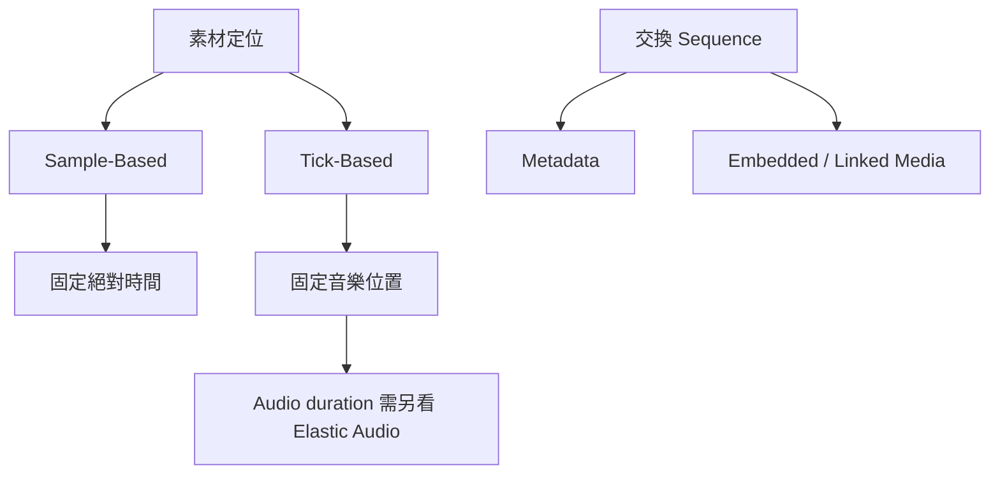

# Ch02b — 時間跟著秒還是跟著拍？再看資源與交換格式

> Timebase 決定素材跟哪一種時間移動，System Resources 決定它能否即時播放，而交換格式決定另一套系統能重建多少安排。

原文：[[Pro_Tools_Reference_Guide_2023.3.pdf#page=47]]，原書 p. 15–23（PDF p. 47–55）。功能與適用條件以 **2023.3** 為準；情境例子與圖解為本筆記重新組織的教學補充。

## Sample-Based 與 Tick-Based：固定的座標不同

把素材放在某一個位置，必須先回答「位置用什麼單位定義」。Sample-Based Track 把位置固定在 sample Timeline；改 Tempo 後，素材仍在原來的絕對時間，但對應的 Bar／Beat 可能改變。Tick-Based Track 則保留音樂位置；Tempo 改變時，同一個小節位置對應的實際秒數也改變。

| Track／資料狀態 | Tempo 改變時位置如何反應 | 長度會怎樣 |
|---|---|---|
| Sample-Based Audio | 保持 sample 位置 | 不因 Tempo 自動變長短 |
| Tick-Based Audio，未啟用 Elastic Audio | 保持 Bar／Beat 的起點或 sync point | Clip Audio duration 不自動伸縮 |
| Tick-Based Audio，啟用 Elastic Audio | 跟著音樂時間定位 | 可以由 Elastic Audio 伸縮以配合 Tempo |
| 預設 Tick-Based MIDI | 維持音樂位置 | Note 的實際時間長度隨 Tempo 改變 |
| 改為 Sample-Based 的 MIDI | Event 固定在 sample 時間 | 不跟 Tempo map 重新排絕對位置 |

最容易誤解的是第二列：**Tick-Based 不等於已經 time-stretch**。它先決定 Clip 的定位基準；要讓 Audio duration 跟著 Tempo 改，還需要 Elastic Audio。反過來，對白或音效常需要固定畫面上的絕對時間，不能只因「這是音樂軟體」就全部改成 Tick-Based。

> [!tip] 實務連結
> 做歌曲編排，想把段落綁在小節上，可從 Tick-Based 與 Elastic Audio 的組合思考；做對白剪輯，要先維持與畫面的對位。Ch39 管 Tempo 等時間標尺，Ch45 才深入處理 Warp 與伸縮。

## Elastic Audio：先分析事件，再決定如何 Warp

Elastic Audio 先分析整個 Audio File 中的 transient events，例如鼓擊、演唱音節或吉他和弦，再利用事件位置進行 Time Compression／Expansion。它能做 real-time 或 rendered 處理，包含 Tempo conform、beat matching、手動 Warp 等；不是單純把 Clip 的右邊拉長就一定得到正確節奏。

工程上，分析點與目標節奏是兩個階段。分析若抓到錯的 Attack，再精準的量化也可能把錯的位置對齊。這也是 Ch02 只建立模型、之後仍需讀 Ch45 的原因。

> [!warning] 不要只看 Grid 對齊
> Waveform 看起來落在 Grid 上，不代表聽感沒有被破壞。伸縮處理的目標是時間重排，音色與 transient 仍應用耳朵確認。

## Track 數量、Voice 與 CPU 是不同的限制

Voice 可理解為被系統實際運送的獨立 Audio stream。原書以 mono Audio Track 使用一個 voice、stereo 使用兩個、5.1 使用六個說明；Punch Recording 及 HDX 中 DSP／Native 交接等情況可能需要更多。因此，「我只有一條 Track」不代表只用一個 voice，也不代表 CPU 很輕。

| 資源 | 用來處理什麼 | 接近極限時的思考方向 |
|---|---|---|
| Host CPU | Native Plug-In、Mixer、部分 Audio 處理 | 降低即時處理量、調整 Playback Engine |
| HDX DSP | 支援的 DSP 處理／Mixer 配置 | 檢查 DSP 分配與是否可改用 Native |
| Voice | Audio stream 與跨處理邊界的路徑 | 減少同時發聲或不必要的 voice 使用 |
| Disk／RAM | 媒體讀寫與快取 | 檢查磁碟活動、Disk Cache 與記憶體 |

## Inactive 與 Mute 的目的不同

Inactive 讓 Track、Plug-In、Send、I/O 或 Path 退出運作，釋出相關資源，同時保留設定。原書描述其名稱常以斜體、深灰背景或整條灰化顯示。Mute 主要是聲音／事件的靜音控制；若目標是確實釋放某項處理資源，應查看 Inactive，而不是假設按 Mute 一定等同卸載 Plug-In。

| 操作 | 你想達成的結果 | 需要注意 |
|---|---|---|
| Mute | 暫時不讓這條路被聽見 | 不等於所有處理資源都釋放 |
| Plug-In Inactive | 讓該 Plug-In 退出處理 | Audio 效果不再運作，但 assignment 保留 |
| Track Inactive | 暫時退出整條 Track 的處理 | Voice、Inserts、Sends 與 I/O 一起停用 |
| Path Inactive | 停用指定路由 | 可能同時影響多條使用該 Path 的 Track |

> [!tip] 實務連結
> 保留一組舊人聲版本但暫時不用，可以先 Make Inactive 並 Hide；它仍是製作備案，卻不必占用全部即時資源。相關操作見 Ch13，效能表則見 Ch07。

## Session 與 Project：可管理的檔案，和可同步的工作單位

Session 是本機儲存的工程；Project 是 2023.3 手冊中的 Cloud-enabled 工作單位，資料與媒體包在本地 project cache，Online Project 另與 Avid Cloud 帳號同步。Project 要透過 Dashboard 開啟，不能像 Session 那樣在 Finder 隨意找單獨媒體檔操作。

第一次建立 Project 需要 online 並登入；之後可 offline 工作，再連線同步。Offline Project 只有本地 cache，不能與其他人協作，也不能視為已在 Cloud 備份。這些是該版文件的工作方式，現行服務狀態必須另行確認。

## AAF、OMF、MXF：別把「安排」當成「媒體」

AAF、OMF 的核心用途是交換 sequence 與相關 metadata，讓另一套軟體重建 Clip 的位置、來源與部分控制資料。Metadata 可以記錄 scene、take、sample rate、timecode 等。原書提醒，未 rendered 的 Media Composer AudioSuite effects 在匯入時會略過；不能預期所有應用程式的即時處理都原封移植。

| 格式 | 可以表示什麼 | 對交接最重要的限制 |
|---|---|---|
| AAF | Sequence，可 linked 或 embedded media | 沒有「AAF Audio File」這種單獨媒體格式概念 |
| MXF | Audio／Video media file | 不是 sequence；可由 AAF 引用，OMF 不能引用 MXF |
| OMF | Sequence 也可作 media format | Pro Tools 可用 OMF Audio，不支援 OMF Video 的相同匯入／播放能力 |
| Embedded media | Metadata 與相關媒體放同一大檔 | 比較好攜帶，但檔較大、匯出匯入較慢 |
| Linked media | 一個 sequence 檔加多份獨立媒體 | 少複製可能更快，但交付時不能漏掉檔案 |

Workspace Browser 則負責資料庫式的搜尋、預聽、排序與匯入。資料庫存的是可搜尋的 metadata 與關聯，不表示每份 Audio 已複製到 Session。

> [!abstract] Takeaway
> Tempo 改變前先確認 Timebase；效能不足時區分 CPU、DSP、Voice、Disk／RAM；跨軟體交接時分清 sequence、metadata 與 media。位置、處理與檔案是三個維度，不能只靠一個「工程檔」概念包辦。

![[PT-Ch02-concept.png]]

圖解讀法：此圖是原創概念示意，位置、比例與箭頭僅表達本章關係；不代表軟體畫面或實測效能。

## 相關

%% PT-NAV-BEGIN %%

上一篇：[[PT-Ch02a-Session與訊號流的基本積木]]

下一篇：[[PT-Ch03-KeyboardFocus與操作模式]]

按任務閱讀：[[PT-00-工作流程導航]]

%% PT-NAV-END %%

[[PT-Ch02a-Session與訊號流的基本積木]] · [[PT-Ch07a-PlaybackEngine與低延遲]] · [[PT-Ch11a-建立Session與媒體格式]]

[[PT-00-索引]] · [[PT-00-功能目錄]] · [[PT-00-快速檢索]] · [[PT-00-Mac快捷鍵]]

標籤： #pro-tools #audio #study-note
