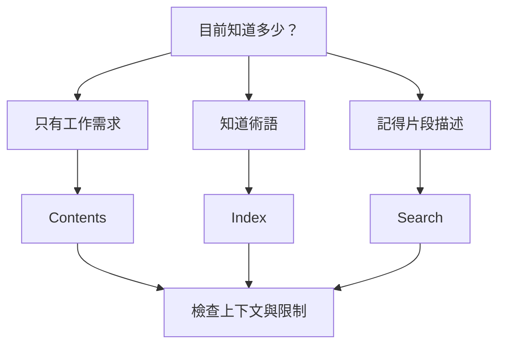

# Ch04 — 用 Help 查功能，不必從頭翻完整本手冊

> Contents 看結構、Index 找術語、Search 找線索；先選對查找工具，才容易找到操作的前提與限制。

原文：[[Pro_Tools_Reference_Guide_2023.3.pdf#page=63]]，原書 p. 31–34（PDF p. 63–66）。功能與適用條件以 **2023.3** 為準；情境例子與圖解為本筆記重新組織的教學補充。

## 三種文件入口，各自回答不同問題

`Help` menu 可以開啟已安裝 PDF，也能進入 HTML-based Help，以及需要網路的 Knowledge Base、Avid Audio Forums 與 Support Center。2023.3 文件描述 Help 在 Pro Tools 的 in-application browser 內開啟；若軟體沒運行，可以從外部 browser 開啟 Help launch page。

| 文件／入口 | 最適合回答的問題 | 容易漏掉的事 |
|---|---|---|
| Pro Tools Reference Guide | 功能怎麼運作、設定的適用條件 | 需要核對版本，不能推定現行介面 |
| Pro Tools Shortcuts | 預設按鍵、Right-click、custom shortcut | 焦點與 Numeric Keypad mode 同樣重要 |
| Audio Plug-Ins Guide | 內附及另售 Plug-In 的控制項 | 宿主手冊不會完整解釋每個 Plug-In |
| Knowledge Base／Support | 已知問題與支援文件 | 是線上資源，內容與服務會更新 |
| Training／Tutorial | 先建立操作流程與畫面感 | 回手冊核對條件與例外 |

在 Pro Tools 內選 `Help > Pro Tools Help`。要從軟體外部找指定版本，可從原書列出的 [Pro Tools Help launch page](https://apps.avid.com/ProToolsHelp/) 進入。這裡保留歷史文件入口，不保證所有舊服務始終可用。

> [!tip] 實務連結
> 想知道某個 EQ 的 Q 旋鈕是怎麼定義，先查 Audio Plug-Ins Guide；想知道它如何放進 Track、怎麼啟用 Automation，才回 Reference Guide。

## Contents、Index、Search 要怎麼選

Help 通常左側是 navigation，右側是 topic。Contents 以階層展開主題；目前 topic 對應的章節會被標示，可用 Show in Contents 看自己在整份文件的哪個位置。上方 hierarchy links 則能回到上層概念。不要只讀命中的一句話就關掉，因為限制條件可能寫在同章前一個 topic。

| 你目前知道什麼 | 建議先用 | 查到後接著做 |
|---|---|---|
| 只知道要處理錄音／剪輯／混音 | Contents | 從章群找功能，再讀周邊小節 |
| 已知道精確功能名稱 | Index | 從字母排序條目跳入 topic |
| 只記得部分描述 | Search | 先找關鍵詞，再確認結果的章節位置 |
| 想接著看操作下一步 | Previous／Next Topic | 依 Contents 順序往前後讀 |

## Search 不是整句自然語言問答

選 Search tab 後，可以指定 All Available Books 或某一本書，再輸入字詞並按 Go。結果會依系統認定的相關程度排序；命中的詞預設反白。它依有效詞資料庫搜尋，不是每個輸入字都會保留，也不保證自動涵蓋所有字形變化。例如原書提醒，找 `capture` 不一定同時找到 `captures` 或 `capturing`。

原書在 p.33 說一般多詞搜尋不要求字詞順序，p.34 另說可以用引號查 literal phrase。實際使用時，可先用未加引號的功能關鍵詞擴大範圍，再用引號嘗試縮小；若該版本 Help 表現與描述不同，就回到 Index 或 PDF 內搜尋。

| 查找技巧 | 為什麼有用 | 範例 |
|---|---|---|
| 先用英文功能名 | 符合介面與索引詞 | `Clip Gain`、`Auto Backup` |
| 先選目標文件 | 減少跨書的無關結果 | 只找 Pro Tools Shortcuts |
| 改用相關字形再試 | 舊 Help 不一定自動處理詞形 | `capture` → `capturing` |
| 不依賴大小寫 | 原書說搜尋不區分大小寫 | `MIDI` 與 `midi` |
| 查完整格式名 | 特定格式的標點可能有意義 | `.WAV` |

> [!tip] 實務連結
> 知道「這個功能叫什麼」比記住它在哪一頁更耐用。本套 [[PT-00-快速檢索]] 用中文需求帶到英文名稱，就是為了讓你離開筆記後仍能查 Help。

## Copy 與 Print：先選對 Topic pane

要複製 Help 文字，先點 topic 讓它成為 active，再選字、`Edit > Copy`，到其他應用程式 Paste。要列印，先點想印的 topic pane，再用 Print button、Right-click > Print 或 browser 的 File > Print。原書也提醒，HTML Help 的 page layout 有限；需要較好的印刷版式，優先用 PDF 的對應頁。

> [!abstract] Takeaway
> 不熟功能時先用 Contents 建地圖，知道名稱時用 Index，只有線索時用 Search。查到後要讀 topic 的上下文與版本條件；PDF 適合精確頁碼與列印，本套 Obsidian 則適合中文需求與跨章連結。

![[PT-Ch04-concept.png]]

圖解讀法：此圖是原創概念示意，位置、比例與箭頭僅表達本章關係；不代表軟體畫面或實測效能。

## 相關

%% PT-NAV-BEGIN %%

上一篇：[[PT-Ch03-KeyboardFocus與操作模式]]

下一篇：[[PT-Ch05a-版本與處理架構]]

按任務閱讀：[[PT-00-工作流程導航]]

%% PT-NAV-END %%

[[PT-Ch01-歡迎與文件讀法]] · [[PT-Ch03-KeyboardFocus與操作模式]]

[[PT-00-索引]] · [[PT-00-功能目錄]] · [[PT-00-快速檢索]] · [[PT-00-Mac快捷鍵]]

標籤： #pro-tools #audio #study-note
