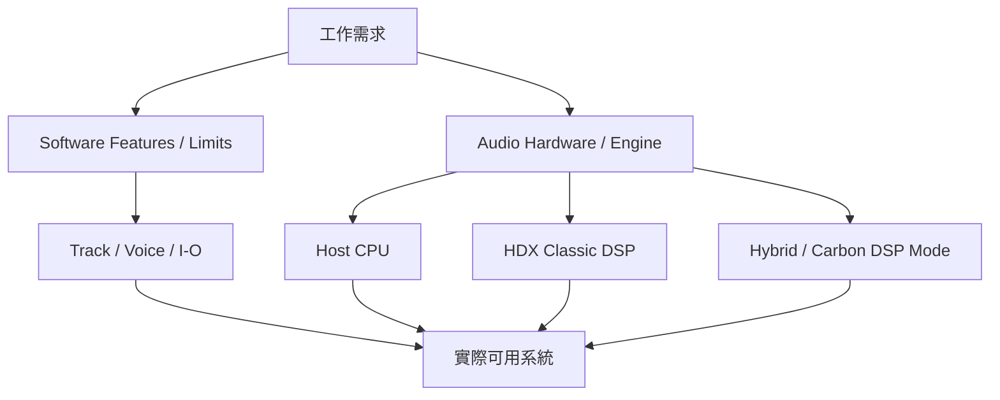

# Ch05a — 選版本與硬體，先分清 I/O、Track、Voice 與 DSP

> 軟體版本限制可用功能與容量，硬體與 Audio Engine 決定訊號如何進出、由誰即時處理；這是兩張不同的規格表。

原文：[[Pro_Tools_Reference_Guide_2023.3.pdf#page=69]]，原書 p. 37–49（PDF p. 69–81）。功能與適用條件以 **2023.3** 為準；情境例子與圖解為本筆記重新組織的教學補充。

## 規格上的「多」到底指哪一種多

錄音介面有很多 Input，不代表目前的 Pro Tools 版本都能使用；Session 容納很多 Track，也不代表可同時播放所有 channel。Ch02 已介紹 Voice 是獨立 Audio stream：stereo Audio Track 通常用兩個，5.1 用六個。比較規格前，要把 I/O、Track、Voice 和 processing capacity 分開。

| 名稱 | 你正在衡量什麼 | 常見誤判 |
|---|---|---|
| I/O channels | 與硬體交換多少 channel | 把 Audio Track 上限當錄音孔數 |
| Audio Track | 能在 Session 內使用多少條 Audio Track | 認為所有 Track 都是 mono |
| Voice | 同時搬運、播放或錄製的 Audio streams | 認為 5.1 Track 只用一個 voice |
| CPU／DSP capacity | 能做多少即時處理 | CPU 數字低就推論必定不會中斷 |
| Feature availability | 能否使用某類功能 | 只有硬體，卻沒有相應軟體版本 |

> [!important] 下表是 2023.3 歷史規格
> 這裡整理的是你提供的 Reference Guide，不是現行版本選購表。不要拿它直接判定現在訂閱包含哪些功能。

## Intro、Artist、Studio、Ultimate 的容量怎麼讀

下表依 p.38–41 與 p.48–49 的具體表整理；最大值仍受 system configuration 與硬體限制。Intro／Artist／Studio 的 Audio Track 數，原書以 mono／stereo Track 的總條數列出；Ultimate 另以 voiceable tracks／voices 描述，不能直接當成同寬度的比較。

| 2023.3 項目 | Intro | Artist | Studio | Ultimate（Host／Hybrid） |
|---|---:|---:|---:|---:|
| 文件列示 I/O 上限 | 4 | 16 | 64 | 256（依 p.49；仍受硬體配置限制） |
| Audio Track 上限 | 8 | 32 | 512 | 2,048 voiceable tracks／2,048 voices |
| Auxiliary Input＋Routing Folder | 4 | 32 | 128 | 1,024 |
| Master Fader | 1 | 1 | 64 | 512 |
| MIDI Track | 8 | 64 | 1,024 | 1,024 |
| Instrument Track | 8 | 32 | 512 | 512 |
| VCA Master | 本段未列出 | 本段未列出 | 128 | 128 |
| Video Track | 本段未列出 | 本段未列出 | 1 | 64 |

各版都在其能力範圍內支援 nondestructive editing 與 Mix Automation；原書也列出最高 192 kHz，以及 16-bit、24-bit、32-bit floating point。高 Sample Rate 是否能用，要看 hardware；Plug-In 的實際可用數量仍看運算，不是看到每 Track 10 Inserts 就保證能把所有槽放滿。

Studio／Ultimate 的定位還包括 advanced Automation、Surround（含 Dolby Atmos、Ambisonics）、AAF／OMF、HEAT、Clip Effects、multi-stem Bounce 等工作流程。HDX／HD Native 搭配 Ultimate 的配置，還有 Field Recorder、TrackPunch、DestructivePunch 等細節，需看對應章與硬體條件。

> [!warning] 原書幾處容量敘述彼此不一致
> Ch02 p.8 的 32-channel 描述、Ch05 p.42 的 Ultimate non-HD 64-channel 描述，與 p.49 的 Core Audio／ASIO 256-channel 表不同。本筆記保留衝突並以明確標示頁碼的詳細表作查核入口；不把整本書所有舊數字混成一張「絕對正確的現行表」。

> [!tip] 實務連結
> 要做多軌鼓錄音，先算同時需要的實體 Input；要混大型交響配樂，再算 Track、Voice 與 CPU。若只是需要 Audio to MIDI 或特定 Automation 功能，容量大不大可能不是第一個篩選條件。

## Native、HDX Classic、HDX Hybrid：處理工作分配不同

Native／host-based 系統主要依靠電腦 CPU；HDX Classic 用 HDX DSP 處理 Mixer 與支援的 Plug-In；HDX Hybrid 則讓 Mixer／大容量播放主要利用 Host，保留 HDX DSP 給低延遲 DSP Mode。Carbon 也提供支援 DSP Mode 的工作流程，但不能因此把所有 HDX Classic 規則搬到 Carbon。

| 架構 | 主要工作分配 | 強項 | 先核對的限制 |
|---|---|---|---|
| Host-based | 電腦 CPU 處理 Native Plug-In 與 Mixer | 不需 HDX card，可用支援的 Core Audio interface | H/W Buffer、CPU、driver 與版本上限 |
| HDX Classic | HDX DSP 處理 Mixer／DSP Plug-In | 專用 DSP 工作流程 | Voice 隨 card 數與 Sample Rate 改變 |
| HDX Hybrid | Host 處理加 track-based DSP Mode | 高 Voice 容量與低延遲錄音並用 | Hybrid I/O、DSP Plug-In 相容與路由 |
| Carbon | Core Audio AVB 加內建 smart DSP | 低延遲 tracking／input monitoring | 特定硬體、Mac 與支援模式 |
| HD Native | HD hardware I/O 加 Host processing | HD I/O 與 FPGA Low Latency Monitoring | 不等於有 HDX Plug-In DSP |

## HDX 的 Voice 與 I/O 不要看錯列

| 配置 | 44.1／48 kHz voices | 88.2／96 kHz voices | 176.4／192 kHz voices | 硬體 I/O |
|---|---:|---:|---:|---|
| HDX Classic，1 card | 256 | 128 | 64 | 64 channels |
| HDX Classic，2 cards | 512 | 256 | 128 | 128 channels |
| HDX Classic，3 cards | 768 | 384 | 192 | 192 channels |
| HDX Hybrid | 2,048 | 2,048 | 2,048 | 每 card 64 channels |
| HD Native | 2,048 | 2,048 | 2,048 | 64 channels |

Hybrid 的 2,048 voices 是 Host 能力架構中的最大值，仍要看 Session 負載；HD Native 同樣沒有憑空變成 2,048 個實體 Input。不同 Sample Rate 下 DSP 的工作量與可用容量，也要從對應的列讀。

> [!abstract] Takeaway
> 先看工作需要哪個 feature，再看 I/O、Track、Voice，最後評估 CPU／DSP 與監聽方式。軟體版本和硬體處理架構互相配合，但它們不是同一個等級階梯。

![[PT-Ch05-concept.png]]

圖解讀法：依原書 p.46–48 的 HDX Classic Voice 規格自繪。各組數字是文件上限，不是效能測試；Hybrid／HD Native 的不同架構另見正文表格。

## 相關

%% PT-NAV-BEGIN %%

上一篇：[[PT-Ch04-用Help找準確答案]]

下一篇：[[PT-Ch05b-錄音介面與HD硬體導覽]]

按任務閱讀：[[PT-00-工作流程導航]]

%% PT-NAV-END %%

[[PT-Ch05b-錄音介面與HD硬體導覽]] · [[PT-Ch07a-PlaybackEngine與低延遲]]

[[PT-00-索引]] · [[PT-00-功能目錄]] · [[PT-00-快速檢索]] · [[PT-00-Mac快捷鍵]]

標籤： #pro-tools #audio #study-note
