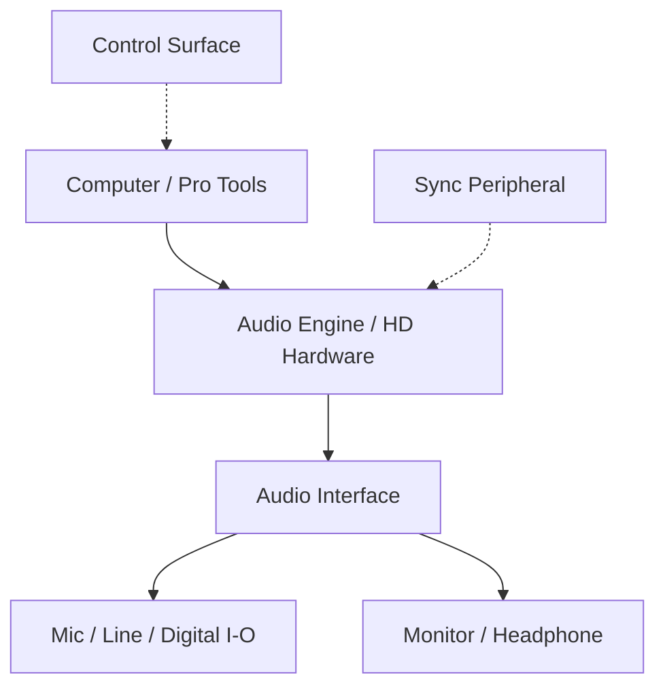

# Ch05b — 介面上的孔、Pro Tools 的 I/O，與監聽系統怎麼對起來

> 同一台介面可能有多種接孔、格式與監聽功能，但同時可用的 Pro Tools I/O 還受連線、Sample Rate 與系統模式限制。

原文：[[Pro_Tools_Reference_Guide_2023.3.pdf#page=74]]，原書 p. 42–54（PDF p. 74–86）。功能與適用條件以 **2023.3** 為準；情境例子與圖解為本筆記重新組織的教學補充。

## MBOX Studio 與 Carbon：功能完整，但處理方式不同

MBOX Studio 的軟硬體組合包含 MBOX Control、Pro Tools Studio 與 Sibelius Artist。原書列出 44.1／48 kHz 時最高 21 Inputs、22 Outputs，176.4／192 kHz 時為 10×10 simultaneous I/O，提醒你通道數會隨 Sample Rate 改變。它把 mic／line／instrument、headphone、monitor switching、Bluetooth、digital I/O、FX Loop、tuner 等整合在一起。

Carbon 的核心特色則是 Core Audio AVB 與內建 HDX DSP 的低延遲錄音流程。它提供 8 個 analog preamp inputs、line I/O、獨立監聽／headphone、ADAT 與 talkback，不能只用「同樣有 8 個前級」概括兩台設備的差別。

| 項目 | MBOX Studio（本章） | Carbon（本章） |
|---|---|---|
| 主要控制／連接 | MBOX Control、USB Type-C connector | AVB Ethernet／Core Audio AVB |
| 監聽思路 | 介面內部 direct monitoring | smart DSP tracking／input monitoring |
| Mic／Instrument | 4 個 combo input；Variable Z、HPF、Pad 等 | 8 analog preamp input；指定輸入具 Variable Z |
| 外部效果接線 | 2 個 FX Loop，含 level／impedance matching | 依音訊路徑與 I/O 配置 |
| 監聽與通訊 | Main／Alt、headphone、Bluetooth 等 | 多 headphone、monitor、talkback |

> [!tip] 實務連結
> 對錄音者來說，低延遲要問「正在聽到的處理跑在哪裡」。介面 direct monitoring、DSP Plug-In、Host Native monitoring 是不同路徑；看見 Low Latency 一詞，不代表可以隨意掛任意 Native Plug-In 且零等待。

## Carbon Pre 擴充：增加 I/O，不是憑空增加另一套 Carbon DSP

Carbon Expanded system 最多加入兩台 Carbon Pre，每台增加 8 channels Audio I/O，錄音處理可利用主 Carbon 的 DSP。Carbon Pre 也可當 standalone mic preamp、ADAT AD／DA converter 或 AVB interface，模式不同，接孔的可用性也不同。

| 模式／Sample Rate | 原書的重要條件 |
|---|---|
| Carbon Pre 加入 Expanded system | Carbon Pre 自己的 ADAT I/O 不在 Pro Tools 中可用；主 Carbon 的 ADAT 仍可用 |
| Carbon／Carbon Pre 的 ADAT，44.1／48 kHz | 16 channels |
| ADAT，88.2／96 kHz | 8 channels |
| ADAT，176.4／192 kHz | 4 channels |
| Carbon Pre standalone | 依 ADAT、AD→DA 或 AVB 模式完成指定工作 |

這也是為什麼「設備背面還有 ADAT 孔」不等於目前運作模式就能把它全部算進錄音輸入。

## HDX／HD Native 與 HD interface 是兩個層次

HDX card 或 HD Native hardware 負責與 HD 系統連接／處理；真正接 Audio 的可能是 HD I/O、HD OMNI、HD MADI、MTRX 或 MTRX Studio。系統必須有至少一台支援的 HD interface，不能只有 card 就開始錄音。HDX 的每 card I/O 與 Classic／Hybrid Voice 規格，回到 [[PT-Ch05a-版本與處理架構]]。

| HD interface | 主要定位 | 原書特別值得記住的條件 |
|---|---|---|
| HD OMNI | 前級、I/O 與監聽整合 | 最高 8 discrete Pro Tools I/O；多種 analog 接孔不等於同時更多 analog input |
| HD I/O | 可配置 analog／digital 的多聲道轉換 | 最高 16 discrete I/O，可用 expansion cards 調整組合 |
| HD MADI | 與 MADI 設備交換多聲道 digital Audio | 64 channels；沒有 analog A/D、D/A |
| MTRX | 模組化轉換、路由與網路 Audio | DADman 控制；實際 analog 功能取決於 installed cards |
| MTRX Studio | 固定較整合的 analog／Dante／ADAT／monitor | DADman、cross-point routing 與 monitor processing |

HD OMNI 的 Mic／DI 與 Line 可能共用實際通道，配置數量應看 simultaneous I/O 而非插孔總數。HD I/O 的三種標準組合包括 8×8×8、16×16 analog、16×16 digital；擴充後仍受介面的總通道架構限制。

HD MADI 提供 Optical／Coax MADI、SRC、Word Clock／Loop Sync 等工具，適合與大型 digital system 交換訊號。MTRX 的主機可有 AES3、MADI、Dante 與選購 cards，其內部設備能力不能直接當成 Pro Tools 經 DigiLink 的同時 I/O 能力。這兩者要分開查。

> [!warning] 原書的硬體段落有疑似複用文字
> MTRX p.53 出現與 HD I/O 類似的「三種標準配置」描述，且同頁介面能力與 synchronization Sample Rate 範圍不同。本筆記不把這段直接當成購買規格；需要選購或接線時，回對應設備的 Installation／Operation Guide 核對。

## 大系統還需要哪些附加元件

| 類別 | 本章例子 | 作用 |
|---|---|---|
| Synchronization peripheral | Sync X／SYNC HD | 配合支援 HD 系統的同步工作 |
| Remote mic preamp | Avid PRE | 可從 Pro Tools 控制相應前級設定 |
| Control surface | S1、Dock、Avid Control、Artist Series 等 | 以硬體／遠端介面操作軟體 |
| MachineControl | Sony 9-pin compatible devices | Serial machine communication，Ultimate 條件見 Ch61 |
| VENUE Link | Ethernet 連接 VENUE system | Live recording 與 Virtual Soundcheck 工作流程 |

> [!tip] 實務連結
> 進錄音室接手工程時，先畫一張「電腦／Engine → 介面 → 監聽」地圖，再標出 clock 與控制器。聲音線、clock 線、控制線功能不同；知道它們分工後，才有辦法判斷問題是在 Audio path 還是 control connection。

> [!abstract] Takeaway
> 不用背完每一個接孔，先掌握設備的角色、同時可用的通道與當前模式。任何通道數都要帶著 Sample Rate、連線與系統架構一起讀；低延遲監聽、Audio conversion 與 control surface 也要分開理解。

![[PT-Ch05-concept.png]]

圖解讀法：依原書 p.46–48 的 HDX Classic Voice 規格自繪。各組數字是文件上限，不是效能測試；Hybrid／HD Native 的不同架構另見正文表格。

## 相關

%% PT-NAV-BEGIN %%

上一篇：[[PT-Ch05a-版本與處理架構]]

下一篇：[[PT-Ch06a-I-O與Path地圖]]

按任務閱讀：[[PT-00-工作流程導航]]

%% PT-NAV-END %%

[[PT-Ch05a-版本與處理架構]] · [[PT-Ch09a-周邊設備與控制協定]] · [[PT-Ch07b-HardwareClock與效能診斷]]

[[PT-00-索引]] · [[PT-00-功能目錄]] · [[PT-00-快速檢索]] · [[PT-00-Mac快捷鍵]]

標籤： #pro-tools #audio #study-note
