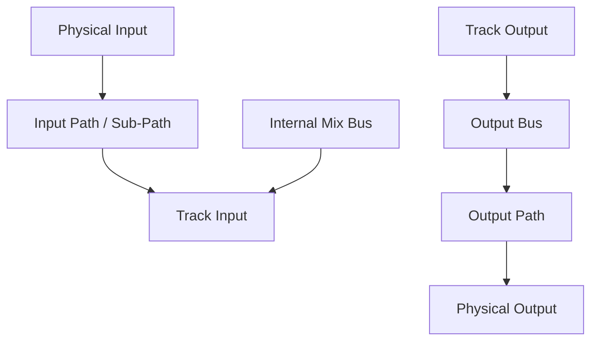

# Ch06a — I/O Setup 是一張可命名的接線表

> Track selector 裡的名字只是路徑入口，真正能否錄到、送出聲音，要一路追到 I/O Setup 的 Bus、Output Path 與實體通道。

原文：[[Pro_Tools_Reference_Guide_2023.3.pdf#page=87]]，原書 p. 55–81（PDF p. 87–113）。功能與適用條件以 **2023.3** 為準；情境例子與圖解為本筆記重新組織的教學補充。

## 先用兩條路看懂整個架構

輸入路徑是 Physical Input → Input Path／Sub-Path → Track Input。輸出路徑則多一層：Track Output → Output Bus → Output Path → Physical Output。這個中介 Bus 讓 Session 可以保留原本的 Track assignment，而在另一台設備上重新映射到當地 Output。

I/O Setup 從 `Setup > I/O` 開啟。它的 Channel Grid 是 cross-point matrix，讓邏輯 Path 對應硬體通道；不是只能把第一個 Input 永遠叫 Input 1。你可以依棚內用途命名，例如 Vocal Mic、Cue、Main，而不必在錄音時反覆猜接孔編號。

| 層次 | 你在設定什麼 | 例子（教學命名） |
|---|---|---|
| Physical Input／Output | 介面真實接孔／可用 port | Analog 1、Analog 1–2 |
| Input／Output Path | 一組具名稱與 format 的通道 | Vocal Mic、Monitor L/R |
| Bus | Session 內部路由／對 Output 的映射 | Drum Sub、Main Mix |
| Track assignment | 某條 Track 使用哪一條 Path | Vocal Track Input 選 Vocal Mic |

> [!tip] 實務連結
> Track 有 signal meter 但主喇叭沒聲音，別只看 Track Output 顯示 Main。還要在 Bus 頁查 Main 的 Mapping To Output，再到 Output 頁確認 Channel Grid 指向正在接喇叭的硬體輸出。

## 六個主要頁籤，分清哪個管哪一段

| I/O Setup 頁面 | 工作 | 儲存／硬體關係 |
|---|---|---|
| Input | 命名與映射 Physical Input | 系統與 Session 保存 |
| Output | 命名與映射 Physical Output | 系統與 Session 保存 |
| Bus | Internal Mix Bus、Output Bus 與 Mapping To Output | Session 保存，用來跨系統 remap |
| Insert | Hardware Insert 的成對 Input／Output | 配合實際外部設備接線 |
| Mic Preamps | 支援前級與介面路徑對應 | 如 Avid PRE／MTRX 的設定 |
| H/W Insert Delay | 外部 Hardware Insert 的 offset delay | 單位 milliseconds，供 Delay Compensation 使用 |

原書建議，先把系統層的 Input、Output、Insert、Mic Preamps、H/W Insert Delay 設好，再處理 Bus。只換 Session 而沒有換硬體時，不應每次都把整個硬體接線重新設計一次。

## Main Path 與 Sub-Path：同一組通道的不同入口

Main Path 是一組具 format 的通道，例如 Stereo 的 L、R。Sub-Path 是 Main Path 內的子集合，例如 Stereo 的左邊單獨做 mono Input，或在 Surround Bus 中另外取用 LR、Center。Main Path 被重新映射時，Sub-Path 跟著移動，維持關係。

| Main format | 原書預設 Sub-Path 的核心概念 | 何時實用 |
|---|---|---|
| Mono | 不需要再拆預設 Sub-Path | 單支 mic、單一 line |
| Stereo | 兩個 mono：`.L`、`.R` | 只錄 Stereo interface pair 的其中一邊 |
| LCR／Quad／5.x 等 | LR Stereo 加各 channel 的 mono 子路徑 | 分別處理對白、Surround 或監聽 |
| 7.0.2／7.1.2 | 多種較小格式、Overhead LR 與各 mono channel | Dolby Atmos Bed 等多聲道工作 |

Output Sub-Path 的重點是**同一個 physical output 的其他 format／明確 downmix 需求**。一般工作使用 Output Bus Sub-Path 通常就足夠，不需要為了看起來完整而重複增加所有 Physical Output Sub-Path。

## 建立 Path 的實際順序

1. `Setup > I/O`，選 Input、Output、Insert 或 Bus。
2. 點 New Path，設定數量、channel width 與名稱；需要不同類型就 Add Row。
3. 決定是否使用 Add Default Channel Assignments，以及適用頁面的 Auto-Create Sub-Paths。
4. 點 Create；在 Input／Output／Insert 頁的 Channel Grid 確認硬體指派。
5. 若要單獨建立子路徑，先選 Main Path，再 New Sub-Path，最後在 Grid 對應 Main Path channels。
6. 檢查名稱與映射，按 OK。Cancel 會放棄這次變更。

建立 Output Path 時，Pro Tools 會自動建立同寬度 Output Bus 並 map 過去。這很方便，但也表示新增的 Bus 不是你「另外接了第二份聲音」；它是 Output 的邏輯入口。

> [!warning] 自動指派不是永遠不重疊
> Add Default Channel Assignments 從可用通道依序指派；若新建數量超過可用硬體 channels，會繞回第一個通道。大量新增後一定要看 Grid，不能以為每一列都對應不同接孔。

## Grid 的有效映射：完整包含可以，部分重疊不行

每條有效 Path 都需要名稱、format 與有效的 I/O assignment。Output Path 可以完全獨立，或完全包含在較大的 Path 內；兩條 Output Path 只重疊部分通道，會形成 invalid configuration，Pro Tools 不讓你直接套用。

| 操作 | 結果／風險 |
|---|---|
| 點 Stereo Path 的第一格 | 左 channel 放在該格，其餘依序往右填 |
| 拖動 Grid 內的單一 channel | 重新配置通道順序，其他 assignment 可能 shuffle |
| 改 Path format | 現有 channel assignment 會清除，需重查 |
| 移動 Main Path | Sub-Path 跟著移動 |
| Delete Path | 使用它的 Track／Send assignment 會重設成 No Output |
| Make Path Inactive | 停用整條 Path，所有使用者受影響 |

改名稱可 double-click Path Name；也能在 Track 的 Input／Output selector 上 Right-click > Rename。拖動 Path Name 可調整 selector 中的 menu 順序。Default 會依當前系統重建預設，並不是「只把畫面整理一下」；先 Export Settings 再大改。

> [!abstract] Takeaway
> I/O Setup 最重要的是四層輸出模型，以及 Path／Sub-Path 的關係。先理解接線，再命名；建立後看 Grid，不要只相信 selector 的文字。

![[PT-Ch06-concept.png]]

圖解讀法：此圖是原創概念示意，位置、比例與箭頭僅表達本章關係；不代表軟體畫面或實測效能。

## 相關

%% PT-NAV-BEGIN %%

上一篇：[[PT-Ch05b-錄音介面與HD硬體導覽]]

下一篇：[[PT-Ch06b-Bus監聽與特殊路徑]]

按任務閱讀：[[PT-00-工作流程導航]]

%% PT-NAV-END %%

[[PT-Ch06b-Bus監聽與特殊路徑]] · [[PT-Ch06c-跨系統映射與AuxIO]] · [[PT-Ch13c-路由Solo與Track狀態]]

[[PT-00-索引]] · [[PT-00-功能目錄]] · [[PT-00-快速檢索]] · [[PT-00-Mac快捷鍵]]

標籤： #pro-tools #audio #study-note
