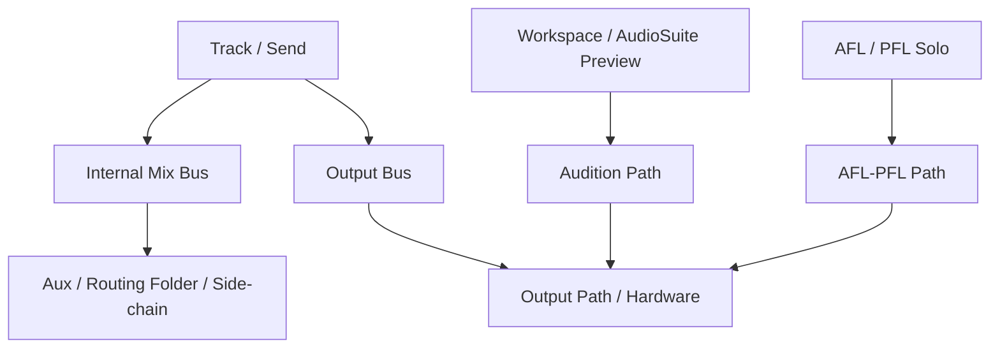

# Ch06b — Main Mix、Audition、Solo：你聽到的不一定走同一條路

> Pro Tools 可以同時有主混音、素材預聽、AFL／PFL 與其他監聽路徑；某一種聲音有輸出，不能證明其他路徑也接好了。

原文：[[Pro_Tools_Reference_Guide_2023.3.pdf#page=95]]，原書 p. 63–87（PDF p. 95–119）。功能與適用條件以 **2023.3** 為準；情境例子與圖解為本筆記重新組織的教學補充。

## Internal Mix Bus 與 Output Bus 的差別

Internal Mix Bus 把 Audio 送到其他 Track Input 或 Plug-In side-chain；常見用途是 Effects Send／Return、Submix、bus recording。Output Bus 則透過 Mapping To Output 連到 Output Path，最後到硬體。兩者都出現在 Bus 頁，關鍵差異是有沒有／如何對外映射。

| 需求 | 用哪種路由 | 檢查點 |
|---|---|---|
| 多軌鼓集中一條做處理 | Internal Mix Bus → Auxiliary Input／Routing Folder | 來源 Output 與接收 Track Input 名稱是否同一條 Bus |
| Reverb 共用 Return | Send → Internal Mix Bus → FX Track | Send level、Return Input 與 Return Output |
| 主混音到喇叭 | Output Bus → Output Path → Physical Output | Mapping To Output 與 Grid |
| Audio 給 side-chain | Internal Mix Bus → side-chain input | Plug-In 是否已選並啟用相應來源 |
| Dolby Atmos Object | Object Bus → Renderer Object Input | 另有 Renderer mapping，不等於普通 Output Bus |

建立並映射 Output Bus：Bus 頁 New Path → 選 format 與名稱 → Create → 啟用 Mapping To Output → 選目的 Output Path。適當 format 可直接映射；不同 channel width 還涉及 upmix／downmix，應檢查 Routing Coefficients，而不是把 format conversion 當成單純改名稱。

> [!tip] 實務連結
> 接手另一間棚的 Session，Track Output 仍維持叫 Main Mix，卻把 Main Mix 的 Mapping To Output 改到當地 Monitor Path，通常比逐條改 Track Output 更易維護。

## 五種常被混為一談的監聽設定

| 設定 | 哪一類聲音使用它 | 位置／注意 |
|---|---|---|
| Monitor Path | Session 的主要監聽標記與跨系統對應 | Output 頁；speaker icon 表示這個角色 |
| Audition Path | Clips List、Workspace、AudioSuite preview | Output 頁；不是所有 Track playback 的總路由 |
| Output Meter Path | Transport／相關設備 Output meter 看哪條 Bus／Output | Output 或 Bus 頁；表頭有值不等於喇叭接對 |
| Default Output Bus | 新建 Track 的預設 Output assignment | Bus 頁；可依 format 設定 |
| AFL/PFL Path | AFL／PFL Solo 的獨立監聽 | Output 頁；選 None 會讓 AFL／PFL 無法使用 |

Audition、Monitor、AFL/PFL 可遇到 format 不同時的自動 downmix／upmix。這種便利有助於剪輯與檢查，但不能據此認為 Stereo 已完整呈現 Surround 空間關係。原書不建議把 downmixed／upmixed monitoring 作為正式混音的判斷基礎。

> [!warning] 預聽沒聲音，先別重建整個 Session
> 如果 Timeline 播放正常，但 Workspace preview 沒聲音，先檢查 Audition Path。若只在 AFL／PFL Solo 時出問題，查 AFL/PFL Path。問題範圍由哪一種操作觸發，就先沿那一條路追。

## 外部 Hardware Insert 與錄音延遲補償是不同設定

Insert 頁把對應的 Physical Output／Input 作為外部設備的一趟來回；H/W Insert Delay 用 milliseconds 設定外部裝置的 offset，供 Delay Compensation Engine 在使用 Hardware Insert 時對齊。它不是你隨意縮小就能「降低音效卡 latency」的 Buffer 控制。

HDX／HD Native 另有 Compensation for Input Delays After Record Pass，以及 Compensation for Output Delays After Record Pass。它們補償介面 conversion 等引入的延遲，作用與「即時耳機監聽是否舒服」不同。原書建議錄音情境啟用 Input compensation；從 digital source 錄音時，Input 與 Output compensation 都要啟用。

| 問題 | 先看什麼 | 不該用來取代它的設定 |
|---|---|---|
| Native input monitoring 太晚 | Playback Engine 的 H/W Buffer Size | H/W Insert Delay |
| 外部 Compressor 回送對位 | Hardware Insert／H/W Insert Delay＋Delay Compensation | 只改 Track Name |
| 支援 HD 系統錄後位置補償 | After Record Pass compensation | 把它當現場監聽 latency 開關 |
| 素材 preview 路徑錯 | Audition Path | Record Pass compensation |

## HD Native Low Latency Monitoring 與 Atmos Fold Down

本章的 Output 頁 Low Latency Monitoring 設定特別指 HD Native，可選實際使用的 Output Path，預設是 1–2。其他 Engine 的 LLM／DSP Mode 要看各自章節，不能把這個頁面上的條件擴張成所有機型都相同。

Dolby Atmos 的 Bed/Object Fold Down Path 是另一個特殊入口。當 Renderer 無法通訊時，Pro Tools 可以把 Bed／Object 轉成指定 format 供監聽；是否只在斷線時啟用，或 Always Active，要在 Peripherals 的 Dolby Atmos 頁決定。它使用不可見的 internal bus，原書提醒不能以一般 Master Fader 或 Edit Window Output Meter Path 直接量測這條隱藏路徑。

> [!tip] 實務連結
> 遠端剪輯 Atmos Session 時，用 Fold Down 聽內容能幫助確認剪接，但仍需在正確 Renderer／監聽配置做空間混音判斷。能聽到並不是所有路徑與 metadata 已完整驗證。

## 重設、排序與批次映射要有範圍概念

Bus 頁可以依 Name、Format 或 Mapping To Output 排序；Default 旁可以選 All Busses、Output Busses、Internal Busses。原書預設建立 24 個 Internal Busses，但你可按需求增加。Reset 會改成預設 Bus 名稱，可能破壞你用語意命名的可讀性。

| Mac modifier（Bus mapping 情境） | 典型用途 |
|---|---|
| Option-click Mapping To Output | 把同 format 的 Output Busses 對到同一目的 |
| Option+Shift-click | 對選取的同 format Busses 套用 |
| Command+Option-click | 依序 cascading 到後續 Output Paths |
| 指定多個 Output | 見該版本 selector 的多重指派操作；完成後確認所有目的 |

原書 p.83／p.85 對部分多重指派 modifier 的敘述不完全一致，這裡不把矛盾抄成兩個同名快捷鍵；需要該操作時應以實際 selector、[[PT-00-Mac快捷鍵]] 的核對記錄與原頁確認。

> [!abstract] Takeaway
> 主混音、預聽、Solo 和表頭可能各走不同 Path。先確定問題屬於哪一條路，再決定改 Bus mapping、監聽指定或補償設定；不要用一個 Default 按鈕解決所有未知問題。

![[PT-Ch06-concept.png]]

圖解讀法：此圖是原創概念示意，位置、比例與箭頭僅表達本章關係；不代表軟體畫面或實測效能。

## 相關

%% PT-NAV-BEGIN %%

上一篇：[[PT-Ch06a-I-O與Path地圖]]

下一篇：[[PT-Ch06c-跨系統映射與AuxIO]]

按任務閱讀：[[PT-00-工作流程導航]]

%% PT-NAV-END %%

[[PT-Ch06a-I-O與Path地圖]] · [[PT-Ch06c-跨系統映射與AuxIO]] · [[PT-Ch09b-SatelliteVENUE與DolbyAtmos連線]]

[[PT-00-索引]] · [[PT-00-功能目錄]] · [[PT-00-快速檢索]] · [[PT-00-Mac快捷鍵]]

標籤： #pro-tools #audio #study-note
