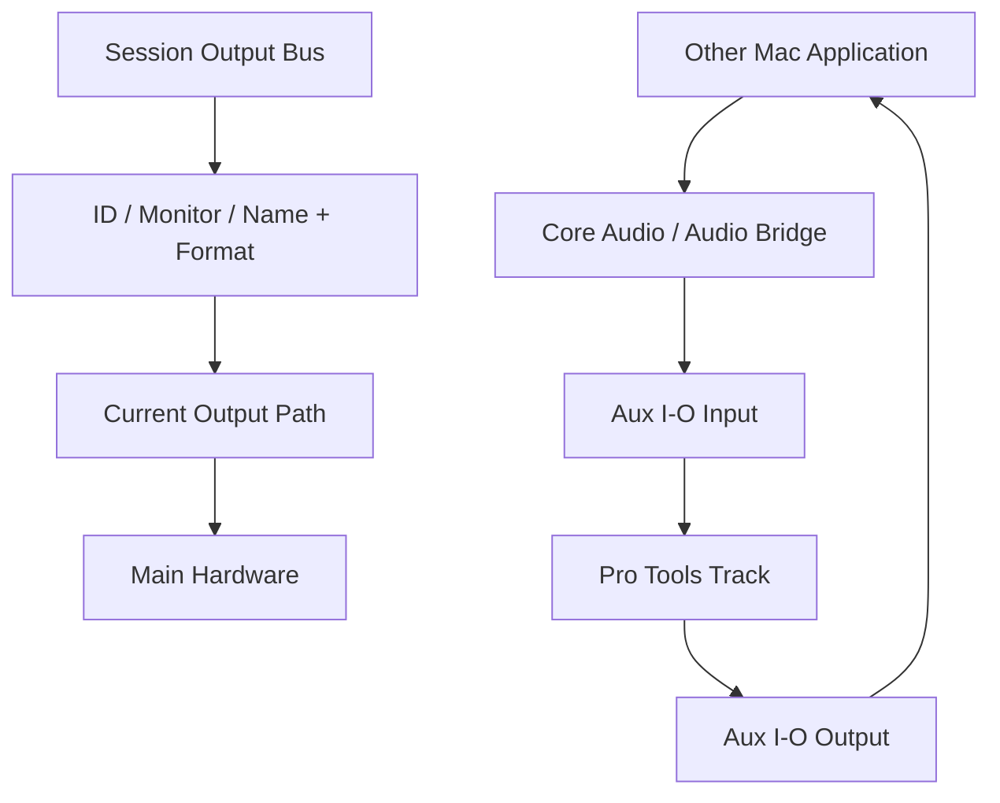

# Ch06c — 搬到另一台電腦，讓 Session 的路由接回當地硬體

> Session 保存「我要往哪裡送」，系統保存「這裡實際接在哪裡」；I/O mapping 連接兩者，Aux I/O 再把訊號延伸到其他 Mac 應用程式。

原文：[[Pro_Tools_Reference_Guide_2023.3.pdf#page=119]]，原書 p. 87–93（PDF p. 119–125）。功能與適用條件以 **2023.3** 為準；情境例子與圖解為本筆記重新組織的教學補充。

## .pio 與 Session 裡的設定如何共存

I/O Settings File 的副檔名是 `.pio`。它讓你保存一套環境或工作用途的 Path configuration，在 Dashboard 建立 Session 時選用，也能從 I/O Setup import／export。Last Used 則在按 OK 關閉 I/O Setup 時自動更新，代表最後使用狀態，不等於你特別命名的穩定備份。

| 命令 | 讀／寫哪裡 | 範圍 |
|---|---|---|
| Import Settings | 從 `.pio` 或 `.ptx` 讀取 | 預設只導入目前頁籤 |
| Apply to all tabs | 導入時擴大範圍 | 所有 I/O 頁籤 |
| Export Settings | 把當前配置寫成 `.pio` | 輸出所有頁籤 |
| Restore from Session | 用 Session 保存的設定覆蓋系統 | 預設只目前頁籤，可擴大至全部 |
| Last Used | 關閉 I/O Setup 時更新的配置 | 用作後續新 Session／匯入選項 |

要讓自訂 `.pio` 出現在 Dashboard 的 I/O Settings menu，應放在 Root Settings Folder 的 IO Settings 子資料夾；Root Settings Folder 可由 Operation Preferences 調整。這不是 Audio Files 的儲存位置，兩者不要混淆。

> [!tip] 實務連結
> 為錄音、混音、外部 Hardware Insert 各存一份有意義名稱的 `.pio`。做大幅變更前 Export 一次，能避免把 Last Used 當成回不去的唯一狀態。

## Import 時的 Yes／No 在處理什麼

選 Import Settings、找到來源後，系統可能問是否刪除現有 Path。原書的 Yes 是移除 unused paths 再加入新 Path；No 是保留目前配置並加入。它不表示自動刪掉所有正在使用的設定，也不表示 import 後一定沒有重疊。若新舊 Path overlap，新 Path 可能以 Inactive 出現，需要人工整理。

1. 先選只想修的頁籤，例如 Output。
2. Import Settings，選 `.pio` 或 `.ptx`。
3. 只有確實要整套覆蓋，才啟用 Apply to all tabs；Mac 也能 Option-click Import Settings。
4. 看 Path name、format、Grid 與 Active status。
5. 最後按 OK，再用實際播放檢查 Monitor／Audition 等用途。

> [!warning] 成功 import 只代表設定讀進來
> 另一間棚的 Analog 1–2 不一定是你這裡的喇叭。必須查 Physical Output mapping，不應只確認「有相同名稱」。

## 開啟不同系統 Session 時，Pro Tools 先嘗試 remap

原書依序描述：能用 unique ID 時先用 ID；Session Monitor Path 一定對到目前系統 Monitor Path；其他 Output Bus 若名稱與 format 精確符合，就可依名稱／format 對應。沒有匹配時，你可以手動 map，下一次開啟會記住該系統的映射。

| 畫面線索 | 表示什麼 | 建議下一步 |
|---|---|---|
| Bus mapping 顯示綠色 | 路徑名稱／format 改變後已成功 remap | 比對 Previous Output Mappings，再試聽 |
| Previous Output Mappings | 上次儲存的 Output 對應 | 看是否仍符合本次製作需求 |
| Path 斜體 | 該硬體／Path 目前不可用或 inactive | 確認 hardware 與指定 |
| Session Notes 列 unmatched busses | 尚有對應問題 | 從提示的 I/O Setup button 進去修 |
| Show Last Saved Setup | 查看 Session 上次保存的 Input／Output 配置 | 這是比對，不是當前可套用的編輯畫面 |

Show Last Saved Setup 亮起時，不能用 OK 直接存成目前配置；要切回 current setup 或明確 Restore from Session。儲存 Session 後，綠色 remap 轉回正常顏色，last-saved 的比較狀態也會更新。

同一台電腦切換 Playback Engine，Pro Tools 也把不同 Engine 視為不同系統：各自保存 I/O settings、Monitor、Audition 等設定。這能減少從錄音介面改用 Built-in Audio 時逐條重接的負擔，但第一次切換仍要核對。

## Mac 的 Aux I/O：把另一個應用程式接進來

2023.3 的 Aux I/O 適用 macOS Big Sur 或更新版本；不支援 Pro Tools Intro，也不支援 HDX Classic。主 Playback Engine 可以仍是你的主要錄音系統，再從 I/O Setup 加其他 Core Audio device 作額外 Input／Output，例如與其他 DAW、sound library、會議軟體交換 Audio。

| 角色 | 應該怎麼想 | 不能假設 |
|---|---|---|
| Main Playback Engine | 核心錄音／監聽硬體 | 任意 Aux device 都有相同確定延遲 |
| Aux I/O device | 額外跨應用程式路由 | 可當作需要精準 timing 的主錄音路徑 |
| Pro Tools Audio Bridge | 原書建議的跨應用程式 Core Audio 橋接 | 一個 device 同時雙向使用而不檢查限制 |

設定步驟：`Setup > I/O` → Input 或 Output 頁點 Aux I/O → 對所需 Core Audio devices 選 In／Out → 如有需要改 Display Name → OK → 再確認 Track Input／Output 或 Send 指向哪個 device。與另一個應用程式配對的 Audio Bridge 詳見 Ch10。

原書建議跨應用程式與硬體使用相同 Sample Rate，並優先用 Pro Tools Audio Bridge。Aux I/O 的 latency 較大而且 non-deterministic，可能在不同 playback／record passes 改變，不適合作為 timing-critical Audio 任務的可靠基準。

> [!tip] 實務連結
> 可以把 Pro Tools 混音送去 Zoom 給合作對象聽，或從 Ableton Live 送入素材；精準錄音與監聽仍保留在主 Engine。先把「分享試聽」與「確定 sample 對位的錄音」分開設計。

> [!warning] Ignore Errors 是取捨，不是修復
> Playback Engine 可以對 Aux I/O 啟用 Ignore Errors，維持連續播放，但原書明示可能產生 pops／clicks。正式交付前仍要排查原因與檢查 Audio。

> [!abstract] Takeaway
> `.pio` 是可重用的接線配置；Session 的 Bus 與系統 Output 需要 remap。Aux I/O 擴充了 Mac 的訊號交換，但應把它定位成 utility routing，不能忽略其延遲與 timing 限制。

![[PT-Ch06-concept.png]]

圖解讀法：此圖是原創概念示意，位置、比例與箭頭僅表達本章關係；不代表軟體畫面或實測效能。

## 相關

%% PT-NAV-BEGIN %%

上一篇：[[PT-Ch06b-Bus監聽與特殊路徑]]

下一篇：[[PT-Ch07a-PlaybackEngine與低延遲]]

按任務閱讀：[[PT-00-工作流程導航]]

%% PT-NAV-END %%

[[PT-Ch06a-I-O與Path地圖]] · [[PT-Ch06b-Bus監聽與特殊路徑]] · [[PT-Ch10-MIDIStudio與AudioBridge]]

[[PT-00-索引]] · [[PT-00-功能目錄]] · [[PT-00-快速檢索]] · [[PT-00-Mac快捷鍵]]

標籤： #pro-tools #audio #study-note
