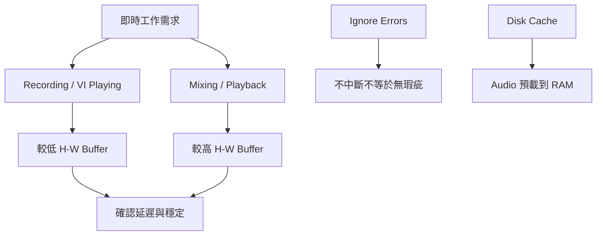

# Ch07a — Playback Engine：在穩定播放與低延遲演奏之間取捨

> H/W Buffer Size 控制 Host 即時處理的緩衝量；錄音想要反應快，混音想要處理空間，而 Engine 決定這個取捨如何落實。

原文：[[Pro_Tools_Reference_Guide_2023.3.pdf#page=127]]，原書 p. 95–103（PDF p. 127–135）。功能與適用條件以 **2023.3** 為準；情境例子與圖解為本筆記重新組織的教學補充。

## 開機順序是讓設備先準備好

原書先從系統啟停談起：降低 Output devices 的音量；有 expansion chassis 就先啟動 chassis，再開 control surface、MIDI／sync peripherals、需要供電的 audio interface，最後開電腦與 Pro Tools。HDX／HD Native 介面啟動後至少等 15 秒初始化。關機則先退出 Pro Tools，降低或關掉輸出設備，再關電腦與各類周邊。

這不是要求每個小型系統都照抄大型棚的設備清單，而是提醒：軟體啟動時，需要硬體與 driver 能被辨識；輸出音量先降低，也能避免啟停瞬間的突發聲音。DigiTest 是檢查 HDX／HD Native card、順序與連線的專用診斷工具，不是一般 Core Audio interface 的通用掃描器。

> [!tip] 實務連結
> 如果只有某次啟動看不到介面，先檢查供電、連線與初始化，確認它已被系統看見，再到 Playback Engine。不要一開始就改動整份 Session 的 I/O。

## 設定 Playback Engine 的四步

1. `Setup > Playback Engine`。
2. 在 Playback Engine selector 選目前要使用的硬體／Core Audio device。
3. 調整這個 Engine 可提供的 H/W Buffer Size、相關 optimization 與 Disk Playback 選項。
4. 按 OK；換 Engine 時 Session 可能關閉後重新開啟。

| Engine／模式 | 你實際在選什麼 | 原書限制／動作 |
|---|---|---|
| 第三方 Core Audio interface | Mac 支援 driver 的 Audio device | I/O settings 可能需重查 |
| Built-in Output | 只用內建輸出做播放／編輯 | 不代表同時已配置內建錄音輸入 |
| Pro Tools Aggregate I/O | 內建 Input＋Output 的組合 | 在 Audio MIDI Setup 配置 |
| Carbon | Core Audio AVB 設定的 Carbon | DSP Mode 需符合硬體條件 |
| HDX Classic／Hybrid | 決定 DSP／Host 分工 | 更動 Engine／Hybrid 可能要求重啟 Pro Tools |
| HD Native | 使用 HD Native 系統 | 不等於 HDX DSP Plug-In 系統 |

Ch05 的 Classic 與 Hybrid 分工，在這裡變成真正的 Engine 設定。HDX Classic 的 Number of Voices 與 Hybrid 的 Hybrid I/O Channels 也是不同項目：前者配置可用 Voices，後者決定 DSP Mode 錄音／Input monitoring 可用的 Hybrid channels。原書建議 Hybrid I/O 只配置實際需要的最低數量。

## Buffer 是一段準備時間，不是音質等級

H/W Buffer Size 是 Host-based 處理所用的緩衝大小。設小時，Native input monitoring 與 Virtual Instrument 的反應通常較快；設大時，CPU 有更多時間完成當批處理，適合高負載混音。但較小不保證對任何 Session 都穩定，較大也不代表每個 Plug-In 本身的 latency 都消失。

| 工作情境 | 原書提供的方向 | 要聽／看什麼 |
|---|---|---|
| 即時彈 Virtual Instrument | 較低 Buffer | 手感、MIDI-to-Audio latency、錯誤 |
| Native 錄音監聽 | 較低 Buffer | 錄音者聽見自己的延遲 |
| 大量 Native Plug-In 混音 | 較高 Buffer | 中斷是否減少、即時處理是否穩定 |
| HDX 中經 Native Plug-In 的路徑 | 仍需考量 Host Buffer | 不要認為有 DSP card 就完全不受影響 |
| DSP Mode tracking | 依支援的 DSP signal path | Native-only Plug-In 與路由條件另查 Ch52 |

> [!note] 直覺用的補充公式
> 一個包含 $N$ samples 的 Buffer，其時間長度為 $T=N/f_s$ 秒。這是時間單位換算，用來理解緩衝量；**不是總 round-trip latency 的完整公式**。總延遲還有 Input／Output buffering、driver、converter 與 Plug-In 等因素。原書本段沒有提供固定「最佳 Buffer」，所以不替你的機器杜撰一個必然正確的數字。

> [!tip] 實務連結
> 拿同一份 Session，先固定 Sample Rate 與 Plug-In，逐級試較低 Buffer，看它在需要的錄音負載下能否穩定。混音階段再提高，不必把錄音設定當成終身固定值。

## Ignore Errors：允許不中斷，也可能讓瑕疵留下

Ignore Errors During Playback／Record 抑制 AAE error report 造成的中斷。原書承認，作曲時為保持思路，或許可以接受短暫 clicks／pops；正式 final mix 要停用以確保品質。負載太大仍可能嚴重失真，不是打開這項就表示 CPU 問題已修好。

macOS 可分別對 Main Playback Engine 與 Aux I/O 選擇。Minimize Additional I/O Latency 則處理某些忽略錯誤情境增加的 buffering，原書描述最少可能需要 128 samples；這是特定選項的額外緩衝，不是介面總延遲保證值。

| Optimization | 原書作用 | 不適用／取捨 |
|---|---|---|
| Dynamic Plug-In Processing | 需要處理 Audio 時才分配對應 Host cycles | 行為與即時 Session 內容相關 |
| Optimize Performance at Low Buffer Sizes | Mac 上減少 thread-wakeup jitter；影響最低兩檔 Buffer | 某些 Plug-In 可能造成短暫 hang，需關閉或增 Buffer |
| Limit Number of Real-Time Threads | 減少即時 thread 競爭 | **Intel Mac only**，不能當 Apple Silicon 通用設定 |
| Intel Turbo Boost | 整台 Intel Mac 的效能／風扇噪音取捨 | **支援 Turbo Boost 的 Intel Mac only** |
| Video Engine | 啟用對應 Video playback／edit | 不做 Video 時不需為了「完整」硬開 |

## Disk Cache：RAM 用在 Audio 預載

Cache Size 決定為 Audio playback／recording 預先分配的快取，Normal 是原書建議大多 Session 的起點。固定 Cache Size 可把 Timeline 中靠近 Playhead 的 Audio 優先放進 RAM；它和 H/W Buffer 的用途不同。

原書的最大可配置估算為 installed RAM 減 4 GB，但不能把「介面允許選的最大值」理解成「應該全部分配」。Virtual Instrument、Video Engine、作業系統與其他程式也要用記憶體。用 System Usage 的 Disk Cache 與 Memory meter 觀察，再決定是否調整。

> [!abstract] Takeaway
> 錄音與混音需要的 Buffer 不同；Engine、DSP Mode、Ignore Errors 與 Disk Cache 也各處理不同問題。先保留可比較的測試條件，再一次改一項，才知道改善從哪裡來。

![[PT-Ch07-concept.png]]

圖解讀法：用 $T=N/f_s$ 計算單一 Buffer 的時間長度，屬教學算例；橫軸不是本機保證可選的 Buffer 清單，也不是總 round-trip latency 實測。

## 相關

%% PT-NAV-BEGIN %%

上一篇：[[PT-Ch06c-跨系統映射與AuxIO]]

下一篇：[[PT-Ch07b-HardwareClock與效能診斷]]

按任務閱讀：[[PT-00-工作流程導航]]

%% PT-NAV-END %%

[[PT-Ch05a-版本與處理架構]] · [[PT-Ch07b-HardwareClock與效能診斷]] · [[PT-Ch06c-跨系統映射與AuxIO]]

[[PT-00-索引]] · [[PT-00-功能目錄]] · [[PT-00-快速檢索]] · [[PT-00-Mac快捷鍵]]

標籤： #pro-tools #audio #study-note
