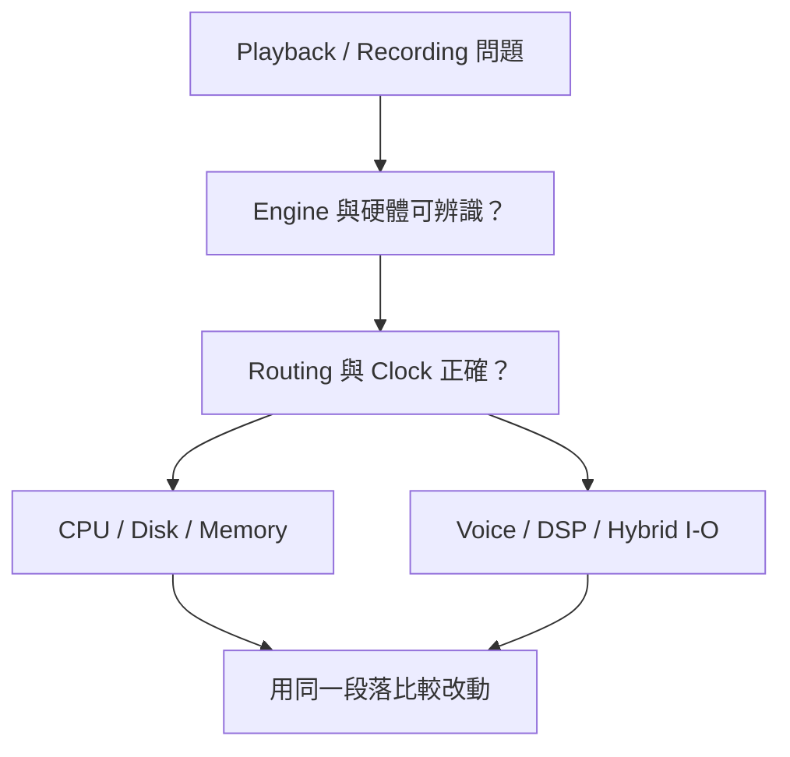

# Ch07b — 沒聲音、爆音、卡住：把 Hardware、Clock 與資源分開查

> Playback Engine 選哪套系統，Hardware Setup 設那套系統的硬體；Clock 決定取樣節奏，System Usage 才用來看即時負載。

原文：[[Pro_Tools_Reference_Guide_2023.3.pdf#page=135]]，原書 p. 103–113（PDF p. 135–145）。功能與適用條件以 **2023.3** 為準；情境例子與圖解為本筆記重新組織的教學補充。

## Hardware Setup 不是另一個 Mixer

`Setup > Hardware` 的內容依介面與目前 Engine 改變。Avid HD interface 可能直接提供 Physical routing、digital format、clock、Sample Rate 等設定；第三方介面常由 Launch Control Panel／Launch Setup App 開啟廠商自己的控制程式。看不到相同頁籤，不代表功能一定不存在，可能只是由另一個程式負責。

| 想改什麼 | 先看哪裡 | 原因 |
|---|---|---|
| 用哪台 audio interface | Playback Engine | 選定整個運作 Engine |
| 介面的 Clock／digital format | Hardware Setup 或廠商 Control Panel | 硬體層參數 |
| Track 使用哪條 Bus／Input／Output | Track selector＋I/O Setup | 軟體路由層 |
| 新 Session 的 Sample Rate | Dashboard／New Session；未開 Session 時的預設 | 目前 Session 的 Sample Rate 不能直接用此欄改掉 |
| 內建 Input 與 Output 組合 | Audio MIDI Setup 的 Aggregate I/O | Core Audio device 組合設定 |

原書提醒 Pro Tools Aggregate I/O 是為 Mac built-in audio 設計，最佳效能用預設配置。不要把它等同於任何第三方多介面組合的通用穩定性保證。

## Internal 與 External Clock：數位接線還需要共同節奏

Clock Master 決定取樣節奏。類比訊號直接錄進介面，通常使用 Internal；從另一台 digital device 轉入，或整棚有共同 house clock 時，要依實際架構讓系統跟隨對應來源。可選項依硬體而異，例如 AES／EBU、S/PDIF、ADAT、Word Clock。

| 情境 | 原書建議的思考 | 必須確認 |
|---|---|---|
| Mic／Line analog 錄音 | 通常選 Internal | 介面與 Session Sample Rate |
| 接外部 digital source | 依來源或共同 clock 同步 | source 已接好、供電並有效輸出 |
| House clock 系統 | 使用共用 reference 的規劃 | 哪台是 master、其餘誰跟隨 |
| 外部 Clock 不存在 | 不要盲選 External | 原書提醒可先保留 Internal |

這裡的 Clock 與 Ch02 的 timecode synchronization 有關但不相同：Clock 關心取樣節奏，timecode 也涉及位置。要讓多套系統從同一個時間點正確運作，不能只看到數字時間碼一致就省略 Clock 規劃。

> [!tip] 實務連結
> 裝上新的 ADAT preamp 後出現零星 clicks，先核對兩端 Sample Rate、digital format 與 clock master。這種症狀未必是 CPU 太慢，單純把 Buffer 拉大可能掩蓋不了數位同步錯誤。

## 多台 HD interface 先辨識，再配置

在 Hardware Setup 的 Peripherals list 選設備後，用 Identify 讓該台 front-panel LEDs 亮起，確認畫面上的第一台真的對應你手上那台。接著才在 Main 頁設定 Clock、digital format、Physical Input／Output pair 等。Input／Output 端口在 I/O Setup 也有對應控制，兩者的變更會互相反映。

| 設備 | 本章配置順序／工具 | 容易漏掉的限制 |
|---|---|---|
| HD OMNI | 先 Monitor 頁，再 Main、Analog In／Out、Mixer | Monitor path 不從普通 I/O Grid 任意改 |
| HD I/O | Main，再依已裝卡看 Analog In／Digital 等頁 | 頁籤與 installed cards 相依 |
| HD MADI | 選 Port 1 或 Port 2 設定 | 兩個 Port 的相關設定 linked、屬全域 |
| MTRX／MTRX Studio | DADman Control software | 不要期待所有路由都在普通 Hardware Setup |
| 第三方 Core Audio interface | 廠商 Control Panel／Setup App | 名稱與支援項目由 driver／設備決定 |

選 Optical digital format 時尤其要看清：ADAT 與 Optical S/PDIF 使用相似外形接孔，但 channel format 不同。原書說改為 Optical S/PDIF 時，原本八個 ADAT channels 的用途會改變，不能只以「都有光纖」判斷相容。

## System Usage：每一個 Meter 回答不同問題

`Window > System Usage` 提供 CPU、Disk、Memory 與特定系統資源的狀態。CPU Total 包含 Native Plug-In、Mixer、Elastic Audio、Clip Gain 等處理；individual CPU meters 是各處理器負載的概略顯示，不是系統所有應用程式的完整工作監視器。

| Meter | 主要表示 | 接近極限時先想什麼 |
|---|---|---|
| CPU Total／individual | Pro Tools 即時／相關處理負載，含短暫 peak | 哪段有密集 Plug-In／處理；Buffer 是否太低 |
| Disk | Audio 磁碟活動 | 同時讀寫量、媒體位置與儲存條件 |
| Disk Cache | 已分配 Audio cache 的使用情況 | 只有 fixed Cache Size 才顯示此 meter |
| Memory | Pro Tools 使用的 physical RAM | 包含 Engine、Plug-In、Video、Disk Cache；不是全系統總 RAM |
| Voices | 可用與已用 voices | 包括某些 DSP／Host routing 額外用量 |
| Time Slots | HDX DSP Time Slots | HDX 特有資源 |
| Hybrid I/O Channels | DSP Mode record／input monitoring 用量 | HDX Hybrid 特有配置 |
| HDX DSP meters | 每個 DSP chip 的 mixer／Plug-In 用量 | 不是電腦 CPU meter |

> [!warning] 低平均值不等於絕不過載
> 原書提供 peak indicator，正是因為即時系統還要完成瞬間工作。不要只用低 CPU 平均值就否定 playback error；要看它發生時的 Session 段落與各種資源。

## 排查要一次處理一個層次

先確認訊號與硬體連線，再看 Clock；確認設備工作正常，才進入 CPU／Disk／Voice 的資源診斷。原書列出的減載方法包括降低過密 Automation、讓不需要的 Track I/O／Track／DSP Plug-In inactive。這些方法都有工作範圍，不是把全部設定清掉。

> [!tip] 實務連結
> 可以用同一個最容易出問題的段落做比較：保留原版 Session，先只停用一組非必要處理，再看是否改善。能重複的條件，比一次同時改十個選項更容易找出成因。

> [!abstract] Takeaway
> 把問題拆成 Hardware／routing、Clock、CPU／Disk／RAM／Voice。每次看對應工具與 Meter，才能知道需要改接線、設定、Buffer，還是 Session 的處理量。

![[PT-Ch07-concept.png]]

圖解讀法：用 $T=N/f_s$ 計算單一 Buffer 的時間長度，屬教學算例；橫軸不是本機保證可選的 Buffer 清單，也不是總 round-trip latency 實測。

## 相關

%% PT-NAV-BEGIN %%

上一篇：[[PT-Ch07a-PlaybackEngine與低延遲]]

下一篇：[[PT-Ch08a-顯示與錄音操作偏好]]

按任務閱讀：[[PT-00-工作流程導航]]

%% PT-NAV-END %%

[[PT-Ch07a-PlaybackEngine與低延遲]] · [[PT-Ch06a-I-O與Path地圖]] · [[PT-Ch10-MIDIStudio與AudioBridge]]

[[PT-00-索引]] · [[PT-00-功能目錄]] · [[PT-00-快速檢索]] · [[PT-00-Mac快捷鍵]]

標籤： #pro-tools #audio #study-note
