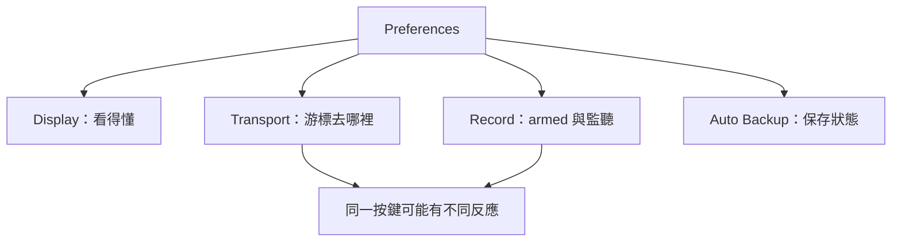

# Ch08a — Preferences：先把畫面、播放游標與錄音行為調成可預期

> Preferences 決定同一個操作會怎樣反應；先掌握關鍵開關，才不會把設定差異誤認成軟體故障。

原文：[[Pro_Tools_Reference_Guide_2023.3.pdf#page=147]]，原書 p. 115–123（PDF p. 147–155）。功能與適用條件以 **2023.3** 為準；情境例子與圖解為本筆記重新組織的教學補充。

## 顯示設定的目標是看得懂與找得到

從 `Setup > Preferences` 進入，選對頁籤再調整，最後 OK。Display 頁包含 Tool Tips、menu organization、UI Theme、language 與 Color Coding。不是每一項都需要更改；先處理你反覆遇到的閱讀與查找問題。

| Display 設定 | 開啟／選擇後的用途 | 何時有幫助 |
|---|---|---|
| Tool Tips：Function | 顯示按鈕／工具用途 | 剛學介面，認不得圖示 |
| Tool Tips：Details | 展開縮寫名稱、值與 assignment | Track Name／I/O 太長看不全 |
| Organize Plug-In Menus By | Flat List、Category、Manufacturer 或兩者 | Plug-In 多，按處理類型或廠牌找 |
| Organize Track I/O Menus By | Type、Width 或兩者 | Bus／Interface／Surround paths 多 |
| Default Automatic Naming to English | 自動命名維持英文 | 跨語言合作、對照文件 |
| Auto-Switch Input Language | 輸入文字時切 OS 語言，命令時切回英文 | 繁中輸入與英文快捷鍵切換 |
| UI Theme | Classic／Dark | 配合環境光與個人閱讀需求 |
| Reset Don’t Show This Again | 恢復被隱藏的提醒 | 想重新看設定／警告條件 |
| Show Dashboard when Pro Tools starts | 啟動顯示建檔入口 | 希望一開啟就選 Session／Template |

Edit Window Default Length 影響工作區與 scrollbar 的敏感度，不是替歌增加 Audio。原書 Ch08 p.115 列最高 24 小時，Ch12 p.211 卻保留 48 kHz 下 12 小時 25 分的舊敘述；本筆記不把衝突合併成保證值。實際上先把長度設為略長於目前工作即可，版本疑義見 [[PT-00-版本與原文疑義]]。

Color Coding 可依 Track Type、Group、MIDI channel／device、Track Color 或 Marker 等建立規則。MIDI Note Color Shows Velocity 以顏色深淺呈現 velocity，深色較大；這是 MIDI event 視覺化，不是 Audio loudness meter。

> [!tip] 實務連結
> 大型混音可以把 Plug-In menu 設 Category and Manufacturer，Track I/O 用 Type and Width，再開 Details Tool Tips。這三項分別降低「找效果器」「找路徑」「看全名稱」的摩擦。

## 播放停止後游標去哪裡，是 Preference

Timeline Insertion／Play Start Marker Follows Playback 開啟時，停止後游標停在剛剛停止的位置；關閉時回到開始播放的位置。這會直接改變你反覆聽一小句時的手感。Mac `Control+N` 切換此 Preference，別與建立新 Session 的 `Command+N` 混淆。

| Operation／Transport 設定 | 主要行為 |
|---|---|
| Edit Insertion Follows Scrub／Shuttle | Scrub 結束後 Edit cursor 跟到停止位置 |
| Audio During Fast Forward／Rewind | 快轉／倒帶時可聽 Audio |
| Latch Forward／Rewind | 按一下持續，直到 Stop／Play 等停止條件 |
| Play Start Marker Follows Timeline Selection | 更改 Timeline Selection 時起點跟隨 |
| Dynamic Transport Follows Timeline Selection During Playback | 播放中改 selection，是否立即改變 Playhead／Loop 行為 |
| Numeric Keypad Mode | Classic／Transport／Shuttle，詳見 Ch03 |
| Use Separate Play and Stop Keys | Transport mode 中 Enter 開始、Numeric 0 停止 |

Use Separate Play and Stop Keys 會改掉 Numeric Enter 原本新增 Memory Location 的用途；此時用 Numeric `.` 再 Enter 新增。這種設定造成的差異，不是快捷鍵表少寫一列而已。

Custom Shuttle Lock Speed 調最高 Shuttle Lock 前進速度；Custom FF／REW Speed 則是另一種快轉／倒帶倍率，不能把兩個速度欄位當同一功能。HD 系統 Reserve Voices for Preview in Context 會為 Session 播放時的素材預聽預留 voices，寬度跟 Audition Path 有關。

## Auto Backup 保護的是 Session 狀態

Enable Session File Auto Backup 會在 Session File Backups 存漸進備份；Keep n Most Recent Session Backups 控制保留量，Backup Every 控制間隔。Project 的版本歷史另由 Revision History 管理，不能推論與本機 Session 的每份備份永遠同樣保存。

| 設定／位置 | 用途 | 不代表 |
|---|---|---|
| Session File Auto Backup | 自動保留 Session 文件狀態 | 每次都複製所有 Audio Files |
| Documentation and Settings Root | 文件、Grooves、I/O、Plug-In Settings、Templates 等 | Audio 錄音目的地 |
| Project Media Cache | Project 的本機資料與媒體快取位置 | 已確認 Cloud 同步完成 |
| Sound Libraries | loops 等資源的位置 | 任意匯入檔已自動收進 Session |

> [!warning] 自動儲存不是媒體歸檔
> `.ptx` 有備份，引用的外接碟 Audio 卻不見了，仍可能無法還原聲音。完整交接回 Ch11 的 Save Copy In。

## Record Enable 與 Input Monitoring 的預設反應

| 錄音設定 | 作用／差異 |
|---|---|
| Latch Audio Tracks | 各 Audio Track Record Enable 可維持各自開關 |
| Cancel Previous on Audio Tracks | 新 Audio Track armed 時取消其他 Audio Track |
| Cancel Previous on All Tracks | 新 Track armed 時取消其他類型 Track |
| Link Record and Play Faders | 錄音與播放使用相同 Fader level 記憶方式 |
| Enable Automation in Record | 錄音時也能寫 Automation；會使上述 Link 選項停用 |
| Disable Input When Disarming Track in Stop | 停止時解除 armed，也退出 Input Only |
| Mute Record-Armed Tracks While Stopped | 停止時 mute armed input；TrackInput 可另控制 |
| Automatically Create New Playlists When Loop Recording | 各 Loop Take 自動進 Alternate Playlists |

Shift-click Record Enable 可不受所選 Cancel Previous 規則限制，用 latch 方式切換該 Track。Ultimate 還有 Audio Track／Transport RecordLock、PEC／Direct indication、Online recording 與 DestructivePunch File Length 等針對配音／同步錄音的設定。HDX Hybrid／Carbon 可在 Record／Input enabled 時自動進 DSP Mode，解除時是否自動退出也有獨立選項。

## 顯示與診斷的其他選項

Mouse Wheel Scrolling Snaps to Track 讓捲動對齊 Track；關閉則較連續。Ultimate 的 Clip Auto Fade In／Out 於 playback 自動套用 0–10 ms，並不寫入磁碟；Local Waveform Cache Versions 可減少 network Session 的重建與同步工作。Video 的 Enable GPU、Prevent Tearing、Play Start Latency 用來處理影像效能，不是 Audio Buffer。Save Logs 會打包 logs，Reset Logging 依支援排查需求使用；Analytics 則是匿名使用資料選項。

> [!abstract] Takeaway
> 先調可讀性，再弄清游標與 Record Enable 的反應。保留 Auto Backup，但另外規劃媒體備份；遇到錄音行為不一致，先比對 Operation Preferences，再懷疑檔案損壞。

![[PT-Ch08-concept.png]]

圖解讀法：此圖是原創概念示意，位置、比例與箭頭僅表達本章關係；不代表軟體畫面或實測效能。

## 相關

%% PT-NAV-BEGIN %%

上一篇：[[PT-Ch07b-HardwareClock與效能診斷]]

下一篇：[[PT-Ch08b-剪輯混音與Automation偏好]]

按任務閱讀：[[PT-00-工作流程導航]]

%% PT-NAV-END %%

[[PT-Ch03-KeyboardFocus與操作模式]] · [[PT-Ch08b-剪輯混音與Automation偏好]] · [[PT-Ch11b-儲存備份與工程交接]]

[[PT-00-索引]] · [[PT-00-功能目錄]] · [[PT-00-快速檢索]] · [[PT-00-Mac快捷鍵]]

標籤： #pro-tools #audio #study-note
