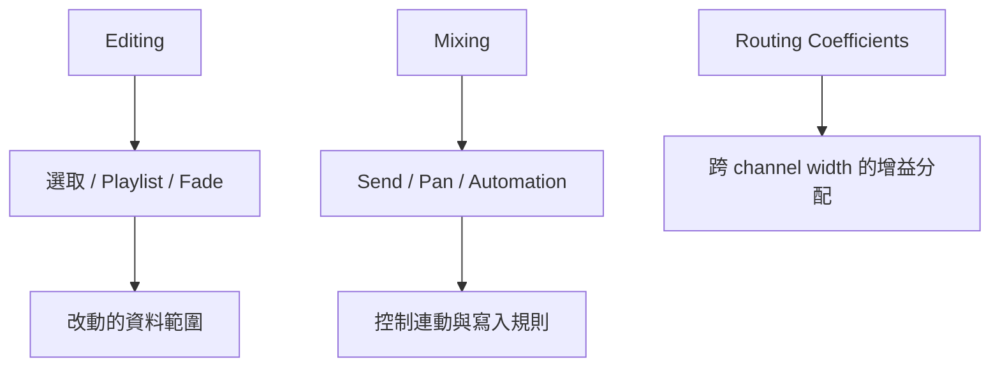

# Ch08b — 讓剪輯、Send 與 Automation 按你預期工作

> Editing 決定你改動哪份資料，Mixing 決定控制如何連動；看懂開關的兩種結果，比收集一份「最佳設定」更實用。

原文：[[Pro_Tools_Reference_Guide_2023.3.pdf#page=156]]，原書 p. 124–132（PDF p. 156–164）。功能與適用條件以 **2023.3** 為準；情境例子與圖解為本筆記重新組織的教學補充。

## Editing：先知道選取會帶動誰

Clips List 與 Timeline 上的 Clip occurrence 不是同一個視圖。Clips List Selection Follows Edit Selection 讓選到的 Timeline Clip 同步在列表選取；Edit Selection Follows Clips List Selection 則是反方向。開啟哪一個，決定你點列表時是否改動當前編輯範圍。

| Editing 設定 | 作用 | 適合用來解決什麼 |
|---|---|---|
| Auto-Name Separated Clips | 新分割 Clip 自動加序號 | 快速剪輯時減少命名對話 |
| Separate Clip Operates On All Related Takes | 相同 User Time Stamp 的相關 Take 一起分割 | 比較同一位置的不同錄音 pass |
| Send Fully Overlapped Clips to Playlist while Editing | 全被蓋住的 Clip 移到別的 Playlist | 編輯時保留替代素材 |
| 同功能 while Recording | 錄音蓋住整段時保留到 Playlist | 避免 Take 只剩眼前版本難找 |
| Double-Click Selects Automation Breakpoints | double-click 的選取依 breakpoint 邊界 | 想快速圈選 Automation 區間 |
| Clip Gain Nudge Value | 每次 nudging 的 dB 步進 | 原書範圍 0.1–6.0 dB |
| New Tracks Default To Tick Timebase | 新 Track 使用 ticks | 音樂位置工作；Audio 伸縮仍另看 Elastic Audio |
| Suppress Name Dialog When Creating New Playlists | 自動命名新／複製 Playlist | 多次 Take 建立流程 |
| Show Target Playlists After Sending Clip Selection | 送到 Target Playlist 後把它顯示為主 Playlist | 立即確認 comp 結果 |

1–5 Number Keys Control 可以改成 Zoom Presets 或 Clip Effects Presets，搭配不同 modifier 叫出另一組用途。若你的數字鍵與別人的教學不同，先檢查這裡；詳細鍵位留給 [[PT-00-Mac快捷鍵]]。

> [!tip] 實務連結
> 多 Take comping 要先確定 Playlist 保存策略。用「全蓋住時保留」改善找回素材的便利，但仍應清楚命名 Track／Playlist，不能指望自動搬移替你做版本管理。

## Fades、Zoom 與 Undo：影響編輯節奏的細節

Crossfade Preview Pre／Post-Roll 決定 Fades dialog 預聽時帶多少前後內容；QuickPunch／TrackPunch Crossfade Length 決定 Punch 接縫預設長度。Preserve Fades when Editing 在剪動時保留 Fade 關係；Auto Accept Adjust Bounds 自動調整無效 Fade 邊界，會減少對話但也減少一次人工檢查。

| 設定群 | 你在決定什麼 | 使用時的判斷 |
|---|---|---|
| Default Fade Settings | Smart Tool 的 Fade In／Out／Crossfade shape | 先讓常用接縫有一致起點，仍要試聽 |
| Smart Tool Fade Adjustment | 直接調 shape，或需按 Command 才調 | 避免游標落在 Fade 區誤改 |
| Zoom Toggle | 垂直／水平 zoom、Track Height／View、Grid | 讓進出細節視圖維持一致上下文 |
| Remove Range Selection After Zooming In | Zoom 後 range 是否收成 insertion | 當心範圍消失後下一個命令作用不同 |
| Levels of Undo | 最多保留多少可復原動作 | 原書最高 64；並非所有命令都可 Undo |

## Mixing：新 Send 的預設不一定能直接聽見

Sends Default To 決定新 Send level，原書預設是負無限，等於無可聽訊號。因此，選了 Bus 卻沒聽見 Reverb，可能只是 Send 還沒打開。Send Pans Default to Follow Main Pan 讓新 Send 的 Pan 跟 Main Pan；不是所有情況都需要這個連動。

| Mixing 設定 | 選取時 | 未選取時／取捨 |
|---|---|---|
| Use Absolute Pan Linking | grouped Pan 直接跳到相同絕對值 | 保持原本相對 offsets |
| Allow Sends to Persist During LLM | 讓 Sends 維持含 Plug-In 影響的訊號 | 一般 LLM 會 bypass 對應 Plug-In／Sends |
| Default EQ／Dynamics | 指定快速插入的常用 Plug-In | 可另決定 control surface Insert Slot |
| Edit／Mix Window Follows Banking | 畫面跟 control surface 的 bank | 畫面不隨每次 banking 移動 |
| Edit／Mix Window Follows Select | 所選 Track 捲入視野 | 避免每次選取都重排視野 |

Allow Sends to Persist During LLM 的用途，是低延遲 dry monitoring 之外仍給錄音者 Reverb／Delay；Send 收到的 processed Audio 還帶有其 latency。它不能保證 Native processing 本身變成低延遲。

## Automation：寫完後如何收手，比開始寫更重要

| 設定 | 核心作用 | 為什麼要注意 |
|---|---|---|
| Plug-In Controls Default to Auto-Enabled | 新 Plug-In 的適用 controls 自動可寫 Automation | 減少啟用步驟，也擴大可被寫動的範圍 |
| Smooth and Thin Data After Pass | pass 結束平滑並依 Degree of Thinning 減量 | 減少資料但要核對動態形狀 |
| Touch Timeout | 非 touch-sensitive 控制停止移動後繼續寫多久 | 不等於立刻回原曲線 |
| AutoMatch Time | 放手後回既有 Automation 值的時間 | 決定回歸過程是否突兀 |
| After Write Pass, Switch To | 寫完改 Touch、Latch 或維持 Write | 留在 Write 可能使下一 pass 繼續覆寫 |
| Include Control Changes in Undo Queue | Mixer moves 進 Undo queue | 復原較前的動作可能連最新 level 一起還原 |
| Latching Switch Controls in Touch | switch controls 是否 latch | Mute／Bypass 與連續 Fader 不同 |
| Allow Latch Prime in Stop | 停止時先準備 Latch 新值 | 只在理解下一 pass 會寫什麼時用 |

VCA／Trim 還有 Coalesce when Removing Members from VCA Group、Standard VCA Logic、Include Sends in Trim Mode 與 Coalesce Trim Automation。前者關係到移除成員後是否把 VCA 的作用寫入成員；Trim 的 Coalesce 可在每 pass、退出 Trim 或手動時整合。這不是單純切換視圖，而是在決定哪一份 Automation 成為有效結果。

> [!warning] 靜態 Fader 位置與底層曲線要分開
> 你剛剛拉到的值，可能在放手、停止或下一個 breakpoint 後回到 Automation。先查 Mode、Touch／Latch 的回歸規則，再判斷是不是「Fader 自己亂跑」。

## Delay Compensation 與 Routing Coefficients

Delay Compensation Time Mode 只決定延遲資訊顯示 milliseconds 或 samples；Compensate Side Chains 則決定支援情境的 side-chain timing 補償。改顯示單位不會改變實際 latency。

Routing Coefficients 決定不同 channel width 之間 fold down／fan out 的增益分配，包含內部 routing、Bus→Output、Audition 與 AFL／PFL。New Session Defaults 不改目前 Session，也不改既有 Template 的設定；Current Session Settings 才影響目前工作並隨檔儲存。

原書的 Modern／Classic coefficients，以及 5.x→7.x、7.x→5.x、Surround→Stereo、LFE inclusion，會改變聲道如何分配。例如把 5.x 的 surround split 到 side／rear，原書列出每路 −3 dB；不要把 downmix 當作只少幾個 channel，忽略 level 變化。

> [!abstract] Takeaway
> Preferences 的價值是讓行為可預期：選取影響誰、接縫怎麼保留、新 Send 是否有 level、Automation 何時停止寫、不同格式如何 fold down。每個開關都應接到一個明確需求。

![[PT-Ch08-concept.png]]

圖解讀法：此圖是原創概念示意，位置、比例與箭頭僅表達本章關係；不代表軟體畫面或實測效能。

## 相關

%% PT-NAV-BEGIN %%

上一篇：[[PT-Ch08a-顯示與錄音操作偏好]]

下一篇：[[PT-Ch08c-MeteringProcessing與MIDI偏好]]

按任務閱讀：[[PT-00-工作流程導航]]

%% PT-NAV-END %%

[[PT-Ch08a-顯示與錄音操作偏好]] · [[PT-Ch08c-MeteringProcessing與MIDI偏好]] · [[PT-Ch13b-建立編輯與管理Track]]

[[PT-00-索引]] · [[PT-00-功能目錄]] · [[PT-00-快速檢索]] · [[PT-00-Mac快捷鍵]]

標籤： #pro-tools #audio #study-note
