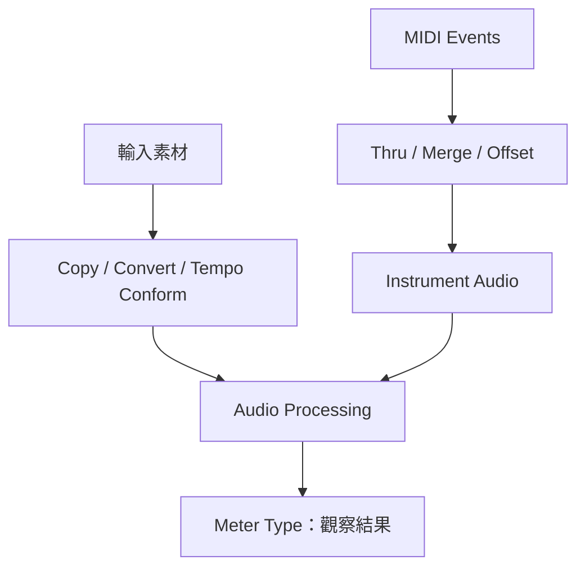

# Ch08c — 表頭、匯入與 MIDI：看見的、存下來的、送出去的要分開

> Meter Type 改變量測的觀點，Processing Preferences 改變媒體處理規則，而 MIDI Preferences 改變事件的顯示與路由。

原文：[[Pro_Tools_Reference_Guide_2023.3.pdf#page=165]]，原書 p. 133–142（PDF p. 165–174）。功能與適用條件以 **2023.3** 為準；情境例子與圖解為本筆記重新組織的教學補充。

## 表頭的 0，不一定都在說同一件事

Track Meters 與 Master Meters 可以 linked，也能各用不同 Meter Type。Sample Peak 看每個 sample 的動態；RMS／VU 看一段時間內的反應；PPM、K-scales 等又有不同 scale 與 ballistics。因此，換 Meter Type 後「讀值看起來比較低」，不代表 Audio 已被調小。

| Meter Type 群 | 閱讀重點 | 原書定位 |
|---|---|---|
| Sample Peak | 唯一 0-sample integration time 的選項 | 直接看 sample peak 動態 |
| Pro Tools Classic | 舊版 scale／ballistics | 延續既有工作習慣 |
| Linear／Linear Extended | 接近高 level 區域提供較細的刻度 | 分別延伸至約 −40／−60 dB |
| RMS | 一段時間的平均訊號量 | 與瞬間 Peak 互補，不等於 LUFS |
| VU／Digital VU | VU ballistics，scale 不同 | 音樂／對白 level 觀察 |
| PPM Digital／BBC／Nordic／EBU／DIN | 對應不同廣播 scale 與反應規則 | 不可只看名稱就拿來跨標準比較 |
| K-12／K-14／K-20 | RMS scale 加 secondary sample peak | 配合校準監聽與 headroom 工作 |
| VENUE Peak／RMS | 相應 ballistics 配 VENUE scale | 與相關系統對照 |

> [!tip] 實務連結
> Track 想看較接近平均 level 的資訊，Master 想抓 peak，可解除 Track and Master Meter Types Linked 後分開選。要交付特定 loudness 規格，還需用該規格要求的量測，不能把 VU 或 RMS 直接當 LUFS。

Advanced Meter Type Settings 可改 Decay、0 dBFS reference、Integration Time、Color Break High／Low；某些標準不允許改其關鍵參數。原書建議通常保留預設，只有需要匹配外部 console／broadcast meter 才有理由調整。Reset 可回到所選 Meter Type 的預設。

Peak Hold 與 Clip Indication 都可選 3 Seconds、Infinite、None。Gain Reduction meters 還取決於 Plug-In 是否支援，不是打勾就能讀到任何第三方效果器；可選 Compressor／Limiter、Expander／Gate、優先某類，或 All–Summed。總和顯示也不能代替逐個 Plug-In 檢查。

## 匯入設定決定「複製、轉換、變速」哪一件發生

| Processing／Import 設定 | 作用 | 最容易誤會的地方 |
|---|---|---|
| Automatically Copy Files on Import | Drag-and-drop 的 Audio 複製到 Session Audio Files | **不控制 Import Audio command** 的同名行為 |
| Convert Copied Files to Session Format | copied files 轉 Session file format | 關閉可保留原格式，除非不相容 |
| Do Not Convert Sample Rate on Import | 不自動做 SRC | mismatch 的檔可能以不同速度／音高播放 |
| Convert Imported WAV to AES31／BroadcastWave | 讓相應 WAV 符合指定標準 | 是檔案處理規則，不是 routing |
| Import REX Files as Clip Groups | REX slices 保留為 group 內各 Clip | 不選時可 consolidate 為 Elastic Audio 分析的 Audio |
| Drag and Drop Conforms to Session Tempo | No Files、REX／ACID Only、All Files | 決定拖入素材是否變成 Tick-Based Elastic Audio |
| Sample Rate Conversion Quality | 指定相應拖入匯入流程的 SRC 品質 | 品質較高通常花更久，不改整份 Session sample rate |

> [!warning] 「不轉 Sample Rate」不是「無損且完全一樣」
> 若來源與 Session Sample Rate 不同，跳過 SRC 可能使播放速度與 pitch 改變。除非你明確要這種變化，不要把它當作通用保真開關。

## Handles、Commit 與 Elastic Audio 預設

AudioSuite Default Handle Length 決定處理 selection／Clip 前後保留多少來源；Length 可設 0–60 秒，Whole File 則處理所引用整份檔案。可用 Handle 仍受來源真實長度限制，不會生成不存在的演奏。

| 群組 | 設定 | 用途 |
|---|---|---|
| Commit | Always Use 32-bit／Follow Session Settings | 決定新 Commit Audio 的 bit depth |
| TC/E | TC/E Plug-In＋Default Settings | 決定 Time Compression／Expansion Trim 使用誰 |
| Elastic Audio | Default Plug-In | preview／import 與新 Track 的預設演算法 |
| Elastic Audio | Default Input Gain，0 至 −6 dB | 降低處理造成 clipping 的可能 |
| Elastic Audio | Enable Elastic Audio on New Tracks | 新 Track 自動啟用，Timebase 仍要另查 |
| DSP Management | Open Unresourced DSP Plug-Ins as Native | HDX DSP 不足時，盡可能轉 Native；否則 inactive |
| HEAT | Enable HEAT in New Sessions | 已裝對應功能時的新 Session 預設 |
| Celemony ARA | Audio to MIDI Plug-in | 指定已安裝轉換 Plug-In |

Parallel Task Optimization 控制 waveform calculation、indexing、Clip Gain／Clip Effects／Elastic Audio rendering 等平行背景工作。原書列 Off=1、Low 最多 4、Med 最多 6、High 最多 8 tasks；這不是即時 audio threads 的同一個設定。While Loading Waveforms Display in Low Resolution 先畫較低解析度 waveform，再換完整資料，對大型／network Session 有幫助。

Noise Burst Peak Protection 會將高於 +20 dBFS 的突發訊號靜音。原書提醒，關閉雖可保留 full 32-bit float headroom，卻移除這層保護；Carbon 的 output path 又有其固定行為。不要為了追求「最大 headroom」在不了解訊號鏈時隨意關閉。

## MIDI Preferences：音名、監聽與事件合併規則

| MIDI 設定 | 決定什麼 |
|---|---|
| Display Events as Modified by Real-Time Properties | 顯示經 Real-Time Properties 影響的結果 |
| Default Thru Instrument | 哪個 MIDI／Instrument destination 接收未特別 armed 的輸入 |
| Use MIDI to Tap Tempo | 用 MIDI keyboard 在 Tempo field 輸入速度 |
| Use F11 Key for Wait for Note | F11 切換 Wait for Note，仍可能被 macOS 攔截 |
| Automatically Create Click Track | 新 Session 自動建立 Click Track |
| Pencil Tool Resolution | 畫 controller data 的密度，1–100 ms |
| Global MIDI Playback Offset | 以 samples 補償 event 的早／晚，正值較晚、負值較早 |
| Double-Clicking a MIDI Clip Opens | Docked／獨立 MIDI Editor、Score、Event List 或 Name dialog |
| Note Display Options | middle C 以 C3、C4 或 MIDI note 60 表示 |

MIDI Merge Release Mode 的 Latch 會續寫最後值直到停止；Latch Until Next Event 持續到下一個事件；Touch 立即停止新增值，原書特別指適合補 pedal data、不用來修改既有值。它不是 Audio Automation Touch mode 的直接同義詞。

Delay Compensation for External Devices 可以分別補償 Pro Tools 產生的 MTC、MIDI Beat Clock、MIDI Notes／Controllers；需要已啟用相應 Delay Compensation。這與 I/O Setup 的 Hardware Insert offset 是不同層次。

> [!abstract] Takeaway
> Meter 要看量測目標，Import 要分清 Copy／Convert／Tempo conform，MIDI 要分清事件資料與 Audio。不要把三種不同設定都簡化成「品質設最高」。

![[PT-Ch08-concept.png]]

圖解讀法：此圖是原創概念示意，位置、比例與箭頭僅表達本章關係；不代表軟體畫面或實測效能。

## 相關

%% PT-NAV-BEGIN %%

上一篇：[[PT-Ch08b-剪輯混音與Automation偏好]]

下一篇：[[PT-Ch08d-協作同步與設定作用範圍]]

按任務閱讀：[[PT-00-工作流程導航]]

%% PT-NAV-END %%

[[PT-Ch08b-剪輯混音與Automation偏好]] · [[PT-Ch08d-協作同步與設定作用範圍]] · [[PT-Ch13a-Track類型與Metering]]

[[PT-00-索引]] · [[PT-00-功能目錄]] · [[PT-00-快速檢索]] · [[PT-00-Mac快捷鍵]]

標籤： #pro-tools #audio #study-note
