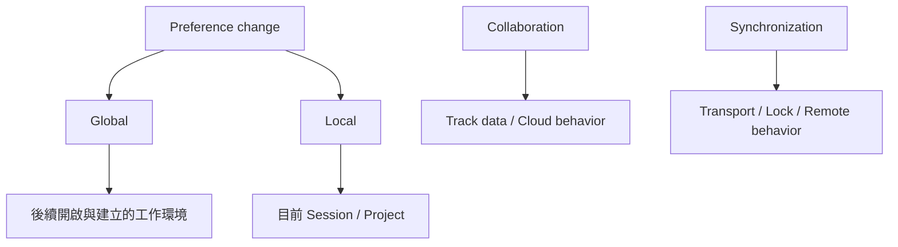

# Ch08d — 有些設定跟著電腦，有些設定跟著 Session

> 調整 Preference 前，先知道它改變的是所有工程的工作環境，還是只有目前 Session 的行為。

原文：[[Pro_Tools_Reference_Guide_2023.3.pdf#page=174]]，原書 p. 142–147（PDF p. 174–179）。功能與適用條件以 **2023.3** 為準；情境例子與圖解為本筆記重新組織的教學補充。

## Global 與 Local 的核心差異

原書把 Preferences 分為 global（system-wide）與 local（目前 Session／Project）。Global 會成為後續開啟舊 Session 和建立新 Session 的環境；Local 隨目前工程，不能推定打開另一份舊 Session 也會採用。新 Session 使用 global，再加最近使用的 local settings；從 Template 建立時又要檢查 Template 保存的內容。

| 範圍 | 影響誰 | 日常例子 |
|---|---|---|
| Global | 這台 Pro Tools 後續使用的工作環境 | 大多數 Preferences |
| Local | 目前 Session／Project 的特定設定 | 本章下列例外項目 |
| New Session Defaults | 新建立 Session 的預設 | 不一定覆蓋已存在的 Template／目前 Session |

這能解釋「我改過了，為什麼舊工程不一樣」。如果設定本來是 local，另一份 Session 保有它自己的值，不是這次更改沒有儲存。

## 原書列出的 Local 例外，用表格一次查

| 頁籤／群組 | 2023.3 p.146–147 列出的 local items |
|---|---|
| Display | Edit Window Default Length、Always Display Marker Colors、Default Track Color Coding、Default Clip Color Coding |
| Operation／Transport | Latch Forward／Rewind、Custom Shuttle Lock Speed、Custom FF／REW Speed、Back／Forward Amount（Ultimate） |
| Operation／錄音與其他 | PEC／Direct Style Input Monitoring、DestructivePunch File Length、Clip Auto Fade In／Out Length（上述有 Ultimate 條件） |
| Delay Compensation | Delay Comp Time Mode、Compensate side chains（原書此清單標 HDX 條件） |
| Mixing | Coalesce When Removing Members from VCA Group（Studio／Ultimate） |
| Processing | Convert Imported WAV Files To AES31／BroadcastWave |
| MIDI | Display Events as Modified by Real-Time Properties、Automatically Create Click Track、Default Thru Instrument、Pencil Tool Resolution、Delay for External Devices options |
| Editing／Metering／Collaboration／Synchronization | 原書 local 清單列 None；其餘未列例外的項目屬 global |

> [!note] 文件分類也有沿用痕跡
> p.146 把 Delay Compensation 的幾項列在 Operation 清單，但前文實際說明位於 Mixing 附近。查找請用精確英文名稱與來源頁，不要只依清單的分類位置猜。

> [!tip] 實務連結
> 做一份工作 Template 時，先設定你要跟著每個工程保存的 Local 行為，再儲存 Template；換到別台電腦時，另準備 Global 的工作環境清單。兩種設定不應假設會一起完整轉移。

## Collaboration：自動分享之前，先知道範圍

| Collaboration preference | 啟用時的效果 |
|---|---|
| New Tracks Are Shared | 新建 Track 自動 share |
| First Invite Shares All Tracks | 第一次邀請別人時分享全部 Track |
| Joining Project Downloads All Shared Tracks | 加入 Project 後下載所有 shared Tracks |
| Automatically Download New Shared Tracks | 後續新增 remote shared Tracks 自動下載 |
| Enable Track Notes Dialog | 開 Project 時顯示 missing Plug-In、I/O mismatch 等報告 |

這些是 Avid Track Collaboration 的選項，不等於把普通 Session 放上 Dropbox 就自動變成同一套 Project。關於服務使用方式與可用性，要留在 2023.3 文件範圍，現行狀況另外確認。

Cloud Storage Services 的 Prevent Others from Overwriting Open Session 會在 Session 開啟時建立 temporary marker，讓其他使用者知道有人正在用；它不是保證雲端服務完全沒有 conflict 的檔案鎖系統。副檔名可選 `.tmp` 或 `.ptmp`：原書要求 OneDrive 用 `.ptmp`，因其忽略 `.tmp`；legacy NAS compatibility 又有不同考量。

Keep Unused Folders on Session Close 避免結束時移除又重建空資料夾，減少 sync churn。Local Waveform Cache 也能減少反覆同步，但 non-NAS storage 下仍有 Prevent Others... 等前置條件。

> [!warning] 標記檔不等於完整備份
> 其他人知道工程正在開啟，不代表所有 Audio 都已上傳，或 Session 可以安全同時編輯。交接仍要確認 Sync 狀態與媒體完整性。

## Synchronization：Transport、位置與等待時間要成套理解

Machine Chases Memory Location 讓外部 transport 跟著 Memory Location；Machine Follows Edit Insertion／Scrub 讓外部機器跟著插入點／Scrub。Linear Devices 使用 jog，nonlinear device 可用 cue；不是每一台機器都用同一種定位命令。

| 設定群 | 原書主要用途 | 何時才需要 |
|---|---|---|
| Minimum Sync Delay | 裝置取得穩定 lock 的準備 frames，最低 15 frames | 外部同步系統 |
| Delay Before Locking to LTC／Serial Timecode | 等待外部 timecode／servo 穩定 | 支援的 HDX／HD Native 情境 |
| Machine Cues Intelligently | 遠距 cue 先高速定位再慢速接近 | 特定外部 tape／transport |
| Stop at Shuttle Speed Zero | shuttle 停止時送明確 Stop | 需要明確停止命令的機器 |
| Remote Mode | 接收 track arming、servo lock、9-pin commands 等 | Pro Tools 作為受控設備 |
| Punch In／Out Frame Offset | 補償外部 Punch 時機差 | 已量測並需要校正的工作流程 |

Satellite 的 Transmit／Receive Solos、Transmit／Receive Play Selections 可個別決定；AAE Errors Stop All Linked Systems 則決定某台錯誤是否讓全部 linked systems 停止。這不是網路檔案分享設定，而是多套 Pro Tools transport／selection 的協同行為。

> [!abstract] Takeaway
> 大多 Preferences 是 Global，少數明確列出為 Local。協作的自動範圍、雲端 temporary marker 與同步 transport 也各做不同的事；先分清作用範圍，再開啟自動化行為。

![[PT-Ch08-concept.png]]

圖解讀法：此圖是原創概念示意，位置、比例與箭頭僅表達本章關係；不代表軟體畫面或實測效能。

## 相關

%% PT-NAV-BEGIN %%

上一篇：[[PT-Ch08c-MeteringProcessing與MIDI偏好]]

下一篇：[[PT-Ch09a-周邊設備與控制協定]]

按任務閱讀：[[PT-00-工作流程導航]]

%% PT-NAV-END %%

[[PT-Ch08a-顯示與錄音操作偏好]] · [[PT-Ch09b-SatelliteVENUE與DolbyAtmos連線]] · [[PT-Ch11c-Project版本與Template]]

[[PT-00-索引]] · [[PT-00-功能目錄]] · [[PT-00-快速檢索]] · [[PT-00-Mac快捷鍵]]

標籤： #pro-tools #audio #study-note
