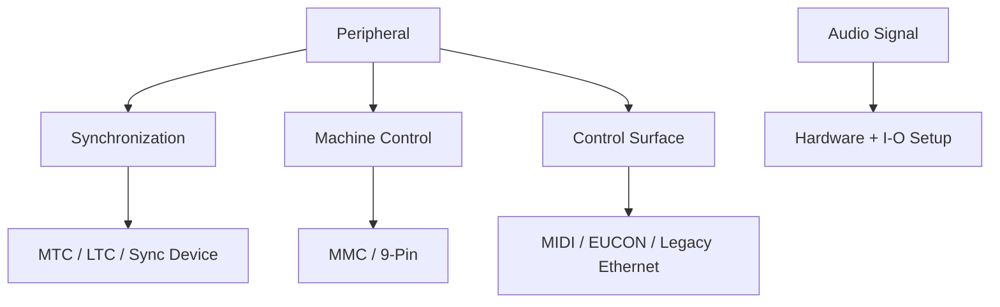

# Ch09a — Peripherals：接通控制訊息，不等於接通 Audio

> Peripherals 管的是同步、控制器與可遙控設備；Audio 路徑仍要在 Hardware、I/O Setup 和 Track assignment 中完成。

原文：[[Pro_Tools_Reference_Guide_2023.3.pdf#page=181]]，原書 p. 149–156（PDF p. 181–188）。功能與適用條件以 **2023.3** 為準；情境例子與圖解為本筆記重新組織的教學補充。

## 先按「訊息用途」分類，再找頁籤

從 `Setup > Peripherals` 選對設備類別，設定後按 OK。它與 Playback Engine 的角色不同：選 Engine 是決定由哪個 Audio device 運作；Peripherals 是讓特定協定與 Pro Tools 溝通。

| 頁籤／類別 | 主要用途 | 不要混成 |
|---|---|---|
| Synchronization | MTC ports、支援的 Sync X／SYNC HD | Audio Input／Output mapping |
| Machine Control | MMC、9-Pin Deck Control／Emulation | 普通 MIDI note 演奏輸入 |
| MIDI Controllers | HUI、Komplete Kontrol 等 control surface | 所有 USB MIDI keyboard 的必要設定 |
| Ethernet Controllers | EUCON 或 legacy Ethernet control surface | 一般 LAN file sharing |
| Mic Preamps | 支援前級的遠端控制 | 只插 mic cable 就會自動遙控所有前級 |

> [!tip] 實務連結
> 一把 MIDI keyboard 只是拿來彈 Virtual Instrument，先看 Ch10／Track MIDI Input；只有需要 transport、Fader 或特定 DAW integration 時，才進相應 Controller 設定。

## MTC Reader／Generator 與 Synchronization device

MTC Reader Port 是從外部接收 MIDI Timecode 的 MIDI In；MTC Generator Port 是 Pro Tools 送出 MTC 的 MIDI Out。接收與送出是兩個方向，不能因為都叫「MIDI」就選同一個看起來熟悉的 port。

| 設定 | 說明 | 適用條件 |
|---|---|---|
| Sync X Enabled／Enable SYNC HD | 讓已連接同步 peripheral 與 Pro Tools 配合 | Ultimate＋支援的 HDX／HD Native |
| Current Firmware Version | 顯示連接設備 firmware | 是識別資訊，不是升級命令 |
| Idle MTC Enabled | idle 時仍送 MTC | 依外部設備需求 |
| Pitch Memory Enabled | 保留最後外來 timecode speed 對應 sample rate | SYNC HD；Sync X 固定維持此行為 |
| LTC Output Level | 類比 LTC 輸出 level | 原書 −24 至 +9 dBu |
| VITC Read／Generate／Insertion | 讀取與寫入 video VITC 的條件／行數 | SYNC HD 特定功能 |

Bi-Phase／Tach 要配合實際 encoder 的 wiring 與 pulses per frame（原書 2–254）；Reset Bi-Phase 依 Session timecode 更新起始 frame。這類功能用在特定同步系統，不是一般音樂製作必須填滿的設定。

SYNC HD 的 Dub Window 可把 timecode 疊到 Video，選位置、大小與字色；極端畫面位置可能在 safe-title 外。Sync X 的 Relay-Based GPOs 涉及 GPIO triggers，開關會影響裝置 relay 的可聽 click；Displays 可設定 screensaver／off，以免長時間亮屏影響壽命。

## MMC 與 9-Pin：誰在控制誰

| 模式 | Pro Tools 的角色 | 傳送／接收關係 |
|---|---|---|
| MIDI Machine Control Master | 控制外部 MMC device | 送 MMC，收對方 MTC |
| MIDI Machine Control Remote | 接受外部 MMC 控制 | 收 MMC，送 MTC 回主控 |
| 9-Pin Machine Control／Deck Control | 以 serial 控制外部 deck | 支援的 HDX／HD Native＋Ultimate 情境 |
| 9-Pin Remote／Deck Emulation | Pro Tools 扮演 virtual deck | 回應標準 Sony P2 9-pin commands |

MMC ID 從 0–127；127 是對所有 IDs 廣播的特殊設定。若你只想控制其中一台，不要把 127 當成「隨便預設就好」。Preroll 則是給外部機器定位與取得 lock 的時間；舊 tape transport 與 nonlinear device 所需時間不同，machine preroll 也可能加到 Transport preroll 上。

9-Pin Deck Control 會嘗試辨識 Machine Type；無法辨識時可載入 Generic 1。Remote Deck Emulation 預設模擬 Sony BVW-75，也能依 controller 換型號。Chase LTC 使 Pro Tools 跟外部 LTC，而不是不斷要求 tape transport 去追 Pro Tools，避免多餘定位與等待。

> [!warning] MTC 與 MMC 是不同工作
> 有 timecode 能讀，不等於 transport commands 已互通；按 Play 能叫動機器，也不等於兩邊 Clock／位置已穩定鎖定。排查要把控制與同步分開。

## MIDI Controller、EUCON 與遠端前級

原書 MIDI Controllers 頁最多配置四個 controllers，設定 Type、Receive From、Send To、# Ch’s。列表包括 HUI、Surround Panner、M-Audio Keyboard、Komplete Kontrol；Command 8 在此版標 Windows only。Komplete Kontrol 要先依廠商指示安裝配置，再選對應 DAW port。

Ethernet Controllers 另有 Enable EUCON，與 legacy controllers 的 Ethernet Port／device declaration。Edit Toolbar 的 EUCON Status 可以顯示 disabled、enabled、connected 或 error；看到已 enabled，不等於已有 controller connected。

| 控制類型 | 先檢查 | 設定範圍 |
|---|---|---|
| MIDI control surface | Type 與雙向 MIDI ports | 不是只有 Receive From |
| EUCON | EuControl／支援設備與 Enable EUCON | 狀態要看實際 connection |
| Legacy Ethernet surface | 正確 network interface 與宣告設備 | 依支援的 legacy hardware |
| Avid PRE 等 Mic Preamp | Type、Receive From／Send To、I/O mapping | Retain Current Settings 可保留硬體值 |

Mic Preamps 的 Remote Lock-Out Mode 會讓 connected PRE 忽略 front-panel controls；Retain Current Settings 則避免開舊 Session 時套入不同前級設定。它們會改變「誰能改 gain」與「開檔時採哪個值」，錄音前應和現場操作人員的工作分工一致。

> [!abstract] Takeaway
> Peripherals 的每一頁都在回答「什麼設備、用什麼協定、往哪個方向溝通」。先分清 Audio、MIDI events、control commands、Clock／timecode，設定就不再像一排不知要不要勾的選項。

![[PT-Ch09-concept.png]]

圖解讀法：此圖是原創概念示意，位置、比例與箭頭僅表達本章關係；不代表軟體畫面或實測效能。

## 相關

%% PT-NAV-BEGIN %%

上一篇：[[PT-Ch08d-協作同步與設定作用範圍]]

下一篇：[[PT-Ch09b-SatelliteVENUE與DolbyAtmos連線]]

按任務閱讀：[[PT-00-工作流程導航]]

%% PT-NAV-END %%

[[PT-Ch09b-SatelliteVENUE與DolbyAtmos連線]] · [[PT-Ch10-MIDIStudio與AudioBridge]] · [[PT-Ch07b-HardwareClock與效能診斷]]

[[PT-00-索引]] · [[PT-00-功能目錄]] · [[PT-00-快速檢索]] · [[PT-00-Mac快捷鍵]]

標籤： #pro-tools #audio #study-note
