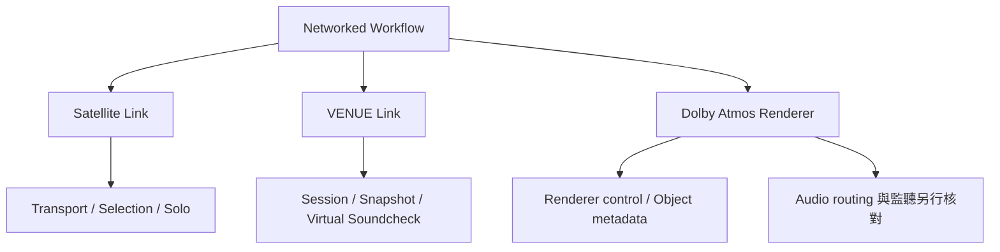

# Ch09b — 多系統連線：Satellite、VENUE Link 與 Dolby Atmos Renderer

> 網路連通只是第一步，還要確認角色、控制協定與 Audio 去向；三種連線並不是同一個「同步」按鈕。

原文：[[Pro_Tools_Reference_Guide_2023.3.pdf#page=188]]，原書 p. 156–159（PDF p. 188–191）。功能與適用條件以 **2023.3** 為準；情境例子與圖解為本筆記重新組織的教學補充。

## Satellite Link：讓多套系統一起定位與播放

Satellite Link 使 linked Pro Tools systems 能共同 cue、Play／Stop、設定 play selection 與 Solo。原書在支援 HDX／HD Native 的配置中描述最多 12 套系統；沒有 HD hardware 時，最多兩套：一台 Administrator 加一台 Satellite，常見用途是獨立 Video monitoring。

它不是把多台 CPU 合併成單一 Plug-In 處理器，也不是把所有 Audio 自動收成一個混音。要共享 transport 與 selection，還要在對應設定選擇 transmit／receive；Audio 本身仍需自己的 routing 規劃。

| Satellite 設定 | 你在宣告什麼 |
|---|---|
| System Name | 其他系統看到的本機名稱 |
| Administrator | 負責宣告／管理其他 Satellite 的角色 |
| Satellite | 讓本機可被 Administrator 宣告 |
| System list | 本次要連的各套系統與順序 |
| Interface | 多張網卡時使用哪個 Ethernet interface |
| TCP／UDP Port | Satellite communication port；原書預設 28282，可設 1024–65534 |
| Reset Network | Disconnect 後重新建立 Satellite network connection |

> [!tip] 實務連結
> 一台 Pro Tools 做 Audio、另一台專看 Video，可用角色命名如 Audio-Admin、Video-Sat 區分。這是控制協作設計，不是提升單一電腦 Audio rendering 的 RAM／CPU 擴充。

## VENUE Link：把現場 console 的資訊帶進錄音流程

VENUE Link 透過 Ethernet 將 VENUE 與 Pro Tools 連在一起，支援根據 VENUE settings 建立 Pro Tools Session、Live Recording／Virtual Soundcheck，以及由 VENUE Snapshots 建立或定位 Pro Tools Markers。

| 欄位 | 用途 | 排查方向 |
|---|---|---|
| System Name | 本機 Pro Tools 識別名稱 | 多套設備別都留難辨識名稱 |
| VENUE System | 選遠端 VENUE，或手動 IP | 是否選到正確 console |
| Advanced Network／Interface | 多網卡時指定實際連線 | 不要把 Internet 網卡與 console 網卡混用 |
| TCP／UDP Port | 指定對應通訊 port | 兩端規劃需一致 |

這裡只設定 integration。Audio recording path 與 Virtual Soundcheck 的實際 Audio 交換，要接著查 Ch24／Ch25 與 VENUE 專用文件；看到 Snapshot marker 能同步，不代表所有 Audio channels 都已接對。

## Dolby Atmos：Renderer connection 與 Audio／metadata 要一起看

2023.3 的 Peripherals > Dolby Atmos 頁用於與外部 Renderer／RMU 溝通。Enable 必須選取，才可使用對應 Atmos 工作，即使 Renderer 暫時沒有 connected。Connection Status solid 是成功，flashing 是已 enabled 但無法通訊，unlit 是尚未 enabled。

| 設定／狀態 | 主要意義 | 你可以據此判斷什麼 |
|---|---|---|
| Renderer Host | Renderer IP 或可選的 host | 本機 Production Suite Renderer 可用 localhost |
| Connection Status solid | Pro Tools 與 Renderer 通訊成功 | 不代表每一條 Audio／Object routing 都正確 |
| Connection Status flashing | 已啟用但無法與 Renderer 溝通 | 查 host、network 與對方應用程式 |
| Link Object and Audio Recording | 將 Object Audio／metadata 錄音監聽連動 | 依 Atmos recorder 工作流程 |
| Monitor Format | 顯示連接 Renderer 的監聽模式 | 不是在這裡任意改整份 Session format |

## Fold Down Path 是備用／輔助監聽，不是另一個 Renderer

Bed／Object Fold Down Path 本身在 I/O Setup 的 Output 頁指定；Peripherals 決定何時使用它。Active When Renderer Disconnected 只在 Renderer 不通時接手；Always Active 則允許 Renderer 正常時，也另外用 Pro Tools 的 Fold Down 做非混音用途的檢查。

1. 先確認 Session 與版本支援 Atmos。
2. 在 Peripherals 啟用 Dolby Atmos，選 Renderer Host。
3. 觀察 connection 狀態。
4. 到 I/O Setup 核對 Output／Object mapping 與 Fold Down Path。
5. 以實際 playback 確認 Audio，再檢查 metadata 與 Renderer 監聽設定。

> [!warning] localhost 的意思只限這台電腦
> Renderer 在同一台 Mac 時可使用 localhost；若 Renderer 在另一台 workstation，應使用那台的 network address。不能在兩台不同電腦各填 localhost，就期待它們指向彼此。

> [!abstract] Takeaway
> Satellite 連共同 transport，VENUE Link 連現場 console integration，Dolby Atmos 頁連 Renderer。每種連線都需自己的角色、狀態與 Audio path 檢查；網路亮燈不等於整個聲音工作流程已完成。

![[PT-Ch09-concept.png]]

圖解讀法：此圖是原創概念示意，位置、比例與箭頭僅表達本章關係；不代表軟體畫面或實測效能。

## 相關

%% PT-NAV-BEGIN %%

上一篇：[[PT-Ch09a-周邊設備與控制協定]]

下一篇：[[PT-Ch10-MIDIStudio與AudioBridge]]

按任務閱讀：[[PT-00-工作流程導航]]

%% PT-NAV-END %%

[[PT-Ch09a-周邊設備與控制協定]] · [[PT-Ch06b-Bus監聽與特殊路徑]] · [[PT-00-功能目錄#Ch58 — Mixing to Dolby Atmos]]

[[PT-00-索引]] · [[PT-00-功能目錄]] · [[PT-00-快速檢索]] · [[PT-00-Mac快捷鍵]]

標籤： #pro-tools #audio #study-note
