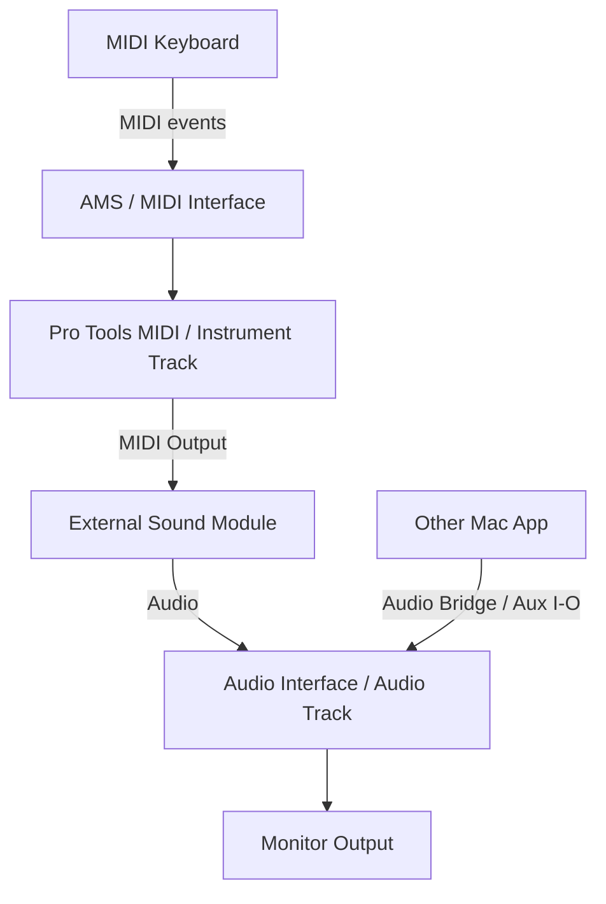

# Ch10 — Audio MIDI Setup：MIDI 接線圖與 Audio Bridge 是兩件事

> MIDI Studio 把演奏訊息送到正確設備，Audio Bridge 把真正的聲音送到另一個應用程式；知道兩條線的差別，才容易排查「有反應卻沒聲音」。

原文：[[Pro_Tools_Reference_Guide_2023.3.pdf#page=193]]，原書 p. 161–166（PDF p. 193–198）。功能與適用條件以 **2023.3** 為準；情境例子與圖解為本筆記重新組織的教學補充。

## Mac 用 AMS 建立可讀的 MIDI Studio

Audio MIDI Setup（AMS）會辨識 MIDI interface 的 generic ports；你可以定義 external MIDI devices，給 Manufacturer、Model、Name 與可用 channels，讓 Pro Tools 的 MIDI Input／Output menu 顯示有意義的裝置名稱。

先停止 Pro Tools Transport，再開 AMS。原書提醒不要在 playback 期間改配置，以維持最佳運作。入口可用 macOS `Applications/Utilities/Audio MIDI Setup`，或 Pro Tools 的 `Setup > MIDI > MIDI Studio`。

| 步驟 | 在 AMS 做什麼 | 為什麼 |
|---|---|---|
| 1 | `Window > Show MIDI Studio` | 顯示 MIDI 裝置與 ports |
| 2 | 確認已連接 MIDI interface 出現 | 驗證電腦已辨識連線 |
| 3 | 按 `+` 建 External Device | 代表接在 MIDI interface 外的硬體 |
| 4 | Device Output arrow 接 Interface Input arrow | 硬體演奏訊息進電腦 |
| 5 | Interface Output arrow 接 Device Input arrow | 電腦送 MIDI 給硬體發聲 |
| 6 | Double-click Device，填 Manufacturer／Model／Name | 在 Pro Tools menu 清楚辨識 |
| 7 | Properties 設 Transmits／Receives channels | 限定裝置實際使用的 1–16 channels |

輸出箭頭接輸入箭頭，表示訊息方向；不是要求兩端同名才會通。要移除虛擬接線，選 cable 再 Delete。AMS 中的虛擬線也不會替你接上真實 DIN cable；它是對實體路由的描述。

> [!tip] 實務連結
> 鍵盤的 MIDI Out 要進 interface MIDI In；想讓 Pro Tools 播放硬體音源，則從 interface MIDI Out 回硬體 MIDI In。Audio 還要另外從硬體的 Line Out 接 audio interface，才能聽見或錄到實際聲音。

## Device 定義與 Patch Name 資料

原書說 AMS 的 Manufacturer／Model 由 `.middev` 資料提供，預設目錄在 `/Library/Audio/MIDI Devices`，Pro Tools 有自己的 device list。名稱不存在時可手動輸入，不需要為了「列表裡沒有我這台」就停止使用 generic port。進一步編輯 `.middev` 是進階維護，應保留原資料，不能把它當一般 MIDI 接線的必要步驟。

圖示可用系統提供的 device icons，自訂 TIFF 亦有對應資料夾。這些是識別與視覺管理，不會提高 MIDI timing precision。Patch Name 的詳細使用另見 Ch35。

| 你遇到的狀況 | 先確認 | 下一步 |
|---|---|---|
| AMS 完全看不到 interface | 供電、連線、driver／device support | 先解決系統辨識 |
| Pro Tools 收不到演奏 | Track MIDI Input／port／channel | 不只看 AMS 名稱 |
| Pro Tools 播放 MIDI，硬體不發聲 | MIDI Output port／channel，設備接收設定 | 硬體 Audio 仍要另接 |
| 沒有特定音色名稱列表 | device／patch definition | 可先用正確 generic port 工作 |

## Pro Tools Audio Bridge：這是 Audio，不是 MIDI

Audio Bridge 提供多個 Core Audio drivers，讓 Pro Tools 經 Aux I/O 與其他 Core Audio 應用程式交換 Audio。雖然 Core Audio device 可以出現在 Main Playback Engine selector，原書明確說 Audio Bridge 是為 Aux I/O streaming 設計，**不應當成主要 Playback Engine**。

| Audio Bridge device | Channel count | 典型用途的思考 |
|---|---:|---|
| 2-A | 2 | 一條 stereo 方向 |
| 2-B | 2 | 另一條分開的 stereo 方向 |
| 6 | 6 | 5.1 等六聲道 routing |
| 16 | 16 | 多組 stems／多聲道交換 |
| 32 | 32 | 較多 channels 的交換 |
| 64 | 64 | 大型多聲道交換 |

原書建議選最接近需求的 channel count，且**同一 device 每次只能作 Input 或 Output，不能同時雙向**。因此要做往返，需規劃不同 bridge devices／方向，避免把同一條 bridge 任意同時用在兩側。

## 例子：Pro Tools 與另一個 DAW 交換 stereo Audio

以下是依 Ch06／Ch10 規則重組的接線例，不是手冊對某個 DAW 的固定 preset。

1. 主 Playback Engine 保留實際錄音介面。
2. 在 `Setup > I/O > Aux I/O`，把 Audio Bridge 2-A 作 Pro Tools Out。
3. 在另一個應用程式把 2-A 選為接收來源，依它的 routing 把聲音送去需要的地方。
4. 若需要回傳，用另一個 device，例如 2-B：另一程式 Out → Pro Tools Aux In。
5. 兩邊使用相同 Sample Rate，再逐段確認 meters。
6. 檢查回送有沒有再次送回同一圈，避免 feedback loop。

> [!warning] Audio Bridge 不保證確定的 round-trip timing
> Ch06 已提醒 Aux I/O 有 non-deterministic latency。這是跨應用程式交換工具，不是取代主錄音 Engine 的 sample-accurate timing 保證。

進階使用者可修改 `ProToolsAudioBridge.config` 定義 channel count 與 device name；原書要求先退出所有使用它的應用程式、編輯設定後重新啟動電腦。設定檔位於 `/Library/Audio/Plug-Ins/HAL/ProToolsAudioBridge.driver/Contents/Resources/`。這份筆記只說明機制，不更動你的系統 driver。

## Windows 的對應概念

Windows 用 MIDI Studio Setup（MSS）建立 Instrument，填 Input Port、Output Port、Manufacturer／Model 與 Send／Receive channels，可 import／export 配置。Input Port 是設備送進 interface 的方向，Output Port 是 interface 送到設備的方向。設 None 會使該裝置不出現在對應的 Track MIDI selector。

> [!abstract] Takeaway
> AMS 的 MIDI 圖管理事件方向與裝置名稱；Audio Bridge 管的是應用程式之間的 Audio streams。要讓硬體音源發聲，必須同時接好 MIDI control 與 Audio return，不能只完成其中一條。

![[PT-Ch10-concept.png]]

圖解讀法：此圖是原創概念示意，位置、比例與箭頭僅表達本章關係；不代表軟體畫面或實測效能。

## 相關

%% PT-NAV-BEGIN %%

上一篇：[[PT-Ch09b-SatelliteVENUE與DolbyAtmos連線]]

下一篇：[[PT-Ch11a-建立Session與媒體格式]]

按任務閱讀：[[PT-00-工作流程導航]]

%% PT-NAV-END %%

[[PT-Ch02a-Session與訊號流的基本積木]] · [[PT-Ch06c-跨系統映射與AuxIO]] · [[PT-Ch13c-路由Solo與Track狀態]]

[[PT-00-索引]] · [[PT-00-功能目錄]] · [[PT-00-快速檢索]] · [[PT-00-Mac快捷鍵]]

標籤： #pro-tools #audio #study-note
