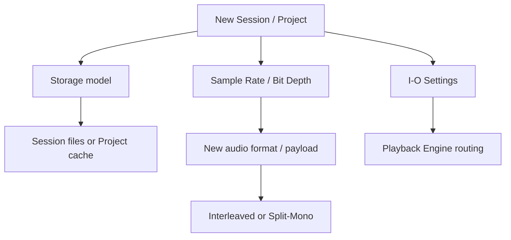

# Ch11a — 建立 Session：先決定資料放哪裡，再決定錄成什麼格式

> 新工程的 Sample Rate、Bit Depth、儲存模式與 I/O，不只是開檔選項，它們會影響後續交接、容量與工作流程。

原文：[[Pro_Tools_Reference_Guide_2023.3.pdf#page=201]]，原書 p. 169–180（PDF p. 201–212）。功能與適用條件以 **2023.3** 為準；情境例子與圖解為本筆記重新組織的教學補充。

## Session 與 Project：同樣製作，儲存方式不同

Session 的 `.ptx` 與 Audio／Video 媒體存於本地或支援的儲存系統；Project 是 2023.3 手冊中的 Avid Cloud-enabled 工程，資料與媒體形成 bundle，在本機 cache 與 Cloud 之間同步。兩者一般錄音、編輯、混音功能相近，但不能用相同方式管理檔案。

| 特性 | Session | Project（此版文件） |
|---|---|---|
| 開啟入口 | Finder／Dashboard／Open Session 等 | Dashboard |
| 資料位置 | Session File 與分開的媒體位置 | Project bundle＋local cache |
| 找單獨 Audio File | 可查 Audio Files／實際媒體位置 | 不應在 cache 隨意拆檔，需匯出媒體 |
| Avid Cloud collaboration | 不是只靠 Session 格式就具備 | Online Project 才可協作 |
| 工作完成後歸檔 | 收齊 Session 與媒體 | 可 Save Copy In 成本機 Session |

Online Project 的資料會與 Cloud mirror；Offline Project 只保存在本機 cache。第一份 Project 的建立需要 online 並登入 Avid Master Account，之後才能照相應條件離線工作。這是該版工作方式，不作現行雲端服務可用性保證。

> [!tip] 實務連結
> 個人錄音與交給另一間棚的工作，可先用清楚的 Session folder 管理；需要 Track-based collaboration 才選對應 Project 流程。不要因為名稱叫 Project，就把它當成所有 DAW 工程的泛稱。

## Dashboard 怎麼選，不需要一開就依賴 Template

Dashboard 有 Create、Recent、Projects、Getting Started 等頁。Recent 顯示最近十份 Session／Project；未登入時 Project 不會出現在清單。Getting Started 的 Beat、Singer Songwriter、Podcasting 等起點適合快速看工作架構，但不表示你每份工程都要沿用它的 routing。

建立空白 Session：`File > New` 打開 Dashboard → Create → 選 Local Storage／Session → 命名 → 不選 Create from Template → 設 format／Sample Rate／Bit Depth／I/O → 選儲存位置 → Create。用 Template 時，選 Template Group 與範本，再核對這些參數。

| 建立時的欄位 | 實際決定什麼 | 必須問自己的問題 |
|---|---|---|
| Local Storage／Collaboration and Cloud Backup | Session 還是 Project | 要本機檔案管理，還是 Cloud collaboration？ |
| File Type | 新 Audio 的 WAV／AIFF 格式 | 交接規格要求什麼？ |
| Sample Rate | 整份 Session 的取樣時間基準 | 影像、音樂或指定交付規格？ |
| Bit Depth | 新錄／轉換 Audio 的儲存精度 | 容量與後續處理需求？ |
| Interleaved | multichannel 是否放同一 Audio File | 接收方要 interleaved 還是 split-mono？ |
| I/O Settings | 起始 Path configuration | 是否對應當前 Playback Engine？ |
| Prompt for Location／Location | 每次詢問，或固定預設路徑 | 能否立刻找到工程資料夾？ |

> [!warning] 快捷鍵會受目前視窗改變
> Dashboard 裡 `Command+S` 用於 Sign In／Out，而正常 Session 裡是 Save。看懂目前視窗後再按，不要把快捷鍵當作無條件全域命令。

## Sample Rate：先照工作規格，再考慮更高值

原書以 44.1 kHz 連結 CD／音樂、48 kHz 連結影視／Video；88.2／96、176.4／192 kHz 是相應較高 rate，要 hardware 支援，且會增加儲存與處理負擔。Higher rate 不應被簡化成任何素材都「一定更好聽」的開關。

目前 Session 的 Sample Rate 不能在 Session Setup 直接改成另一個值；本章提供的轉換方法是 Save Copy In，建立不同 rate 的副本並轉換相應 Audio。若只是新增 Audio File 的 Bit Depth／File Type，則可在 `Setup > Session` 調整。

| 想改的東西 | 本章提供的方式 | 對既有媒體的影響 |
|---|---|---|
| 新錄 Audio 的 Bit Depth | Session Setup 的 Bit Depth | 不會把所有舊 Audio 自動重寫 |
| 新錄 Audio 的 WAV／AIFF | Session Setup 的 Audio Format | 既有檔可維持 mixed formats |
| Session Sample Rate | Save Copy In | 建立另一份工程，轉換所需 Audio |
| 新 multichannel file 是否 interleaved | Session Setup 的 Interleaved | 影響之後新錄或匯入並轉換的檔 |

## Bit Depth：檔案位元數與整條訊號鏈不同

16-bit 有較小檔案，24-bit 是原書描述常見的 production／post-production 選擇；32-bit floating point 可在 AudioSuite／處理與轉換流程中保留更大表示範圍、減少不必要 rounding。這不代表錄音介面的 analog stage 或 A/D converter 永遠不會 overload。

同 Sample Rate、channel count、duration 的無壓縮 payload，大致按每 sample 位元數成比例：

$$
\text{Audio payload bytes}\approx f_s\,t\,C\,\frac{b}{8}
$$

$f_s$ 是 samples／second，$t$ 是秒數，$C$ 是 channel count，$b$ 是每 sample bits；未含 header、metadata、壓縮等。這是依格式定義補充的容量直覺，不是原書實測。

| 儲存格式 | 相對 16-bit payload | 相同條件的容量關係 |
|---|---:|---|
| 16-bit PCM | 1× | 基準 |
| 24-bit PCM | 1.5× | 24／16，不是更小 |
| 32-bit float | 2× | 比 24-bit 大約三分之一 |

> [!warning] 原書 p.173 疑似筆誤
> 該頁把 24-bit 相對 16-bit 的容量寫成「三分之一」的方向，與位元數不符。本筆記依 $24/16=1.5$ 說明，沒有照錯句翻譯；詳見 [[PT-00-版本與原文疑義]]。

## Interleaved 與 Multi-Mono：通道內容怎麼包裝

Interleaved 把 Stereo／Multichannel channels 收在同一個檔案；Multi-Mono／Split-Mono 則把各 channel 分開成 mono files。Stereo split-mono 常見 `.L`、`.R` 配對，在 Stereo Track 中可當成一組編輯，也能拆成各自的 Mono Track。

選哪種應看後續需求，不能把「一個檔」誤認成聲道被合成 mono。反過來，多個 mono files 也要保留配對與命名，否則交接時容易缺其中一邊。

> [!abstract] Takeaway
> 建 Session 時先確定儲存方式、交付 Sample Rate 與檔案位置，再看 Bit Depth、Interleaved、I/O。格式設定決定新資料如何建立；它不會自動把所有舊檔變成同一格式，也不能代替完整備份。

![[PT-Ch11-concept.png]]

圖解讀法：依相同 Sample Rate、時長、channel count 的位元數自算 payload 比例，排除 header、metadata、壓縮等；不是原書測量數據。

## 相關

%% PT-NAV-BEGIN %%

上一篇：[[PT-Ch10-MIDIStudio與AudioBridge]]

下一篇：[[PT-Ch11b-儲存備份與工程交接]]

按任務閱讀：[[PT-00-工作流程導航]]

%% PT-NAV-END %%

[[PT-Ch11b-儲存備份與工程交接]] · [[PT-Ch11c-Project版本與Template]] · [[PT-Ch06c-跨系統映射與AuxIO]]

[[PT-00-索引]] · [[PT-00-功能目錄]] · [[PT-00-快速檢索]] · [[PT-00-Mac快捷鍵]]

標籤： #pro-tools #audio #study-note
