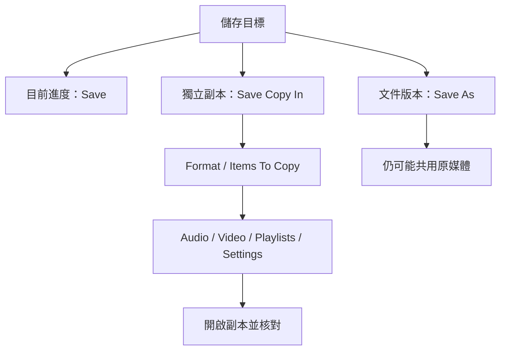

# Ch11b — Save、Save As、Save Copy In：三種儲存解決三種問題

> Save 保存目前進度，Save As 分出文件版本，Save Copy In 才能依選項收齊媒體、轉換格式並準備獨立交接。

原文：[[Pro_Tools_Reference_Guide_2023.3.pdf#page=207]]，原書 p. 175–188（PDF p. 207–220）。功能與適用條件以 **2023.3** 為準；情境例子與圖解為本筆記重新組織的教學補充。

## Session folder 裡的檔案各有角色

`.ptx` 保存 Session 的安排，Audio File 是外部引用。Audio Files folder 通常收錄新錄或轉換的 Audio；若 Disk Allocation／匯入方式把資料留在其他位置，這裡未必有所有引用的聲音。看到「資料夾裡已經有 Audio Files」不能保證完整。

| 名稱 | 主要內容／用途 | 歸檔時要知道 |
|---|---|---|
| `.ptx` | Session 文件 | 必要，但不包含全部 Audio／Video |
| Audio Files | 新錄／轉換媒體 | 還要查外部引用 |
| Session File Backups | Auto Backup 的工程狀態 | 不是每次完整複製 Audio |
| Bounced Files | Bounce Mix 預設輸出位置 | 成品與可編輯工程不同 |
| Rendered Files | Rendered Elastic Audio 暫存等 | 部分資料可重新生成 |
| Clip Groups | 匯出的 Clip Groups | 看是否為本次交付必需 |
| Video Files | Session 的預設 Video 位置 | 匯入也可能仍引用外部檔 |
| WaveCache.wfm | waveform 顯示快取 | 可重算，不是原始 Audio |
| Fade Files | 舊版 rendered fades 可能留下 | 10.0 之後使用 real-time fades，不等同舊機制 |
| Renamed Audio Files | 不合法名稱等情況產生的新副本 | 原檔仍保留，查 Notes report |

> [!tip] 實務連結
> 把「聲音能不能重建」與「畫面快不快」分開：WaveCache 可重新計算，原始 Audio 不能靠 `.ptx` 重新長出來。清理磁碟前先辨識角色。

## 開工程時的提示，是問題清單而非雜訊

Unavailable Resources 可能列出缺 Plug-In、I/O、DSP、Voice；相應 Insert／Path 可能 inactive，超出能力的 Tracks 也可能無法發聲。可以保存 Notes report，逐項排查，而不是跳過後才猜哪一條沒聲音。

Transfer Volume（如光碟）開啟時，Pro Tools 會要求移到可工作儲存位置並複製／轉換引用媒體。檔案名稱含 `/`、`\`、`:`、`*`、`?`、引號、`<`、`>`、直線等不支援字元時，原書描述會建立用底線替換名稱的副本，放到 Renamed Audio Files，原檔不變，並可產生報告。

Plug-In 造成開檔慢或不穩時，可在 Open Session dialog **Shift-click Open**，讓全部 Plug-Ins inactive。這是用來隔離問題；不是把效果永久刪除。重新正常開啟或按該版本支援方式恢復，仍要檢查各 Plug-In 是否真的可用。

## 三種儲存的行為一次比較

| 命令 | 做了什麼 | 接下來繼續改哪一份 | 媒體會完整複製嗎 |
|---|---|---|---|
| Save | 覆寫目前 Session／保存進度 | 目前這份 | 不因此複製所有媒體 |
| Save As | 另存 Session 文件新名稱 | 新名稱的文件 | 不複製一整套 Audio |
| Save Copy In | 依格式與 Items To Copy 建副本 | **仍是原 Session** | 依你勾選的項目 |
| Revert to Saved | 放棄未存變更，回最後儲存狀態 | 還原後的目前文件 | 不修復遺失媒體 |

Save 本身不能 Undo；Delete Track 等也有不能 Undo 的情況。需要實驗分支時，可以先 Save As 留版本，但它引用相同媒體，不是物理隔離的獨立 archive。

> [!warning] Save Copy In 完成後，你還在原檔
> 若目的是把工程移到新磁碟繼續工作，完成副本後要明確關閉原檔、開新副本並核對路徑。否則你可能以為在改新版本，實際仍寫回原處。

## 做可交付副本的操作順序

1. 先 Save，目前工作狀態才有明確基準。
2. `File > Save Copy In`，選相應 Format，例如 Session（Latest）。
3. 設 Audio File Type、Sample Rate、Bit Depth；需要統一所有 copied Audio 時查 Convert To Specified Format。
4. 在 Items To Copy 選需要的 Audio、Video、設定等；想含所有 Session 正在使用的 Audio，勾 All Audio Files／相應 Audio Files 選項。
5. 決定是否保留所有 Alternate Playlists，還是只 Main Playlist；是否只選取 Tracks。
6. 儲存到清楚的目的地。
7. **開啟新副本實際核對** missing files、routing、Plug-In 與播放內容，再進行傳送或刪除舊副本等後續動作。

本筆記只提供交接步驟，不執行檔案刪除。手冊所說「全部 Audio」是 Session 所使用的檔案，不包含早已從 Session 移除、只殘留在磁碟上的任意檔案。

| Items To Copy／選項 | 開啟時的效果 | 可能漏掉什麼 |
|---|---|---|
| Audio Files | 把引用的相應 Audio 收到新位置 | 已移出 Session 的磁碟檔不算 |
| Convert To Specified Format | 依所選格式／bit depth 等做轉換 | 關閉時可保留原格式 bit-by-bit copy |
| Main Playlist Only | 只含主要 Playlist | Alternate Takes 不在副本 |
| Selected Tracks Only | 只含選定 Track | 未選 Track 的內容／安排 |
| Movie／Video Files | 複製並重指向新 Video | 不勾可能仍引用舊位置 |
| Don’t Copy Elastic Audio Rendered Files | 不帶可重生成的 rendered files | 新開檔需重新生成 |
| Session／Root Plug-In Settings | 保存相應 settings folders | Root settings 可能需手動放回目的系統指定位置 |
| Preserve Folder Hierarchy | 保留原媒體跨磁碟／資料夾的相對布局 | 不勾則可集中同類資料 |
| Clip Effects Quick Presets | 帶自訂 Clip Effects Presets | 不等於 Plug-In 已安裝在另一台機器 |

## 降 Bit Depth 的 Dither，是命令本身的規則

原書 p.185 明確列出 Save Copy In 的轉換表：32-bit float→24／16-bit、24→16-bit 時自動使用 Dither＋Noise Shaping；同 bit depth 或升 bit depth 時不使用。這不是所有 Export／Bounce 命令一律相同的規則，不能把 Save Copy In 的行為延伸到任何檔案轉換。

| 轉換（Save Copy In） | Dither／Noise Shaping |
|---|---|
| 32-bit float →24-bit／16-bit | Yes／Yes |
| 24-bit →16-bit | Yes／Yes |
| 同 Bit Depth | No／No |
| 16-bit →24-bit／32-bit float | No／No |
| 24-bit →32-bit float | No／No |

> [!abstract] Takeaway
> 想留製作版本，用 Save As；想交出可重建的工程，用設定正確的 Save Copy In，再真的開副本驗證。不要把有 `.ptx`、有 Auto Backup 或有 Bounce 成品，誤認成可編輯素材已完整備份。

![[PT-Ch11-concept.png]]

圖解讀法：依相同 Sample Rate、時長、channel count 的位元數自算 payload 比例，排除 header、metadata、壓縮等；不是原書測量數據。

## 相關

%% PT-NAV-BEGIN %%

上一篇：[[PT-Ch11a-建立Session與媒體格式]]

下一篇：[[PT-Ch11c-Project版本與Template]]

按任務閱讀：[[PT-00-工作流程導航]]

%% PT-NAV-END %%

[[PT-Ch11a-建立Session與媒體格式]] · [[PT-Ch11c-Project版本與Template]] · [[PT-00-功能目錄#Ch22 — File and Session Management and Compatibility]]

[[PT-00-索引]] · [[PT-00-功能目錄]] · [[PT-00-快速檢索]] · [[PT-00-Mac快捷鍵]]

標籤： #pro-tools #audio #study-note
