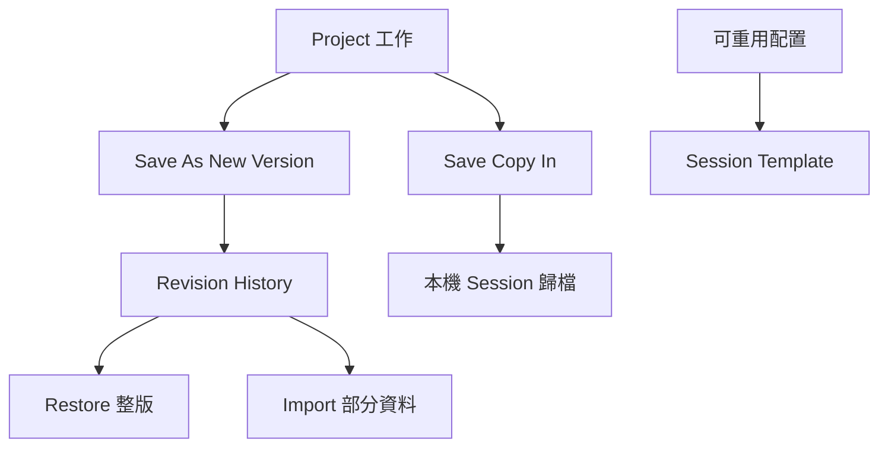

# Ch11c — 把 Project 的版本、Template 與製作註記管清楚

> 版本是作品狀態，Template 是可重用的起點，Cloud cache 是同步資料；三者不能用同一個「備份」概念代替。

原文：[[Pro_Tools_Reference_Guide_2023.3.pdf#page=220]]，原書 p. 188–201（PDF p. 220–233）。功能與適用條件以 **2023.3** 為準；情境例子與圖解為本筆記重新組織的教學補充。

## Project 版本：Save As New Version 與 Revision History

Project 使用 `File > Save As New Version` 建立具標題的新版本，可以附 Project Notes。每一版的 title 必須唯一，不能用同名直接覆寫另一版。`File > Revision History`（Mac：Command+Control+O）列出各版及其手動／自動保存的 histories。

| 命令／操作 | 作用 | 要先理解的結果 |
|---|---|---|
| Save As New Version | 新建作品版本 | 不等於只有改檔名 |
| Restore | 關閉目前 active version，開所選版本 | 可能先提示儲存未存變更 |
| Import | 從另一版匯入特定資料 | 不必整版回復即可取回某條 Track |
| Rename | 改版本標題 | 名稱仍需唯一 |
| Delete version | 永久移除該版及完整 Save History | 不能視為普通 Hide |
| Delete history | 移除某一個手動／自動保存點 | 不是整個版本都刪除 |

Revision History 的自動 save points 會隨時間 thinning，保留較合理的分布，不會永遠保存每一筆。原書列原始版本、最新 manual save、最近兩次 automatic backups 等保留規則，也把近兩小時、24 小時、一週內的保存密度分開。重要的狀態應明確建版本／歸檔，不應期待自動 save history 永久保持同一密度。

> [!tip] 實務連結
> 舊版有最好的 Guitar Solo，但其他 Tracks 以新版為準，用 Import 取回那一條，而不是 Restore 整份再重新做所有修改。這就是「版本回復」與「資料挑選」的差別。

## Cloud conflict：決定哪一邊是這次要保留的內容

切回較舊版本時，local active version 可能與 Cloud 最新 shared Tracks 不一致。原書說即使 Auto Upload All／Auto Download All 已開，偵測到 conflict 時也不會直接互相覆寫，而是提示可選擇上傳覆寫 Cloud、下載覆寫 local、保持不變，或 unshare conflicting Tracks。

| 選擇 | 你認定哪份內容要當這次結果 | 風險 |
|---|---|---|
| Upload／overwrite Cloud | 目前 local 內容 | 可能蓋掉合作對象較新的內容 |
| Download／overwrite local | Cloud 內容 | 可能失去本機尚未保留的修改 |
| Do nothing | 暫不裁定 | 差異仍存在，不能假設已同步 |
| Unshare conflicting tracks | 把本機分支隔開 | 後續合作範圍改變 |

先看衝突 Track 名稱與你要保留的版本；不要為了關掉對話而隨意選一個方向。本章是功能說明，不會替你執行任何 Cloud 覆寫或刪除。

## Session 與 Project 互轉，要檢查媒體與頻寬

用 Save Copy In 可把 Session 存成 Project，或把 Project 存成本機 Session。Session→Project 前，可以先整理不需要分享的內容、把只用到大檔一小段的 Clip consolidate，降低 upload／download 量；但這是有目的地製作分享副本，不等於應在唯一原始工程裡刪除所有 Alternate Takes。

Project→Session 前先接受／拒絕 shared Track changes，再 Save Copy In 選 Session（Latest），核對轉出內容。完成後開啟該 Session 驗證，才有獨立歸檔的依據。

## 三種 Cloud／Cache 操作後果差很多

| 操作 | Local cache | Cloud copy | 協作／其他電腦 |
|---|---|---|---|
| Remove Local Cache（Online Project） | 移除本機副本，可再下載 | 保留 | 仍可由 Cloud 恢復 |
| Disable Backup to Cloud | 留本機 cache | 原書描述會移除 Cloud Project／media | 變 Offline，不能跨機器存取或協作 |
| Delete Project（你是 Owner） | 不可視為安全歸檔手段 | 原書明示永久刪除且不可復原 | 不應在未歸檔前做 |
| Delete Project（只是 Collaborator） | 退出該協作 | Owner／其他人的 Project 保留 | 相當於移除自己參與 |

Shared Project 或 cache 已清除的某些狀態不能直接 Disable Backup to Cloud。Project 所有媒體的 Cloud storage 也算 Owner 的 allocation，不是誰上傳就一定算誰的額度。

> [!warning] Offline 不等於備份完成
> 關掉 Backup to Cloud 不是「留一份 Cloud 再斷線」；此版文件描述會刪掉 Cloud copy，只剩本機 cache。若目的是保存作品，先轉為完整 Session 並驗證。

## Template：把工作方法存起來，不只複製一堆 Tracks

Session Template 用 `.ptxt` 區分 `.ptx`。先建立合適的 Tracks、routing、Plug-In 與顯示設定，再選 `File > Save As Template`。Install Template In System 可放到供 Dashboard 讀取的分類，Category 可新增；Select Location For Template 則選任意目的地，但若不在正確 Template category 位置，不會自動出現在 Dashboard。

| Template 選項 | 作用 | 建議檢查 |
|---|---|---|
| Name | 可重用起點的名稱 | 如 Vocal Tracking、Mix Prep，具用途 |
| Category | Dashboard 分類 | 不需要每個版本另開難找分類 |
| Include Media | 帶入 Session 的 Audio／MIDI／Video 媒體 | 會包含所有相關媒體，先清掉不想散布的內容 |
| Install Template In System | 安裝到 Dashboard 可讀位置 | 依 Root Settings Folder 設定 |
| Select Location For Template | 自訂檔案位置 | 未必立即出現在 Dashboard |

模板不必很大。一條 Instrument、一條 Vocal、共享 FX return 和適當 Master control，就能作為創作起點；更重要的是 I/O、timebase 與預設行為符合用途。若把舊作品的巨大媒體全帶進去，新建工程就只是另一份笨重副本。

> [!note] 原書副檔名有一處疑義
> p.194 明確列 `.ptxt`，p.196 又出現 `.ptt` 的寫法。本筆記以前者作為該版 Session Template 定義，保留原頁供對照，不另杜撰一種新格式。

## Metadata Inspector 與 Project Notes：把背景寫在適當地方

`Window > Metadata Inspector` 可看／編輯 Title、Artist、Contributor、Location 等，Sample Rate、Bit Depth、Date、BPM 等部分欄位是顯示資訊，不是修改 Session format 的入口。Project Owner 等欄位也由 Project 身分決定。

Project Notes 是**隨特定版本**保存的註記，可寫待辦、修訂內容或工作提醒。Track Comments 則屬特定 Track；不要把整份作品版本紀錄都塞進某條 Track 名稱。

> [!abstract] Takeaway
> 用版本保存作品決策，用 Template 保存工作架構，用 Metadata／Notes 保存脈絡。清 cache、轉 Offline、Delete Project 的後果各不相同；任何歸檔都要以能實際開啟並重建媒體為準。

![[PT-Ch11-concept.png]]

圖解讀法：依相同 Sample Rate、時長、channel count 的位元數自算 payload 比例，排除 header、metadata、壓縮等；不是原書測量數據。

## 相關

%% PT-NAV-BEGIN %%

上一篇：[[PT-Ch11b-儲存備份與工程交接]]

下一篇：[[PT-Ch12a-主要視窗與Transport]]

按任務閱讀：[[PT-00-工作流程導航]]

%% PT-NAV-END %%

[[PT-Ch11a-建立Session與媒體格式]] · [[PT-Ch11b-儲存備份與工程交接]] · [[PT-Ch08d-協作同步與設定作用範圍]]

[[PT-00-索引]] · [[PT-00-功能目錄]] · [[PT-00-快速檢索]] · [[PT-00-Mac快捷鍵]]

標籤： #pro-tools #audio #study-note
