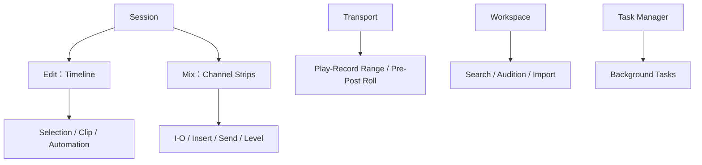

# Ch12a — 同一份 Session，用 Edit 看時間，用 Mix 看訊號

> Edit 與 Mix 不是兩份工程：前者把資料攤在 Timeline，後者把 Track 攤成 channel strips，Transport 則決定從哪裡播放或錄音。

原文：[[Pro_Tools_Reference_Guide_2023.3.pdf#page=235]]，原書 p. 203–220（PDF p. 235–252）。功能與適用條件以 **2023.3** 為準；情境例子與圖解為本筆記重新組織的教學補充。

## 不要只記視窗名稱，要記每個視窗在回答什麼

`Window > Edit` 與 `Window > Mix` 是主要入口，Mac 用 **Command+=** 切換兩者。Edit 中的 Track 與 Mix 中的 channel strip 對應同一份資料與控制；改 Fader 或 Mute，不會因換到另一個視窗就變成另一份混音。

| 視窗／面板 | 最適合回答的問題 | 常見用途 |
|---|---|---|
| Edit | 什麼資料在何時出現？ | Clip、MIDI、Automation、段落編排 |
| Mix | 訊號去哪裡、level 與處理怎麼設？ | Insert、Send、I/O、Pan、Fader |
| Transport | 從哪裡開始、播放／錄什麼範圍？ | Play／Record、Pre／Post-Roll、Counters |
| Plug-In window | 這個處理器如何調參數？ | Frequency、Q、Compression controls 等 |
| MIDI Editor／Score Editor | MIDI events 如何排列或記譜？ | Notes、Controller lanes、Notation |
| Workspace Browser | 素材在哪裡，能否預聽與匯入？ | 搜尋、metadata、Soundbase、Catalog |
| Task Manager | 背景工作正在做什麼？ | Copy、Index、Search 等進度與錯誤 |

Artist Chat 是 Project 協作者的通訊入口；in-application browser 則提供 Help、Knowledge Base、Forums、Support 等網頁資源。它們不是 Audio routing 的一部分。

> [!tip] 實務連結
> 先在 Edit 對齊與剪好人聲，再到 Mix 看 gain staging／Sends／Inserts；需要反覆比較時用 Window Configurations 存工作視角，見下一篇。不要把每次找面板的時間算進剪輯技巧。

## Edit Toolbar：先看選取與狀態，再動工具

Toolbar 有 Edit Modes、Edit Tools、Counters、selection indicators、Grid、Nudge 等。Edit Mode 會改變移動、貼上與工具的行為；Grid 是對齊尺度，Nudge 是微移步長，不能因為都是時間值就當作同一項。

| 顯示項 | 代表什麼 | 讀錯的代價 |
|---|---|---|
| Main／Sub Counter | Edit insertion 的主要／次要 timebase 位置 | 用錯單位判斷時間 |
| Cursor Location | 滑鼠當前位置 | 不一定就是播放開始點 |
| Cursor Value | Audio peak、MIDI pitch 或該 automation 值 | 不同 Track View 意義不同 |
| Edit Selection Start／End／Length | 目前 Edit 範圍 | 不是每時候都等於 Timeline playback 範圍 |
| Grid／Nudge | 對齊間距／每次微移量 | 改 Grid 不會自動改 Nudge |
| MIDI Selection | note number、Note On／Off velocity 等 | MIDI 資料與 Audio amplitude 不同 |

額外 Toolbar 元件可在右上 menu 或 Right-click Toolbar 選擇顯示，例如 Zoom、Transport、Quantize、MIDI Controls、Synchronization、Ableton Link、Output Meters、EUCON、Track Collaboration、MIDI Input 等。需要的才顯示，避免每項都開造成視覺干擾。Mac **Command-drag** 可重排元件。

## 指示燈不是裝飾，它們能縮小問題範圍

| Indicator | 重要狀態／功能 |
|---|---|
| Timeline Data Online | 當前 Track playlists 使用的資料是否可播放；綠可用、紅不可用／處理中 |
| Session Data Online | 整份 Session 引用的 Audio 是否可用；紅色可點入 Relink |
| Delay Compensation | 啟用 Options > Delay Compensation 時才顯示 |
| Task Manager | 背景忙碌會動畫，需要注意時可紅色；點擊開 Task Manager |
| Global Freeze | 至少一條 Track frozen 時亮；相關批次操作有 Track 類型／hidden／inactive 限制 |
| Track Solo | 有 Solo 時亮；可點擊清除所有 Solo |
| Track Mute | 有 Mute 時亮；**不能把點擊當作 Clear All Mutes** |

Timeline Data Online 與 Session Data Online 的差異尤其重要：目前排列正在用的檔案都在，可能仍有 Session 引用的其他檔案離線。播放這段沒問題，不代表所有 Alternate Takes／Clip 都已齊全。

> [!warning] Waveform zoom 不等於 Audio gain
> Audio Zoom 只是畫面上 waveform 的垂直放大；Track Height 改的是軌高。兩者都不會把 Audio 變大聲，應與 Clip Gain、Fader 分開。

## Transport：Timeline Selection與Edit Selection要先分清

Transport 的 Start、End、Length 定義播放／錄音範圍。Pre-Roll 在該範圍前先播放，幫錄音者接上節奏；Post-Roll 讓範圍結束後繼續播放，確認 Punch 接回原素材是否自然。當 Timeline 與 Edit selections linked 時，圈 Track 內容可以同時定義播放範圍；unlinked 時則不應這樣假設。

| 控制 | 本章作用 | Mac 常用入口／提醒 |
|---|---|---|
| Return to Zero | 到 Session 開始 | Return |
| Go to End | 到 Session 末端 | Option+Return |
| Stop／Play | 停止／播放 | Spacebar；Numeric 0 需 Transport mode |
| Record | 先 armed Transport，再 Play 開始 | 只在 Record-enabled Tracks 錄音 |
| Half-Speed Playback | 以半速播放 | Shift+Spacebar |
| Online | 讓外部 timecode 觸發相應播放／錄音 | 不是「登入 Internet」 |
| Record Enable indicator | 至少一條 Audio Track armed 時紅色 | 不代表已經錄到磁碟 |
| TrackInput Monitor indicator | 至少一條 Audio Track 處於 Input Only 時綠色 | 與 Record Enable 是不同狀態 |

Right-click Play 可選 Loop、Half-Speed、Dynamic Transport 等；Right-click Record 可選 Normal、Loop、QuickPunch、Destructive 等，部分需 Ultimate／HD 配置。破壞性模式有不同結果，不能只因「Record 按鈕長得差不多」就不核對。F12、Command+Spacebar 等錄音按鍵還會遇到 macOS／function-key 衝突，集中見[[PT-00-Mac快捷鍵]]。

## MIDI Controls：Tempo map、Countoff與等待第一個事件

| MIDI control | 作用 | 重要條件 |
|---|---|---|
| Wait for Note | 收到 MIDI event 才開始 record | 第一個事件會對到 record range 起點 |
| Metronome Click | 啟用 Click pulse | Double-click 開 Click／Countoff Options |
| Count Off | 開始前數指定小節 | 與 Timeline Pre-Roll 不是同一設定 |
| MIDI Merge | 新錄 MIDI 合併既有資料 | 關閉改為 Replace |
| Tempo Ruler Enable／Conductor | 使用 Tempo ruler 的 map | 關閉才用 Manual Tempo，忽略 map |
| Current Meter／Tempo | 顯示播放位置的拍號／速度 | Manual Tempo 可輸入或 Tap Tempo |

Wait for Note 的 F11 可能被 macOS 的 Desktop command 攔截；不要為此改成完全不同的錄音模式。Countoff、Click、Merge 也可由 Numeric Keypad Transport mode 呼叫，前提仍要看 Ch03。

## Docked Editor與Workspace：不用把整份畫面切走

Edit window 底部可切 MIDI Editor、Melodyne、Clip Effects；`View > Other Displays`選擇顯示。Show／Hide Docked Editor icon 或 double-click 分隔線可叫出上次面板。MIDI pane 與 Tracks pane 有不同 Toolbar focus，切工具前先看黃色外框。

Workspace 可開多個，各自保存顯示。Locations pane 選 Volume／Catalog／Session，Browser pane 顯示其內容或 Search results；Column headers 可重排 metadata 欄位，Soundbase 可加描述性 tags，Track Presets 用來整理預設。Task Manager 監看背景 copy／index，不是素材本身已播放進 Track 的保證。

> [!abstract] Takeaway
> Edit 看時間、Mix 看接線與 level、Transport 看播放範圍。先讀 Counters 與 Indicators，分清 Timeline／Edit selection、MIDI／Audio、顯示 Zoom／真實 Gain，再開始按工具。

![[PT-Ch12-concept.png]]

圖解讀法：此圖是原創概念示意，位置、比例與箭頭僅表達本章關係；不代表軟體畫面或實測效能。

## 相關

%% PT-NAV-BEGIN %%

上一篇：[[PT-Ch11c-Project版本與Template]]

下一篇：[[PT-Ch12b-WindowConfigurations與介面管理]]

按任務閱讀：[[PT-00-工作流程導航]]

%% PT-NAV-END %%

[[PT-Ch12b-WindowConfigurations與介面管理]] · [[PT-Ch03-KeyboardFocus與操作模式]] · [[PT-Ch13a-Track類型與Metering]]

[[PT-00-索引]] · [[PT-00-功能目錄]] · [[PT-00-快速檢索]] · [[PT-00-Mac快捷鍵]]

標籤： #pro-tools #audio #study-note
