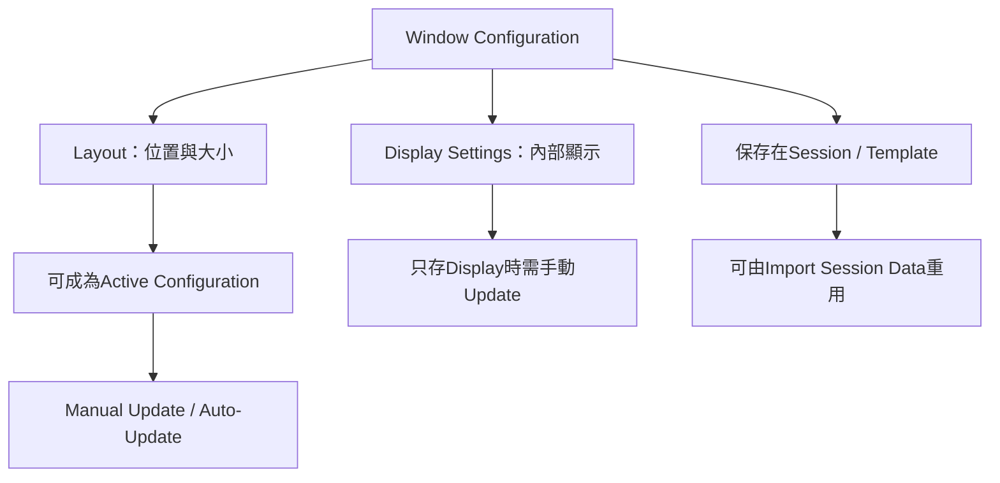

# Ch12b — Window Configurations：把工作視角存起來

> 一套 Window Configuration 保存視窗布局或顯示設定，讓你在錄音、剪輯與混音間切換時，不必重新排列整個桌面。

原文：[[Pro_Tools_Reference_Guide_2023.3.pdf#page=253]]，原書 p. 221–231（PDF p. 253–263）。功能與適用條件以 **2023.3** 為準；情境例子與圖解為本筆記重新組織的教學補充。

## Layout與Display Settings不是同一件事

Window Layout 記錄已開視窗的位置與大小；Window Display Settings 記錄指定視窗裡顯示哪些元素，例如 Edit 的 Clips List 寬度、rulers、Inserts／Sends 欄位、Toolbar arrangement，或 Mix 的 Narrow／Wide 顯示。兩者可配合，也可只保存 Display Settings。

| 儲存內容 | 回復什麼 | 例子 |
|---|---|---|
| Window Layout | 開哪些視窗、位置與大小 | Edit 在左螢幕、Mix 在右螢幕 |
| Edit Display Settings | Edit 內部的清單、rulers、欄位、Toolbar 等 | 剪輯時隱藏不需要的混音欄位 |
| Mix Display Settings | Mix 內部顯示內容與寬度等 | 混音時顯示 Inserts、Sends、Delay Compensation |
| Transport Display Settings | Counters、MIDI Controls、Expanded 等 | 錄音時方便設定 Pre／Post-Roll |
| Include MIDI Lanes | MIDI Automation lanes 的布局 | 編寫 Expression 時保留需要的 CC lanes |

原書最多 99 個 Configuration，隨 Session 保存。可以放進 Template，或透過 Import Session Data 帶進其他 Session。它不是全電腦視窗管理器，Window Configuration List 本身的位置／大小也不在其保存內容內。

> [!tip] 實務連結
> 建立三個明確用途的配置比建立九十九個更實用：Tracking 看 Transport 與 Input、Editing 看 Timeline 和 Playlists、Mixing 看 Channel strips 與 Inserts。這是本筆記建議的分類方式，不是原書固定 Preset。

## 建立與叫回的操作

1. 打開需要的視窗，排好位置與顯示項目。
2. `Window > Configurations > New Configuration`。
3. 選 Window Layout 與要包含的 Display Settings，或只選某個 Window Display Settings。
4. 如有需要，選 Include MIDI Lanes。
5. 命名、填 Number（1–99）及 Comments，再 OK。

開清單用`Window > Configurations > Window Configuration List`；Mac 為 Command+Option+J。叫回可從 Window > Configurations、清單項目，或 Numeric Keypad 依序按`.`、編號、`*`。這與 Memory Location 的`.`、編號、`.`不同，最後一個符號決定你叫回哪種東西。

| Numeric Keypad 序列 | 用途 | 限制／風險 |
|---|---|---|
| `.`、1–99、`*` | 叫回 Window Configuration | 要有該編號 |
| `.`、0、`*` | 前後切換上一個 Window Configuration 狀態 | 單層 undo／redo，不是一般 Edit Undo |
| `.`、1–99、`+` | 在指定 slot 建立 Configuration | 該 slot 已有內容時會覆寫 |

## 手動Update或Auto-Update，會得到不同保存習慣

叫回後可以`Update Active Configuration`，把現在的布局／設定存回。Auto-Update Active Configuration 則在你調整布局或顯示時持續更新 active 配置。只有含 Window Layout 的 Configuration 可以成為 active，因此只存 Display Settings 的那種，不能期待它自動保存每次改動。

| 管理命令 | 結果 | 適合情境 |
|---|---|---|
| Edit | 改名稱、編號、保存的屬性等 | 調整這個配置的定義 |
| Update | 用當前視窗狀態覆蓋選定配置內容 | 你確定要保留這次修改 |
| Auto-Update | 持續記錄 active 配置的改動 | 希望該配置跟著工作習慣調整 |
| Clear | 移除配置內容，保留其他 slot 編號 | 想以新配置填回相同 slot |
| Delete Slot | 移除內容與 slot，後續編號重排 | 願意改變其餘叫回編號 |
| Insert Slot Before | 在某 slot 之前插入，必要時後續加號 | 重新設計編號排序 |

> [!warning] Clear 與 Delete 不是同一個結果
> 若你已把 Numeric Keypad 編號記成習慣，Delete 引起的重排可能讓既有序列叫出不同配置。只是想替換某個 slot，先看 Clear。

Import 其他工程的配置：`File > Import > Session Data`，勾 Window Configurations；只想帶配置時，把 Session Data to Import 改 None，再 OK。這不等於要把原工程的所有 Tracks 與媒體一起匯入。

## Menu的功能分類，能減少搜尋成本

| Main menu | 主要管什麼 |
|---|---|
| File | Session 建立、開啟、儲存與維護 |
| Edit | 目前 selection、clipboard 與 Timeline 資料操作 |
| View | 畫面顯示哪些元素 |
| Track | Track 建立、管理與編輯 |
| Clip | Clip 管理與編輯 |
| Event | Audio／MIDI events 操作 |
| AudioSuite | AudioSuite Plug-In |
| Options | 編輯、錄音、監聽、播放等工作模式 |
| Setup | Hardware、軟體參數與設定視窗 |
| Window | 顯示／切換各視窗 |
| Avid Link | 本版的帳號、產品與社群入口 |
| Help | 文件、Knowledge Base 與 Support |

Track Name、Clip Name、Group Name 以及清單都有情境 Right-click／pop-up menu；它們依對象不同提供命令，不能因 menu 同樣有 Rename 就忽略「你正在改的是 Track 還是原始媒體」。

## 畫面整理與可讀性

`Window > Arrange`可 Tile、Tile Horizontal／Vertical 或 Cascade 一般視窗，但 Floating windows 與 Transport 不受這類排法同樣影響。Hide All Floating Windows 可先清空漂浮面板（Mac：Command+Option+Control+W），Command+W 關最前視窗。把視窗藏起來不是把 Track 或 Plug-In inactive。

UI Theme 可在 Display Preferences 或 Color Palette 選 Classic／Dark；Color Palette 裡 UI Customization 可調亮度與特定元素，High Contrast UI 提高文字與背景對比。Color Palette Preset 可保存整套 Theme／color settings，Quick Presets 1–5 可快速叫回；Mac Command-click 對應按鈕保存。

> [!tip] 實務連結
> 低光錄音室可調 Dark 與 High Contrast，但不要把 Waveform、selection 與 automation curve 調成難辨識的近似顏色。UI 設定的目標是減少誤判，並非所有元素越暗越專業。

> [!abstract] Takeaway
> 把「我正在做什麼」做成可叫回的視角。理解 Layout／Display、Update／Auto-Update、Clear／Delete 的差異，配置才會穩定可用，而不會每次叫回都像碰運氣。

![[PT-Ch12-concept.png]]

圖解讀法：此圖是原創概念示意，位置、比例與箭頭僅表達本章關係；不代表軟體畫面或實測效能。

## 相關

%% PT-NAV-BEGIN %%

上一篇：[[PT-Ch12a-主要視窗與Transport]]

下一篇：[[PT-Ch13a-Track類型與Metering]]

按任務閱讀：[[PT-00-工作流程導航]]

%% PT-NAV-END %%

[[PT-Ch12a-主要視窗與Transport]] · [[PT-Ch11c-Project版本與Template]] · [[PT-Ch08a-顯示與錄音操作偏好]]

[[PT-00-索引]] · [[PT-00-功能目錄]] · [[PT-00-快速檢索]] · [[PT-00-Mac快捷鍵]]

標籤： #pro-tools #audio #study-note
