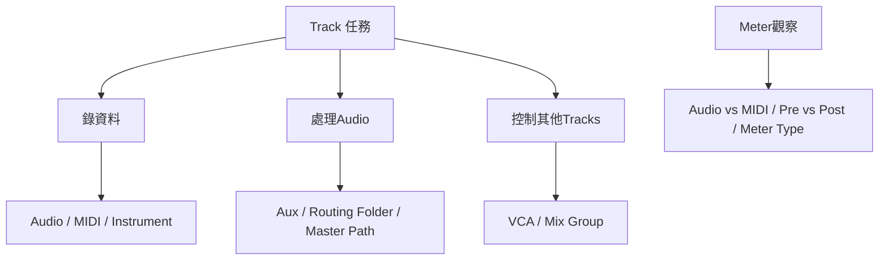

# Ch13a — Track類型：選對資料容器，也選對控制方式

> Audio、MIDI、Auxiliary Input、Master Fader 與 VCA 的外觀相似，但它們處理的資料、路由與控制對象並不相同。

原文：[[Pro_Tools_Reference_Guide_2023.3.pdf#page=265]]，原書 p. 233–250（PDF p. 265–282）。功能與適用條件以 **2023.3** 為準；情境例子與圖解為本筆記重新組織的教學補充。

## 先問這條Track要錄資料、處理Audio，還是控制別人

Audio Track 把 Audio 錄進磁碟，也從 Audio File 播放；Auxiliary Input 通過並處理 Audio，常做 FX return 或 Submix；MIDI Track 錄的是事件，不承載 Audio；Instrument Track 把 MIDI 與 Audio 控制放在同一條 channel strip。這些差別直接決定你能在 Track 上看到哪些 controls。

| Track type | 主要任務 | Input／Output 與處理的關鍵 |
|---|---|---|
| Audio | 錄製／播放 Audio File | 有 Audio I/O、Inserts、Sends 與 Record Enable |
| Auxiliary Input | FX return、Submix、外部音源監聽 | 通過 Audio，本身不錄 Audio 到磁碟 |
| Master Fader | 控制指定 Bus／Output path 整體 level | 作用在既有路徑，不是任意接收多軌的 Aux 替身 |
| VCA Master | 控制指定 Mix Group 成員 | 不通過 Audio，沒有 Audio I/O、Inserts、Sends |
| MIDI | 錄／播 MIDI data | 不選 mono／stereo Audio format |
| Instrument | MIDI 演奏＋Instrument Audio 處理 | 同時有 MIDI 與 Audio 兩套控制 |
| Basic Folder | 收納並總覽成員 Tracks | 不提供特殊 Audio routing |
| Routing Folder | 收納＋類似 Aux 的 Audio 處理 | 只處理實際送進其 Input 的 Audio |
| Video | Timeline 中的 Video | 僅在 Edit 出現，畫面在 Video window 觀看 |

Master Fader 與 VCA 最容易混淆。前者處理指定 Audio path 的 level；後者改變一組 Tracks 的控制關係。想整組鼓通過同一個 Compressor，需要 Audio Submix；VCA 沒有 Inserts，不會替你把鼓加總成 Audio。

> [!tip] 實務連結
> 「我想一顆 Fader 控制全部鼓」可能有兩種需求：共同 Audio processing 用 Aux／Routing Folder；只想調整一組成員的相對 level，用 VCA。先決定要改的是訊號，還是控制。

## Mono、Stereo、Multichannel描述的是Audio寬度

Mono 是一個 Audio channel，Stereo 把兩個 channels 放在同一條 Track；更寬的 format 把多聲道用同一套 Track controls 管理。Stereo Audio Track 通常用兩個 voices，並不是因為畫面只有一列就只占一個。可用 format 與軟體版本／Track type 相關，Ch05 有容量表。

原書本章部分 multichannel 敘述仍用舊範圍，另一些頁卻提 7.1.2，因此不要把「3 至 8 channels」的概念段當成本版所有 format 的完整上限；實際可選 format 應連到 Surround 章群與對應系統。

## Edit與Mix看到的是同一條Track的不同入口

Mix 的 channel strip 強調 Inserts、Sends、I/O、Pan、Fader、Meter 與 Automation mode；Edit 則多了 Playlist、Track View、Track Height、Timebase、Elastic Audio、Freeze 等時間／編輯控制。要在 Edit 看到 I/O，選`View > Edit Window > I/O`；要在 Instrument Track 看到 MIDI controls，選 Instruments view。

| 顯示區／控制 | 讀取或改變什麼 | 注意點 |
|---|---|---|
| Instruments view | MIDI Input／Output、MIDI Volume／Pan／Mute | 與下方 Audio controls 不同 |
| Inserts A–E／F–J | 每條適用 Track 最多 10 個 Insert assignments | 不是每類 Track 都有 |
| Sends A–E／F–J | 額外 Audio 送出 | MIDI／VCA／Master Fader 不提供普通 Sends |
| I/O view | Track Input／Output 與 level／Pan | Mix 常駐；Edit 可選擇顯示 |
| Real-Time Properties | MIDI Quantize、Transpose 等即時屬性 | 不等於 AudioSuite 永久 render |
| Comments | Track 註記 | 可記錄 mic、錄音條件、用途 |
| Delay Compensation view | 延遲與補償資訊 | 與 H/W Buffer 不是同一件事 |

Audio Fader 的最大 gain 為+12 dB；MIDI Volume 是 0–127 的 controller 值，效果取決於音源支援。Volume／Peak／Channel Delay indicator 可用 Mac Command-click 切換顯示，別把顯示的 delay 值誤認成目前 Fader level。

## Meter是觀察點，不是Volume旋鈕

Audio Track 在 record-enabled 或 input-enabled 時顯示相應 input／monitoring level；一般播放時顯示 disk playback 相關 level。MIDI Track 的 meter 顯示最近事件的 velocity，不是合成器的 Audio loudness；Instrument Track 同時提供這兩種資訊，要看你在讀哪一個 meter。

| Meter／刻度 | 代表什麼 | 不要誤讀 |
|---|---|---|
| Fader Gain scale | Fader 對訊號加／減多少 dB | 不等於該聲音目前 peak 是多少 |
| Track Signal Meter | 該 Track 選定觀察位置的 level | 需看 pre／post-fader 與 meter type |
| MIDI Velocity Meter | 最近 MIDI 事件 velocity | 不保證音源發出的音量相同 |
| Gain Reduction Meter | 支援 Dynamics Plug-In 的 GR | 不是 Track Fader attenuation |
| Peak Hold | 保留最近 peak 的顯示 | 不代表當下仍有相同 level |

`Options > Pre-Fader Metering`切換觀察位置。Pre-Fader 不隨 Fader 變動；Post-Fader 會跟著變。錄音時把 Fader 拉小、看到或聽到較低 level，不代表介面前級／A/D 就不會 clip；要在正確的輸入位置觀察。

> [!warning] 改表頭類型不會改善 Audio 本身
> VU、RMS、Sample Peak 的 scale 與 ballistics 不同。同一份 Audio 換表頭後讀值不同，是觀察方式改變，不能當作訊號已被正確調整或符合交付 loudness。

## 紅色、黃色與浮點內部headroom

原書以 64-bit floating-point Mixer 說明內部 headroom，並區分內部超過 0 dBFS 的黃色提醒，以及 converter／fixed-point file 可能真正 clip 的紅色。這是在提醒你檢查最後要落地的地方，不是允許整個訊號鏈無限制過載。Plug-In 本身仍可能有 nonlinear behavior 或其他 level 限制。

| 狀況 | 本章描述的指示／風險 | 正確處理方向 |
|---|---|---|
| Aux／Instrument／Send 內部超 0 dBFS | 可黃燈警告 | 回到訊號鏈檢查，避免後端落地超限 |
| Audio Track physical input 超限 | converter clipping 可能紅燈 | 錄音前級／輸入 level 要修正 |
| 錄成 16／24-bit fixed-point file 超限 | 寫檔可能 clip | 檢查進錄音路徑的 level |
| Master Output 超過 converter 範圍 | 可能紅燈 | 控制真正輸出到 converter 的 level |
| 32-bit float file | 可保存超過 fixed-point 表示範圍的資料 | 不會修復錄前已 clip 的 converter |

清單一 meter／clip indicator 可以點 meter；全部可 Option-click 任一 meter、`Track > Clear All Clip Indicators`或 Option+C。Infinite hold 留著的是歷史警告，清掉後重播問題段，才能分辨它是否仍在發生。

## Metering與畫面寬度可以按需求配置

Meter Type 可在 Preferences > Metering 或 Right-click meter 選；Track／Master 是否一起改，由 Track and Master Meter Types Linked 決定。Gain Reduction display 要對應 Plug-In 支援，可選 Compressor／Limiter、Expander／Gate 等。Wide Meters 讓讀值更清楚；Narrow Mix 讓更多 Tracks 進同一畫面，Mac Command+Option+M 切換。兩者改的是視覺，不是聲音處理精度。

> [!abstract] Takeaway
> Track type 決定它存什麼、處理什麼、控制什麼。讀 Meter 前先看是 Audio 還是 MIDI、pre 還是 post、哪種 scale；用正確觀察點保護真正的 Input 與 Output，而不是只追求畫面不亮紅。

![[PT-Ch13-concept.png]]

圖解讀法：此圖是原創概念示意，位置、比例與箭頭僅表達本章關係；不代表軟體畫面或實測效能。

## 相關

%% PT-NAV-BEGIN %%

上一篇：[[PT-Ch12b-WindowConfigurations與介面管理]]

下一篇：[[PT-Ch13b-建立編輯與管理Track]]

按任務閱讀：[[PT-00-工作流程導航]]

%% PT-NAV-END %%

[[PT-Ch13b-建立編輯與管理Track]] · [[PT-Ch13c-路由Solo與Track狀態]] · [[PT-Ch08c-MeteringProcessing與MIDI偏好]]

[[PT-00-索引]] · [[PT-00-功能目錄]] · [[PT-00-快速檢索]] · [[PT-00-Mac快捷鍵]]

標籤： #pro-tools #audio #study-note
