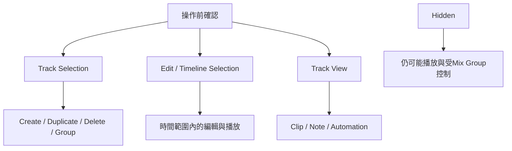

# Ch13b — Track管理：先選對範圍，再建立、複製與編輯

> Track selection、Edit selection、Track View 與顯示狀態各管不同的範圍；把它們分清楚，批次操作才不會誤改一整組資料。

原文：[[Pro_Tools_Reference_Guide_2023.3.pdf#page=283]]，原書 p. 251–270（PDF p. 283–302）。功能與適用條件以 **2023.3** 為準；情境例子與圖解為本筆記重新組織的教學補充。

## New Tracks dialog讓你一次建出工作架構

`Track > New`或 Mac **Command+Shift+N**開 New Tracks。先選定一條 Track，新增內容會插在它之後；不選 Track 則加在尾端。每一 row 可設定數量、format、type、timebase 與 name，Add Row 讓不同類型一起建立，不必反覆開 dialog。

| 欄位／操作 | 決定什麼 | Mac dialog 快捷操作 |
|---|---|---|
| Number of New Tracks | 這一列建幾條 | Tab 往後、Shift+Tab 往前 |
| Track Format | Mono／Stereo／支援的 multichannel | Command+Left／Right |
| Track Type | Audio、Aux、MIDI、Instrument、Folder 等 | Command+Up／Down |
| Track Timebase | Samples／Ticks | Command+Option+Up／Down |
| Track Name | 自訂基礎名稱；多條自動加序號 | 錄音前就命名較容易辨識檔案 |
| Add／Remove Row | 增減不同設定列 | Command+N／Command+Minus 等 dialog 操作 |
| Move Row | 決定建立順序 | 拖動 Move Row icon |

空白區 double-click 會依上次新 Track 的 type／width 建立；加 Command 可強制 Audio、Control 可 Aux、Shift 可 Master Fader，仍要看當前 last-new-track width。沒有既有 Tracks 時，原書列預設 Stereo。初學若容易忘記狀態，先用 dialog 明確看 Type 與 Format 較可靠。

> [!tip] 實務連結
> 一次建立多條 mono drum Audio、Stereo Drum Sub 與 FX Aux，建檔就命好名稱，比錄完一堆 Audio 1、Audio 2 再猜內容有效率。Track name 還會用在自動 Audio File 與 Clip 命名。

## Track Name、Comments與Batch Rename

Double-click Track Name 可改名與 Comments，Previous／Next 可逐條處理；Comments 輸入換行用 Shift+Return。Batch Rename 用所選 Tracks 的 Right-click menu，Mac Option+Shift+R 開 dialog。批次命名先檢查 prefix／suffix／數字規則，避免一口氣把本來可辨識的名稱洗掉。

| 需要記的資訊 | 建議放哪裡 | 原因 |
|---|---|---|
| 短而穩定的用途 | Track Name | selector／畫面容易查找 |
| Mic、位置、錄音條件、處理備註 | Track Comments | 不必塞長串到名稱 |
| 同類 Track 共同命名規則 | Batch Rename | 節省重複操作 |
| 整份作品的修訂說明 | Session／Project Metadata 或 Notes | 不屬於單一 Track |

## Track selection與Edit selection可以連動，也可以分開

Click Track Name 選一條；Shift-click 連續範圍，Command-click 非連續。Option-click 一條尚未選的 Track Name 可全選，對已選項操作可全取消。`Options > Link Track and Edit Selection`讓編輯範圍涉及的 Tracks 也被選取；Shift+T 切換此連動。

| 你看到的狀態 | 代表什麼 | 影響哪種命令 |
|---|---|---|
| Track Name highlight | Track selection | Duplicate、Delete、Grouping 等 |
| Playlist 區有 range | Edit selection | Cut、Copy、Clear、Automation edits 等 |
| Timeline ruler 有 selection | Playback／record range | Transport 相關操作 |
| Group enabled | 適用控制與編輯連動 | 還要看 Group type 與 hidden 狀態 |

要找特定 Track，可`Track > Scroll To Track`（Command+Option+F），輸入名稱前幾個字，再選結果；Right-click Track Name > Scroll Into View 也可直接定位。Scroll 不等於改 Audio routing，也不等於 Make Active。

## Duplicate是挑選屬性；Delete不是可輕易Undo的隱藏

`Track > Duplicate`／Option+Shift+D 可指定 Number of Duplicates，並選 Active Playlist、Alternate Playlists、Automation、Inserts、Sends、Group Assignments；Folder 還可選 All Member Tracks。Insert after Last Selected Track 決定新 Tracks 集中在最後，或分別接在各來源後面。

| 操作 | 你要的結果 | 必須注意 |
|---|---|---|
| Duplicate 含所有 Playlists | 保留 Take 與編輯備案 | 體積與管理範圍都增加 |
| Duplicate 只複製設定 | 建類似處理架構 | 不要不小心多一份 Audio 同時發聲 |
| Duplicate VCA member 但不帶 Group | 新 Track 保留原播放效果 | 原書描述會 coalesce 相關 VCA Automation |
| Delete Track | 移除 Track 及其排列 | **不能 Undo**；Clip 可能仍在 Clips List |
| Hide Track | 暫不顯示 | 仍可播放，不釋放所有資源 |
| Make Inactive | 停用處理但保留內容 | 和 Hide 是不同維度 |

Change Track Width 可在 Track 沒有 Timeline Clips 的前提下換 format，保留可支援的新 width 的 Plug-In、Sends 與 routing。不支援的新 Automation 可能被丟棄並警告；multi-mono unlinked channels 也可能要求重新 link。不要把這個命令當成有素材的所有 Track 都能無條件轉換。

## Track View決定你正在編輯哪種資料

| Track View | 主要內容 | 常見用途 |
|---|---|---|
| Waveform | Audio waveform 與 Clips | Audio 剪輯／安排 |
| Blocks | 只顯示 Clip 框與名稱 | 大範圍編排，較簡單的畫面 |
| Playlists | Alternate Playlist lanes | Take comping |
| Analysis／Warp | Elastic Audio markers | 分析與時間重排 |
| MIDI Clips | 以 Clip 為單位 | 編排、capture、consolidate 等 |
| MIDI Notes | Piano Roll notes | 插入與修改音符 |
| Volume／Pan／Send／Plug-In 等 | Automation 曲線與 breakpoints | 編輯對應控制 |
| MIDI CC／Pitch Bend／Velocity | MIDI event／controller 資料 | 控制演奏表情 |
| Overview（Folder） | 成員 Clip 的整體 blocks | 同範圍處理成員資料，詳 Ch14 |

Audio 的 Waveform／Blocks，以及 MIDI／Instrument 的某些 Clips／Blocks／Selector Notes，是原書所謂 Master views；在這些 view 的編輯可以帶動 Track 的其他資料，例如 Audio Clip 連同相關 Automation。若只在 Volume view 操作，則是在處理不同資料對象。按命令前看 Track View，比事後一直 Undo 更有效。

常用 view 可用 Mac Control+Minus，或 Commands Keyboard Focus 中的 Minus 切換：Audio 在 Waveform／Volume 之間，MIDI／Instrument 在 Notes／Clips 之間。Track Height 則只改顯示高度；Micro／Mini 省空間但省略 controls，精細編輯時放大，不能把按鈕不見誤認成權限被關掉。

## Tracks List：Hidden依然可能發聲

Tracks List 在 Edit／Mix 左側，顯示所有 Tracks；斜體表示 inactive。Show／Hide icon 控制主要視窗的顯示，Sort Tracks By 可依 Name、Type、Edit Group、Mix Group、Voice 等排序，會反映到相關 Track 順序。

Edit 與 Mix 的 show／hide 連動，但各個 MIDI Editor 與 Score Editor 有自己的顯示狀態。Hide Folder 也會 hide members，之後 show Folder 不一定覆蓋對成員獨立設定的 hidden 狀態。

> [!warning] Hidden 成員的 Group 行為不同
> 原書指出：一般 Edit Group 編輯不影響 hidden member；Mix Group 多數操作仍影響 hidden member，Record Enable 例外。Folder Overview 又有自己的成員隱含選取規則，不能把這三種情境混成「沒看到就不會改」。

> [!abstract] Takeaway
> 先看選的是 Track 還是時間，再看 Track View。Duplicate 挑你需要的屬性，Delete 先保留可回復版本；Hidden 只是視覺狀態，並不等於停止發聲或不受所有 Group 控制。

![[PT-Ch13-concept.png]]

圖解讀法：此圖是原創概念示意，位置、比例與箭頭僅表達本章關係；不代表軟體畫面或實測效能。

## 相關

%% PT-NAV-BEGIN %%

上一篇：[[PT-Ch13a-Track類型與Metering]]

下一篇：[[PT-Ch13c-路由Solo與Track狀態]]

按任務閱讀：[[PT-00-工作流程導航]]

%% PT-NAV-END %%

[[PT-Ch13a-Track類型與Metering]] · [[PT-Ch13c-路由Solo與Track狀態]] · [[PT-Ch14b-Overview編輯與Folder操作]]

[[PT-00-索引]] · [[PT-00-功能目錄]] · [[PT-00-快速檢索]] · [[PT-00-Mac快捷鍵]]

標籤： #pro-tools #audio #study-note
