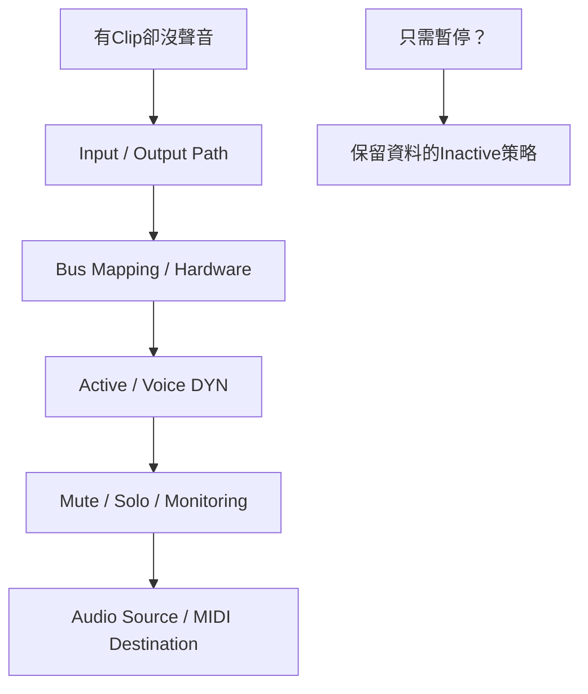

# Ch13c — Track有內容卻沒聲音：沿路由、Voice與監聽狀態逐層查

> 音訊能否被聽見，同時取決於 Input／Output、Voice、Mute／Solo、Active 狀態與硬體映射；任何一層都可能讓有 Clip 的 Track 保持安靜。

原文：[[Pro_Tools_Reference_Guide_2023.3.pdf#page=303]]，原書 p. 271–287（PDF p. 303–319）。功能與適用條件以 **2023.3** 為準；情境例子與圖解為本筆記重新組織的教學補充。

## Audio I/O：Selector列出的是Path，不是無條件的實體孔

Routing Folder、Audio、Auxiliary Input、Instrument 的 Input 可來自 hardware、Internal Bus 或某些 Plug-In Output Bus；Output 可送 hardware 相關 Output Bus 或 Internal Bus。可選項由 Ch06 的 I/O Setup 定義，Stereo／Multichannel 用相應 channel group。

新 Tracks 的 Inputs 通常按可用 Path 依序分配；Output 則由 I/O Setup 的 Default Output Bus 決定。原本空白 Session 的自動分配方便起步，但錄音前仍要逐條核對，不能因名稱叫 Vocal 就認為它已接到你插 mic 的 Input。

| 動作 | 做法／結果 | 注意 |
|---|---|---|
| 指派 Input／Output | Track selector 選 Path | 使用中的項目可能顯示 bold |
| Cascading assignments | Mac Command+Option 選第一個 Path | 對同類／同 width 等適用範圍依序分配 |
| 全部同 Path | Option-click 相應 selector | 先確認真的要影響所有適用 Tracks |
| 選取者同 Path | Option+Shift-click | Track selection 要正確 |
| Rename Path | Right-click selector > Rename | 改的是 I/O Path，不只該 Track 的別名 |
| 搜 Path | 點 selector 後輸入、Search 或 Tab | 搜尋結果最多 20 個，核對完整名稱 |

Output selector 的 New Track 可以新建 Aux／Audio／Instrument，並用可用 Internal Bus 把來源 Output 接到新 Track Input。選 Track submenu 也可接到適合的既有 Track；目的 Track 通常需要 Input 是 Internal Bus 或 No Input。這能快速建 Submix，但仍要命名與檢查 Output 是否回到主混音。

> [!tip] 實務連結
> 多軌鼓要送 Drum Sub，不一定先去 I/O Setup 手刻所有 Bus；可由來源 Output 建立新 Aux。但完成後仍檢查每條鼓的 Output、Drum Sub Input 與它的最終 Output，避免只是新增一條沒有訊號的 Aux。

## No Output與Inactive I/O，不是一樣安全的暫停方法

原書 p.273 警告，設 No Output 可能使相應 Pan／Plug-In Automation 資料遺失。若只是暫時關閉一段 routing，使用 Make Inactive 可保留 Automation／Playlist。這也是不能把「沒聲音」的狀態都當成互換選項的原因。

| 狀態 | 它做什麼 | 資料／資源上的重點 |
|---|---|---|
| No Input | 不指定這條 Audio Input | 不代表原 Audio Clip 被刪除 |
| No Output | 移除 Output assignment | 原書有 Automation 遺失警告 |
| Inactive I/O assignment | 暫停該 Track 的路徑 | 保留 automation／playlist；Plug-In 仍可能占資源 |
| Inactive Path（I/O Setup） | 全域停用該 Path | 所有使用同 Path 者都受影響 |
| Inactive Track | 停用整條 Track 的聲音／處理 | Plug-In、Send、Voice 等退出運作 |

Mac Command+Control-click 對應 Input／Output selector 可切 active／inactive；Right-click menu 也可明確選。多重 Output assignments 時，會需要指明哪條 Path；Send 多重 Output 中一個 active 狀態切換可能連整組 assignment 一起切換。大量操作後用 selector 與實際 meter 核對。

## Voice不足：Track位置可能決定誰先播放

當 Session 中的 voiceable Tracks 超過可用 voices，較高 priority Tracks 先取得資源。Edit 上方／Mix 左側／Tracks List 較上方的 Track priority 較高。Voice selector 可選 DYN（Dynamically Allocated）或 Off；低 priority Track 可能因沒有 voice 而不能播放／錄製。

| 檢查／處理 | 原書方向 |
|---|---|
| Voice selector 是 Off | 改成 DYN，仍要有可用 voice |
| 可用 voices 耗盡 | 將不需要的 Tracks inactive／voice off |
| 重要 Track priority 太低 | 調到 Edit 上方或 Mix 左側 |
| Punch 模式或 DSP／Native 交接 | 可能有額外 voice 用量，見 Ch27／Ch51 |
| 版本容量有疑問 | 查 Ch05 具體表，不沿用本章部分舊數字 |

> [!warning] 本章容量敘述有舊版本痕跡
> p.276 仍列某些舊 Track 上限，與 Ch05 的 2023.3 系統表不同。本篇教 priority 與 DYN 機制，沒有把舊上限當成你目前系統的保證值。

## MIDI I/O：Input有事件，不代表Output有音源

MIDI Track 預設 Input All 接收所有 port／channel；Output None 則不送給任何對象。Instrument Track 的 MIDI controls 在 Instruments view，可各自指定 Input／Output；音源 Plugin 通常會自動接到 Track Audio Input，但若換了配置仍應確認。

| 層次 | 要確認什麼 |
|---|---|
| MIDI Input | 正確 device／port／channel；必要時不要一律 All |
| MIDI Output | 送到哪個 instrument／硬體 port 與 channel |
| Instrument Audio | 音源實際是否產生 Audio |
| Audio Output | 音源 Audio 如何送到主混音／monitor |
| MIDI Mute vs Audio Mute | 前者停止事件送出，後者靜音 Audio |

原書提醒單一 MIDI Track 不承載多個獨立 channel 資料的同樣模型，但可指定多個 MIDI destination。這不等於一個 MIDI port 只剩一個 channel，也不表示 MIDI Output 自動錄下硬體回來的 Audio。

## SIP、AFL、PFL：Solo其實有不同監聽位置

| Solo mode | 聽到哪裡 | Fader／Pan 是否影響 |
|---|---|---|
| SIP／Solo In Place | 靜音其他 Tracks 後在原 mix 路徑聽 | 保持原路由與處理關係 |
| AFL／After Fader Listen | 送 AFL/PFL Path 的 post-fader／post-pan signal | 會 |
| PFL／Pre Fader Listen | 送 AFL/PFL Path 的 pre-fader／pre-pan signal | 忽略 Track Fader／Pan |

AFL/PFL 要先設好 I/O Setup 的 AFL/PFL Path；None 會使這兩種 mode 不可用。Solo 模式有版本／Mixer 條件，p.281 的舊 Surround Mixer 用語應與 Ch05 適用系統一起讀，不能只憑這一頁推定任意安裝都相同。

Solo Latch 會累加所選 Solo；X–OR 取消前一次 Solo；Ultimate 的 Momentary 按住才聽。切到 PFL 時原書會先清既有 Solo 以避免可能的大 level 跳動。Solo Safe 則用 Mac Command-click Solo，適合讓 FX return／Submix 不被其他 SIP Solo 切掉；AFL／PFL soloed Tracks 不使用同樣 Solo Safe。

> [!tip] 實務連結
> Solo 人聲後 Reverb 消失，先確認 FX return 的 Solo Safe 與 Signal routing，不要先加第二個 Reverb。若在 PFL 聽起來特別大，先看它是不是繞過原本很低的 Fader level。

## Folder、Inactive與Color Coding的收尾檢查

Basic Folder Mute 會 mute 全部 members；Routing Folder Mute 只 mute 它自己的 Audio Output，沒有經過它的 members 仍可能發聲。Make Folder Inactive 會讓 members 一起 inactive，但原本獨立 inactive 的 member 不應在恢復時被誤認為一定已重新啟用。

Color Palette 可以對 Tracks、Markers、Groups、Clips in Tracks、Clips in Clips List 分別上色。Track Color 與 Clips List Color 是不同來源；若 Default Clip Color Coding 選別的規則，拖入 Track 的 Clip 可能重新用 Track 顏色，Clips List 中仍保持原色。Hold button 固定所選顏色，方便連續套用；Apply to Channel Strip 加 Saturation／Brightness 只改視覺。

> [!abstract] Takeaway
> 按順序查：Path assignment → Bus／hardware mapping → active 狀態 → Voice → Mute／Solo →實際 Audio／MIDI 來源。藏 Track、關 Output、Mute 與 Inactive 都能造成「聽不到」，卻有不同資料與資源後果。

![[PT-Ch13-concept.png]]

圖解讀法：此圖是原創概念示意，位置、比例與箭頭僅表達本章關係；不代表軟體畫面或實測效能。

## 相關

%% PT-NAV-BEGIN %%

上一篇：[[PT-Ch13b-建立編輯與管理Track]]

下一篇：[[PT-Ch14a-Basic與RoutingFolder]]

按任務閱讀：[[PT-00-工作流程導航]]

%% PT-NAV-END %%

[[PT-Ch13a-Track類型與Metering]] · [[PT-Ch13b-建立編輯與管理Track]] · [[PT-Ch14a-Basic與RoutingFolder]] · [[PT-Ch06a-I-O與Path地圖]]

[[PT-00-索引]] · [[PT-00-功能目錄]] · [[PT-00-快速檢索]] · [[PT-00-Mac快捷鍵]]

標籤： #pro-tools #audio #study-note
