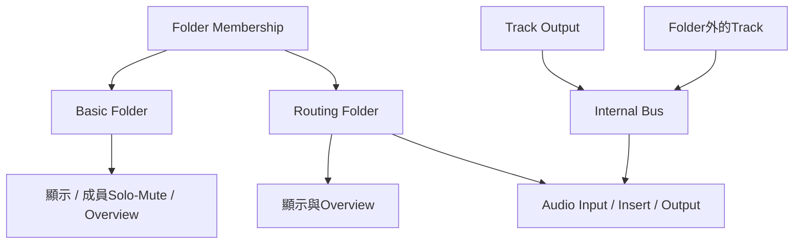

# Ch14a — Folder收納Tracks，但不一定收納它們的Audio

> Basic Folder 管理畫面與成員，Routing Folder 另外提供 Audio 處理；成員關係與實際訊號路由必須分開確認。

原文：[[Pro_Tools_Reference_Guide_2023.3.pdf#page=321]]，原書 p. 289–298（PDF p. 321–330）。功能與適用條件以 **2023.3** 為準；情境例子與圖解為本筆記重新組織的教學補充。

## Folder讓複雜Session先有可讀的層級

Folder Track 是其他 Tracks 的容器，能放 Audio、MIDI、Aux、Instrument 等，也能再放 Folder。原書支援最多九層：外層是 parent，內層是 child，同層是 siblings。收合 Folder 會把 members 從主要視窗藏起來，但不是把素材刪掉，也不是自動停止播放。

例如一組鼓有多條 close mic、overhead、room，可以先放入 Drums，收合後從高層看歌曲的 Vocal、Guitar、Bass、Drums 等大區塊。這是資訊整理，不必然代表所有鼓已經 sum 到同一個 Audio Bus。

| 特性 | Basic Folder | Routing Folder |
|---|---|---|
| 收納各類 Track 與子 Folder | 有 | 有 |
| 開／關 Folder 以整理畫面 | 有 | 有 |
| Overview 顯示 members 的 Clip blocks | 有 | 有 |
| Audio Input／Output、Inserts、Sends | 沒有這種特殊 Audio 路由功能 | 類似 Auxiliary Input |
| Fader／Pan／Track Automation | 不作一般 Audio 處理 Track 使用 | 可處理送進其 Input 的 Audio |
| Solo | 讓 members 不被其他 Solo 邏輯靜音，獨立 Muted 者例外 | 同樣有 member 相關 Solo 行為 |
| Mute | 將 members 靜音 | **只靜音 Routing Folder Output** |

> [!important] 最重要的一句話
> **放進 Routing Folder，不保證 Audio 已送進這條 Folder。** Audio 還是依各 Track 的 Output／Send 與 Folder 的 Input 走；Folder 外的 Track 也可以把 Audio 送進來。

## Basic Folder：適合只想整理，不改原本接線

建立方式：`Track > New`（Command+Shift+N）→Type 選 Basic Folder→命名→Create。沒有 Audio channel width 需要你拿來做 submix 的同一種配置。它的 Audio signal indicator 在任何 member 播放 Audio 時亮綠，即使該 member muted 仍可能亮；MIDI indicator 在有 MIDI 事件播放時亮 amber。

這些 indicator 是成員活動提示，不是該 Folder 自己已把 Audio 加總並送到 Output 的 meter。看見綠燈，只能幫你知道裡面有活動，不能當作 Audio routing 的驗證。

> [!tip] 實務連結
> 原工程已經有完整 Drum Aux 與並行處理，只想改善畫面，可先用 Basic Folder 收納，保留既有 Audio 路徑。之後若要改用 Routing Folder，再明確檢查原 Aux 的角色，避免不小心多一份 Submix。

## Routing Folder：整理之外，也可當Submix處理點

建立時 Type 選 Routing Folder，再選 Width、Time Base、Name。它可以像 Aux 一樣接 Audio、放 Plug-In、用 Sends、寫 Track Automation，適合 stem／summing 工作。Track View 除了 Overview，也有 Volume／Pan／其他 Automation views。

| Routing Folder 控制 | 真正作用範圍 | 不會自動做到的事 |
|---|---|---|
| Volume／Pan | 經過 Folder Audio path 的訊號 | 直接改每條 member 的 Fader 值 |
| Inserts | 送進 Input 的 Audio | 處理所有視覺上放在裡面的 Track |
| Mute | Folder 自己的 Output | mute 繞過此 Input 的 member |
| Freeze | Folder Audio Output 的 rendered 結果 | 包含沒有經過它的 Audio |
| Track Automation | Folder 自身控制 | 改寫每條 member 的 Automation |
| Audio／MIDI indicators | members 有無活動 | 證明所有 members 已經 route 進來 |

> [!warning] Mute Folder 後還有聲音，不一定是 bug
> 可能某條 member 直接 Output 到 Main，或有其他 Send 路由繞過 Folder。先畫出 Audio path，再判斷是否符合製作需求。

## 把既有Tracks移進新Folder，注意Route Tracks選項

1. 選要收納的 Tracks。
2. `Track > Move To New Folder`，或 Command+Option+Shift+N。
3. 選 Basic 或 Routing Folder；Routing 還要選 Format、Time Base。
4. 若要把來源 Audio 一併導向 Folder，選**Route Tracks to New Folder**。
5. 命名、Create，再看各 member Output 和 Folder Input。

原書說，新 Routing Folder 會建立同名 Internal Bus 並指定到 Input；但是 members 的 Outputs 只有勾 Route Tracks to New Folder 時才自動指向該 Bus。這就是「建立容器」與「改接線」在 dialog 裡分成兩件事的原因。

| 你的需求 | 建議選擇 | 完成後檢查 |
|---|---|---|
| 只收納，不動混音路由 | Basic Folder 或不自動 route 的明確配置 | 原 Track Output 是否維持 |
| 鼓全部經同一處理點 | Routing＋Route Tracks | 每條鼓 Output、Folder Input／Output |
| 收納 MIDI 與 Audio 一起看 | 適合的 Folder 層級 | MIDI 聲音來源與 Audio return 仍要另查 |
| Folder 裡有不想經 Submix 的例外 | 明確保留獨立 routing | Mute／Freeze 不會涵蓋例外 Audio |

## 從既有Aux轉為Routing Folder

選 Auxiliary Input 後`Track > Convert Aux to Routing Folder`，或 Right-click Track Name 選同名命令。這能把舊 Session 的 Submix Aux 變成可收納 Tracks 的 Folder，再人工把相應 Tracks 放進來；轉換本身不代表它已知道哪些 Tracks 應該成為 members。

原書 Ch13 另外提醒：新 Aux 一般預設 Solo Safe，但 Aux 轉 Routing Folder 後不維持同樣 Solo Safe 狀態。轉換完成要重查 Solo 與監聽行為，不要只測所有 Tracks 一起播放的情況。

> [!abstract] Takeaway
> Basic 負責整理；Routing 再提供 Audio 處理。Folder membership、Audio routing、Mute／Freeze 作用範圍是三個問題，建立或轉換後逐一核對，才不會把漂亮的層級誤認成正確的 Submix。

![[PT-Ch14-concept.png]]

圖解讀法：此圖是原創概念示意，位置、比例與箭頭僅表達本章關係；不代表軟體畫面或實測效能。

## 相關

%% PT-NAV-BEGIN %%

上一篇：[[PT-Ch13c-路由Solo與Track狀態]]

下一篇：[[PT-Ch14b-Overview編輯與Folder操作]]

按任務閱讀：[[PT-00-工作流程導航]]

%% PT-NAV-END %%

[[PT-Ch14b-Overview編輯與Folder操作]] · [[PT-Ch13c-路由Solo與Track狀態]] · [[PT-Ch06b-Bus監聽與特殊路徑]]

[[PT-00-索引]] · [[PT-00-功能目錄]] · [[PT-00-快速檢索]] · [[PT-00-Mac快捷鍵]]

標籤： #pro-tools #audio #study-note
