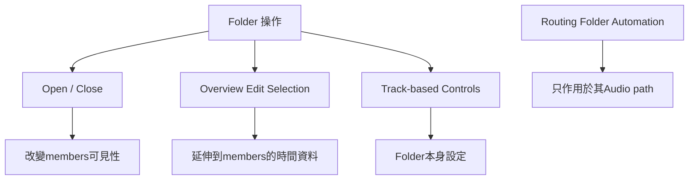

# Ch14b — 在Overview剪一刀，可能同時剪到整個Folder

> Folder 的 Overview 是跨成員的編輯入口，收合只改顯示，不會把成員排除在所有編輯之外。

原文：[[Pro_Tools_Reference_Guide_2023.3.pdf#page=328]]，原書 p. 296–302（PDF p. 328–334）。功能與適用條件以 **2023.3** 為準；情境例子與圖解為本筆記重新組織的教學補充。

## 開關Folder：先知道要影響哪一層

在 Edit／Mix 點 Folder icon、Tracks List 的 reveal triangle，或 Right-click Folder Name 選 Open／Close，都可展開或收合。Edit 裡的 member 縮排、Mix 裡的顏色框線，幫你看出層級。Folders 多時，不應只靠畫面上下位置猜它現在屬於誰。

| Mac 操作 | 主要影響範圍 | 條件 |
|---|---|---|
| Shift+F | 開／關所選範圍的 Folder | Edit 依 Edit selection，Mix 依 Track selection |
| 選 member 後 Shift+F | 收合其 parent Folder | 非 Folder 的 member 被選時 |
| Command-click Folder icon／triangle | 整個 Folder hierarchy | 包含相應 nested 層級 |
| Option-click | 同層 siblings Folders | 不只目前一個 Folder |
| Command+Option-click | siblings 加下方 nested Folders | 適合大範圍整理層級 |
| Option+Shift-click | 所選 Folders | 先核對 selection |

Pro Tools 會盡量維持目前畫面上的 Tracks 可見，但多個 Folder 同時展開仍可能改變捲動位置。Shift+F 不是「所有 Folders 無條件一起切」，它有焦點與選取條件；速查頁也應帶著這些條件讀。

> [!tip] 實務連結
> 編排時先收合鼓組與大部分合成器，只保留正在改的 Vocal／Guitar。要回頭修鼓，再打開 Drums；以明確命名的 Folder 當導航，比在幾十條 Audio 間來回找更快。

## 移入、移出既有Folder

選 Tracks 後，可以拖到 Folder 位置；橘色插入線表示即將放入的層級與順序，也可用 Right-click > Move To > Folder Name。移出時選 Move To > Top Level，或拖到 Folder 外的正確插入位置。移動 Folder 本身也會帶著 members 一起移動。

| 你要做的動作 | 建議先看 | 做完核對 |
|---|---|---|
| 加入既有 Folder | 橘色插入線的層級 | 縮排／Mix 框線是否正確 |
| 移到 Top Level | 是否選對 members 而非 parent | 原本 parent 是否仍保留其他 members |
| 搬整組 Folder | 是否選 Folder 本身 | 其全部 members 跟著移動 |
| 改 Folder width | 是否含 members | 原書說含一條以上 member 時不能改 width |
| 改 Audio routing | Track Output／Folder Input | 移動容器不等於重接 Audio |

這裡的移動是 Track 的層級與排序，不是把 Audio File 搬到另一個 Finder 資料夾。原始媒體仍按 Session／Disk Allocation 等規則存放。

## Overview是成員Clip在時間上的綜合顯示

Basic Folder 只提供 Overview，Routing Folder 另有 Track Automation views。Overview 裡的 blocks 代表 members 的 Clip 材料；在 Folder 上圈一段 Edit selection，Pro Tools 會把該範圍隱含延伸到成員資料。

當 Folder 開著，通常可用 Cut、Copy、Paste、Clear 等編輯，作用到所有 members 的相應範圍；收合時仍會延伸到 members，但某些命令受限制，menu 會灰掉。**閉合並不等於裡面的資料不會被編輯。**

| 選取／編輯對象 | 通常作用到哪裡 | 重要區分 |
|---|---|---|
| Folder Overview 的 Edit selection | 所有 members 在該時間範圍的資料 | 可以跨 Audio／MIDI 與子層級形成大範圍操作 |
| 明確只圈某條 member | 被明確選到的資料 | 適合局部修正而非整組 |
| Folder Track-based 設定，如 color | Folder Track 本身 | 不會全部傳給 members |
| Routing Folder Volume／Automation | Folder 自身 Audio path | 不改 member 各自 Automation |

> [!warning] 先看是不是 Overview，再按 Clear
> 你以為只刪掉 Folder 上「摘要的一塊」，實際可能清掉所有 members 的那段編排。這個 blocks 不是唯讀縮圖；操作前先 Save／保留版本，再確認 selection 範圍。

## 關閉Folder時，有些命令不能靠隱含選取做

原書分兩層說明。無論 Folder 開或關，**Track Commit**以及切 Inserts／Sends bypass，不支援只靠 Overview 對 member 產生的 implicit selection。關閉 Folder 時，還限制 Select／Split Notes、Step Input、Record Enable、Input Monitor、特定 Plug-In Automation 編輯、Real-Time Properties 與 Elastic Properties 等。

| 想做的事 | 若 Overview／closed 狀態不可用 | 原因 |
|---|---|---|
| 剪整組時間範圍 | 檢查是否為受支援的一般 Edit command | Overview 提供跨 member range editing |
| Commit 特定 members | 展開並明確選要處理的 Tracks | 不能把隱含 range 當作 Track selection |
| 開錄音／監聽 | 展開並明確檢查各 Track | 避免對未見的成員無意 armed |
| 改 MIDI／Elastic 屬性 | 到對應 member 與 view 操作 | 各 Track 的資料與屬性不同 |
| Bypass 某些 Inserts／Sends | 明確選控制／Tracks | 不透過 Folder implicit selection 概括操作 |

Mac Option+Control+Shift+P／`;` 可把 Edit selection 往上／下延伸 through member Tracks。它是精確擴大 selection 的工具，不是必須每次整理 Folder 都使用的捷徑。

## Siblings selection與Folder Automation

Option+Control-click 可選同層 siblings Tracks；Command+Option+Control-click Tracks List 項目可在不同 Folders 的 siblings 中選／取消；Option+Control+Shift-click 擴展 siblings selection。這些 modifier 影響的是層級選取，不能只看按鍵多就推論「大概是全選」。

Routing Folder 的 Volume、Pan 等 Automation 可以在 Track View 或 lanes 編輯。它獨立於 members 的曲線：你在 Folder 做一段整體 fade，並不是把每條 member 的 Volume 曲線重畫一次。若某 member 的 Audio 繞過 Folder，它也不會自動跟這個 fade。

> [!tip] 實務連結
> 一段鼓要整體淡出，用正確 Routing Folder Automation 能保留各 mic 原本的相對調整；若只想淡出某個 room mic，就在該 member 改。先決定控制層級，可以省掉很多重複 Automation。

> [!abstract] Takeaway
> Folder 收合管理的是畫面，Overview 管理的是跨 member 時間編輯，Routing Automation 管理的是經過 Folder 的 Audio。每次操作先辨認自己在哪一層，才能既享受整組編輯效率，又保留局部控制。

![[PT-Ch14-concept.png]]

圖解讀法：此圖是原創概念示意，位置、比例與箭頭僅表達本章關係；不代表軟體畫面或實測效能。

## 相關

%% PT-NAV-BEGIN %%

上一篇：[[PT-Ch14a-Basic與RoutingFolder]]

下一篇：[[PT-Ch15-Track-Presets與可重用工作流程]]

按任務閱讀：[[PT-00-工作流程導航]]

%% PT-NAV-END %%

[[PT-Ch14a-Basic與RoutingFolder]] · [[PT-Ch13b-建立編輯與管理Track]] · [[PT-Ch13c-路由Solo與Track狀態]]

[[PT-00-索引]] · [[PT-00-功能目錄]] · [[PT-00-快速檢索]] · [[PT-00-Mac快捷鍵]]

標籤： #pro-tools #audio #study-note
