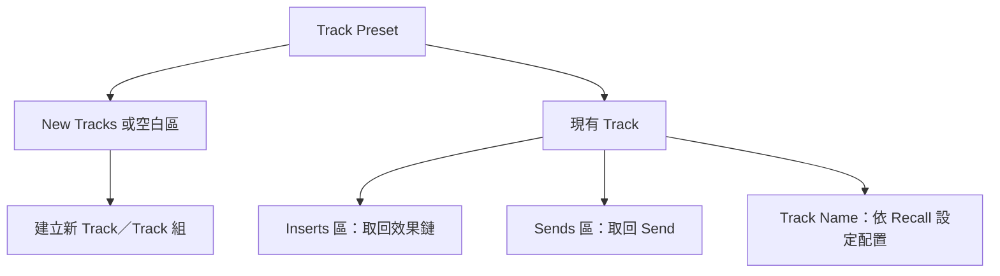

# Ch15 — Track Presets：把常用工作流程存成可重用積木

> Track Preset 不只存一顆效果器，而是把 Track 的結構、處理與可選素材一起封裝，再決定下次要帶回哪些部分。

## 1. 你想重用的到底是什麼？

假設每次錄人聲，你都會建立一條 Audio Track、插入幾顆 Plug-In，並送到同一類 Reverb 和 Delay。若每次從零搭建，時間往往花在重複設定，而不是聽聲音。Track Preset 就是為這種「工作骨架可以重用，但素材不同」的情況設計。

原書說明，Track Preset 能擷取一條或多條所選 Track 當下的 configuration，包括 Track type、format、level、panning、Plug-In 與 Send configuration 等。它既能建立新的預設 Track，也能只把 Inserts 或 Sends 套到已存在的 Track。先分清楚重用範圍，才不會原本只想換效果鏈，卻連其他設定也一起覆蓋。

| 重用需求 | 比較適合的入口 | 操作結果 |
|---|---|---|
| 一整套新的人聲或鼓組工作骨架 | New Tracks dialog 的 Track Presets | 建立一條或多條新 Track |
| 現有 Track 換成常用效果鏈 | Inserts selector > Recall Inserts | 擷取 Preset 的 Inserts |
| 現有 Track 套常用空間效果 Send | Sends selector > Recall Sends | 擷取 Preset 的 Sends |
| 找出分類、標籤相符的 Preset | Workspace > Track Presets | 先搜尋，再依拖放位置決定用途 |
| 重用帶素材的 Loop／MIDI 素材組 | 儲存時包含 Audio and MIDI Clips | Preset 同時攜帶設定與已選素材 |

> [!tip] 實務連結
> 把「Lead Vocal Input Chain」與「Drums Parallel Compression Bus」分開存，比只用「我的設定」更好找。這兩種命名是原書使用的工作情境；你的 Preset 名稱最好同時描述用途與訊號角色，而不是只寫音色形容詞。

## 2. 存檔前先決定：設定、素材、Folder 要帶多少

選取已配置好的 Track，執行 `Track > Save Track Preset`，或右鍵 Track Name 選 `Save Track Preset`。Mac 的直接入口是 `Option+Shift+P`。這個動作不會替你判斷哪些資料值得重用，因此真正重要的是接下來的 Save Track Preset dialog。

| Save 選項 | 它控制什麼 | 使用時要想清楚 |
|---|---|---|
| Category | Preset 分類；不存在時可 Add Category | 依工作類型分類，而不是把所有東西塞同一層 |
| Name | 預設取 Track 名；也能輸入其他名稱 | 選既有名稱會涉及覆寫，要先確認版本 |
| Include All Member Tracks | Folder Track 是否連同成員一起儲存 | 關閉時可只保留空 Folder；開啟時保留 Folder hierarchy |
| Include Audio and MIDI Clips | 是否把 Audio／MIDI Clips 也帶進 Preset | 只重用處理鏈時，通常不需要帶錄音素材 |
| Clips in Edit Selection Only | 只帶所選 Edit 範圍內的完整 Clips 與相關 Automation | Edit selection 的起點定義 Preset 第一個 sample |
| Auto-populate tags from Track Data | 從 Plug-In、Track type／name／width 等自動產生 tags | 自動標籤有助搜尋，仍可補用途型 tags |
| Tags | 手動加上描述性 metadata | 每輸入一個 tag 後按 Return 確認 |

「Clips in Edit Selection Only」值得特別理解：它不是把整個 Session 壓縮進去，而是以目前 Edit selection 當作保存素材的參考範圍。原書強調選取起點會成為 Preset 的第一個 sample；日後配合 Track Offset，才能把這包素材放到新 Session 想要的位置。這是內容座標的決定，不是單純勾選一個減少檔案大小的選項。

> [!warning] 素材是否被包進去，要看儲存選項
> 不要因為 Recall dialog 能選 Clips and Media，就認為 Preset 裡一定有素材。原書指出，Clips 與 media 必須在保存時選擇包含，之後才有可取回的內容。

## 3. Track Data to Recall：重用時的防火牆

`Track Data to Recall` 決定 Preset 被取回時要套用哪些 Track／Session data。從 Save Track Preset dialog 可用 `Command+R` 開啟；Recall 時按住 Mac 的 `Control`，能先開啟資料選擇 dialog，再調整匯入範圍。不要把 `Control` 寫成 `Command`，兩者在這裡不是同一個按鍵。

這個設計讓「Preset 存得完整」與「每次只取需要的部分」可以同時成立。保存時可留下工作骨架；取回到別人的 Session 時，再避免帶入不適合的 I/O、時間資料或素材。完整可選 Track data 的定義延伸到 Ch21 的 Import Session Data。

| Recall 控制 | 結果 | 適合的情況 |
|---|---|---|
| No Offset | 不另外施加 Track Offset | 保留既有定位邏輯 |
| Offset To | 指定 Bars／Beats、Min:Sec、Timecode、Feet+Frames 或 Samples 位置 | 明確指定素材要落在哪裡 |
| Offset to Song Start Marker | 對齊 Song Start Marker | 匯入音樂工作骨架 |
| Offset to Timeline Selection | 以 Timeline Selection 起點定位 | 把 Loop／段落素材放在當下工作區 |
| Force to Timebase > Ticks | 強制以 Tick-Based 取回 | 內容要跟隨音樂時間的情境 |
| Force to Timebase > Samples | 強制以 Sample-Based 取回 | 內容要固定在絕對時間的情境 |

`Track Data to Recall` 本身也有 Presets：五個按鈕可儲存常用選擇，Mac 用 `Command-click` 寫入該按鈕，普通點擊取回。Librarian menu 可另存 `.ptpreset`；這與實際 Track Preset 的 `.ptxp` 是兩種用途不同的檔案，不要混在一起。

> [!tip] 實務連結
> 你可以建立「只取 Inserts」「取整組 Track 與路由」「帶 MIDI 素材但不帶其他 Session data」等 Recall 配置。這裡是工作方法示例，不是軟體內建 Preset 名稱；用五個按鈕切換範圍，比每次憑印象勾選可靠。

## 4. 同一個 Preset，拖到不同位置會有不同結果

![[PT-Ch15-reuse-scope.png]]

在 New Tracks dialog 的 Track Type selector 選 `Track Presets`，再選 Category 和 Preset，最後 `Create`。也可從既有 Track 的 Output selector 選 `New Track`，再套 Preset，適合一邊建立目的 Track、一邊接路由。

Workspace 的 `Track Presets` location 提供同一批內容，`Window > New Workspace > Track Presets` 可直接打開。拖到 Tracks List 或 Edit／Mix 空白處會建立新 Track；拖到 Inserts 或 Sends 區則只取該配置。拖到 Track Name 是配置既有 Track；若 Preset 內有多條 Track，原書指出一般只取第一條，需注意不是整個多軌 Preset 都會自動攤開。

| Workspace 操作 | 應確認的事 |
|---|---|
| 雙擊 Preset、右鍵 Recall Track Preset | 都可作為建立 Preset Track 的入口 |
| 選多個 Preset > Import Track Preset | 會一次建立所選 Presets 的 Track |
| 右鍵 Preset 資料夾 > Import Track Preset | 可整個資料夾一起取回 |
| 選 Preset 後改右側 Track Data to Recall pane | 修改會寫回該 Preset，影響之後的 Recall |
| 把 Stereo Preset Inserts 取回到不同寬度 Track | 只有支援目的 Track format 的 Plug-In 才能適應並取回 |

> [!warning] 「有這個 Preset」不代表「所有 Plug-In 都會出現」
> 原書以 Stereo 到 5.1 為例：支援 5.1 的 Plug-In 可按目的 Track 取回成 5.1；不支援該格式的 Plug-In 不會被取回。檢查 Track format，比反覆拖放更能找到原因。

## 5. 在 Mac 上保存與整理

2023.3 的預設 Track Preset 位置為 `~/Documents/Pro Tools/Track Presets`，檔案副檔名 `.ptxp`。可在 `Preferences > Operation > Documentation and Settings` 改儲存位置；子資料夾會成為 Preset Category。這讓檔案組織與介面分類連在一起。

## 跟做練習：把同一個 Preset 用在兩種情況

以下是依本章功能設計的教學練習，不是原書的逐步範例。先建立一條已有常用 Inserts／Sends 的 Track，確認目前設定符合需求，再保存成清楚命名的 Track Preset。第一輪不帶 Clips，目的是把「工作設定」從某一次錄音內容中分離。

先用 New Tracks 的 Track Presets 建一條新 Track，觀察 Track type、format、Inserts 與 Sends，確認你保存了什麼。接著選另一條已有素材的 Track，只從 Inserts 的 Recall Inserts 套用同一個 Preset。兩次操作都使用同一檔案，但想保留與想替換的範圍不同；這就是 Preset 不應只被當成「完整複製軌道」的原因。

第二輪才帶素材。選好 Edit selection，啟用 Include Audio and MIDI Clips 及合適的 Clips in Edit Selection Only，再存另一個明確名稱。取回時改用 Offset to Timeline Selection，檢查你定義的起點與素材位置。不要在尚未理解時間原點前，就把它塞進已有很多剪輯的新工程。

| 驗證問題 | 若結果不對，先查哪裡 |
|---|---|
| 新 Track 的結構不完整 | 儲存時選了哪些 Tracks，Folder 是否包含 member tracks |
| Inserts 少了某顆處理器 | 目的 Track format 與 Plug-In 可用格式 |
| 素材沒跟著出現 | 儲存時是否包含 Clips／Media |
| 素材有出現但落點不同 | Edit selection 原點、Track Offset、Timebase |
| 改過 Recall 範圍後下次行為也變了 | Workspace 右側 Recall pane 是否已把修改寫回 Preset |

> [!tip] 實務連結
> 定義可重用配置時，把「這包東西解決什麼工作」寫在名稱與 tags。把不相關角色硬塞成一個超大 Preset，反而會讓取回時到處取消設定。好的工作積木應該容易判斷用途，也容易確認範圍。

> [!abstract] Takeaway
> 先選「要建立新 Track，還是只套 Inserts／Sends」，再決定 Recall 範圍。儲存時分清設定與素材；取回時分清時間定位、Timebase 和目的 Track format。真正可重用的不是某次混音結果，而是能在新 Session 重新工作的結構。

## 原文定位

本篇依 2023.3 原文整理，操作名稱與版本限制以該版為準。來源：[[Pro_Tools_Reference_Guide_2023.3.pdf#page=335|原書 p. 303–315／PDF p. 335–347]]。圖表與實務情境為原創教學整理；未逐句翻譯。

## 相關

%% PT-NAV-BEGIN %%

上一篇：[[PT-Ch14b-Overview編輯與Folder操作]]

下一篇：[[PT-Ch16-Group聯動與相對關係]]

按任務閱讀：[[PT-00-工作流程導航]]

%% PT-NAV-END %%

[[PT-00-索引]] · [[PT-00-功能目錄]] · [[PT-00-快速檢索]] · [[PT-00-Mac快捷鍵]]

標籤： #pro-tools #audio #teaching
