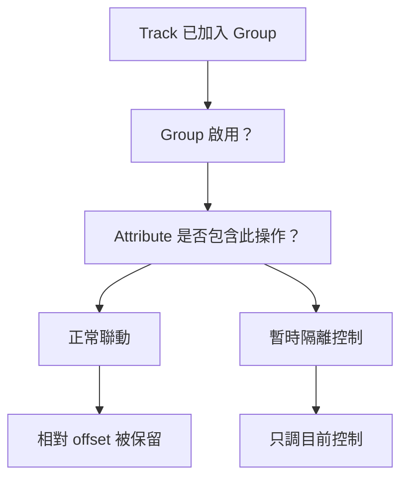

# Ch16 — Grouping Tracks：讓多軌一起動，又保留彼此差異

> Group 是操作聯動規則，不是把多條 Audio 合成一條訊號；把這點分清楚，才不會把 Group、Bus 與 VCA 混為一談。

## 1. Group 解決的是「一起做同一件事」

多支麥克風錄同一套鼓時，剪其中一條而漏掉其他條，可能破壞時間關係；兩條已平衡好的 Track 一起調整時，也不希望每次都重算相對電平。Pro Tools 的 Group 讓特定 Track 與特定控制保持聯動，同時保留原先的相對差異。

原書列出最多 104 個 Group，分成四個 bank，每個 bank 26 個 Group ID。Track 能參與不同群組，群組也能形成彼此重疊的工作集合。這是編輯和控制的組織方式，並沒有因此替 Track 改 Output assignment。

| 類型 | 主要聯動範圍 | 典型用途 |
|---|---|---|
| Edit Group | Track View／Height／Timebase、Audio／MIDI 與 Automation 編輯、Rulers 等 | 多麥克風剪輯、整組 Track 改顯示方式 |
| Mix Group | 所選的 Main／Send／Plug-In／其他 Mix attributes | 同步調整電平、Pan、Mute 或特定控制 |
| Mix/Edit Group | 同時具有 Edit 與 Mix 的聯動 | 同一組素材在剪輯與混音都要一起操作 |
| Bus 路由 | 把訊號送往共同目的地；不是此處 Group 的功能 | 做共同處理、Submix 或錄製匯總訊號 |
| VCA Master | 可指派給一個 Mix Group 的控制角色 | 從上層控制既有群組；深入操作見 Ch50 |

> [!tip] 實務連結
> 剪鼓可以先用 Edit Group 保持切點一致；要讓整組鼓進同一個 Compressor，則要另外配置 Bus／Auxiliary Input 或 Routing Folder。Group 不會替你插入 Compressor，也不會替你改 Output。

## 2. 先看哪些參數會聯動，哪些根本不在範圍內

Mix Group 的可選 attribute 很多，包括 Main Volume／Mute／Pan、Send Level／Mute／Pan、Record Enable、Input Monitoring、Automation Mode、Plug-In Controls／Bypass 等。部分 Surround、Object 與較進階屬性依 2023.3 版本／硬體條件提供；操作時需以對應畫面可選範圍為準。

| 可以選擇聯動的類型 | 要注意的範圍 |
|---|---|
| Main Volume、Pan、Mute | 是控制值聯動，不是改變訊號接線 |
| Inserts A–J 的 Plug-In Controls／Bypass | 聯動既有 Plug-In 的控制；不等於把 Plug-In 插入其他 Track |
| Sends A–J 的 Level／Mute／Pan | 按 Send slot 與所選 attribute 聯動 |
| Record Enable／Input Monitoring | 需確認是否選為該 Group attribute，不能以為建 Group 就全開 |
| Main／Send LFE、Object Controls | 原書標示部分僅 Studio／Ultimate，Object 另涉及 Dolby Atmos |
| Voice assignment、Output assignment | **不受 Group 控制** |
| 插入 Plug-In、Elastic Audio Plug-In | **不受 Group 控制** |

一個 Mix Group 也可以指派給 VCA Master。原書限制，一條 VCA 一次只能對應一個 Group，而且不能控制包含它自己的 Group。這個限制避免自我控制的循環；因此 VCA 的成員關係應從一開始就清楚命名與檢查。

> [!warning] 「同一組」不代表每個按鈕都會一起動
> 在開始批次操作前，先看 Attributes。尤其是錄音、Mute 與 Automation Mode，操作後果不同，不要只看到 Group 名稱亮起，就假定所有設定都同步。

## 3. 建立 Group：成員、用途、屬性三件事一起決定

選取預計成組的 Track，執行 `Track > Group`，或在 Groups List menu 選 `New Group`。在 Group dialog 輸入名稱、選 Edit／Mix／Mix/Edit、指定 Group ID，再調整 Tracks 與 Attributes。

| Dialog 頁面 | 回答的問題 | 操作要點 |
|---|---|---|
| Tracks | 哪些 Track 屬於這組？ | Available Tracks 與 Currently In Group 間用 Add／Remove 移動；雙擊名稱也可切換 |
| Attributes | 這一組的哪些控制一起動？ | 為特定 Group 勾選需要的參數 |
| Globals | 哪些屬性當作共用規則？ | 先定基礎組合，再讓個別 Group 使用 Follow Globals |

如果已選好 Track，`Add` 可以把目前選取加入；`Replace` 則用目前選取取代既有成員。這兩個動作看起來都會更新成員，但意義完全不同。要把一支新麥克風加進鼓組用 Add；要整組重建才用 Replace。

`Follow Globals` 讓個別 Group 使用 Globals 頁的基準，Attributes 頁會灰化表示正在跟隨。若這組需求特殊，取消 Follow Globals，再設定自己的 Attributes。原書亦提供六個 Group attribute Preset 儲存位置，適合保存常用組合，而不是把每個 Group 都設成完全相同。

> [!tip] 實務連結
> 可以把多麥克風素材的 Group 只連動必要的編輯行為，把不同角色的 Mix Group 分開。保留「這組為什麼存在」的單一用途，比把所有控制全部勾起來更容易維護。

## 4. Groups List 的三種圓形，是選取狀態而不是開關狀態

| 符號 | 意義 | 容易看錯的地方 |
|---|---|---|
| Filled-in Circle | 這組所有成員都被選中，且沒有額外 Track | 代表選取剛好等於該組 |
| Hollow Circle | 只選了部分成員 | 不是群組壞掉或群組被停用 |
| Circle with a Dot | 全部成員都被選中，另外還選到組外 Track | 代表選取範圍大於群組 |

群組是否啟用，要看 Groups List 的 Group 名稱是否 highlight。右鍵名稱或點 Track 的 Group ID，可檢視 Tracks／Attributes、Modify、Duplicate、Select Tracks in Group、Show／Hide 等。預設 `All` Group 涵蓋全部 Track，不能刪除；它的類型與 Mix attributes 可由 Modify 調整，別把「不能刪」理解成「任何設定都不能調」。原書前段有簡寫敘述，後面的 Modify ALL Group 步驟才交代這個細節。

> [!warning] Delete Group 不能 Undo
> 若只是暫時不希望聯動，停用該 Group 或 Suspend All Groups 即可，不需要刪掉整個 Group 結構。

## 5. 隱藏、焦點與暫時獨立操作

![[PT-Ch16-grouped-offsets.png]]

原書特別提醒：使用 Tracks List 隱藏的 Group 成員，**不會收到 Edit 操作**；Mix 操作通常仍作用於隱藏 Track，但 record-enable 有例外。因此「看不見」不一定是「不會被改」，而「Group 啟用」也不一定保證隱藏 Track 被一起剪。

Groups List Keyboard Focus 讓你用 Group ID 字母切換 enable。Mix window 的 Group keyboard focus 一直可用；Edit window 則要先把 Groups List focus 切過去。若鍵盤字母沒有做出預期操作，先檢查 focus，而不是立即重建 Group。Mac 可 `Control-click` 群組控制，暫時對單個項目操作；原書也列出右鍵控制的隔離方法。

## 6. 為什麼推到底再拉回，仍能保留相對差距？

對 Main Volume、Main Pan、Send Level、Send Pan 等 grouped controls，某個控制先碰到極限時，系統仍保留彼此 offset。把控制從極限拉回後，原本的相對關係可以恢復。這解釋了為何某些 Fader 暫時卡在頂端，不表示整組比例已經被永久壓扁。

Automation view 會用位在極限的藍色 breakpoints 表示 overflow。這不是額外增加了超過控制上限的實際輸出，而是系統保存群組相對關係的資訊。

## 相對 Pan 與 Absolute Pan：本章最後一個重要例外

Grouped controls 預設保留 offset，但有時你希望所有 grouped Pan 都變成**同一個值**，而不是保持原來的左右差距。原書提供 `Setup > Preferences > Mixing > Use Absolute Pan Linking`。啟用後，grouped Pan 會跟到目前正在調整的那個 Pan 的 absolute value。

| Pan Linking | 動作結果 | 使用前想清楚 |
|---|---|---|
| 預設相對行為 | 保留彼此 offset | 原本的定位差異仍有意義 |
| Use Absolute Pan Linking | 跟到相同的 absolute Pan value | 你真的要讓所有定位重合嗎？ |

這個 preference 解釋了「同樣是 Pan Group，為什麼這台電腦的行為和另一台不同」。先看是否使用 Absolute Pan Linking，再檢查 Group Attributes；不要直接認定某支 Pan slider 壞掉。

多個 Group 同時包含一條 Track 時，也要留意衝突。原書 p. 327 指出，若推 Fader 時群組規則衝突，會遵從上層的 parent group。實務上更好的做法，是讓每個 Group 名稱描述用途，暫時只啟用當前所需集合，而不是建立很多互相重疊又無法說明優先關係的 Group。

## 跟做練習：檢查「選取」與「啟用」的差別

建立一組測試 Tracks，只選其中一部分，觀察 Groups List 的 Hollow Circle；再全選成員，觀察 Filled-in Circle；最後多選一條組外 Track，觀察 Circle with a Dot。這三個圖示描述選取集合，不是在告訴你 Group 是否正在運作。

接著保持選取不變，點 Group 名稱切換 enable，調一個已選入 Attributes 的控制。對比啟用與停用時，其他成員是否一起變動。最後只暫時隔離其中一個控制，再回到正常 Group。透過這個練習，你會把「Track 被選中」「Track 屬於某組」「Group 啟用」「此 attribute 有連動」四件事拆開。

> [!tip] 實務連結
> 當大量 Track 意外一起變動，先 Suspend All Groups 做隔離，再逐一恢復目前工作需要的 Group。這是排查規則的方式，不必刪除已經建立好的結構。

> [!abstract] Takeaway
> Group 有三個層次：**誰是成員、哪類操作聯動、哪些 attributes 被選中**。它不改 Output、不自動插 Plug-In。先確認 Group／focus／隱藏 Track，再操作；想臨時獨立調整就隔離控制，想暫停就 suspend，別用刪除代替停用。

## 原文定位

本篇依 2023.3 原文整理，操作名稱與版本限制以該版為準。來源：[[Pro_Tools_Reference_Guide_2023.3.pdf#page=349|原書 p. 317–328／PDF p. 349–360]]。圖表與實務情境為原創教學整理；未逐句翻譯。

## 相關

%% PT-NAV-BEGIN %%

上一篇：[[PT-Ch15-Track-Presets與可重用工作流程]]

下一篇：[[PT-Ch17a-Clips-List搜尋與素材辨識]]

按任務閱讀：[[PT-00-工作流程導航]]

%% PT-NAV-END %%

[[PT-00-索引]] · [[PT-00-功能目錄]] · [[PT-00-快速檢索]] · [[PT-00-Mac快捷鍵]]

標籤： #pro-tools #audio #teaching
