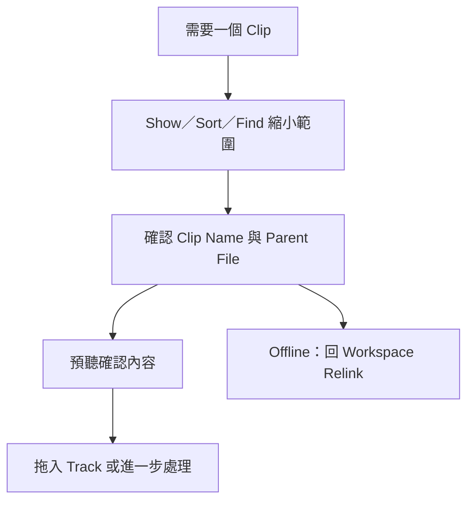

# Ch17 — Clips List：先找到正確 Clip，再開始編輯

> Timeline 告訴你素材放在哪裡，Clips List 告訴你 Session 裡有哪些 Clip；兩個地方回答的問題不同。

## 1. Clip、Whole-File 與 Parent File 是三個層次

每次錄音、匯入與某些編輯動作，都可能在 Clips List 增加條目。條目多，不代表硬碟多出同樣數量的完整 Audio files；許多 Clip 只是對同一個 parent audio file 的不同範圍描述。這是 Pro Tools 非破壞編輯能保留素材的基礎。

原書把整個 audio file 的 Clip 稱為 whole-file audio clip，於 Clips List 用**粗體**顯示。一般片段則是該檔案的一部分；Stereo／Multichannel Clip 能摺疊為一項，再展開個別 channel。要檢查實體素材，應看 File Name／Full Path 或 Reveal，而不是只根據 Clip Name 猜。

| 想確認的事 | 看哪裡 | 解決的問題 |
|---|---|---|
| 這是不是完整 Audio file？ | 粗體 whole-file Clip | 分清原始錄音與剪輯片段 |
| 這個片段來自哪個檔案？ | File Name／Full Path | 找 parent file、檢查媒體位置 |
| 這是 Audio、MIDI 還是 Clip Group？ | Show 與 Type 顯示 | 避免把不同資料類型混著操作 |
| 時間跟 Tempo 還是絕對 sample？ | Timebase 欄／圖示 | 分辨 Tick-Based 與 Sample-Based |
| 多聲道各 channel 是什麼？ | 展開 Stereo／Multichannel 項目 | 檢查 channel 對應與個別素材 |

> [!tip] 實務連結
> 混音接手別人 Session 時，看到大量名稱相近的 Vocal Clip，先加看 File Name 與 Full Path。你需要知道哪些是同次錄音的剪輯，哪些真的是不同錄音檔，否則「重新命名」「清掉不用的」會變得很危險。

## 2. Show、Sort By、Find：縮小範圍比一直捲動有效

Clips List menu 的 `Show` 控制 Audio、MIDI、Video、Groups、Auto-Created 等顯示類型；先隱藏眼前不需要的類別，能降低視覺干擾。原書特別提到，剪輯後大量 auto-created Clips 會讓清單變得很擁擠，可關掉 `Show > Auto-Created`，但這只是隱藏，不是清除。

`Sort By` 可依 Name、Length、Time Stamp、Timebase 等排序；Audio 另有 File Name、File Length、Creation／Modification Date、Disk Name、Track Format／Width 等條件。再選 Ascending／Descending 決定方向。找最後一次新錄的音可以先按時間／檔案資訊排序；找特定角色的素材，則用名稱搜尋。

| 工作需求 | 建議的查找策略 | 為什麼這樣找 |
|---|---|---|
| 只看錄音素材 | Show > Audio，必要時隱藏 Auto-Created | 避免把 MIDI／大量剪輯衍生項混進來 |
| 找特定人聲 Take | Find，以名稱片段搜尋 | 不必輸入完整 auto-generated 名稱 |
| 找同一個 parent 的不同片段 | 顯示 File Name，再排序／比對 | Clip 名稱可以不同，來源仍可能相同 |
| 判斷素材使用哪個時間座標 | 顯示 Timebase | 變更 Tempo 前先知道影響範圍 |
| 找不到剛匯入的 Clip | 檢查 Show 與目前 Find 篩選 | 可能已存在，只是被顯示條件擋住 |

Mac `Command+Shift+F` 開 `Find Clips`。`By Name` 接受名稱中的部分文字；`Include Subsequently Added Clips` 會讓後續加入的 Clip 也能顯示，清單上方的加號代表這個狀態。Find History 存在 Session 裡，反覆查同一組素材時能直接重用。

> [!warning] 同一組快捷鍵，焦點不同用途也可能不同
> Workspace 的 Advanced Search 也使用 `Command+Shift+F`。先確認最前方視窗與 Keyboard Focus；本書把功能名稱與使用情境一起保留，就是為了避免只背按鍵卻按錯地方。

## 3. 選取與預聽：清單不是只能拖拉

可以點名稱選取，用 Marquee 做連續選取，或用 Mac `Command-click` 加選不相鄰項目。啟用 Clips List Keyboard Focus 後，輸入 Clip 名稱開頭的字母即可定位。這裡比對的是 **Clip name**，不是 parent file 名稱或所在 disk 名稱。

啟用 Editing preferences 的 `Clips List Selection Follows Edit Selection`，清單和 Edit Window 的選取會互相跟隨：在清單點某 Clip，可對應到已配置 playlist 裡的實例；在 Track 選取，也會反映在清單。這對「明明看得到 waveform 卻不知道清單名稱」的情況很有用。

| 選取項目 | 原書意義 | 使用時機 |
|---|---|---|
| Select > Unused | 選取沒有放進目前 Session Track 的 Clips | 整理前先檢查未使用項 |
| Unused Except Whole Files | 排除 whole-file Clips | 想先處理衍生片段而保留完整來源項目 |
| Offline | Parent file 不可用／找不到 | 轉向 Workspace Relink 排查來源 |
| Select Parent in Workspace | 同步 highlight parent file | 從 Clip 反查實體素材 |

Mac `Option-click` Clip 名可預聽，Audio／Clip Groups 走 I/O Setup 的 Audition Path。Sample-Based Clip 以原本時間播放；Tick-Based MIDI 與經 Elastic Audio 處理的內容以 Session 目前 Tempo 預聽。MIDI 預聽還要有 MIDI preferences 的 Default Thru Instrument，因此「MIDI 有內容但預聽無聲」不一定是 Clip 壞掉。

## 4. Stereo／Multichannel 摺疊的條件

Stereo 與 Multichannel 的組成 Clip 必須同長度，才會作為集合顯示。把一組素材拖到多條 Mono Track 後，如果某個 channel 被剪成不同長度，集合顯示會消失，改成個別 Clip。這是顯示規則反映了素材關係改變，不是多聲道音訊忽然變成新格式。

![[PT-Ch17-clip-parent-model.png]]

> [!tip] 實務連結
> 一個素材在 Timeline 被剪成很多片，只是有很多不同範圍。用 parent file 概念思考，會更容易理解後半篇的 Rename、Remove 與 Delete：它們改的是不同層級，不應當成同一種「清理」。

> [!abstract] Takeaway
> 先用 Show／Sort／Find 找到候選，再看 parent file 與 Timebase，最後預聽。粗體是 whole-file；清單條目不是硬碟檔案的數量。接著讀 [[PT-Ch17b-Clips命名與安全清理]]，處理命名、批次整理與刪除界線。

## 原文定位

本篇依 2023.3 原文整理，操作名稱與版本限制以該版為準。來源：[[Pro_Tools_Reference_Guide_2023.3.pdf#page=361|原書 p. 329–339／PDF p. 361–371]]。圖表與實務情境為原創教學整理；未逐句翻譯。

## 相關

%% PT-NAV-BEGIN %%

上一篇：[[PT-Ch16-Group聯動與相對關係]]

下一篇：[[PT-Ch17b-Clips命名與安全清理]]

按任務閱讀：[[PT-00-工作流程導航]]

%% PT-NAV-END %%

[[PT-00-索引]] · [[PT-00-功能目錄]] · [[PT-00-快速檢索]] · [[PT-00-Mac快捷鍵]]

標籤： #pro-tools #audio #teaching
