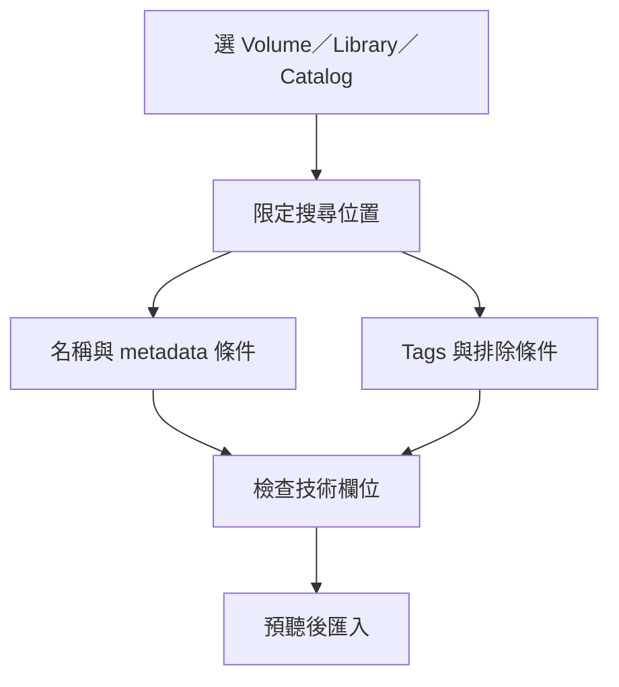

# Ch18 — Workspace：用 metadata 把散落素材變成可搜尋的素材庫

> Workspace 把檔案位置、metadata 與搜尋條件放在一起；先縮小搜尋範圍，再描述內容，才能從大量素材中找到真正要用的聲音。

## 1. Workspace 是素材管理介面，不只是檔案對話框

Workspace 把 browser-style interface 與 database 結合，用來搜尋、排序、預聽及匯入媒體。它能看到 mounted volumes、資料夾、Session／Project、Catalogs、Track Presets 與 Sound Libraries 等。資料庫保存對素材的描述與索引，不代表把所有音檔搬進一個新資料夾。

| 入口／物件 | 它代表什麼 | 注意點 |
|---|---|---|
| Volume／Folder | 實體儲存位置與其內容 | 檔案移動、複製與刪除可能實際影響磁碟 |
| Project／Session | 目前工作的素材關聯 | 適合查這份工作用到的媒體 |
| Catalog | 以 aliases 組織不同來源的素材集合 | 不是另一份實體媒體備份 |
| Sound Libraries | 可搜尋的音效／Loop 等素材位置 | 新增 library location 可只是指向原資料夾 |
| Track Presets | 儲存好的 Track 工作配置 | 參考 [[PT-Ch15-Track-Presets與可重用工作流程]] |

Mac `Option+I` 開一般 Workspace；原書的 `Option+O` 直接聚焦 Project。不同 browser 可以各自停在不同位置；同時開很多視窗之前，先給每個視窗清楚的任務，避免「我剛才是在查哪個硬碟」的混亂。

> [!tip] 實務連結
> 音效素材放外接碟、Loop 放另一個 library，也能透過 Workspace 搜尋與 Catalog 整理。這種管理方式把「檔案物理位置」與「工作分類」分開，適合日積月累的素材庫。

## 2. R／P／T 是儲存卷用途，不是檔案存不存在

| 類型 | 意義 | 工作上的結果 |
|---|---|---|
| Record（R） | 可作錄音與播放的 Performance volume | 可以配置錄音目標 |
| Playback（P） | 可播放的 Performance volume | 能播放已存在素材，但不作錄音目的地 |
| Transfer（T） | 可儲存、搬移，但不直接作 Session 播放用途 | 媒體需 Copy and Relink 到合適 Performance volume |

即使 Finder 能打開某個音檔，也不代表 Pro Tools 已把其所在 volume 當成合適的播放／錄音位置。看到 Transfer 提示時，先檢查 volume designation 與支援條件，不要直接把問題當成檔案遺失。

Workspace 的 database 會保存 metadata 與 waveform cache；手動 `Update Index` 可更新所選 folder 與 subfolders 的資料。自動索引不代表第一次打開很大的素材庫就會立刻有所有 metadata；工作尚未完成時，可用 Task Manager 確認背景進度。

## 3. 用欄位回答問題：Name 只是其中一個線索

Browser pane 的每一列是一個 item，每一欄是一種 metadata。可以重排、縮放、隱藏欄位，再存成 View Preset。原書支持多層欄位排序，因此你可以先依類型／分類，再以檔名或其他條件排列。

| Metadata 類型 | 可以幫你做什麼 | 應留意的事 |
|---|---|---|
| Name、Kind、Duration | 快速辨識檔案與長度 | Duration 對 Tick-Based 音樂素材可使用 Bars／Beats |
| Sample Rate、Bit Depth、Channel Width | 檢查技術規格 | 不要為了改「顯示」而無意改動可編輯的 metadata |
| Tags、Rating、Favorite | 用內容與主觀選擇建立搜尋入口 | Tags 對 WAV／AIFF 可存入 file header |
| Tempo、Key | 找音樂素材的節奏與調性線索 | 有無可用資訊取決於檔案 metadata／analysis |
| Comments／Catalog Comments | 記錄素材說明或工作備註 | 兩者保存範圍不同，要看欄位定義 |

`Set Column Metadata Values for Multiple Selected Files` 能一次替多個檔案設定 Author、Category、Comments、Tags 等適用欄位。批次修改能省很多時間，也會一次影響很多素材；先確認選取範圍再輸入，比完成後逐項修正安全。

> [!warning] 改 Sample Rate 欄位不等於做 Sample Rate Conversion
> 原書指出，某些檔案的 Sample Rate metadata 可編輯，用於特定速度／時脈修正工作。這是改檔頭解讀，不是重新取樣產生等時長資料；正常規格轉換應用 Import／Conversion 的正確流程，見 Ch21。

## 4. Simple Search 與 Advanced Search 的分工

Simple Search 適合已知名稱片段；Advanced Search 適合把需求變成多個可比較條件。先在 Locations 選一個位置，或啟用 `Search Checked` 勾多個位置，再決定搜什麼。否則很精準的字串，也可能是在錯的硬碟裡找。

| 搜尋方式 | 操作核心 | 適合什麼問題 |
|---|---|---|
| Simple Search | 在 Browser Search field 輸入文字 | 名稱或一般文字線索已知 |
| Advanced Search | 選 Column、criteria、搜尋值，可 Add Row | 同時限定格式、描述、長度等 |
| Search Checked | 在 Locations 勾選多個搜尋位置 | 素材跨多個 library／volume |
| Tags search | 選擇或輸入內容 tags | 不知道檔名，但知道聲音種類 |
| 排除指定 tag | 以 exclude 條件剔除特徵 | 要某一類聲音，但不要其中某些特性 |

Mac 在 Workspace 用 `Command+Shift+F` 切入 Advanced Search。每列依 Column → Search Criteria → Search Text 設定，按 Return 執行；需要時再加條件。這是「把需求拆成欄位」的練習：例如聲道數、檔案類型、描述詞各自是不同條件，不要把它們全塞進 Name。

## 5. Soundbase 與 tags：讓記不住檔名也能找聲音

`Window > New Workspace > Soundbase`，或 Mac `Option+Control+I`，可開啟 Soundbase。原書的 Sound Libraries 預設位於 `~/Documents/Pro Tools/Sound Libraries/`；新增其他 location 時，內容可以留在原本位置，library 只是指向它。移除 Sound Library Location 也不等於刪除原資料夾內容。

在 Tags pane 點選內容標籤，結果會依 tags 縮小；也能排除特定 tag。對自己的舊素材庫，要先補上 tags 才會有這種搜尋優勢。選一個或多個音檔，透過右鍵或 Tags column 開 `Assign Tags`，新增或移除標籤，還能指定 Favorite 與 0–5 Stars。

![[PT-Ch18-search-relink-map.png]]

> [!tip] 實務連結
> 素材庫最有價值的標籤，是下次搜尋真的會用的詞：樂器、聲源、動作、音色特性或使用場合。先用一小批素材建立一致語彙，再批次擴展，比一口氣為每個檔案加十幾個不一致的標籤有效。

> [!abstract] Takeaway
> Workspace 的核心順序是：**先選位置，再用 metadata 描述需求，最後預聽**。Catalog 與 library location 是管理入口，不是備份。接 [[PT-Ch18b-Workspace預聽與Tempo]] 了解如何在 Session 情境試聽，再讀 [[PT-Ch18c-Relink與背景任務]] 處理素材連結。

## 原文定位

本篇依 2023.3 原文整理，操作名稱與版本限制以該版為準。來源：[[Pro_Tools_Reference_Guide_2023.3.pdf#page=379|原書 p. 347–377／PDF p. 379–409]]。圖表與實務情境為原創教學整理；未逐句翻譯。

## 相關

%% PT-NAV-BEGIN %%

上一篇：[[PT-Ch17b-Clips命名與安全清理]]

下一篇：[[PT-Ch18b-Workspace預聽與Tempo]]

按任務閱讀：[[PT-00-工作流程導航]]

%% PT-NAV-END %%

[[PT-00-索引]] · [[PT-00-功能目錄]] · [[PT-00-快速檢索]] · [[PT-00-Mac快捷鍵]]

標籤： #pro-tools #audio #teaching
