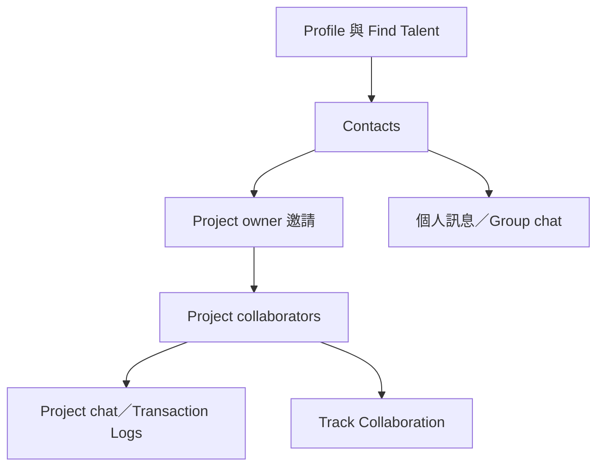

# Ch19 — Artist Chat 與 Avid Link：人、Project 與訊息各有自己的範圍

> 協作先要分清「聯絡到誰」「邀請進哪個 Project」「把訊息送到哪個對話」；這些不是同一個權限。

> [!warning] 歷史版本範圍
> 本篇依 **2023.3** 手冊記錄 Avid Link／Artist Chat 的設計與操作；雲端服務、帳號與 UI 可能變更，不代表這些服務在目前仍按相同方式提供。本篇沒有對外發送邀請或訊息。

## 1. Profile 是讓別人知道你能做什麼

`File > Sign In` 登入 Avid Master Account 後，從 `Avid Link > Profile` 編輯個人資料。原書的 Profile 包含基本資訊與 Portfolio；可加入 Audio Content，提供作品音檔與相關說明。它是合作前的自我介紹，不是錄音工程本體，也不是讓別人自動取得你的 Project。

| 物件 | 回答的問題 | 是否等於 Project 權限？ |
|---|---|---|
| Avid Profile | 你是誰、技能與作品是什麼 | 否 |
| Contacts | 你已連結哪些人 | 否 |
| Find Talent | 想找哪個人或哪種技能 | 否 |
| Project invitation | 邀請誰參與特定 Project | 是，需按協作流程接受 |
| Artist Chat Messages | 與個人或群組交談 | 不代表取得所有相關 Project |

> [!tip] 實務連結
> 錄音合作常把聯絡資訊、示範作品與工程權限混在一段訊息裡。先整理 Profile 和技能，再針對特定 Project 邀請，可讓合作對象知道「這次要做什麼」與「能開啟什麼」，減少不必要來回。

## 2. Find Talent：從搜尋到成為 Contacts

從 `Avid Link > Find Talent` 依姓名搜尋，或用 Skill tags 篩選。找到人後，可以先看 Profile，再用 Add Contact 送邀請與文字訊息；對方尚未成為 Avid Creative Community 成員時，原書也提供以 email 邀請的流程。

這裡要分兩個階段：連結成為 Contacts，是建立可聯絡關係；邀請參與 Project，是針對一份工作的協作。原書的 Project invitation 由 Project owner 發起，不是每個 Contact 一出現就自動能看見你的工程。

| 工作順序 | 應確認的事 | 為什麼重要 |
|---|---|---|
| 查姓名／Skill | 是否為正確對象 | 同名與相近技能都可能造成誤認 |
| 檢查 Profile／作品 | 專長是否符合這次工作 | 「音訊工作者」仍可能是不同角色 |
| Add Contact | 是否接受連結 | 建立聯絡關係而非直接交付素材 |
| 邀 Project | 是否為正確 Project、由 owner 邀請 | 把工程權限與工作目的對齊 |
| 確認接受與在線狀態 | 對方是否已加入、是否目前在線 | 接受邀請不等於當下能即時回應 |

## 3. Artist Chat 的 Project controls

Artist Chat 的 Pro Tools Projects 區會列出你以 owner 或 collaborator 身分參與的 Projects。即使某個 Project 不是目前開啟的工程，也能從清單選它，參與該 Project 的聊天。這是便利之處，也是發訊息前最該看清楚的地方：訊息的 Project 不必然等於你現在編輯的 Session／Project。

原書提供 Show／Hide Participants、Invite Contacts to Collaborate、Collaboration Transaction Logs 等控制。Logs 是協作交易活動紀錄，可協助判斷 Track 資料上傳、下載與變更；它不是錄音波形，也不應取代實際聲音確認。

| 操作 | 誰能做／用途 | 操作後要確認 |
|---|---|---|
| Invite Contacts to Collaborate | Project owner 邀既有 Contacts | Project 名稱與對象 |
| Accept／Decline | 受邀者決定加入 | 接受後出現在 Projects 清單 |
| Remove participant | Project owner 移除成員 | 對方將不再有該 Project 可用性 |
| Leave project | Collaborator 離開 | 與隱藏清單項目不同 |
| Show Participants | 看成員與狀態 | Invited／accepted、online／offline 是不同資訊 |
| Show Transaction Logs | 顯示協作活動 | 用來追蹤變更，而非證明混音一致 |

> [!tip] 實務連結
> 一次參與多個製作案時，發送工作決策前先看 Project Name。把「這段 Vocal 我已換 Take」寫在錯的 Project chat，即使工程本身沒錯，也會讓他人依錯誤上下文繼續工作。

## 4. Project chat、私人訊息與 Group chat

Project chat 面向該 Project 的所有參與者；若只想與某位成員確認事情，可從 Participants 名稱選 Message，建立個別對話。`Avid Link > Messages` 則提供一般訊息區，能建立新聊天或多 Contact 的 Group chat。

Group chat 額外提供命名、顯示參與者、添加／移除成員等操作；原書對誰能移除成員、誰能修改群組有具體區分。不要以為能看到一個 Group chat，就一定有管理該群組所有人的權利。

| 對話形式 | 可見範圍的理解 | 適合的內容 |
|---|---|---|
| Project chat | 該 Project 的參與者 | 段落決策、版本交接、誰負責哪些 Track |
| Individual message | 指定對象 | 個別確認、私人安排 |
| Group chat | 該聊天群組成員 | 跨 Project 的工作討論 |
| Transaction Logs | 協作操作紀錄 | 看上下載與變更活動，不是一般文字決策 |

## 5. 清單越長，Pin 越重要

原書可在 Pro Tools Projects 與 Messages 清單中 Pin／Unpin 項目，讓常用項目固定在好找的位置。Pin 是導覽設定，不是把資料下載完成，也不是把 Project 鎖住不讓人修改。把顯示、資料同步與權限分開理解，整套協作介面會清楚很多。

![[PT-Ch19-collaboration-layers.png]]

## 邀請失效、成員離開與移除：不要用同一個詞混稱

原書把尚未接受 invitation 的人標示為 Invited；Project owner 可選 `Revoke Invitation` 撤回。已經接受的 participant 則是另一個狀態，可由 owner 依規則 `Remove`。Collaborator 自己離開 Project 用 `Leave`，會失去該 Project 的存取並從相關清單移除，其他參與者也會收到狀態變化。

本章還有一個容易漏掉的條件：**當 participant 目前仍開著該 Project，Remove command 不可用**。因此按鈕不存在或灰化，不一定是你權限全壞掉；可能是動作的前提還未滿足。處理前先看你是否為 owner、對方是 pending 還是已加入、Project 是否正在被對方開啟。

| 想做的事 | 原書對應動作 | 要先確認 |
|---|---|---|
| 取消還沒接受的邀請 | Revoke Invitation | 對方仍在 pending／Invited 狀態 |
| 讓已加入成員不再參與 | Remove | 你是 owner，且對方未開啟該 Project |
| 自己退出別人的 Project | Leave | 之後不再有該工作可用性 |
| 只是讓常用項目好找 | Pin／Unpin | 不改 Project membership |
| 與新成員另外聯絡 | Add to Contacts／Message | Project 共事不等於原本就是 Contacts |

## 一次交接，分開確認訊息與資料

以下是基於本章功能的工作建議。先確認對方已接受 Project invitation；再由 Project chat 說明這輪修改的 Track 與目的；實際上傳則到 Ch20 的 Track Collaboration 執行。對方收到訊息後，仍要完成下載並檢查資料，不要用一句「收到」代替工程驗證。

可以把對話決策與 transaction logs 互相對照：文字說明為什麼換 Take，logs 顯示哪時上傳了什麼變更。若對話很多，可隱藏 logs 讓聊天乾淨，需要追溯時再顯示。這樣能保留決策脈絡，也不必把每則系統活動重寫成一段聊天。

> [!tip] 實務連結
> 避免只說「新版好了」。寫出 Track role、修改範圍與需要對方檢查的項目，讓對方能在正確 Project 對照實際內容。這是合作寫作習慣，不是另一種自動同步功能。

> [!abstract] Takeaway
> Profile、Contacts、Project membership 和 chat thread 是不同層次。先找對人，再邀對 Project，最後在正確對話討論。真正上傳與接收 Track 變更的機制，接 [[PT-Ch20-Track-Collaboration與衝突處理]]。

## 原文定位

本篇依 2023.3 原文整理，操作名稱與版本限制以該版為準。來源：[[Pro_Tools_Reference_Guide_2023.3.pdf#page=431|原書 p. 399–412／PDF p. 431–444]]。圖表與實務情境為原創教學整理；未逐句翻譯。

## 相關

%% PT-NAV-BEGIN %%

上一篇：[[PT-Ch18c-Relink與背景任務]]

下一篇：[[PT-Ch20-Track-Collaboration與衝突處理]]

按任務閱讀：[[PT-00-工作流程導航]]

%% PT-NAV-END %%

[[PT-00-索引]] · [[PT-00-功能目錄]] · [[PT-00-快速檢索]] · [[PT-00-Mac快捷鍵]]

標籤： #pro-tools #audio #teaching
