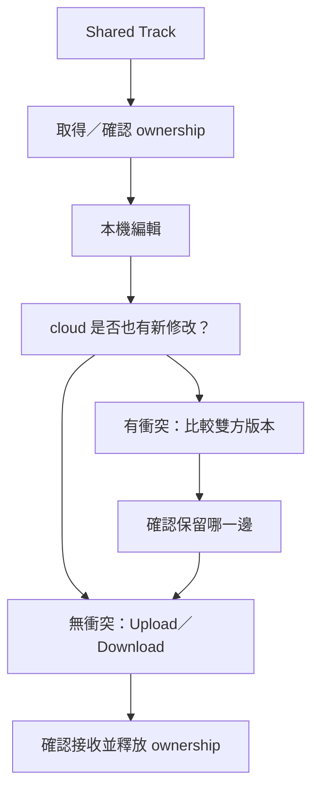

# Ch20 — Track Collaboration：控制共享範圍，讀懂 ownership 與衝突

> Track Collaboration 不是所有人的工程即時鏡像；它讓每個人選擇何時、以哪條 Track、把哪些變更交給雲端版本。

> [!warning] 雲端服務的版本界線
> 以下是 **2023.3 手冊**描述的線上 Project 工作方式，未查核現行服務供應、方案與介面。這裡只整理知識，沒有對外分享、邀請或上傳任何 Project。

## 1. Project owner 與 Track owner 不同

建立 Project 並邀人加入的是 Project owner；媒體佔用原書所述 owner 的雲端 storage allocation，也只有 Project owner 能管理邀請。Track owner 則表示某條共享 Track 目前由誰負責修改，它會隨工作交接而改變。

| 角色／物件 | 負責的範圍 | 不代表什麼 |
|---|---|---|
| Project owner | Project 建立、成員邀請、其雲端容量 | 不是每條 Track 必須一直由他編輯 |
| Track owner | 單條共享 Track 的工作責任與交接 | 不是嚴格禁止其他人在本機做任何修改的檔案鎖 |
| Local copy／cache | 目前這台機器的資料狀態 | 不保證與雲端最新版本完全一致 |
| Cloud copy | 已上傳至共同 Project 的資料 | 不包括每個人尚未上傳的所有修改 |

`File > Start Collaboration` 可把既有 Session 保存、關閉並複製成 Project，或在沒有工程開啟時由 Dashboard 建立。先弄清楚 Session 到 Project 的轉換，才知道眼前操作的是本機工作還是線上協作版本。

## 2. 哪些共享、哪些只在初次下載、哪些不共享？

原書把資料分成三類。部分 Track／Conductor 資料可持續上傳；部分 Project 屬性只在初次下載時帶入；另一些結構根本不共享。這比「上傳工程＝什麼都一樣」更接近實際行為。

| 類別 | 原書列出的例子 | 工作上的意義 |
|---|---|---|
| 可持續共享 | Audio／MIDI 與部分 Track data、Volume／Pan／Mute Automation、Plug-In assignment／settings／automation、I/O assignment，以及適用的 Conductor rulers | 要透過相關 Upload／Download 控制交換修改 |
| 初次下載的 Project 屬性 | Sample Rate、Bit Depth、File Format、Project Start／Length、Timecode Rate 等 | 不能假定後續改動都像 Track edits 一樣持續同步 |
| 不共享 | Mix／Edit Groups、Clip Groups、Basic Folder Tracks、VCA Tracks、HEAT settings、Video | 本機工作結構不必然在合作者系統重現 |
| Routing Folder 的特殊情況 | 分享後轉成 Auxiliary Input，成員移到頂層 | 不能依賴原 Folder hierarchy 原封不動傳遞 |

共享 Track 的 Plug-In 設定，不會順便讓合作者擁有那顆 Plug-In。若對方缺少處理器，`Share Track as Frozen` 可以交付 Frozen 狀態，讓對方聽見處理結果；它解決的是可播放性，不是授予相同的即時編輯能力。

> [!tip] 實務連結
> 交接前先約定：哪些聲音必須可聽、哪些必須可調、哪些本機結構可不傳。只要把這三件事分開，Freeze、共享 Track 與另交參考 Mix 才能各司其職。

## 3. Global tools 與每軌 tools

`View > Track Collaboration` 顯示 Global tools；Track 的 Collaboration view 則顯示個別 Share、Upload、Download 與 Ownership。Global 一次處理共同資料，逐軌操作則讓你先完成一部分再交接。

| 控制 | 用途 | 應讀清的範圍 |
|---|---|---|
| Share Track | 決定這條 Track 是否分享 | 未分享的 Track 可留作個人草稿 |
| Upload Track Changes | 把該 Track 本機變更送到 cloud | 不等於保存所有其他 Track 的進度 |
| Download Track Changes | 接收 cloud 的該 Track 變更 | 可能覆蓋本機對同一軌的修改 |
| Upload All New Changes | 一次送出待上傳變更 | 操作前先確認所有涉及的 Track |
| Download All New Changes | 一次接收新變更 | 避免把「某軌完成」誤當整個 Project 都適合更新 |
| Abandon Changes | 放棄尚未上傳的本機修改 | 不等於只清除提示燈 |
| Force Upload／Force Download | 強制以某一方完整內容更新 | 應先理解哪一份會被替換 |

原書也有 `Download All Shared Tracks`、雲端空間 meter 以及 Task Manager 進度。看到 Share icon 亮起，不表示對方本機已下載完成；要分清「已分享」「上傳中」「已在 cache」等狀態。

## 4. Automatic／Manual ownership 的生命週期

未被擁有的共享 Track，可因你開始做可共享修改而自動取得 ownership。這種 automatic ownership 在上傳後可自動釋放；manual ownership 則由你明確取得，完成上傳後仍保留，直到主動 Relinquish。

| Ownership 狀態／動作 | 行為 | 合作習慣 |
|---|---|---|
| Unowned | 任何人可開始工作 | 先溝通，避免同時改同一條 |
| Automatic ownership | 由可共享修改暫時取得 | 完成並上傳後交還工作空間 |
| Manual ownership | 明確取得，保持到釋放 | 適合一段持續工作，但別無限占用 |
| Request | 向現在的 owner 要求交接 | 等確認後再大量修改 |
| Rescind My Request | 取消尚未完成的要求 | 工作計畫改變時清楚撤回 |
| Relinquish | 主動釋放 ownership | 上傳與交接應相互配合 |
| Seize | 直接取得他人 ownership | 它不是避免衝突的正常首選，仍要確認版本 |

原書提醒 ownership **不是限制性鎖定**。其他人仍可能在本機對同軌修改，之後出現 cloud／local conflict。因此單靠 icon 不足以解決協作；成員間對工作區域的約定同樣重要。

## 5. 黃色 Upload／Download：先決定保留哪一邊

當 Upload Track Changes 或 Download Track Changes 變成黃色，代表本機與 cloud 都有變更而出現衝突。上傳會讓 cloud 使用你的版本，下載則會讓本機使用 cloud 版本。這不是把兩套編輯自動聰明合併的承諾。

![[PT-Ch20-local-cloud-conflict.png]]

> [!warning] 黃色不等於按任一邊都能修好
> 把游標停在警示控制可看 tooltip，確認是本機將覆蓋 cloud，還是 cloud 將覆蓋本機。必要時先把有價值的修改保留為獨立版本，再決定更新方向。

## 6. Conductor rulers 也需要交接

Tempo、Meter、Key、Chord 等適用 Conductor ruler 也有 Upload／Download 與 Ownership controls。這些不是純顯示資料：一個 Tempo 變更可能影響 Tick-Based 音樂素材的整體位置，因此更不適合多人各自修改後盲目同步。

Tracks List 的 cloud icon 可指示共享內容是否已下載到 local cache；灰色雲端狀態與正在下載的指示要分開看。網路或 cache 尚未就緒時，可以先檢查狀態與 Task Manager，不要把等待誤當成功。

## 用一個交接情境把狀態串起來

以下為本筆記的工作情境：製作人正在整理人聲，另一位工程師準備調整同一條 Track 的處理。先由人聲編輯者取得 ownership，完成有意義的一輪修改再 Upload；工程師看到新變更後 Download，確認內容與版本，才接手自己的修改。不是每切一刀就要求所有人立即更新，也不是一天結束才告訴對方整軌都已改掉。

如果工程師在下載之前已經開始動同一條 Track，local 與 cloud 可能同時有修改。這時要先比較雙方有價值的部分，再決定保留哪個版本；必要時把資料另外保存再合併。黃色 Upload／Download 控制只是把衝突暴露出來，並不替你理解哪一句演唱比較好、哪一套 Automation 是新的決策。

| 交接階段 | 操作責任 | 驗證方式 |
|---|---|---|
| 開始前 | 說清誰處理哪些 Tracks／Rulers | Ownership 與聊天內容一致 |
| 製作中 | 保留個人草稿或只分享有意義的狀態 | Share Track 與 Upload 範圍明確 |
| 送出 | Upload 已完成的一輪工作 | 看 Task Manager 與上傳控制狀態 |
| 接收 | Download 並驗證內容 | 回聽指定段落，不只看 icon |
| 交還 | Relinquish，或依 automatic ownership 行為釋放 | 下一位能清楚接手 |

## Abandon、Ignore 與 Force 不是一般的「重新整理」

`Abandon Changes` 放棄本機尚未上傳修改；`Ignore Changes` 拒絕該 Track 的 cloud 變更並保留目前本機版本；`Force Download` 會以 cloud 的整條 Track 重新取代本機，`Force Upload` 則明確要求推送本機內容。它們都有方向，不能當成網頁重整那樣隨便按。

例如只是想延後處理對方變更，就不該用 Abandon 清掉自己的工作；只是想確認網路進度，也不該 Force Upload 把共同版本改回舊內容。遇到無法說明的狀態，先停在查看 tooltip、Task Manager 和 transaction logs，再決定資料動作。

> [!tip] 實務連結
> 協作的單位最好是「可驗證的一輪工作」：換好哪個 Take、修好哪一段 Tempo、做完哪條 Track 的編輯。這比讓大家不停猜「你現在是不是還在動那一軌」更有效。

> [!abstract] Takeaway
> 協作要同時管理**分享範圍、ownership、上下載方向**。Project owner 管成員與雲端配置；Track owner 管工作交接。黃色衝突先確認版本，Conductor 也要明確分工；不要期待兩套不同的剪輯被自動無損合併。

## 原文定位

本篇依 2023.3 原文整理，操作名稱與版本限制以該版為準。來源：[[Pro_Tools_Reference_Guide_2023.3.pdf#page=445|原書 p. 413–430／PDF p. 445–462]]。圖表與實務情境為原創教學整理；未逐句翻譯。

## 相關

%% PT-NAV-BEGIN %%

上一篇：[[PT-Ch19-Artist-Chat與Avid-Link協作入口]]

下一篇：[[PT-Ch21a-Audio與MIDI匯入匯出]]

按任務閱讀：[[PT-00-工作流程導航]]

%% PT-NAV-END %%

[[PT-00-索引]] · [[PT-00-功能目錄]] · [[PT-00-快速檢索]] · [[PT-00-Mac快捷鍵]]

標籤： #pro-tools #audio #teaching
