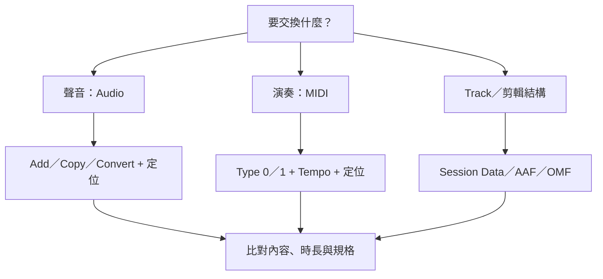

# Ch21 — Audio／MIDI 匯入與匯出：先決定資料型態，再決定 Copy 與 Conversion

> 匯入不是單純把檔案拖進畫面，而是決定來源留在哪裡、規格怎麼解讀、內容落在什麼時間位置。

## 1. 先選對交換單位

一個 Audio file、一條帶 Plug-In 和 Automation 的 Track、一段 MIDI，以及完整 AAF sequence，帶的資料完全不同。先問你需要的是聲音、演奏事件、Track configuration，還是影音剪輯結構，再挑 Import 入口。

| 要交換的資料 | 入口／格式 | 不會自動代替的東西 |
|---|---|---|
| Audio file／Clip | File > Import > Audio；也可拖放 | 不是整條 Track 的全部混音設定 |
| MIDI 演奏 | Standard MIDI File Type 0／1 | 不是已經合成好的音訊 |
| Track 與 Session 設定 | File > Import > Session Data | 需選擇匯入哪些屬性，不必全部覆蓋 |
| 影音編輯結構 | AAF／OMF／適用 MXF 工作流程 | 不是跨軟體所有功能無損重建 |
| Clip Group | Clip group file | Audio 通常仍需另外收集其引用檔案 |

## 2. Add、Copy、Convert 是三個不同動作

`Add` 會讓 Session 引用來源檔目前的位置，不搬移、不產生複本。`Copy` 把資料複製到新的位置。`Convert` 則為格式、Bit Depth 或 Sample Rate 的要求產生轉換資料。對可直接使用的素材，這些選擇仍有管理上的差異；「能 Add」不等於「交付時不用收集」。

| 動作 | 來源位置 | 資料規格 | 典型風險 |
|---|---|---|---|
| Add／Link | 保留原位置並引用 | 可維持原資料 | 拔掉來源 volume 或移動下載資料夾後 Missing |
| Copy | 產生複本並使用適當位置 | 可維持規格 | 只複製了部分素材，誤以為整份工程已自足 |
| Convert | 產生新的轉換資料 | 依目標改格式／Bit Depth／Sample Rate | 未理解來源 rate，導致速度或 pitch 不對 |

原書允許某些不同 Sample Rate 的素材不轉換加入，但會以不正確的 speed／pitch 播放，Import dialog 會警告。這不是正常換規格的建議流程。若要保持演奏時間與音高，應正確執行 Sample Rate Conversion；若故意重新解讀 rate 作特殊效果，則要清楚知道自己在改什麼。

> [!tip] 實務連結
> 收到別人的 Stems，先看 Sample Rate／Bit Depth 和它們的對齊方式，再匯入。別靠「拖進去有聲音」判定成功；至少要比對長度、音高與共同起點。

## 3. Import Audio 的可跟做流程

1. 執行 `File > Import > Audio`，選來源 file 或 Clip，先查看 properties。
2. 在 dialog 中預聽；確認格式、Sample Rate 與內容。
3. 把素材加入 Import list；需要轉換時選 Convert，並確認 SRC 設定。
4. 按 Done，依需要選複製／轉換檔案的 destination。
5. 在 Audio Import Options 選 `New Track` 或 `Clips List`，以及落點。
6. 回到 Timeline 檢查位置與時長，必要時看 Task Manager 等轉換完成。

拖放則看放置位置：拖 Clips List 是把素材放進素材清單；拖 Track 是放到既有 Track；拖 Tracks List／空白處可建立新 Track。Spot mode 會讓你明確指定位置，適合以 Timecode／Time Stamp 工作。

| Import preference | 它處理的問題 | 不要與哪個概念混淆 |
|---|---|---|
| Automatically Copy Files on Import | 是否自動把匯入檔案收集成複本 | 不是自動建立所有外部 Plug-In 的備份 |
| Convert Copied Files to Session Format | 複製時轉成 Session format／Bit Depth／Sample Rate | 不等於只改檔名 |
| Drag and Drop From Desktop Conforms to Session Tempo | Finder 等桌面拖放是否跟 Tempo | 不等於所有沒有 Tempo 的音檔都能精準對拍 |
| Enable Elastic Audio on New Tracks | 新建 Track 預設啟用 Elastic Audio | 不同於所有素材都應使用時間伸縮 |
| Default Plug-In／New Tracks Default to Tick Timebase | 決定相關預設處理與時間座標 | 會影響工作方式，匯入後應再檢查 |

REX／ACID 的音樂時間資料可與 Elastic Audio／Clip Group 等 import 設定配合。舊 SD II 的匯入依版本有歷史限制；2023.3 本章有專門說明轉換，跨舊工程時應走原文指定流程，不把舊格式等同一般 WAV。

## 4. Export Clips as Files 與完整 Mixdown 不同

`Export Clips as Files` 把選定 Clip 匯出為新的 Audio files，可改 format、Sample Rate、Bit Depth。它不是把整條混音訊號經過 Track Plug-Ins、Sends、Bus 全部印出來；需要整體混音請看 Ch54 的 Mixdown，或 Ch47 的 Track render。

原書明確提醒，Warped Elastic Audio Clips 用這個命令會以 **unwarped 的原始 duration** 匯出。若你想交付已伸縮的時間結果，應先選合適 render 流程，再驗證輸出，不要單憑檔名判斷。

| 輸出 | 保存的重點 | 應確認 |
|---|---|---|
| Export Clips as Files | 選定 Clip 的音訊與規格轉換 | 不代表完整 Track／Mix processing |
| Export Clip Definitions | Clip 範圍等定義 | 不會把 Clip 另存成獨立音檔 |
| MIDI Export | 演奏與適用音樂資訊 | 不是音源的聲音 |
| Bounce／Commit／Freeze | 依功能印出或暫存處理結果 | 各自可編輯性與範圍不同 |

此處 Export Clips as Files 在降低 Bit Depth 時，原書列出會套用 Dither，相關表格也列 Noise Shaping；不要把這個行為泛化成所有 Export／Bounce 都相同。例如 AAF／OMF 的 24-bit→16-bit 轉換另有不同說明。

## 5. MIDI Type 0／1 與 Tempo map

Type 0 把所有 channel 資料放在一個 Track；Type 1 可保留 multitrack。Pro Tools 匯入 Type 0 時會依 channel 分成適用的 Clips／Tracks，匯入 Type 1 則按各原始 Track 建立資料。

Import MIDI dialog 可選 New Track／Clips List、Session Start／Song Start／Selection／Spot 等位置，也有是否匯入 Tempo map，以及移除既有 MIDI Tracks／Clips 的選項。`Remove Existing MIDI Tracks` 與 `Remove Existing MIDI Clips` 不同：前者對 Track 結構操作，後者可清掉 MIDI／Instrument Tracks 上的既有資料；執行前要讀清楚。

輸出用 `File > Export > MIDI`，決定 Type、Location Reference 與 `Apply Real-Time Properties`。Mute Automation、muted Clips 與 Track mute 對輸出的影響不能憑聽到的結果推測，原文 p. 450 的 Items Not Exported 必須另外核對。需要別人聽到你使用的音色時，還要交付 Audio render。

![[PT-Ch21-transfer-decisions.png]]

> [!abstract] Takeaway
> 先選交換單位，再決定 Add／Copy／Convert 與時間落點。Export Clip 不是完整 Mixdown，MIDI 也不是音色。要帶 Track 配置，讀 [[PT-Ch21b-Import-Session-Data精準合併]]；要與剪輯師交換，讀 [[PT-Ch21c-AAF-OMF與交付文件]]。

## 原文定位

本篇依 2023.3 原文整理，操作名稱與版本限制以該版為準。來源：[[Pro_Tools_Reference_Guide_2023.3.pdf#page=463|原書 p. 431–451／PDF p. 463–483]]。圖表與實務情境為原創教學整理；未逐句翻譯。

## 相關

%% PT-NAV-BEGIN %%

上一篇：[[PT-Ch20-Track-Collaboration與衝突處理]]

下一篇：[[PT-Ch21b-Import-Session-Data精準合併]]

按任務閱讀：[[PT-00-工作流程導航]]

%% PT-NAV-END %%

[[PT-00-索引]] · [[PT-00-功能目錄]] · [[PT-00-快速檢索]] · [[PT-00-Mac快捷鍵]]

標籤： #pro-tools #audio #teaching
