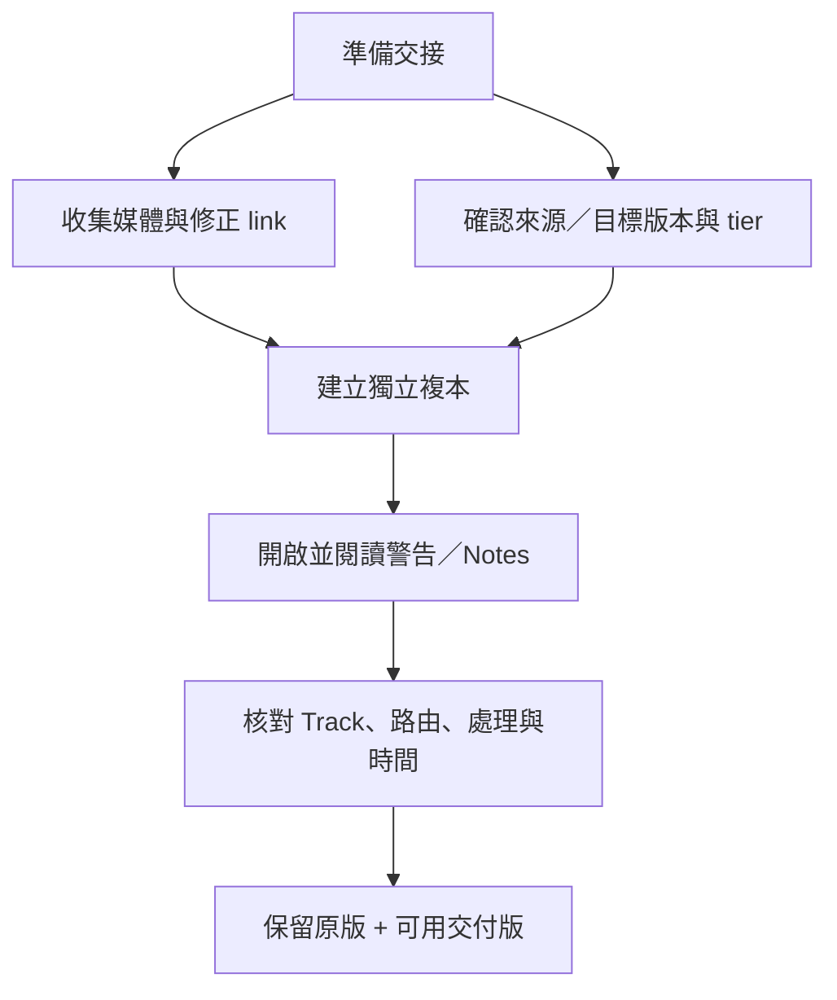

# Ch22 — 檔案管理與相容性：能打開 Session，不代表內容全部保住

> 一份可交接的 Session，要同時保住媒體連結、儲存位置、版本功能與語言編碼；只傳 `.ptx` 不足以證明工程完整。

## 1. Software files 與 Session data 不同

原書區分軟體／Plug-In 檔案與工作資料。前者位在系統應有位置，後者是 Session、Audio files、其他媒體與設定。Session 保存結構與引用，Audio files 仍是外部資料；新增錄音的目的地由 Disk Allocation 決定。

| 資料層級 | 包含什麼 | 搬機前要做什麼 |
|---|---|---|
| Application／Plug-In | 執行程式與處理器 | 依支援與安裝流程處理，不是只複製 Session |
| Session file | Track、Timeline、設定與媒體引用 | 保留版本並確認能正確開啟 |
| Audio／其他媒體 | 真正的錄音與引用內容 | 收集完整，確認沒有外部依賴 |
| Presets／settings | 可重用工作配置 | 明確分辨是否隨工程攜帶 |

原書有避免把 system drive 當主要錄音目的地的歷史效能建議。這應理解成 2023.3 文件對 storage performance 的要求，不可直接把它變成「所有現代 SSD 系統碟一定不能錄音」的絕對規則。實際選擇要依合格儲存配置與測試，不用舊硬碟情境推定所有新電腦。

> [!tip] 實務連結
> 交接前最有效的測試，是從預計交付的複本開工程，並暫時讓原資料位置不可被依賴，再看是否完整。目的是檢查你交出去的是可用工程，還是只有指回自己電腦的捷徑。

## 2. File ID 比檔名更接近素材身分

Pro Tools 使用媒體 identifier 幫助區分檔案；較新版本也使用 SMPTE ID，以支援相關交換。檔名改掉或搬位置時，ID 等資料可輔助 Relink。不要只因為有同名 WAV，就把它視為缺少 Take 的正確替代。

| 連結問題 | 該做的事 | 不該只靠的事 |
|---|---|---|
| 改位置 | Relink，核對候選來源 | 只在 Finder 看名字 |
| Transfer volume | Copy and Relink 到可播放 volume | 認為找到路徑就一定能播放 |
| Offline volume | 先掛載，再修引用 | 在另一堆同名檔裡隨便配一份 |
| 含非法字元的舊檔名 | 看 Pro Tools 的重命名副本與 Notes | 以為原檔被無聲修改 |

若開啟含不合法字元的來源名，原書說明 Pro Tools 可建立重新命名複本，用 underscore 取代字元，放入 Renamed Audio Files；原檔保留，並可寫出 Notes 對照。這就是為何工程旁的文字報告值得一起保存。

## 3. WAV、BWF、WAVE Extensible、RF64／BW64

| 名稱 | 本章的重點 | 交接意義 |
|---|---|---|
| WAV／Broadcast Wave | 可攜帶適用 Time Stamp 等 metadata | 音訊內容與定位資訊可一起交接 |
| WAVE Extensible | 描述 Multichannel 與 speaker positions | 大於 Stereo 的 channel layout 要檢查 |
| RF64／BW64 | 支援大型 WAV 類型資料 | 「能播放」不等於每種 metadata 都被理解 |
| BW64 的 ADM metadata | 原書說明本版可 link／play，但不承認其特有 ADM metadata | 不要由容器支援推定完整物件／場景資料支援 |

原書指出，Pro Tools 產生或轉換達 4 GB 以上的 WAV 時，結果會使用 RF64，即使來源是 BW64。這是本版文件的具體行為；不要把輸入副檔名相同當作所有 metadata 在輸出後完整不變的證據。

## 4. 跨 Mac／Windows：三個問題分開解

跨平台要分清檔案格式、volume format 與路徑／命名。對方能開 WAV，不代表能讀你的 storage filesystem；能讀 filesystem，也不代表 Plug-In 都安裝好。原書討論 HFS+、NTFS 與 MacDrive 等舊流程，應作歷史相容知識，不當成現行 macOS／Windows 唯一交換方式。

對線上 Project，原書可用 `Save Copy In` 存為本機 Session 來離線分享；cloud cache 的存在，不等於你已擁有一個清楚可交付的 Session folder。與 Ch20 的同步概念連起來看，就知道為何交付形式需要明確轉換。

> [!tip] 實務連結
> 合作前先問四件事：對方 Pro Tools tier／version、必要 Plug-In、可讀 storage 格式，以及要收到可編輯 Session 還是 Audio stems。這些問題比「你也是 Mac 嗎」更能預測交換結果。

## 5. 跨 tier 與跨 version：警告可能是資料被丟棄

本章 p. 497–498 對 Ultimate／Studio／Artist／Intro 的 Track、Voice、Video 與其他限制逐項列出。高階 Session 在低階打開，不只可能變 inactive，部分超出容量或不支援的資料會 **lost／dropped**。不能把所有結果都寫成「只是不能播放，升級就自動回來」。

| 交換方向 | 本章典型風險 | 應做的保護 |
|---|---|---|
| Ultimate → Studio | Track 數、部分高階／Video 等功能受限 | 保留原檔，事先減少依賴，檢查警告 |
| Studio／Ultimate → Artist | 2023.3 Artist 的 Track／Aux／Instrument 等限制更低；VCA／Video／Multichannel 等有缺失 | 改交適合的複本或 render，勿直接覆蓋原工作 |
| 新版 → 舊版 | 新功能、Track format、Keyboard Shortcuts 或處理狀態可能不保留 | 用對應 Save Copy In format，逐項驗證 |
| 跨舊 TDM／RTAS／AAX 世代 | Plug-In format 與對應處理器不同 | 準備 Audio render 與清楚的處理器清單 |

本章的舊版表格涵蓋 2022.x、2021.x、2020.x、12.x、11.x、10.x 直到更早版本。正確用法不是背完所有歷史數字，而是先找到**你的來源與目標版本那一對**，讀它的 caveats，再測複本。某一組跨版本相容，不能類推所有相隔更遠的版本。

`Save Copy In` 的舊 Session format 也有資料捨棄規則：可能牽涉 Clip Effects、VCA、Surround、Elastic Audio、Group attributes、Video、MIDI 等。若對方只需聲音，先印出必要處理；若需要繼續編輯，另交可用資料與限制說明。

![[PT-Ch22-compatibility-layers.png]]

## 6. 語言與 Markers 的特殊情況

本章說明 Automatic Naming Language 可選跟隨介面或使用英文，對跨語言合作特別實用。Unicode 能處理多語名稱，但更舊版本可能不完整支援。保留英文字母的技術角色名與一致命名規則，有助降低顯示差異；這是合作策略，不代表中文一定不能用。

Media Composer 2022.12 匯出的 Pro Tools markers 在特定版本組合有欄位對應差異，本章 p. 506 說明 comment、location name 與 color 等資料如何落入 Pro Tools。若工作依賴 Marker 命名，應實際抽查，不只看 Marker 數量一樣就算完成。

## 跟做檢查：從交付複本反查依賴

以下為根據本章與 Ch18 概念設計的驗證流程。先保留原始工程，再建立將交付的 Session 複本。從複本開啟，查看 Missing／Transfer 提示，必要時在 Workspace 顯示 parent file 的 Full Path。若路徑仍指向自己未交出去的位置，複本還不能算自足。

接著查看 inactive Tracks、Plug-Ins 與 I/O paths。Inactive 不必然表示資料已丟棄，但 dropped／lost 警告卻可能代表另一種結果。保留所有開啟時警告與 Notes，與原版 Track 數、角色、Video、Markers、VCA 和多聲道設定對照；需要的處理若不可攜，先做 Audio render。

| 驗證階段 | 看什麼 | 通過後才可推論 |
|---|---|---|
| Media | 檔案是否 online、路徑是否在可交付範圍 | 引用媒體可取得 |
| Structure | Track／Playlist／Marker 是否完整 | 編輯結構沒有明顯缺漏 |
| Routing | Input／Output／Bus 是否有效 | 訊號可走到正確目的地 |
| Processing | 必要 Plug-In 是否可用，或有對應 render | 聲音能合理重建 |
| Time | 起點、Tempo、Timecode／picture 對齊 | 交付時間關係可用 |
| Result | 以參考 Mix 或已知段落回聽 | 實際輸出符合工作需要 |

這個順序故意把聲音驗證放在後面：若媒體還缺、路由還 inactive，就先不要把聽到的差異全歸咎於混音。也不要因為第一段聽起來正常，就推論整份長工程所有 alternate playlists、Markers 與特殊格式都完整。

## 為什麼保留兩種交付會更有用

可編輯 Session 保留未來修改能力，Audio render 保存此刻可聽的結果。兩者服務不同目的，並不互相排斥。當接收端缺某個 Plug-In、不同 tier 無法保留某種 Track，render 可當參考或替代；原 Session 則仍保存設計意圖與資料結構。

> [!tip] 實務連結
> 把「無法重建的處理」「已轉成 Audio 的 Track」「接收端需要注意的版本限制」寫成短交接說明。這種具體清單能讓對方判斷下一步，不必從一串 inactive 警告猜你的工程原本該怎麼響。

> [!abstract] Takeaway
> 檢查四層：**媒體是否齊全、storage 是否可讀、tier 容量是否足夠、版本功能是否保留**。一律保留原版，用複本驗證交換；「能開」與「無損接手」不是同一件事。

## 原文定位

本篇依 2023.3 原文整理，操作名稱與版本限制以該版為準。來源：[[Pro_Tools_Reference_Guide_2023.3.pdf#page=523|原書 p. 491–507／PDF p. 523–539]]。圖表與實務情境為原創教學整理；未逐句翻譯。

## 相關

%% PT-NAV-BEGIN %%

上一篇：[[PT-Ch21c-AAF-OMF與交付文件]]

下一篇：[[PT-Ch23a-播放位置與選取範圍]]

按任務閱讀：[[PT-00-工作流程導航]]

%% PT-NAV-END %%

[[PT-00-索引]] · [[PT-00-功能目錄]] · [[PT-00-快速檢索]] · [[PT-00-Mac快捷鍵]]

標籤： #pro-tools #audio #teaching
