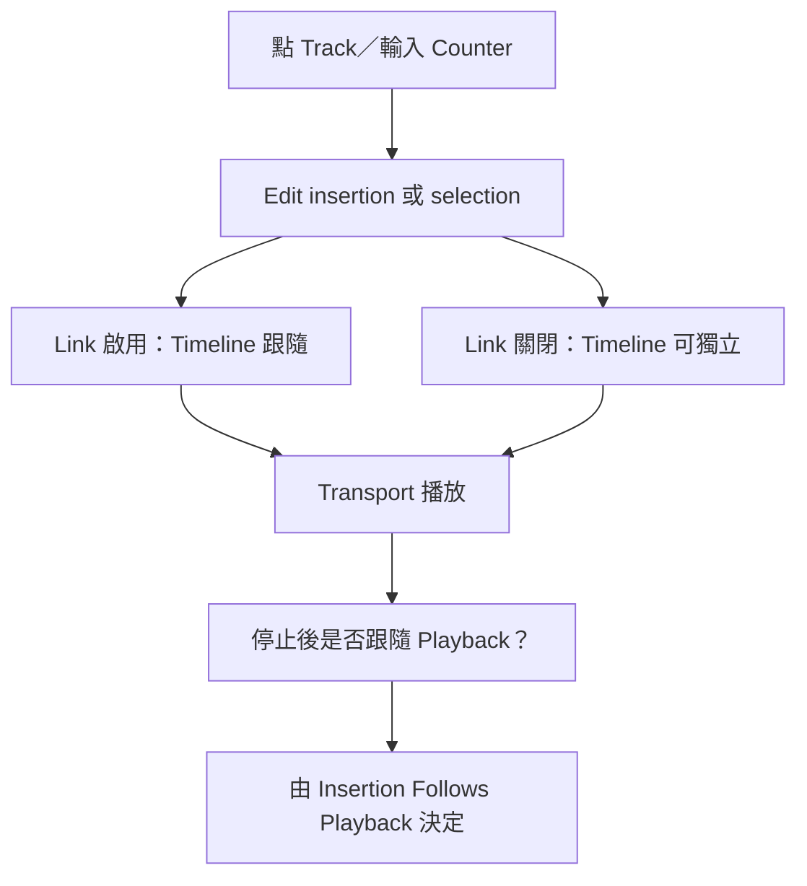

# Ch23 — Playback：分清 Edit、Timeline 與停止後的起點

> 播放從哪裡開始，不只由你最後點到哪裡決定；Edit selection、Timeline selection 與 insertion-following 設定必須一起看。

## 1. 播放的第一個檢查：有資料，也要有聲音路徑

Audio Track 播放需要素材 online、Output 指向可監聽路徑。MIDI 則還需要音源：Instrument Track 上的 instrument Plug-In，或外部 MIDI device 的 Audio 回到 Auxiliary Input／Instrument／Audio 路徑。MIDI meter 在動，不能證明 audio return 已經接好。

| 播放資料 | 最短檢查鏈 | 常見無聲原因 |
|---|---|---|
| Audio | Clip online → Track → Output → monitor | Offline media、inactive path、Mute／routing |
| Instrument Plug-In | MIDI events → instrument → audio output | 沒有音源、MIDI output 對錯 Plug-In |
| External MIDI | MIDI out → 外部音源 → interface audio input → monitor | 只接 MIDI 沒接 Audio 回來 |

基本啟停用 Transport Play／Stop 或 Spacebar。Numeric keypad `0` 的行為與 Numeric Keypad Mode 有關；不要把數字列的 0 和獨立 keypad 的 0 當成相同按鍵。完整 Mac 分類見 [[PT-00-Mac快捷鍵]]。

## 2. 三種游標／位置要分開

Main／Sub Counter 顯示目前時間位置與可選時間格式，Edit Selection indicators 則描述選取範圍。Playback cursor 是播放正在經過的位置；Edit cursor 是編輯插入點。它們可能暫時重合，但用途不同。

| 概念 | 回答的問題 | 視覺／操作提示 |
|---|---|---|
| Edit cursor／selection | 下一個 edit 要改哪裡？ | 用 Selector 在 Track playlist 指定 |
| Timeline selection | Transport 要播放哪個範圍？ | 在 Timebase ruler 設範圍 |
| Playback cursor | 現在正在播放哪裡？ | 播放時移動 |
| Counter | 用哪種時間單位描述位置？ | 可直接輸入位置，不只用滑鼠拖 |
| Playback Cursor locator | 游標在畫面外哪邊？ | 點定位指示可讓畫面回到播放位置 |

> [!tip] 實務連結
> 修人聲時，常需要一邊聽較長的上下文，一邊選一小段編輯。只有理解 Edit 與 Timeline 可分開，才不會每次點一個字，下一次播放範圍就跟著丟失。

## 3. Link Timeline and Edit Selection 是聯動開關

啟用 `Options > Link Timeline and Edit Selection`，Track 內的 Edit selection 與 Timeline 的播放範圍互相對應。這是一般「我選哪段就播哪段」的直覺工作方式。關閉後，就可以保留不同的 edit 和 playback 範圍。

| 需求 | 建議先檢查 | 為什麼 |
|---|---|---|
| 選一段就反覆播那段 | Link Timeline and Edit Selection | 讓 Edit 範圍成為播放範圍 |
| 保留長播放範圍，同時剪短段落 | 解除 Link | 不讓每次 edit selection 打斷聆聽上下文 |
| 停止後從原本位置重播 | Insertion Follows Playback 狀態 | 決定停止時 insertion 是否跟到最後播放點 |
| 播放游標跑到畫面外 | Playback Cursor locator／Scrolling | 是導覽問題，不是選取資料遺失 |

可直接點 Main Counter 或 Edit Selection Start indicator 輸入位置；不同時間格式的欄位與分隔方式要照畫面。Counter 精準定位適合跳已知 Timecode／bar，不必把 Timeline 一直縮放到能點中的程度。

## 4. Scrolling 是顯示策略，不等於改 Audio

`Options > Scrolling` 提供不同畫面跟隨方式；Center Playhead 屬原書 Studio／Ultimate 的功能。顯示跟著 playback 移動，可以改善長時間工作，但也可能讓你不容易比較固定位置的 Clips。

在選取範圍、播放位置與顯示追隨之間，先確定哪個是你想維持不變的。若只是想看見游標，不應為此改成另一段 Timeline selection；若只是想比較剪點，也不用把播放資料重新排列。

## 5. 播放範圍與 Transport Fade-in

播放選取範圍時，可透過預設操作在範圍開頭／結尾附近聆聽，快速檢查剪點，不必完整聽過整段。重要的是先確定操作作用於 Edit 或 Timeline；兩者解除 Link 時，對象不同會聽到不同結果。

原書的 Transport Fade-in 會在開始播放時，讓來源 Audio 從靜音線性漸入至現有電平，可設 `0.000–4.000 seconds`，用來避免重新定位時突然爆出音量。這是 Transport 層級的行為，不是替每個 Clip 生成可見 Fade。

> [!warning] 錄音前要檢查 Transport Fade-in
> 原書要求錄音時停用；在啟用狀態錄到的 Audio 會包含該 Fade。不要以為它只是監聽上「比較舒服」的小功能，完全不會影響記錄結果。

![[PT-Ch23-playback-time-model.png]]

> [!abstract] Takeaway
> 先確定 **Audio 路徑、Edit／Timeline Link、Insertion Follows Playback**，再查 scrolling 和 mode。接 [[PT-Ch23b-Loop-Dynamic-Transport與同步]]，把 Loop、Play Start Marker、MIDI Beat Clock 與 Ableton Link 放進同一個時間概念。

## 原文定位

本篇依 2023.3 原文整理，操作名稱與版本限制以該版為準。來源：[[Pro_Tools_Reference_Guide_2023.3.pdf#page=543|原書 p. 511–521／PDF p. 543–553]]。圖表與實務情境為原創教學整理；未逐句翻譯。

## 相關

%% PT-NAV-BEGIN %%

上一篇：[[PT-Ch22-媒體管理與跨版本相容性]]

下一篇：[[PT-Ch23b-Loop-Dynamic-Transport與同步]]

按任務閱讀：[[PT-00-工作流程導航]]

%% PT-NAV-END %%

[[PT-00-索引]] · [[PT-00-功能目錄]] · [[PT-00-快速檢索]] · [[PT-00-Mac快捷鍵]]

標籤： #pro-tools #audio #teaching
