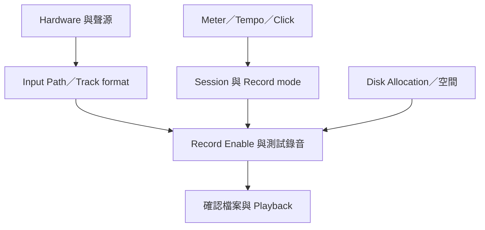

# Ch24 — 錄音前準備：先把硬體、時間與錄音模式配好

> 錄音開始之前，先決定訊號怎麼進、檔案寫在哪裡、演奏跟哪個時間基準，以及這次是否保留舊 Take。

## 1. 用四層檢查取代「按紅鈕試試看」

原書把 Record Setup 分為 Hardware、Session、Track、Monitoring 四層。硬體正確不代表 Session 的 I/O 已對應；Track armed 不代表監聽一定是 Input；聽得到也不代表檔案真的寫在你以為的磁碟。

| 層級 | 核心問題 | 開錄前確認 |
|---|---|---|
| Hardware | 聲源如何接入，interface／clock 是否正確？ | mic／line 來源、硬體格式、必要數位同步 |
| Session | Sample Rate、Meter、Tempo、record range／mode 是什麼？ | 時間基準與是否破壞舊資料 |
| Track | Track format、Input／Output、名稱、Record Enable 是否正確？ | Mono 來源別選錯 input pair，路由別接錯 |
| Monitoring | 演奏者聽哪一條路？ | Auto Input／Input Only、buffer、interface direct monitor |

> [!tip] 實務連結
> 錄一分鐘測試，停止後確認 waveform、Playback 和磁碟來源，比正式演奏開始後才發現 Input 進錯軌可靠。測試應走與正式錄音相同的路徑。

## 2. 錄音電平在進入檔案之前就要正確

Hardware I/O 與音源的設定要依 interface User Guide。Pro Tools 的 meters 能顯示輸入與錄到 disk 的 clipping；input／output converter 也可能削波，不能只看某個 mixer fader 是否還在 0 以下。

Audio Volume indicator 可切到 peak 等資訊，Headroom indicator 則提供相對於目前 Meter Type 參考位準的資訊。這些讀值協助判斷餘裕，但不會替你修正已在 analog 前級或 A/D 發生的 clipping。

| 控制／讀值 | 作用 | 不會做什麼 |
|---|---|---|
| Interface input／preamp gain | 決定進轉換器的訊號幅度 | 不會由一般 Track playback Fader 自動代替 |
| Track meter／peak | 觀察數位路徑的訊號 | 不保證前級沒有先失真 |
| Headroom indicator | 提供相對參考位準的餘裕 | 不等於所有 Meter Type 都用同一個判斷基準 |
| Track Volume／Pan（直接錄入時） | 調監聽／播放 mix | 不改已進入該 Track 的錄音電平 |

原書另有 Calibration Mode，限 HDX／HD Native 等系統；一般第三方 interface 不應照套硬體專用校準步驟。

## 3. Click、Count Off、Meter 與 Tempo 各有角色

`Track > Create Click Track` 建立使用 Click II 的 Auxiliary Input Track。`Options > Click` 或 Transport 的 Metronome button 控制 Click；`Count Off` 則是起錄前的拍數提示。`Setup > Click/Countoff` 可設定 accented／unaccented notes、何時發聲與 countoff 長度。

| 時間設定 | 決定什麼 | 典型錯誤 |
|---|---|---|
| Meter | 每小節拍數與拍單位 | 把每小節 click 數不對當成 Tempo 錯 |
| Tempo | 音樂播放速度 | 開新 Session 沒調整原書所述 120 BPM 預設 |
| Conductor／Tempo ruler | 用 Tempo events 控制速度 | 以為拖 Manual Tempo 一定會覆蓋 Tempo map |
| Manual Tempo | 忽略 Tempo ruler，使用指定速度 | 已有變速歌曲卻誤切固定速度 |
| Count Off | 起錄前的節奏準備 | 不等於 pre-roll 播放原本 Audio |

設定初始 Meter／Tempo 時，原書以 `1|1|000` 的位置置換預設。Manual Tempo 可用 slider 或 `T` tap tempo；Conductor 開啟後，速度又回到 Tempo ruler。錄 MIDI／節奏素材時，先決定這首歌是否需要 Tempo map，會影響之後編輯品質。

> [!tip] 實務連結
> Count Off 適合還沒有伴奏或要從靜音開始的演奏；Pre-Roll 適合補錄時先聽既有上下文。兩者都在正式錄入前提供準備，但給演奏者的線索不同。

## 4. Record mode：先分是否破壞，再分如何 Punch

| Record mode | 對舊 Audio 的處理 | 工作目的／條件 |
|---|---|---|
| Normal（Nondestructive） | 新錄音寫新檔；舊檔仍在 disk | 一般錄音與保留多個 Take |
| Destructive | 以新錄音永久覆蓋來源相關資料 | 只在明確需要破壞式工作流程時使用 |
| Loop | 同一段反覆錄不同 Take | 範圍至少 1 秒；不是 Loop Playback 的 500 ms 條件 |
| QuickPunch | 非破壞式，播放中 Punch in／out | 預先 armed 的 Audio Tracks 可隨時進出錄音 |
| TrackPunch | 非破壞式，逐 Track 控制 | 原書限定 Ultimate |
| DestructivePunch | 保持單一連續檔的破壞式 Punch | 原書限定 Ultimate，另有檔案準備要求 |

一般 Normal 模式在舊 Clip 上重新錄，Timeline 會被新 Take 覆蓋顯示，但原本 Audio file 並未因此從 disk 消失。Destructive 則真的改掉原始資料。你若需要挑 Take、回頭改 comp，就應優先建立非破壞式流程，而不是錄完再希望恢復舊檔。

> [!warning] MIDI 的 Merge／Replace 是另一套邏輯
> 即使 Audio 用 Normal／Nondestructive，MIDI 仍可能在未開 MIDI Merge 時取代既有事件。不要把本表的 Audio 保留方式直接套到 MIDI；見 Ch26。

## 5. Track Name、Input／Output 與 Record Enable

錄音檔會用 Track Name 加自動編號產生名稱；Stereo／Multichannel channel 另有對應 suffix。先命名 Track，會比錄完面對大量 Audio_01 再整理省事。Input Path 指聲源，Output Path 指監聽／輸出目的地，兩者不是同一個 selector。

| Record 控制 | 用途 | Mac 原書操作 |
|---|---|---|
| Record Enable | 讓指定 Track 等待錄音 | 點 Track 的 Record Enable |
| All selected tracks | 對選定集合操作 | Option+Shift-click Record Enable |
| Record Safe | 避免重要 Track 被誤 armed | Command-click Record Enable |
| Latch Record Enable Buttons | 決定多條 Track 的 armed 持續行為 | 在 Preferences 檢查，不只靠 Shift 猜 |

Group 的 record-enable 行為有特定限制；不要以為建立 Mix Group 後，按任一軌就會把整組全 armed。原書提醒可先在 Groups List 選整組，再用選定 Track 的批次操作。

## 6. Disk Allocation：檔案寫到哪裡要能說清楚

預設 Audio 寫進 Session folder 的 Audio Files。`Setup > Disk Allocation` 可逐 Track 配置其他 recording volume；Round Robin Allocation 可分配新 Track 到多顆合適錄音碟。磁碟設為 P 或 T 可排除不想被 Round Robin 使用的 volume。

`Window > Disk Space` 觀察可用空間。多碟錄音的代價是媒體會分散，因此交接／備份必須收集；保存 Disk Allocation 設定並不會自動把歷次錄音搬回同一個資料夾。

![[PT-Ch24-record-setup-layers.png]]

> [!abstract] Takeaway
> 先做 Hardware → Session → Track → Monitoring 的檢查，再錄短測試。Record mode 決定是否保留舊資料；Disk Allocation 決定檔案去哪裡。接 [[PT-Ch24b-Input-Monitoring與Latency]] 解決「錄得到但聽不對」的問題。

## 原文定位

本篇依 2023.3 原文整理，操作名稱與版本限制以該版為準。來源：[[Pro_Tools_Reference_Guide_2023.3.pdf#page=567|原書 p. 535–552／PDF p. 567–584]]。圖表與實務情境為原創教學整理；未逐句翻譯。

## 相關

%% PT-NAV-BEGIN %%

上一篇：[[PT-Ch23b-Loop-Dynamic-Transport與同步]]

下一篇：[[PT-Ch24b-Input-Monitoring與Latency]]

按任務閱讀：[[PT-00-工作流程導航]]

%% PT-NAV-END %%

[[PT-00-索引]] · [[PT-00-功能目錄]] · [[PT-00-快速檢索]] · [[PT-00-Mac快捷鍵]]

標籤： #pro-tools #audio #teaching
