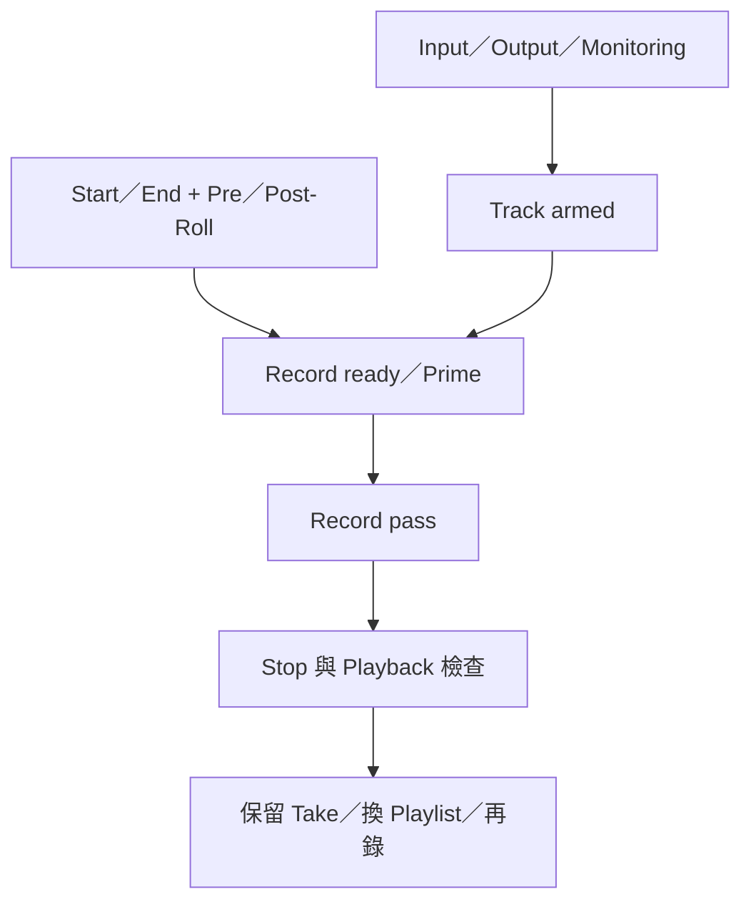

# Ch25 — Audio Recording：從第一個 Take 到可控制的補錄

> 一次可靠錄音的標準，是輸入正確、監聽合理、檔案可播放，而且你知道重新錄製時舊 Take 是否仍保留。

## 1. Basic Recording 的完整閉環

在 Audio Track 的 Input Path 選聲源、Output Path 選監聽，按 Track Record Enable。看 input meter，從 interface 的正確位置調輸入，不用一般 Track Fader 去拯救已經 clipping 的 input。Track Volume／Pan 在本章的直接 Audio recording 情境是監聽設定，不改錄入資料。

1. 選與聲源相符的 Track format：Mono 來源用 Mono，Stereo 來源用 Stereo；更高 Multichannel 依 Studio／Ultimate 的支援。
2. 設 Input／Output，命名 Track，armed，確認 meters。
3. 依 Ch24 決定 monitoring、Tempo／Click 與 Record mode。
4. 在 Transport 先 Record arm，再 Play，或用已確認的錄音快捷入口。
5. Stop，解除不需要的 Record Enable，Playback 檢查。
6. 確認新 Clip 出現在 playlist 與 Clips List，檔案寫到正確 disk。

| 看到的東西 | 證明什麼 | 仍未證明什麼 |
|---|---|---|
| Input meter 有動 | 該路徑有訊號 | 一定錄到正確檔案／聲源 |
| Record Enable 紅色 | Track 已準備錄音 | Transport 已真正開始錄製 |
| Waveform 出現 | 有錄到資料並建立概觀 | 頻道／音高／相位與實際內容一定正確 |
| Playback 正常 | 該 Take 可在目前環境播放 | 交付到另一台也一定沒有外部依賴 |

> [!tip] 實務連結
> 第一個 Take 錄完先聽十幾秒，確認左右聲道、音色與 latency 是否合理。這不是浪費表演時間，而是避免後面十個 Take 都重複同一個 setup 錯誤。

## 2. 錄音快捷鍵與 Prime for Record

原書列 `F12`、`Command+Spacebar` 等直接開始錄音入口；Mac 上需檢查系統是否攔截 function key／Spotlight。完整前提由 [[PT-00-Mac快捷鍵]] 統一記錄，避免每篇各自寫出不同版本。

`Prime for Record` 則是先讓系統準備好錄音資源。先在 Transport 按 Record，再 `Option-click` Play 或從其右鍵選 Prime for Record；Stop 亮、Play 與 Record 閃爍，之後按 Play 才真正開始。這對大量 Track 的起錄準備有用，但不等於已經把演奏錄進檔案。

| 名稱 | 目前狀態 | 下一步 |
|---|---|---|
| Track Record Enable | 哪些 Track 可錄 | 還要啟動 Transport 錄製 |
| Transport Record Ready | 全域準備起錄 | 配合 Play 進入錄音 |
| Prime for Record | 資源已先準備 | 按 Play 進入錄音 |
| Recording | 真正寫入錄音資料 | 以 Stop／Punch out 等操作結束 |

## 3. Punch／Loop points 是資料範圍，Pre／Post-Roll 是上下文

可用 Selector 在 playlist、Timebase ruler、Timeline selection markers 或 Transport Start／End 定錄音範圍。若從 Edit selection 定範圍，先確認 `Link Timeline and Edit Selection`。需要精準 bar 或 Timecode，直接輸入 Start／End 通常比滑鼠拖得更可靠。

| 範圍元素 | 意義 | 對演奏者的作用 |
|---|---|---|
| Record Start／Punch in | 開始錄入位置 | 從這裡換成新演奏 |
| Record End／Punch out | 結束錄入位置 | 之後回到原素材／停止規則 |
| Pre-Roll | 錄音範圍前的播放時間 | 先聽節奏和前一句 |
| Post-Roll | 範圍後繼續播放的時間 | 聽收尾與下一句銜接 |
| Count Off | 起錄前節拍提示 | 不一定包含既有 Audio 上下文 |

Transport Expanded 可編輯 Pre／Post-Roll；也可在 Timebase ruler 拖 flags。Mac 在已選範圍前後用 Selector `Option-click` 可設定相應 Pre／Post-Roll。`Options > Pre/Post-Roll` 是成對啟停入口之一；只設定數字而沒啟用，不會自動播放該準備時間。

> [!tip] 實務連結
> 補一個子音或短句，不要只把選取範圍切得極短就要求演奏者立即進入。保留前一句或至少足以找到 groove 的 Pre-Roll，再聽 Post-Roll，通常更容易判斷新 Take 是否融入。

## 4. 自動範圍 Punch 不必先開 QuickPunch

先定一個錄音範圍，Normal／Nondestructive 也能按 selection 自動 Punch。QuickPunch 主要提供 playback 進行中手動進出錄音的彈性；它和「有一個選取範圍」不是同一件事。原書 Ch27 還特別說明 QuickPunch 在 offline／online Transport 時對 selection 的行為不同。

1. 設 Record mode 與 monitoring。
2. 定 Start／End，設 Pre／Post-Roll。
3. armed 指定 Track，在 Transport 啟動錄音。
4. 讓系統在範圍內寫入；結束後回聽前後接點。
5. 若要再試一個 Take，先確認保留方式與 Playlist，再重錄。

## 5. 新 Take、舊 Take 與 Undo／Cancel

Normal／Nondestructive 在既有內容上重錄，寫一個新的 Audio file；舊音檔仍在 disk 並可於 Clips List 找到。Destructive 则永久覆蓋原資料。本章也提供 Undo Recording 與錄音中 Cancel 的流程，但 Loop／Punch pass 的處理單位可能是一整次 pass，而非眼前單一小片段。

> [!warning] Undo pass 之前要知道範圍
> Loop Record 或 QuickPunch／TrackPunch 一個 pass 可能含多個 Takes／punches。不要把「Undo 最新錄音」想成只丟掉畫面上最後那一小塊。保留重要 Take 之後，再整理不需要的資料。

要讓每個 Take 有清楚位置，可以從 Playlist selector 選 New 再錄；之後用 Ch33 的 Playlists／Comping 管理。你也可在同一主 playlist 重錄再選 alternate takes，但兩種方式對工作整理的直覺不同。

![[PT-Ch25-record-takes-model.png]]

> [!abstract] Takeaway
> 錄音要完成「設定 → 記錄 → Playback 驗證」閉環。Record range 管寫入範圍，Pre／Post-Roll 管演奏上下文；Normal 讓舊資料仍可取回，Destructive 則不提供這種餘裕。接 [[PT-Ch25b-Loop-Takes與數位錄音]] 管理反覆錄下來的版本。

## 原文定位

本篇依 2023.3 原文整理，操作名稱與版本限制以該版為準。來源：[[Pro_Tools_Reference_Guide_2023.3.pdf#page=591|原書 p. 559–569／PDF p. 591–601]]。圖表與實務情境為原創教學整理；未逐句翻譯。

## 相關

%% PT-NAV-BEGIN %%

上一篇：[[PT-Ch24b-Input-Monitoring與Latency]]

下一篇：[[PT-Ch25b-Loop-Takes與數位錄音]]

按任務閱讀：[[PT-00-工作流程導航]]

%% PT-NAV-END %%

[[PT-00-索引]] · [[PT-00-功能目錄]] · [[PT-00-快速檢索]] · [[PT-00-Mac快捷鍵]]

標籤： #pro-tools #audio #teaching
