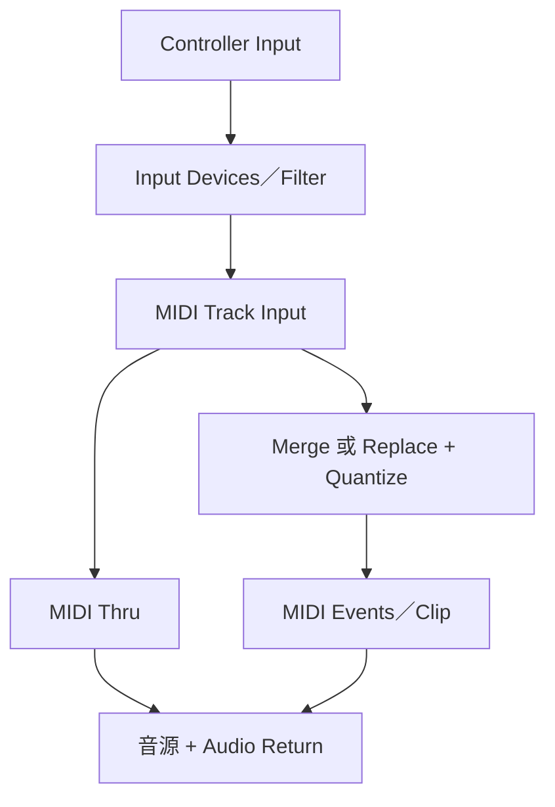

# Ch26 — MIDI 錄音：路由、監聽與 Merge／Replace 是三件不同的事

> MIDI 錄下的是演奏事件；有沒有聲音取決於音源與 Audio 路徑，舊演奏會不會被取代則取決於 Merge／Replace。

## 1. MIDI Track 與 Instrument Track 都要有正確的目的地

MIDI Input selector 可指定 device／port 與 channel，也可設 All。All 會把所有輸入 channel／device 合併錄到該 Track；這不表示一條 Track 之後仍會自動維持原來所有 channel 的獨立播放目的地。Playback 依 Track 指定的 MIDI output device／channel。

Instrument Track 另有 Audio Input／Output，能容納 instrument Plug-In，或讓外部 MIDI 音源的 Audio 回來監聽。MIDI Track 本身的事件與音源發出的聲音，是兩段不同的資料流。

| 資料流 | 起點與終點 | 錄到的東西 |
|---|---|---|
| MIDI input | 鍵盤／pad → MIDI Input selector → MIDI／Instrument Track | Note、velocity、controller 等事件 |
| MIDI playback | MIDI events → MIDI Output selector → 音源 | 驅動音源，不是直接產生 WAV |
| Instrument Plug-In audio | 音源 Plug-In → Track audio output | 監聽聲音；要成 Audio file 還要 render／record |
| 外部音源 audio return | 硬體 audio out → interface input → Audio／Aux／Instrument path | 聲音可監聽或另錄 |

`Setup > MIDI > Input Devices` 要啟用希望接收的裝置；不想錄入的 drum machine／arpeggiator input 可停用。把 Input selector 設成特定裝置與 channel，也能避免多個控制器同時演奏時把事件混到不該去的 Track。

> [!tip] 實務連結
> 鍵盤能發聲卻錄不到 MIDI，先查 Input Devices 與 Track MIDI Input；MIDI waveform／notes 已錄到但播放沒聲，則查 MIDI Output、音源與 Audio return。兩種問題的排查方向不同。

## 2. MIDI Thru 是即時監聽，不是 Playback Offset

`Options > MIDI Thru` 讓輸入控制器的事件轉送到 record-enabled Track 指定音源。外部硬體若同時開 Local Control，也可能自己發聲一次、再被 Thru 觸發一次；原書建議使用 Thru 時適當關閉外部裝置的 Local Control，避免重複。

`Default Thru Instrument` 則能在適用條件下讓輸入直接驅動指定音源，不必每次先建立與 armed 一條 Track。所有 incoming MIDI 都可能送到該預設目的地，與 Track Input selector 的過濾範圍不同。

| 功能 | 管什麼 | 不管什麼 |
|---|---|---|
| MIDI Thru | 即時輸入轉送至音源 | 不會把聲音錄成 Audio |
| Default Thru Instrument | 預設可即時演奏的目的地 | 不代表該聲音已有一條永久錄音 Track |
| MIDI Playback Offset／Track offset | 既有 MIDI Playback 的時間校正 | 原書指出不影響 MIDI Thru |
| External Local Control | 外部鍵盤是否直接觸發自身音源 | 不由 Pro Tools Track Fader 代替 |

## 3. Input Filter、Input Quantize、Wait for Note

`Setup > MIDI > Input Filter` 可錄 All、Only 指定訊息或 All Except 指定訊息。例如不希望演奏中的 Program Change 換掉音色，就把該類訊息排除。`Input Quantize` 會在錄入時自動修正 MIDI note 時間；需要保留 rubato 或原始微時值時，先停用，再事後編輯。

Wait for Note 讓 Record-ready 的系統等待第一個 MIDI event，才從錄音範圍起點開始記錄。注意它等的是 MIDI event，不只是你主觀認為的第一個旋律音；controller 等事件也屬資料。這適合不靠 Count Off、由演奏觸發起始的情況。

| 需求 | 對應功能 | 輸入前要決定 |
|---|---|---|
| 不錄特定訊息 | Input Filter | 要保留／排除哪些 message types |
| 每次錄入就對拍 | Input Quantize | 是否接受改動原始 timing |
| 第一個事件到來才開始 | Wait for Note | 不要被不預期的 MIDI event 提早觸發 |
| 先聽拍數再彈 | Count Off | 與 Wait for Note 的起始流程不同 |

## 4. Merge／Replace 決定舊事件的命運

開啟 MIDI Merge 時，新錄事件與原有事件合併；關閉時，在錄入範圍內既有 MIDI data 會被新資料取代。它不遵循 Audio Normal mode「舊音檔一定留在 disk」的同一種保留邏輯。因此要留住重要演奏，先 Duplicate Clip／Playlist 或錄到 New Playlist。

| 狀態 | 新演奏寫入方式 | 適合什麼 |
|---|---|---|
| MIDI Merge on | 新事件加到既有事件 | 鼓編程逐層加 Kick／Snare／Hi-hat |
| MIDI Merge off／Replace | 替換錄音範圍內的舊事件 | 重彈一段而不想重疊舊音符 |
| Normal + Loop Playback + Merge | 每圈繼續累積事件 | Drum-machine style loop building |
| Loop Record mode | 每圈錄不同 Take，Merge button 不作用 | 保留多次演奏作比較 |

Merge Release mode 專門管理 Continuous Controller 的寫入延續：`Latch` 延續最後值至停止錄音；`Latch Until Next Event` 延續到下一個事件；`Touch` 放開後立即停止寫新值，原書建議用於增加 pedal-based control data，而非改既有資料。這些是 MIDI controller 行為，不是 Audio Automation 的完整同義替代。

> [!warning] Merge 不會自動避免所有重複音符
> 合併會把新資料加入；若你在同一拍重複彈同音高，可能得到重疊事件。它的目標是累積，而不是自動挑選最好的一次演奏。

## 5. 實際錄音與 Clip 邊界

建立 MIDI／Instrument Track，指定 Input、Output 與音源，啟用 MIDI Thru，確認演奏時音源有聲，再決定 Merge、Filter、Quantize 與起始方式。Track Record Enable 與 Transport Record-ready 到位後啟動 Record；本章指出最多同時 record-enable 32 條 MIDI／Instrument Tracks 的組合，這是此版的錄音行為限制，不是把所有 Session Track 容量都設成 32。

錄到的 MIDI Clip 通常延伸到第一個 Note On 前與最後 Note Off 後相鄰的 barline，方便整小節編排。因此 Clip 左右多出一段空白，不代表錄入 latency 或 note 被錯移。真正要看的是事件位置，不只是 Clip 外框。

若在已有 MIDI Clips 上 Replace，原有 Clip boundaries 可能保持，但裡面的 events 已改；只有 gaps 需要時才新增 Clip。因此「畫面 Clip 邊界沒變」不能證明舊演奏還在。

## 6. Punch 與 Undo 的範圍

MIDI 在 Normal mode 就能在 playback 中 Punch，不需 Audio 的 QuickPunch。可先選範圍自動 Punch，也可播放中按 Record 進出。結束後 Undo MIDI Recording 會回復對應錄音，但多次 Punch 與 Loop pass 的 Undo 單位有本章條件；重要素材不應只靠一個未來可能還在的 Undo 來保護。

![[PT-Ch26-midi-audio-separation.png]]

> [!abstract] Takeaway
> MIDI 錄音有三層：**事件進得來、音源聽得到、舊資料保留方式正確**。Merge 累積、Replace 替換；Loop Playback 和 Loop Record 目的不同。接 [[PT-Ch26b-MIDI轉Audio與Retrospective-Record]] 把演奏固定成聲音，並找回未按錄音的片段。

## 原文定位

本篇依 2023.3 原文整理，操作名稱與版本限制以該版為準。來源：[[Pro_Tools_Reference_Guide_2023.3.pdf#page=611|原書 p. 579–593／PDF p. 611–625]]。圖表與實務情境為原創教學整理；未逐句翻譯。

## 相關

%% PT-NAV-BEGIN %%

上一篇：[[PT-Ch25b-Loop-Takes與數位錄音]]

下一篇：[[PT-Ch26b-MIDI轉Audio與Retrospective-Record]]

按任務閱讀：[[PT-00-工作流程導航]]

%% PT-NAV-END %%

[[PT-00-索引]] · [[PT-00-功能目錄]] · [[PT-00-快速檢索]] · [[PT-00-Mac快捷鍵]]

標籤： #pro-tools #audio #teaching
