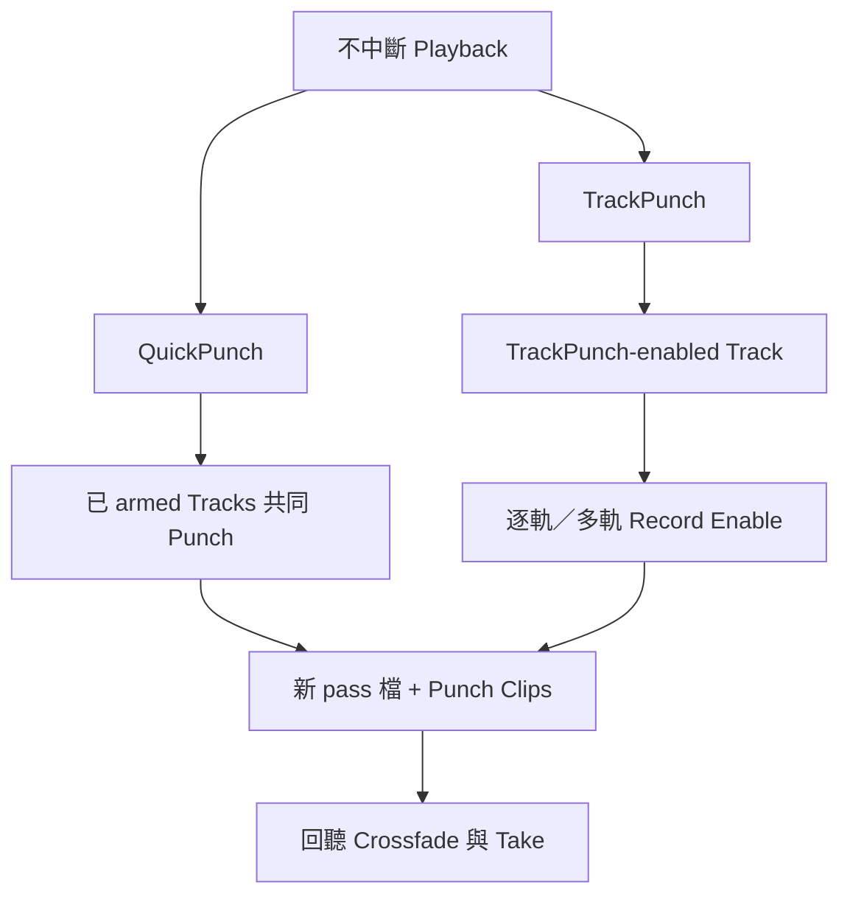

# Ch27 — QuickPunch 與 TrackPunch：播放不中斷，錄音可進可出

> Punch mode 的價值是讓錄音在持續播放中進出；先分「整組一起 Punch」與「逐條 Track 控制」，再選模式。

## 1. 三種 Punch mode 的分工

| Mode | 是否破壞舊 Audio | 主要控制方式 | 2023.3 條件 |
|---|---|---|---|
| QuickPunch | 非破壞式 | 在播放中對已 armed Tracks 共同 Punch in／out | 本章說明可於各系統使用，仍受 voices／資源限制 |
| TrackPunch | 非破壞式 | 每條 Track 可獨立 Punch／arm，Transport 可保持運行 | Ultimate |
| DestructivePunch | 破壞式 | 逐軌／多軌 Punch，維持單一連續檔 | Ultimate，需預備檔案；見後半篇 |

只想對**預先指定範圍**自動錄入，Normal mode 也可以做，不必先開 QuickPunch；MIDI 即時 Punch 更不需 Audio Punch mode。這是分辨使用目的的第一步。

> [!tip] 實務連結
> 一位歌手在伴奏持續播放時想「這句現在補」，QuickPunch 很直接；多條後期 Stem 要各自進出寫入、又不能中斷同步播放時，TrackPunch 的逐軌控制更符合工作。

## 2. QuickPunch／TrackPunch 保留的是一整個 recording pass

兩者在播放開始時就寫新的 recording file，Punch points 則在其中建立相應 Clips。你表面上只錄了一小句，但整個 pass 的 Audio 來源提供了剪點前後的伸縮餘裕。停止再播放是新的 pass，對應另一個 whole-file clip。

| 檔案／Clip 層次 | 本章意義 | 對編輯的好處 |
|---|---|---|
| Whole-file clip | 一次 pass 的完整錄音檔 | 可查看與取用 Punch 前後內容 |
| Punch clip | 該次 Punch in／out 所標示的範圍 | 直接放進 playlist 作替換 |
| 下一次 pass | 新的 whole-file 與編號 | 不把所有錄音永久寫回同一個舊檔 |
| DestructivePunch | 只在 Punch 時替換原有連續檔資料 | 管理方式與保留能力不同 |

voices 是有限資源，Punch 模式可能需要額外配置。若系統提示不能 Record-enable，先查看可用 voice 與 Track／Plug-In 路徑，而不是只計算畫面有幾條 Track。原書對不同 HDX／Hybrid 等情況有分別條件，不能用一個固定數字概括所有系統。

## 3. QuickPunch 的操作閉環

1. 停止 Transport，從 `Options > QuickPunch` 或 Record button 右鍵選 QuickPunch。
2. 檢查 Editing preferences 的 QuickPunch／TrackPunch Crossfade Length。
3. armed 欲補錄 Audio Tracks，設定 Auto Input／Input Only 與必要 Pre-Roll。
4. 開始 Playback，需錄入時按 Transport Record；再次按可 Punch out，Playback 繼續。
5. Stop 後回聽接點，必要時用整個 pass 中的素材調整邊界。

| Transport 狀況 | Selection 對 QuickPunch 的影響 | 不要假定 |
|---|---|---|
| 不處於 online synchronization | 依手動 Record 時機進出，不被 selection Start／End 自動限制 | 有選範圍就一定只錄那段 |
| Online | 依 Operation preferences 的 Online Options | 與一般自由播放完全相同 |
| Record Online at Insertion／Selection | 在相關 selection／insertion 條件內控制 Punch | 不看同步設定就直接照音樂錄音用法操作 |

## 4. Crossfade 與 RecordLock

QuickPunch／TrackPunch 可在 Punch points 自動寫 Crossfade。原書的通用起點建議是 **10 ms**；設為 0 則不產生 Crossfade。這不是所有聲音都應固定 10 ms 的聲學定律，還要聽 transient、噪聲與原素材銜接。

`Audio Track RecordLock` 決定停止後 Track 是否保持 armed；`Transport RecordLock` 決定全域 Record 狀態。它們影響的是下一次 pass 的準備狀態，而不是聲音本身。某些破壞式模式會出於防誤錄而禁用特定 RecordLock，務必看畫面當下狀態。

| Preference | enabled | disabled 的工作直覺 |
|---|---|---|
| Audio Track RecordLock | Stop 後保留 Track armed | Stop 後 disarm，降低下次誤錄機會 |
| Transport RecordLock | 依該模式保留全域 Record-ready 行為 | 依模式回到未 armed；需再確認 |
| QuickPunch／TrackPunch Crossfade Length | 用指定長度接 Punch points | 0 時不自動寫 Crossfade |

> [!warning] armed／Record-ready／Recording 是不同狀態
> 停止後如果 Track 仍 armed，不表示仍在寫檔；下次按 Play／Record 的結果卻會受這些狀態影響。每次交接給另一位操作人員前，應把當前 mode 與 armed 範圍說清楚。

## 5. TrackPunch 把 Track-enabled 與 Record-enabled 拆成兩層

TrackPunch-enabled 表示這條 Track 可參與此模式；Record-enabled 表示要實際錄入。原書用 solid blue、blue／red flashing、solid red 等狀態區分 ready 與 recording。不要只認一個「紅色大概是錄音」的印象。

| Track 狀態 | 本章顯示／概念 | 工作用途 |
|---|---|---|
| TrackPunch-enabled，未 Record-enabled | Solid blue | 可於不中斷播放時加入錄音 |
| TrackPunch 與 Record-enabled | Blue／red flashing 等 ready 顯示 | 等待實際寫入 |
| 正在 Recording | Solid red | 現在正在寫入資料 |
| Mode 顯示 | Transport Record 有 T | 先辨認目前是 TrackPunch |

先啟用 TrackPunch，配置 monitoring，再讓想控制的 Track 進入可參與狀態。Transport Record-ready、Playback 運行時，可逐一用 Track Record Enable 進出錄音，也可讓多條一起 Punch。對 Stem 群組先用 Groups List 選好成員，再做選定 Track 的操作，比臨場逐條找按鈕可靠。

![[PT-Ch27-punch-mode-comparison.png]]

> [!abstract] Takeaway
> QuickPunch 對已 armed Audio Tracks 共同進出，TrackPunch 增加逐軌彈性；兩者保留新 pass 與 Clips。先看 mode、voice、monitoring、RecordLock，再 Punch。會永久替換 Audio 的流程，另讀 [[PT-Ch27b-DestructivePunch與後期工作流程]]。

## 原文定位

本篇依 2023.3 原文整理，操作名稱與版本限制以該版為準。來源：[[Pro_Tools_Reference_Guide_2023.3.pdf#page=633|原書 p. 601–610／PDF p. 633–642]]。圖表與實務情境為原創教學整理；未逐句翻譯。

## 相關

%% PT-NAV-BEGIN %%

上一篇：[[PT-Ch26b-MIDI轉Audio與Retrospective-Record]]

下一篇：[[PT-Ch27b-DestructivePunch與後期工作流程]]

按任務閱讀：[[PT-00-工作流程導航]]

%% PT-NAV-END %%

[[PT-00-索引]] · [[PT-00-功能目錄]] · [[PT-00-快速檢索]] · [[PT-00-Mac快捷鍵]]

標籤： #pro-tools #audio #teaching
