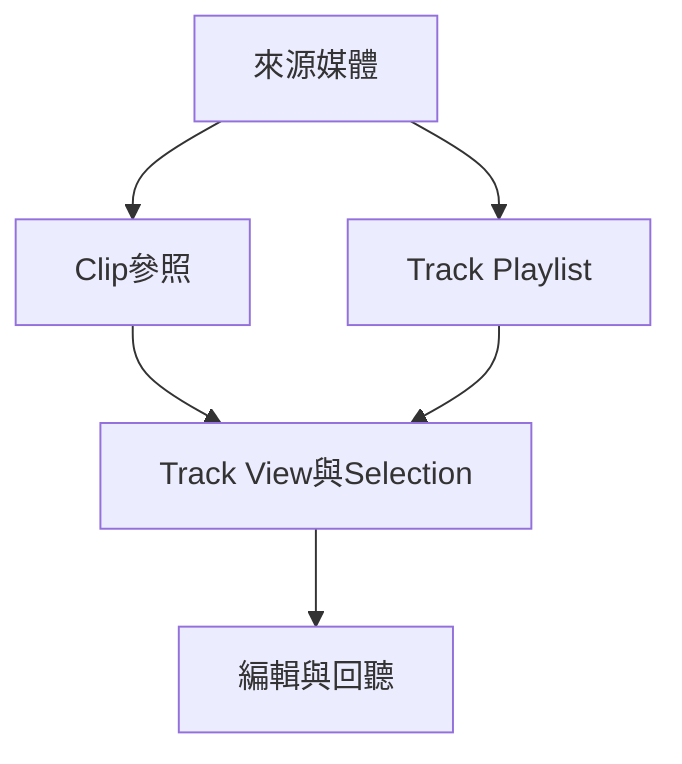

# Ch28 — 編輯前先分清Clip與資料

> 剪輯大多是在改播放素材的地圖；要先知道目前選到的是 Audio、MIDI、Automation，還是它們的組合。

[[Pro_Tools_Reference_Guide_2023.3.pdf#page=653|原書 p. 621–638／PDF p. 653–670]]。內容依 **2023.3** 原文消化重組；英文功能名稱保留。實務連結與原創示意圖用於教學，不是原書逐字翻譯，也不代表現行版本的支援狀態。

## 觀念地圖

![[PT-Ch28-concept.png]]

圖為原創概念示意；示例位置、長度與曲線只用來比較機制，不是原書量測資料或建議處理參數。

## 1. Clip 是素材的使用方式，不等於另一份音檔

一段錄音檔可以被切成好幾個 Clip。你在 Edit window 修短句首、交換副歌順序，通常只改「從檔案哪裡讀到哪裡、何時播放」，原始 Audio file 仍在硬碟。因此，Clip 變短不表示原音檔被截斷；適當使用 Trim，就能重新露出被藏起來的素材。這是 nondestructive editing 的實際意義。

但不要把這個原則擴張成「所有操作都安全」。Pencil 在 sample level 重畫 Audio、Compact 刪除原始檔不用部分，具有不同後果。MIDI 單一 Clip 的 note editing 也可能直接改寫該 Clip；開始實驗前 Duplicate Playlist，比依賴 Undo 穩妥。

| 名稱 | 實際內容 | 你會在哪裡遇到 |
|---|---|---|
| Whole-File Audio Clip | 參照整份 Audio file | 錄音、匯入、Consolidate；Clips List 中粗體 |
| User-Defined Clip | 使用者明確建立或命名的 Clip | Capture、Separate、重新命名 |
| Auto-Created Clip | 編輯途中自動產生的使用範圍 | Trim、Cut、Punch 等操作後大量累積 |
| Offline Clip | 找不到來源媒體的參照 | 能編輯位置，但不能用 AudioSuite 處理 |
| Multichannel Clip | 一組 Stereo／Surround 聲道參照 | 多聲道錄音與匯入 |
| Clip Group | 容納多個 Audio／MIDI Clip 的容器 | 整段編排、跨軌素材搬動 |
| Warped Clip | 已套用 Elastic Audio 的 Clip | 右上方有 Warp indicator |

> [!tip] 實務連結
> 先把名稱當作「這段在作品裡的角色」而非來源檔完整履歷，例如 `Verse Lead comp`。Clips List 太雜時可隱藏 Auto-Created Clip；改名會使自動產生的 Clip 成為 User-Defined Clip，方便保留重要版本。

## 2. 波形是觀察工具，別把放大當成增益

Waveform display 改的是你怎麼看聲音，不是聲音本身。Peak 擅長顯示短暫尖峰；Power 依 RMS 建立 overview，比較適合在縮小後觀察持續能量。Rectified 把正負振幅收在單側，節省高度；Outlines 則增強輪廓辨識。錄音時仍顯示 Peak；zoom 到 sample level 時會回到 Normal Peak。

| 顯示方式 | 適合的問題 | 不應誤解成 |
|---|---|---|
| Peak | 哪裡有 transient 或尖峰？ | 完整的響度量測 |
| Power | 長段落能量輪廓如何？ | 修改 Audio 的 RMS |
| Rectified | Track 很矮時如何看清包絡？ | 把音訊做 rectification 處理 |
| Overlapped Crossfades | 接縫兩側來源是否對準？ | Crossfade 已經一定好聽 |

切音時盡可能靠近 zero crossing，可以降低突然跳變造成 click 的機率；若接縫仍不自然，應建立 Fade 或 Crossfade。剪在波形最高點而不淡接，通常比剪在接近零的位置更容易聽出接縫，但眼睛不能取代回放確認。

> [!tip] 實務連結
> 修鼓先找 attack，修人聲則同時聽子音、氣音和背景。把 waveform zoom 放大只是幫你看清小訊號；真正音量要交給 Clip Gain 或 Fader，兩者另在 Ch44／Ch50 說明。

## 3. Track View 決定複製和刪除的範圍

同一條 Track 切到不同 View，Cut／Copy 的含義會改變。Audio 的 Waveform view 與 MIDI 的 Clips view 是較完整的素材編輯入口；顯示 Automation 時，則針對當前那一類 Automation。是否讓 Automation 隨編輯走，也要配合 Automation Follows Edit 設定，不能只憑 Clip 外觀判斷。

| 選取方式／View | 主要影響 | 要先確認 |
|---|---|---|
| Audio Waveform／MIDI Clips 的 time range | 範圍內素材及相關底層資料 | Automation Follows Edit 與跨軌範圍 |
| MIDI Notes 中 Grabber 框選 | MIDI notes 的 object selection | 不自動把所有 CC 帶走 |
| MIDI Notes 中 Selector 拖選 | time range，包含底層 CC 等資料 | 不要誤刪 Sustain、Pitch Bend |
| Automation／Controller view | 目前顯示的資料類型 | 複製的是哪個參數 |

Audio Track 的 Automation 不存在 Clips List 的 Audio Clip 裡；從 List 拖入 Clip，不會自動帶出原 Track 的 Automation。相對地，MIDI CC 屬於 MIDI Clip，拖動 Clip 會帶著它。MIDI Mute Automation 又是 Track 的 Automation，並不是可匯出的 MIDI event。

MIDI 邊界也有自己的規則：在 Clips view 刪除包含 Note On 的區域，整個 note 會被刪；若只切到 Note Off 一側，note 可能繼續越過 Clip 邊界。要真正切開長音，先在 Notes view 使用 Separate，再回到 Clips view 編排。

> [!warning] 不要把「同一時間範圍」當成「同一種資料」
> 想把音符搬走但留下 pedal，可用 note-only selection；想連整段演奏表情一起搬，就要選完整 time range／Clip。選法不同，結果不同。

## 4. 用可重複的順序做基本剪輯

1. 確認 Edit mode，特別是 Shuffle 是否會推動後面 Clip。
2. 選 Track View，再選要剪的時間範圍或整個 Clip。
3. `Edit > Cut`／`Copy`，把 cursor 放到正確 Track 和時間，再 `Paste`。
4. 要移除但不改 Clipboard，使用 `Edit > Clear`；Layered Editing 下，Cut 與 Clear 對底層重疊素材的效果也不同，見 Ch31。
5. 回放接縫，補 Fade，並檢查 Automation／CC 是否仍正確。

`Paste Special > Repeat to Fill Selection` 適合以短 Room Tone 填滿長區域；最後不足完整長度時會自動修短最後一次。Audio 會出現 Batch Fades dialog，決定重複接縫是否加入淡接。這比手動一段一段 Duplicate 更不易留下缺口。

> [!tip] 實務連結
> 多支鼓麥一起剪時，先確認所有需要同步的 Track 可見且屬於正確 Edit Group。原書明確提醒：隱藏的 group member 不會跟著這類編輯走。

## 5. Undo 是短期回溯，不是備份策略

`Window > Undo History` 可以看哪些操作可 Undo／Redo；點某個舊操作時，它之後的操作也會一起撤回。`Command+Z` 是 Undo，`Shift+Command+Z` 是 Redo。刪除 Track、Clips List 某些清除／Unused 操作會清掉 Undo queue，不能假設永遠能往回走。

> [!note] 原書數字不一致，避免誤背上限
> p.632 概述寫「up to 32」，p.634 的 Levels of Undo 設定步驟卻列 `1–64`。本筆記保留這個差異，實際可設值以使用中的 2023.3 Preferences 為準；重要版本改用 Playlist／Session 副本保留。

> [!abstract] Takeaway
> 先決定資料層與選取方式，再做 Cut／Paste。Audio 的 nondestructive editing 不保證 MIDI、Pencil 或 Compact 也可無痛回復；剪輯接縫要用耳朵與 Fade 驗證。

## 相關

%% PT-NAV-BEGIN %%

上一篇：[[PT-Ch27b-DestructivePunch與後期工作流程]]

下一篇：[[PT-Ch29a-Edit Mode與Grid的選擇]]

按任務閱讀：[[PT-00-工作流程導航]]

%% PT-NAV-END %%

- [[PT-00-功能目錄#Ch27 — Punch Recording Modes]] — 對照相鄰章原文脈絡。
- [[PT-00-功能目錄#Ch29 — Edit Modes and Tools]] — 對照相鄰章原文脈絡。
- [[PT-00-索引]] · [[PT-00-快速檢索]] · [[PT-00-Mac快捷鍵]]
- [[PT-00-版本與原文疑義]] — 原書跨頁表述或快捷鍵差異，另行集中核對。

標籤： #pro-tools #audio #editing
