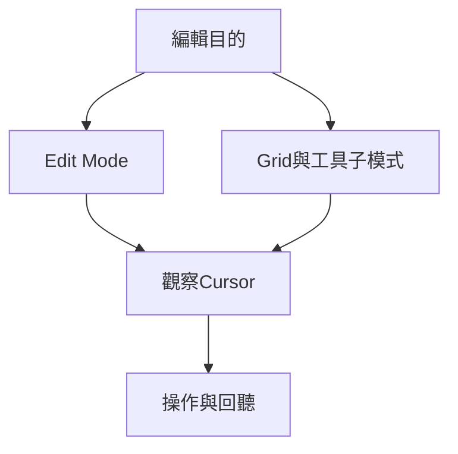

# Ch29a — Edit Mode與Grid的選擇

> Edit mode 決定「這次拖曳遵守什麼規則」，Grid 則決定時間落點的解析度。

[[Pro_Tools_Reference_Guide_2023.3.pdf#page=671|原書 p. 639–642／PDF p. 671–674]]。內容依 **2023.3** 原文消化重組；英文功能名稱保留。實務連結與原創示意圖用於教學，不是原書逐字翻譯，也不代表現行版本的支援狀態。

## 觀念地圖

![[PT-Ch29-concept.png]]

圖為原創概念示意；示例位置、長度與曲線只用來比較機制，不是原書量測資料或建議處理參數。

## 1. 四種模式解決四種問題

別把 Slip 理解成比較專業、Grid 理解成只給新手。你想自由調整口白接縫、整段拿掉後讓後面往前接、對準影片 timecode，或維持音樂拍點，是四個不同任務，理應使用不同模式。

| Mode | Clip 位置如何決定 | 典型工作 | Mac 快捷鍵 |
|---|---|---|---|
| Shuffle | 受相鄰 Clip 約束；插入／移除會移動後方素材 | 口白重排、刪除空檔 | F1 |
| Slip | 可自由拖曳、留白、重疊 | 人聲細修、聲音設計 | F2 |
| Spot | 透過對話框輸入精確位置或依 time stamp 放置 | 影像後期、對 Timecode | F3 |
| Grid | 依 Grid 的時間單位吸附 | 節奏編排、MIDI 序列 | F4 |

Mac 的 F keys 若被系統拿去調亮度或功能列，可能需配合 `fn`。這是鍵盤層的差異，並不代表 Pro Tools 裡的 F1 變成別的功能。

Shuffle 不會把既有素材間的所有 silence 自動刪乾淨；它會遵守 Clip 之間的排列與現有空白關係。最需要記住的是：在 Shuffle 裡調 Trim，也可能把後面整段推動。MIDI note 的插入則不受 Shuffle 的 Clip 規則影響。

> [!warning] 影片同步素材要防止意外 Shuffle
> 在非 Shuffle mode 時，`Command-click` Shuffle button 可開啟 Shuffle Lock。這能擋住快捷鍵或 control surface 誤切 Shuffle；要解除也以相同方式操作。

## 2. Absolute Grid 與 Relative Grid：對準位置或保留偏移

Absolute Grid 把 Clip 的開頭吸到絕對格線；Relative Grid 保留原來離格線的距離，只讓你以整格增量移動。假設某個演奏刻意稍微拖拍，你想把整句搬到下一小節，Relative Grid 能保住這個「稍晚」的關係；Absolute Grid 則比較適合把原本沒對到拍點的段落重新落在拍線上。

| 想要的結果 | 選擇 | 檢查方式 |
|---|---|---|
| 段落開頭正好踩在 barline | Absolute Grid | 看 start 是否落在格線 |
| 整句向後搬一小節但維持搶拍／拖拍 | Relative Grid | 搬前搬後相對拍線偏移一致 |
| 只有這一下要自由微調 | Grid 時按住 Command 暫時切 Slip | 放開後恢復原模式 |
| Slip 中暫時要對拍 | 編輯時按住 Command 暫時切 Grid | 看 cursor 的吸附結果 |

Relative Grid 不是加上 swing，也不會重新量化段落裡所有音符。它處理的是你這次移動的增量；如果要改內部音符節奏，要用 Ch35／Ch48 的 Quantize。

> [!tip] 實務連結
> 鼓 loop 若帶著你喜歡的 microtiming，先保留原始 Clip，再用 Relative Grid 編排；真的要重建節奏，另建 Playlist 後才用 Beat Detective 或 MIDI Quantize。

## 3. Snap To Grid 可以與其他模式共用

`Shift-click` Grid button，或 `Shift+F4`，可以在 Shuffle／Slip／Spot 裡另外開啟 Snap To Grid。這時 cursor 與 selection 受 Grid 約束，但 Clip 編輯仍遵守另一個 mode 的行為。所以「Shuffle+Grid」不是第五種完全不同的 mode，而是「用格線決定選取範圍，再按 Shuffle 處理 Clip」。

| 控制 | 管的事情 | 容易混淆處 |
|---|---|---|
| Edit mode | Clip 移動、插入、刪除的規則 | 不等於顯示不顯示格線 |
| Snap To Grid | 放 cursor／建立選取範圍時的吸附 | 可同時搭配其他 mode |
| Grid Value | 吸附的時間單位與大小 | 可與 Main Time Scale 分開 |
| Grid Lines | 畫面上的格線可視性 | 看不見格線不必然表示未吸附 |

Grid Value 可以跟隨 Main Time Scale，也可以取消 Follow Main Time Scale，改用另一種時間格式。`Shift+=` 增加 Grid value，`Shift+-` 減少。`Clips/Markers` 選項會吸向 Clip start/end/sync point、Marker 與 selection；Pencil 插 MIDI note 仍依選定的 note value，不改成隨意吸向 Marker。

## 4. 鎖住子模式，降低快速切工具時的失誤

`Options > Edit/Tool Mode Keyboard Lock` 會鎖住目前 Absolute／Relative Grid 的子模式，也鎖定 Zoom、Trim、Grabber、Pencil 的工具子模式。你仍可用快捷鍵切工具，但重按同一工具快捷鍵不會意外循環到另一種工具。

> [!tip] 實務連結
> 先確定 Standard Trim、Time Grabber 與 Relative Grid，再開 Keyboard Lock，適合一整段剪輯都採相同規則的工作。滑鼠與 Right-click menu 仍可換子模式，鎖定不會把操作封死。

> [!abstract] Takeaway
> Mode 管規則，Grid 管落點。Relative Grid 保留既有節奏偏移；Shuffle 可能改變後方素材位置，精準對畫面的工程應先做好防誤觸。

## 相關

%% PT-NAV-BEGIN %%

上一篇：[[PT-Ch28-編輯前先分清Clip與資料]]

下一篇：[[PT-Ch29b-工具切換與精準觀察]]

按任務閱讀：[[PT-00-工作流程導航]]

%% PT-NAV-END %%

- [[PT-Ch29b-工具切換與精準觀察]]
- [[PT-00-功能目錄#Ch28 — Editing Basics]] — 對照相鄰章原文脈絡。
- [[PT-00-功能目錄#Ch30 — Making Selections]] — 對照相鄰章原文脈絡。
- [[PT-00-索引]] · [[PT-00-快速檢索]] · [[PT-00-Mac快捷鍵]]

標籤： #pro-tools #audio #editing
