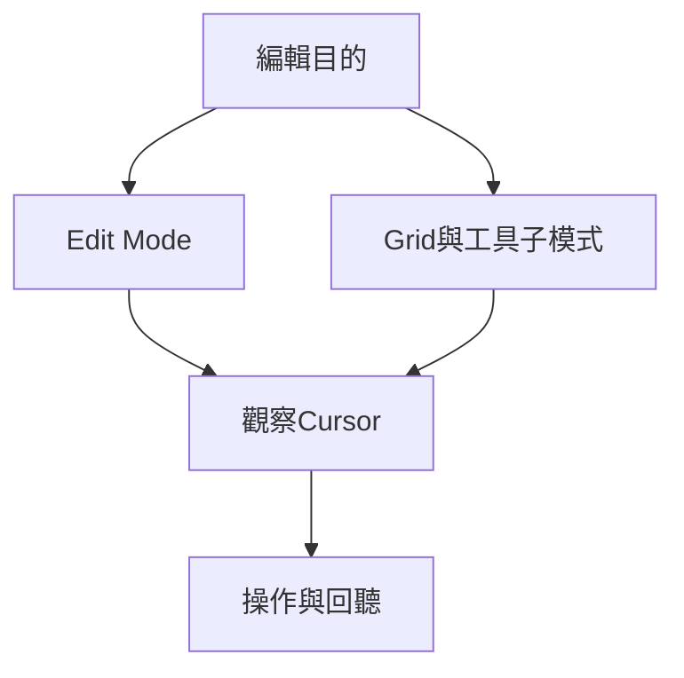

# Ch29b — 工具切換與精準觀察

> 同一個工具在 Clip、MIDI note、Automation 上會有不同語意，先辨認 cursor 再動手。

[[Pro_Tools_Reference_Guide_2023.3.pdf#page=675|原書 p. 643–667／PDF p. 675–699]]。內容依 **2023.3** 原文消化重組；英文功能名稱保留。實務連結與原創示意圖用於教學，不是原書逐字翻譯，也不代表現行版本的支援狀態。

## 觀念地圖

![[PT-Ch29-concept.png]]

圖為原創概念示意；示例位置、長度與曲線只用來比較機制，不是原書量測資料或建議處理參數。

## 1. 先用任務記工具

| Tool | 主要工作 | 快捷鍵／提醒 |
|---|---|---|
| Zoomer | 放大觀察時間與振幅細節 | F5；Normal／Single Zoom |
| Trim | 改 Clip 邊界、note 長度或資料幅度 | F6；要辨認子模式 |
| Selector | cursor 與時間範圍 | F7 |
| Grabber | 選取或移動 Clip／note | F8；Time／Separation／Object |
| Scrubber | 慢速前後聽定位點 | F9；不是一般 Playback |
| Pencil | 畫 MIDI、Controller、Automation、Tempo，或修 Audio sample | F10；Audio sample editing 具有破壞性 |
| Smart Tool | 依 cursor 位置組合 Trim／Selector／Grabber／Fade | F6+F7，或 F7+F8 |

`Escape` 可循環切 Edit Tool。重按 F5／F6／F8／F10 可能循環其子模式；需要固定操作時開 Edit/Tool Mode Keyboard Lock。

## 2. Zoom 的三個方向不要混在一起

Horizontal Zoom 改你看到多少時間；Audio Vertical Zoom 改波形看起來多高；Track Height 改整條 Track 分到多少畫面。後兩者都不直接改聲音音量。

| 需求 | Mac 操作 | 來源 |
|---|---|---|
| 時間放大／縮小 | Command+]／Command+[ | p.644 |
| 看完整 Session（也會重設某些垂直顯示） | Option+A | p.645、648 |
| 只把整個 Session 時間軸縮入視窗 | Option+Control+A | p.645、648 |
| 時間放大到 Edit selection | Option+F；需避免捲動則 Option+Control+F | p.645 |
| 回前一個 Zoom | Command+Option+E | p.645 |
| Zoom Toggle | Commands Keyboard Focus 下按 E | p.651 |

Zoom Toggle 可以記住 horizontal／vertical zoom、Track Height、View 與獨立 Grid，讓你在總覽與局部編輯間切換。`Setup > Preferences > Editing` 決定切入時跟 Selection 還是 Last Used；Zoom Toggle 亮著時調整 Last Used 項目，也會更新記憶。`Option+Shift+E` 則取消 Toggle 而保留目前畫面。

五個 Zoom Preset 適合保存不同時間尺度；它們不是五份 Audio。若只修接縫，Single Zoom 的便利處是放大一次後，自動回到原來正在使用的工具。

> [!tip] 實務連結
> 人聲編輯可讓 Zoom Toggle 使用 Selection 與 Fit To Window；MIDI 編輯則可用 Last Used，把它當隨時叫出的局部編輯工作台。每次都重找 zoom 比切換成本更高。

## 3. Trim 子模式：邊界、拉時間、聽邊界與循環

| Trim 子模式 | 會改什麼 | 條件／代價 |
|---|---|---|
| Standard | 顯示的來源範圍 | 不超出原 file，Audio 不越過相鄰 Clip |
| TCE | 整段時間長度與內容比例 | Elastic Audio Track 用其處理；其他 Audio 用指定 TCE AudioSuite 產生新 file |
| Scrub | 一邊聽一邊找到修邊位置 | 2023.3 原書標示 Ultimate only |
| Loop | 全段循環長度，或單次來源循環邊界 | cursor 在上半部或 Loop icon 的位置決定工作 |
| Tandem trimming | 同步改相鄰重疊兩段的交界 | Command+Control-trim；TCE／Elastic trim 不支援 |

Standard Trim 是「遮住／露出」，TCE 是「讓內容變快／變慢以塞進新長度」。例如原書用一小節 90 BPM drum loop 拉成 120 BPM 的一小節，TCE 改的是整段播放時間，不能把它解釋成只切掉尾巴。非 Elastic Track 的 TCE plug-in 可在 `Preferences > Processing` 選擇。

Loop Trim 在上半部改整個 looped Clip 多長；在 Loop icon／下半部改每次來源的長度，整段 loop 的總長度則維持。先看 cursor，才知道這次是多做幾輪還是改一輪內容。

## 4. Smart Tool 的位置就是功能選單

Audio Waveform view 中，上半部中央是 Selector，下半部中央是 Grabber，左右邊界是 Trim；上角可拉 Fade In／Out，兩段交界下方可拉 Crossfade。既有 Fade 的垂直中央區域可調 shape，取決於 Smart Tool Fade Adjustment preference 是否需配合 Command。

| Cursor 所在內容 | Smart Tool 的特殊行為 | 實際風險 |
|---|---|---|
| Audio Clip | 依位置切 Selector／Grabber／Trim／Fade | 差幾個 pixel 可能改成另一工具 |
| MIDI Notes | 空白處框選、note 中段搬移、兩端修長度 | 一次框多 note 會一起處理 |
| MIDI Note + Command | Velocity Trim | 不等於移調 |
| MIDI + Control | 暫時 Pencil；加 Option 可擦除 | 注意是 Control，不是 Command |
| Automation／Controller | 上方約 25%偏 Trim，其餘偏 Selector | 改的是資料值／breakpoint |

Stereo／Multichannel Track 中的 Smart Tool 邊界依整條 Track 判斷，不是依每一聲道；一般剪輯影響所有聲道。要單獨處理一聲道，見 Ch31 的 Split Into Mono。

## 5. Scrubber 與 Pencil 都需要知道限制

Scrubber 以拖曳方向與速度決定前後播放，適合聽對白子音或細微 click。可同時聽最多兩條 Track，但總聲道數也受限，原書上限為八聲道；兩條 5.1 不能當成只占「兩軌」。Option-drag 是較快的 Shuttle。Numeric Keypad Shuttle 與 Shuttle Lock 的規則不同，前者在 2023.3 的該節標示 Ultimate only，不要混背。

> [!warning] Pencil 修 Audio 會改硬碟檔案
> 只有 zoom 到 sample level，Pencil 才能重畫 waveform。先用 AudioSuite Duplicate 建立真正來源副本；不要把 Duplicate Playlist 當作另存 Audio file。只修很小的突刺並維持周圍波形連續，過度手繪可能引進新的失真。

> [!abstract] Takeaway
> 辨認 Tool 子模式比背 F-key 更重要。Standard Trim 藏露素材、TCE 改長度；Zoom 不改音量，Pencil 修 sample 則會改來源檔。

## 相關

%% PT-NAV-BEGIN %%

上一篇：[[PT-Ch29a-Edit Mode與Grid的選擇]]

下一篇：[[PT-Ch30-選取範圍與時間軸導航]]

按任務閱讀：[[PT-00-工作流程導航]]

%% PT-NAV-END %%

- [[PT-Ch29a-Edit Mode與Grid的選擇]]
- [[PT-00-功能目錄#Ch28 — Editing Basics]] — 對照相鄰章原文脈絡。
- [[PT-00-功能目錄#Ch30 — Making Selections]] — 對照相鄰章原文脈絡。
- [[PT-00-索引]] · [[PT-00-快速檢索]] · [[PT-00-Mac快捷鍵]]

標籤： #pro-tools #audio #editing
