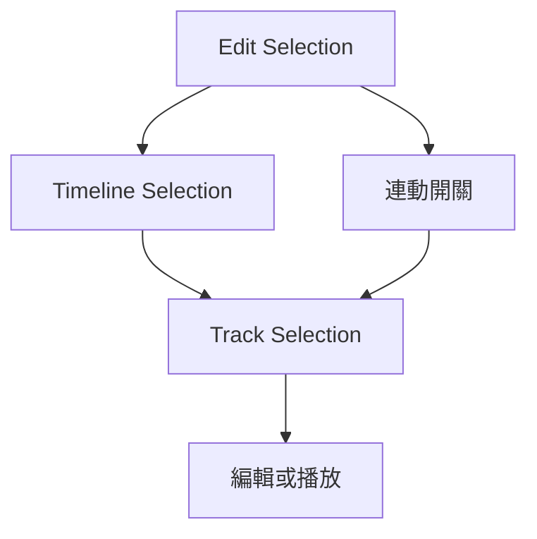

# Ch30 — 選取範圍與時間軸導航

> 選取分成「要改哪裡」與「要播放哪裡」，兩者連動與否決定整個剪輯手感。

[[Pro_Tools_Reference_Guide_2023.3.pdf#page=701|原書 p. 669–691／PDF p. 701–723]]。內容依 **2023.3** 原文消化重組；英文功能名稱保留。實務連結與原創示意圖用於教學，不是原書逐字翻譯，也不代表現行版本的支援狀態。

## 觀念地圖

![[PT-Ch30-concept.png]]

圖為原創概念示意；示例位置、長度與曲線只用來比較機制，不是原書量測資料或建議處理參數。

## 1. 三種 Selection，先分工再連動

Edit selection 指定編輯材料；Timeline selection 指定 playback／record range；Track selection 指 Track 層級命令的對象。它們可以連動，但不是同一件事。

| 選項 | 開啟時 | 關閉時 | Mac |
|---|---|---|---|
| Link Timeline and Edit Selection | 選 Track 範圍也改播放／錄音範圍 | 可循環一整段，同時編輯其中一個小音符 | Shift+/ |
| Link Track and Edit Selection | 有 Edit selection 的 Track 名稱也選取 | Track selection 與局部剪輯獨立 | Shift+T |
| Change Timeline to Match Edit | 把目前 Edit range 複製到 Timeline | 是一次命令，不是長期連動開關 | Option+Shift+5 |
| Change Edit to Match Timeline | 把目前播放範圍複製成 Edit range | 同上 | Option+Shift+6 |

Timeline 的箭頭通常是藍色；Session 中有 Track record-enabled 時會變紅，即使該 Track 被隱藏。兩種範圍解除連動時，Edit range 另外以黑色括號呈現。

> [!tip] 實務連結
> 想讓整個副歌一直 Loop，卻只微調一個 MIDI 和弦，先取消 Timeline／Edit 連動。否則停止後播放範圍可能變成你最後選取的那顆 note。影片工作中，也可先鎖住場景播放範圍，再到遠處挑聲音。

## 2. 選時間範圍，或選離散的 Object

| 做法 | 選到什麼 | 重要條件 |
|---|---|---|
| Selector 拖曳 | 連續時間範圍，可跨 Track | 範圍內可能包含 CC／Automation |
| Selector 雙擊 Clip | 整個 Clip | 適合整段處理 |
| Selector 三擊 Track | 整條 Track 素材 | 先確認 Group 與 View |
| Time Grabber 後 Shift-click 另一 Clip | 兩者及中間整段時間 | 中間其他 Clip 也受影響 |
| Object Grabber 後 Shift-click | 不連續的完整 Clip | 只在 Slip／Grid 可用 |

Object Grabber 的目的，是選「這幾個物件」而非「從第一個到最後一個之間所有時間」。它的選取不照一般 Edit Group 規則自動擴成群組，所以鼓組跨軌剪輯不要未檢查就套用。若只想挑 Clip 的一部分，先 Separate 使它成為獨立 Clip，再 Object-select。

把 Time selection 轉成 Object selection，可用 Object Grabber 子模式下雙擊 toolbar 的 Grabber icon；一般只保留完全選入範圍的 Clip，Control-double-click 可連部分選入的也納入。反過來雙擊 Selector icon，會把離散 Clip 轉成涵蓋第一段到最後一段的連續範圍。

> [!warning] 隱藏 Group member 不會自動被剪
> 多軌同步操作前，把需要一起編輯的所有 Track 顯示出來。這項規則在原書多次重申，不能只看 Group 名稱就認定每支麥都跟著走。

## 3. 用瞬態與鍵盤選準邊界

`Command+Option+Tab` 切換 Tab to Transients。關閉時 Tab 導向 Clip 的 start／end／sync point；開啟時，在 Audio Waveform view 導向偵測到的 attack 前方。在多軌範圍中，會找其中任一 Track 下一個 transient，接近的事件以先出現者為準。

| Mac 操作 | 導航／選取結果 | 前提 |
|---|---|---|
| Tab | 下一個邊界或 transient | 依 Tab to Transients 狀態 |
| Option+Tab | 上一個邊界或 transient | 同上 |
| Shift+Tab | 向後延伸選取 | 以目前定位規則為準 |
| Option+Shift+Tab | 向前延伸選取 | 同上 |
| Control+Tab／Option+Control+Tab | 選下一個／上一個 Clip | 和單純 cursor 移動不同 |
| Command+Option+Z | Restore Last Selection | 救回誤失的選取，並非 Undo 素材 |

人聲不是每個波峰都等於詞頭；低頻 attack 也不見得是畫面最明顯尖峰。Tab 是快速定位的起點，仍要靠聽與 sample zoom 驗證。Warp／Analysis view 的 Tab 行為還會依 Event／Warp marker 改變，不能直接套 Waveform 的假設。

## 4. 精確改範圍，不要不小心搬了素材

Start、End、Length 欄位可以直接輸入精確時間。`/` 在欄位間切換；`.` 或左右鍵移子欄位；上下鍵增減；Escape 取消輸入。時間欄位還可做加減：選欄位後按 numeric keypad 的 +／-、輸入差量，Enter 確認，再 Enter 套用。

| 目的 | 操作 | 改的是 |
|---|---|---|
| 整個 selection 移一個 Nudge | Shift + numeric keypad +／- | 範圍，不是 Audio |
| 只改 selection start | Option+Shift + numeric keypad +／- | 選取起點 |
| 只改 selection end | Command+Shift + numeric keypad +／- | 選取終點 |
| 移到上／下 Track | Control+P／Control+; | 範圍所在 Track |
| 加選上／下 Track | Control+Shift+P／Control+Shift+; | 增加受影響軌道 |

Commands Keyboard Focus 開啟時，P／; 可省下 Control，上述加選則用 Shift+P／Shift+;。一樣的字母在 MIDI notes、文字欄位或別的前景視窗可能做不同事情，所以快捷鍵一定連「焦點」一起記。

播放時可用 Down Arrow 標起點、Up Arrow 標終點；停止後左右鍵捲動到範圍頭尾。這是依耳朵圈片段的高效率方法。停止狀態下，上下鍵又可把插入點收合到 selection 的終點／起點，別把兩種 Transport 狀態混為一談。

## 5. 長工程的總覽：Universe

`View > Other Displays > Universe` 提供可見 Track 的全局縮圖；框線表示 Edit window 現在看得到的區域。點別處只是在工程中導航，不會把 Clip 搬到那裡。Auxiliary Input／Master Fader／VCA 因無 Audio／MIDI Clip 而顯示空區；hidden Track 不出現在 overview。

> [!tip] 實務連結
> 剪很長的現場錄音時，把 Universe 當小地圖，Marker 當段落書籤，Start／End 當精準座標。先粗定位，再對 transient，最後才進 sample level，比一開始就放大到底有效率。

> [!abstract] Takeaway
> 把 Edit、Timeline、Track selection 分清楚，再決定是否連動。選範圍的 Nudge 不搬素材；Object selection 不等於連續時間，也不等於自動完整遵守 Edit Group。

## 相關

%% PT-NAV-BEGIN %%

上一篇：[[PT-Ch29b-工具切換與精準觀察]]

下一篇：[[PT-Ch31-Clip剪裁微移與整合]]

按任務閱讀：[[PT-00-工作流程導航]]

%% PT-NAV-END %%

- [[PT-00-功能目錄#Ch29 — Edit Modes and Tools]] — 對照相鄰章原文脈絡。
- [[PT-00-功能目錄#Ch31 — Editing Clips and Selections]] — 對照相鄰章原文脈絡。
- [[PT-00-索引]] · [[PT-00-快速檢索]] · [[PT-00-Mac快捷鍵]]

標籤： #pro-tools #audio #editing
