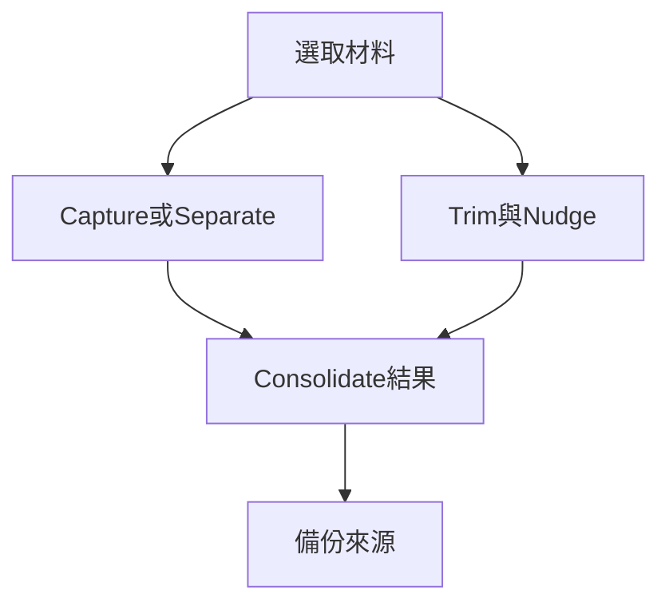

# Ch31 — Clip剪裁微移與整合

> Capture、Separate、Trim、Consolidate 看起來都在整理 Clip，實際上改的是四種不同層次。

[[Pro_Tools_Reference_Guide_2023.3.pdf#page=725|原書 p. 693–707／PDF p. 725–739]]。內容依 **2023.3** 原文消化重組；英文功能名稱保留。實務連結與原創示意圖用於教學，不是原書逐字翻譯，也不代表現行版本的支援狀態。

## 觀念地圖

![[PT-Ch31-concept.png]]

圖為原創概念示意；示例位置、長度與曲線只用來比較機制，不是原書量測資料或建議處理參數。

## 1. 先選對建立 Clip 的命令

| 命令 | 結果 | 原素材 |
|---|---|---|
| Clip > Capture | 把 selection 定義成新 Clip，加入 Clips List | Track 上原段落仍完整 |
| Edit > Separate > At Selection | 在 cursor 或 selection 邊界切出 Clip | 原 file 仍在，Track 分段 |
| Separate > On Grid | 依 Grid 分段 | 可設 Pre-Separate Amount |
| Separate > At Transients | 依 transient 分 Audio Clip | 不用於 MIDI notes／MIDI Clips |
| Edit > Heal Separation | 把符合條件的分離接縫復原 | 必須同來源、相鄰、邊界關係未改 |
| Edit > Consolidate | 將 selection 寫成連續新 Audio file／合併 MIDI 資料 | 產生新的整理結果 |

Capture 的 Mac shortcut 是 `Command+R`，Separate At Selection 是 `Command+E`，Heal Separation 是 `Command+H`；但這些組合的解讀依 Pro Tools 前景視窗，不能用 macOS Finder 的習慣猜。

Separate 後若移動或 Trim 過，Heal 不一定成立。不同 Audio file 本來就不能 Heal 成「從未分離的一份來源」。若只想得到一段可交付的連續素材，改用 Consolidate，而不是反覆嘗試 Heal。

> [!tip] 實務連結
> 想從長錄音摘一個可重用聲音，可先 Capture；要在原 Track 直接剪接，就 Separate。Separation Grabber 還可把 Edit selection 一次切出並拖走，Option-drag 則保留原處而建立副本。

## 2. Trim 的方向與來源餘量

`Trim Clip > To Selection` 留下選取內部；`Start To Insertion`／`End To Insertion` 把一側邊界移到 cursor。`To Fill Selection` 反過來往外露出素材，填選取與 Clip 之間空白，但前提是原 file 真的有內容可露出。

| 需求 | 指令族 | 限制 |
|---|---|---|
| 去掉 selection 以外 | To Selection | 先看選取是否跨其他 Clip |
| 保留 cursor 之後／之前 | Start／End To Insertion | 選對要修哪一側 |
| 往前或後補 gap | Start／End To Fill Selection | 受原 file 可用長度限制 |
| 恢復來源檔邊界 | To File Start／End／Boundaries | 不越過鄰接 Clip |
| 精確移動邊界 | Option + keypad +／-修 start；Command + keypad +／-修 end | 使用目前 Nudge 值 |

多聲道 Track 一般把所有聲道一起剪。要只動一個聲道，先 `Track > Split Into Mono`；原書提醒 Stereo／multi-mono Plug-In 可對應到 mono，multichannel Plug-In assignment 卻不會原樣移到拆出的 Track。拆軌前先記錄路由和效果器。

## 3. Nudge：搬 Clip、修邊界或滑內文

Nudge Value 可用 sample、Timecode 或音符值，且不必跟隨 Main Timebase。一般 numeric keypad `+`／`-` 將完整選中的 Clip 往後／往前移；只有部分選取的 Clip 不適用同樣方式。Nudge 在 Shuffle、Spot、Grid 中仍依 Nudge 規則動，不會改成自動吸 Grid 或彈 Spot dialog。

| 操作 | 固定什麼 | 改什麼 |
|---|---|---|
| keypad +／- | Clip 內部內容關係 | Clip 整體位置 |
| Option + keypad +／- | Clip end | Clip start |
| Command + keypad +／- | Clip start | Clip end |
| Control + keypad +／- | Clip 外框 start/end | 來源內容在外框內的位置 |

最後一種滑動需要 Clip 前後有隱藏的來源餘量。原書指定 `Control + keypad +` 讓內容往左、`-`往右；不要套用「+一定向右」的直覺。

> [!tip] 實務連結
> 若一句對白外框已經卡在正確 Timecode，但開口晚了一點，可滑動內容保持外框不動。若是整句都該晚進，才搬整個 Clip。這兩者對周邊接縫的影響不同。

## 4. 重疊處理與 Quantize

Layered Editing 開啟時，移開遮住別段的 Clip，部分重疊的原素材可重新露出；但被完全覆蓋的 Clip 仍可能被移出 Timeline。它不是「每個歷史版本都永遠在底下」。`Command+Delete` 可清掉 selection 內所有 Track data，不受 Layered Editing 保護；要留 take 應用 Playlists。

`Clip > Quantize to Grid`（`Command+0`）對準 Clip start，若有 sync point 則對準 sync point。它把整段搬動，保持 Clip 內 MIDI notes／Elastic Audio events 相對關係；要改每顆 note 或每次 attack，另用 Event Operations Quantize。

## 5. Consolidate 與 Compact 的代價差很多

Consolidate（`Option+Shift+3`）把 Edit selection 寫為一段 Audio file，連 selection 中空白也算進去。Muted Clip 當作 silence，但 Track mute 與 Mute Automation 不決定其處理；它也不會把底下的 Automation 混進聲音，要含 Automation 與混音路徑的結果應看 Bounce Mix。

Compact 則永久刪去來源 file 未使用的部分，還可能刪掉沒有 Track 上 Clip 參照的 Audio file；完成後 Session 自動儲存。它不是「讓 Session 看起來乾淨」的美化指令，而是會失去未來拉長 Clip 能力的破壞性整理。

> [!warning] Compact 不能 Undo
> 只在確定不再需要來源餘量且有獨立備份後使用。需保留 Crossfade 或未來修邊空間時，設定適當 padding；不要把 Playlist 副本當硬碟 Audio file 備份。

Clip Rating 為 1–5，可在 `Clip > Rating` 設定，`View > Clip > Rating`顯示；它會幫 Ch33 篩選 take，但不改聲音。Ultimate 的 `TCE Edit to Timeline Selection`可把未連動的 Edit range 壓縮／拉長以配合 Timeline range；原書指出不適用 Elastic Audio 與 Melodyne-enabled Track，不能當一般萬用 Fit 命令。

> [!abstract] Takeaway
> Capture 定義、Separate 分段、Trim 藏露、Consolidate 產生連續新素材。Nudge 時看清你搬的是外框還是內文；Compact 則會永久改來源檔。

## 相關

%% PT-NAV-BEGIN %%

上一篇：[[PT-Ch30-選取範圍與時間軸導航]]

下一篇：[[PT-Ch32a-Fade形狀與Crossfade判斷]]

按任務閱讀：[[PT-00-工作流程導航]]

%% PT-NAV-END %%

- [[PT-00-功能目錄#Ch30 — Making Selections]] — 對照相鄰章原文脈絡。
- [[PT-00-功能目錄#Ch32 — Fades and Crossfades]] — 對照相鄰章原文脈絡。
- [[PT-00-索引]] · [[PT-00-快速檢索]] · [[PT-00-Mac快捷鍵]]

標籤： #pro-tools #audio #editing
