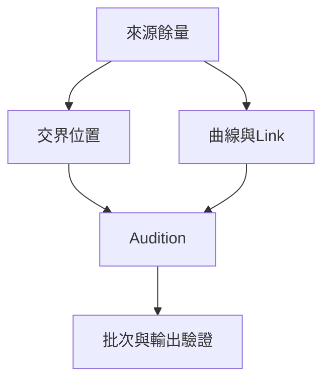

# Ch32a — Fade形狀與Crossfade判斷

> Crossfade 是把兩段來源重疊後交接音量；形狀、位置與來源餘量缺一不可。

[[Pro_Tools_Reference_Guide_2023.3.pdf#page=741|原書 p. 709–717／PDF p. 741–749]]。內容依 **2023.3** 原文消化重組；英文功能名稱保留。實務連結與原創示意圖用於教學，不是原書逐字翻譯，也不代表現行版本的支援狀態。

## 觀念地圖

![[PT-Ch32-concept.png]]

圖為原創概念示意；示例位置、長度與曲線只用來比較機制，不是原書量測資料或建議處理參數。

## 1. 為什麼兩段貼起來還會有 click

Audio 剪在非零振幅的地方，下一瞬間換成另一段不同振幅，接縫可能出現突跳。Fade 把單段邊界平順帶進／帶出；Crossfade 則在一小段重疊區間，把前一段漸弱、後一段漸強。它能減輕接縫，但不能自動修好音高不一致、相位錯位或環境底噪差異。

「兩個 Clip 在畫面上相鄰」不代表有足夠內容做 Crossfade。軟體要讀取 Clip 外框背後的來源餘量。如果正好是原始 file 開頭／結尾，可能沒有可延伸的 Audio；Pro Tools 會要求略過或調整 fade 邊界。

| Placement | Fade 放在哪裡 | 哪邊需有隱藏素材 | 實際目的 |
|---|---|---|---|
| Centered | 跨在 splice 兩側 | 前段 end 之後、後段 start 之前 | 一般交接 |
| Pre-Splice | 接縫之前 | 後段 start 之前 | 保護後段開頭強 attack |
| Post-Splice | 接縫之後 | 前段 end 之後 | 保留前段直到原本結尾 |

> [!tip] 實務連結
> 接第二個鼓點時，Centered 太長可能削弱其 attack；可測試 Pre-Splice，把交接移到 attack 之前。處理人聲時則要聽子音是否出現兩次、前句尾音是否被吞掉，不是只看線條對稱就接受。

## 2. Equal Gain 與 Equal Power 的選擇

相同／高度相關訊號一起疊加，與完全不同來源的聲音疊加，結果不同。Equal Gain 偏向保持相干素材的振幅連續；Equal Power 則用於不相干素材，避免交接中段出現明顯能量凹洞。選錯時，可能一種聽起來中間變小，另一種聽起來突然變大甚至 clip。

| 類型 | 原書建議情境 | 聽覺檢查 |
|---|---|---|
| Equal Gain | phase-coherent 或近似相干，如重複同一 drum loop | 中間是否平順，是否有相消 |
| Equal Power | 不相干或差異很大的兩段素材 | 中間是否掉音量，是否有尖峰 |
| None（Link） | Fade In／Out 獨立調整 | 不再保證一對標準互補曲線 |

這是選擇起點，不是所有同樂器都必須 Equal Gain。兩次不同演奏的人聲雖是同一人，也可能不相干；同一錄音不同裁切若沒對準，也可能發生 phase cancellation。最後要比較完整接縫前後的響度與音色。

> [!warning] Equal Power 不等於「音量永遠一樣」
> 它針對不相干訊號的能量交接，不能保證任何兩段錄音都不變響。訊號相關性、兩段原音量、相位和曲線形狀都會影響結果。

## 3. Shape、Slope、Link 是不同控制

| 參數 | 管什麼 | 常見選項 |
|---|---|---|
| Shape | 變化快慢如何分布 | Standard、S-Curve、七個 preset curve |
| Slope | 單側 fade 採用的增益／功率曲線類型 | Equal Gain、Equal Power |
| Link | Crossfade 兩條曲線是否聯動 | Equal Gain、Equal Power、None |
| Placement／Length | 哪裡交接、交接多久 | Pre／Centered／Post，長度 |

Standard 與 S-Curve 可拖曲線修改；七個 preset 提供固定常用形狀。Preset Curve 4 是線性 shape；最極端 preset 接近突然開／關，不代表適合消除 click。`Link=None`可獨立調兩條曲線與其 start/end，適合特殊拼接，代價是需要更仔細聽增益變化。

圖中虛線是兩條線性 gain 的總和，不是 loudness 或 power 曲線；Equal Power 對不相干訊號的設計，不能用 gain 直接相加是否等於 1 來判斷。

Fades dialog 內能看獨立 waveform、疊合 waveform、sum waveform，並有 Audition。把曲線與波形一起看，才知道是不是在 fade 過程中兩個不該同時響的子音重疊。

## 4. 把常用策略保存，不用每次重選

`Setup > Preferences > Editing`可設定預設 Fade In／Out／Crossfade 與 preview pre/post-roll；Smart Tool 與快速建立 fade 會用到它們。五個 Fade Preset 可存常用設定：`Command-click` preset button 儲存，直接 click 叫回；Fades dialog 中的 `Control+1–5`叫回對應 preset。

設定也能保存為`.fdpreset`，放在 Session Folder 的 Fades Presets 或 Root Settings Folder。前者方便隨工程攜帶，後者適合個人固定用法；不要把保存 preset 誤以為把所有 Track 的 fade 重新套用。

> [!tip] 實務連結
> 建立短接縫修復、人聲換 take、長環境聲交接等不同 preset，比一套 fade 長度硬套所有素材合理。每次使用仍檢查來源餘量與接縫聲音。

> [!abstract] Takeaway
> 先決定 Crossfade 位置與是否有來源餘量，再挑 Equal Gain／Power 與 shape。Shape、Slope 和 Link 不是同一參數；所有曲線都需 Audition。

## 相關

%% PT-NAV-BEGIN %%

上一篇：[[PT-Ch31-Clip剪裁微移與整合]]

下一篇：[[PT-Ch32b-建立批次調整與保留Fade]]

按任務閱讀：[[PT-00-工作流程導航]]

%% PT-NAV-END %%

- [[PT-Ch32b-建立批次調整與保留Fade]]
- [[PT-00-功能目錄#Ch31 — Editing Clips and Selections]] — 對照相鄰章原文脈絡。
- [[PT-00-功能目錄#Ch33 — Playlists]] — 對照相鄰章原文脈絡。
- [[PT-00-索引]] · [[PT-00-快速檢索]] · [[PT-00-Mac快捷鍵]]

標籤： #pro-tools #audio #editing
