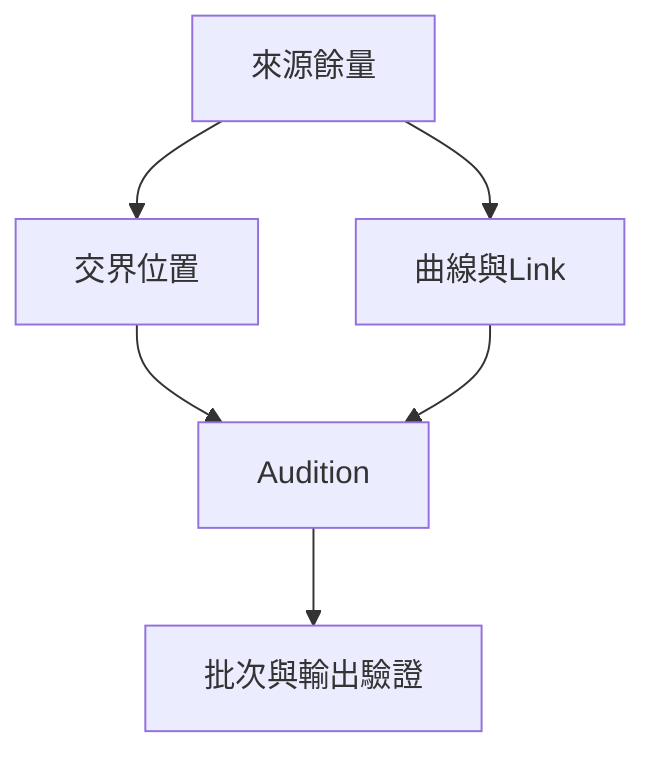

# Ch32b — 建立批次調整與保留Fade

> Fade 跟著 Clip 的邊界工作，但選取包含不包含 Fade，會讓移動與 Nudge 出現不同結果。

[[Pro_Tools_Reference_Guide_2023.3.pdf#page=750|原書 p. 718–729／PDF p. 750–761]]。內容依 **2023.3** 原文消化重組；英文功能名稱保留。實務連結與原創示意圖用於教學，不是原書逐字翻譯，也不代表現行版本的支援狀態。

## 觀念地圖

![[PT-Ch32-concept.png]]

圖為原創概念示意；示例位置、長度與曲線只用來比較機制，不是原書量測資料或建議處理參數。

## 1. 建立與修改的基本流程

要做 Fade In，selection 必須碰到 Clip 起點；Fade Out 則要碰到 Clip 終點。Crossfade 要橫跨前後兩段的接縫，selection 長度決定 fade 長度。先選範圍，再開對話框，比不知道 cursor 目前代表什麼時硬拉 Smart Tool 可靠。

| 動作 | Mac／menu | 用到的設定 |
|---|---|---|
| 開 Create Fades | Command+F；Edit > Fades > Create | 依 selection 判斷 Fade In／Out／Crossfade |
| 直接用預設 Fade | Command+Control+F | Preferences > Editing 的預設 |
| cursor 往 Clip start 做 Fade | Control+D；Fades > Fade To Start | 預設 Fade In |
| cursor 往 Clip end 做 Fade | Control+G；Fades > Fade To End | 預設 Fade Out |
| 移除 Fade | 選取後 Edit > Fades > Delete | 保留 Audio Clip，移除 Fade 處理 |

建立後可用 Trim 改長度；要調 shape，Smart Tool 移到 fade 垂直中央，看到 Fade cursor 再拖。若 Preferences 設定需 Command，就配合 Command。螢幕留下的 fade 圖形是概略代表，未必完全等於拖曳當下顯示的詳細 curve；判斷以實際聲音為準。

> [!tip] 實務連結
> 一個接縫先用對話框試出舒服的長度和形狀，再批次套用相近素材；不要用批次先把所有邊界變得一模一樣，之後才發現某些 attack 被削掉。

## 2. Batch Fades 與 AutoFades 不是同一功能

Batch Fades 針對選取中的多段素材一次建立／修改明確 fade；AutoFades 是 Ultimate 在 playback 實時替獨立 Clip 邊界加淡入淡出，畫面不顯示，原書範圍 0–10 ms。

| 問題 | Batch Fades | AutoFades |
|---|---|---|
| 對象 | selection 中的 Clip 交界與首尾 | 符合條件的獨立 Clip 邊界 |
| 設定 | Fade In／Crossfade／Fade Out 長度、shape、placement | Operation preference 的 Auto Clip Fade In/Out Length |
| Edit window 可見 | 是 | 否 |
| 可調既有 fade | 可調 Shape & Slope／Length | 不替代既有顯式 fade 編輯 |
| 匯出注意 | 視處理路徑檢查 | AudioSuite／Export Clips As Files 不把實時 AutoFade 寫入來源 |

要 Batch：完整選入第一段至最後一段→Command+F→選 Create New Fades 或 Adjust Existing→決定 Pre-Splice／Centered／Post-Splice 與長度→OK→回放。若要修改已有 fade shape，必須確定那些 fade 完整落在 selection 內。

> [!warning] 播放沒 click，不代表輸出的原始 Clip 也沒 click
> 原書指出 AutoFades 不作用於 AudioSuite 處理，直接 Duplicate／Export Clips As Files 仍可能保留原 click。要把這種實時處理寫進最終聲音，原書指定走 Bounce Mix；交付前再聽實際輸出檔。

## 3. 移動Fade、Clip和兩者一起，各有不同後果

| 你實際選了什麼 | 移動／Nudge 後 | 要聽什麼 |
|---|---|---|
| Fade／Crossfade 本身 | 接縫位置改變，受底層來源邊界限制 | 是否換到更好的波形位置 |
| Clip 連同 Fade | Fade 跟著素材走 | 新位置前後是否仍自然 |
| Clip 但沒選旁邊 Fade | Fade 可能伸縮以維持其 start/end | 尾音或 attack 是否被吃掉 |
| Crossfade 的一側 Clip | 拖開可依 Preserve Fades 設定保留或移除 fade；Nudge 可能拉伸交接 | 來源不夠時 fade 可能消失 |

`Preferences > Editing > Preserve Fades when Editing`決定編輯過程保留 fade 的方式。開啟後，Separate 跨到 Crossfade 時可能把它拆成兩側各自的 Fade In／Out；關閉時，selection 內相關 fade 可能被移除。所以看到淡接不見，先看你做了什麼編輯及這項 preference，不要以為檔案損壞。

## 4. Tick-Based Audio改Tempo後，要重新驗證接縫

Fade In／Out 與 Crossfade 在 Tempo 改變後會重新計算，但維持原來的絕對時間長度。這意味它不一定維持原本的幾分音符長；若新位置沒有足夠來源或 Clip 邊界不合法，Crossfade 會被移除。

> [!tip] 實務連結
> 完成一段鼓的剪輯後再改 Tempo，先檢查接縫是否仍有 Crossfade，再聽 cymbal 延音。Ch39 說明 Tick-Based Track 只移 Clip 起點與 Elastic Audio 伸縮的差異，那正是此處接縫可能改變的原因。

> [!abstract] Takeaway
> 把批次建立的顯式 Fade 與 Ultimate 實時 AutoFade 分清楚；選取是否含 Fade 會改變 Nudge 結果。改 Tempo 或編輯後，重新檢查來源餘量與接縫。

## 相關

%% PT-NAV-BEGIN %%

上一篇：[[PT-Ch32a-Fade形狀與Crossfade判斷]]

下一篇：[[PT-Ch33a-用Playlist保留版本與合成Take]]

按任務閱讀：[[PT-00-工作流程導航]]

%% PT-NAV-END %%

- [[PT-Ch32a-Fade形狀與Crossfade判斷]]
- [[PT-00-功能目錄#Ch31 — Editing Clips and Selections]] — 對照相鄰章原文脈絡。
- [[PT-00-功能目錄#Ch33 — Playlists]] — 對照相鄰章原文脈絡。
- [[PT-00-索引]] · [[PT-00-快速檢索]] · [[PT-00-Mac快捷鍵]]

標籤： #pro-tools #audio #editing
